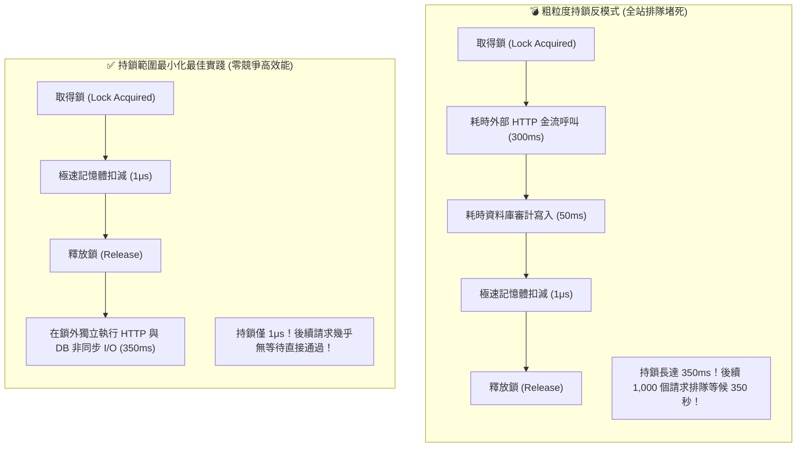

在電商高併發架構中，多個執行緒同時存取或修改共享狀態（例如商品剩餘庫存計數、購物車折價券領取次數、本機記憶體快取字典）是無可避免的實務場景。然而，很多工程師在面對「執行緒安全（Thread Safety）」時，往往走向兩個極端：要麼缺乏並發防護直接裸跑 `count++` 引發超賣災難；要麼粗暴地套用大範圍互斥鎖（`lock`），將包含遠端網路 I/O 的整段邏輯通通包進去，直接引發全站級別的**鎖競爭（Lock Contention）**與集體死鎖。

## 案發現場

某電商秒殺搶購系統在特賣開跑後數秒內，遭遇了嚴重的系統雪崩：

1. **秒殺商品庫存嚴重超賣**：初始庫存僅有 100 件的熱門手機，在促銷結束後對帳竟然賣出了 142 件。排查發現，開發團隊在單機庫存服務中使用了 `if (_stock > 0) { _stock--; }`，而在高達數千 RPS 的併發下，多個執行緒同時讀取到 `_stock == 1`，並同時執行了遞減操作，造成嚴重的資料競爭（Data Race）。
2. **粗粒度持鎖引發全站 504 Gateway Timeout**：事後團隊緊急修復，在扣庫存邏輯外層套上了 `SemaphoreSlim.WaitAsync()`。然而，工程師將「呼叫外部信用卡金流驗證（耗時 300ms）」與「寫入資料庫審計日誌（耗時 50ms）」也一併寫在鎖的保護範圍內！
原本只需要 1 微秒的記憶體操作，持鎖時間被拉長了 35 萬倍。隨後的數千個買家請求在鎖外大排長龍，等待佇列直接打滿 ThreadPool，API 回應延遲飆升至 30 秒，觸發大量 504 逾時！
3. **字串鎖（String Lock）引發全域幽靈死鎖**：某位工程師為了節省記憶體，寫了 `lock (orderId.ToString())` 或 `lock ("global_order_lock")`。因為 C# 的**字串拘留機制（String Interning）**，內容相同的字串在整座應用程式中共享同一個記憶體實例，導致不同顧客的無關訂單意外共用了同一個鎖，引發全域性死鎖！



## 反模式與正確解法

### 反模式一：非原子操作裸跑，或將多個執行緒操作暴露於共享變數

`_count++` 看似只有一行程式碼，但編譯為 CPU 組合語言時，實際包含三個獨立步驟：
1. 將記憶體中的 `_count` 載入 CPU 暫存器；
2. 暫存器數值加 1；
3. 將暫存器數值寫回記憶體。
在多執行緒交錯執行時，兩個執行緒可能同時載入舊值，導致其中一次更新被徹底覆蓋！

#### 正確解法：運用 `Interlocked` 達成 CPU 硬體級無鎖原子操作

對於簡單的整數累加、計數器統計、或狀態值切換，使用 `System.Threading.Interlocked`。它直接對應 CPU 的 `LOCK XADD` 等底層指令，完全不需要作業系統層級的執行緒掛起與 Context Switch，效能是互斥鎖的數十倍：

```csharp
// 💣 Bad：非原子操作，線上必然發生資料競爭
private int _activeOrders;
public void OnOrderCreatedBad() => _activeOrders++; // 致命錯誤！
```

~~~csharp title="Program.cs"
// ✅ Good：運用 Interlocked 無鎖原子操作與 SemaphoreSlim 最小化持鎖
var metrics = new OrderMetrics();

// 1. Interlocked 無鎖遞增（由 CPU 硬體保證原子性，0 鎖競爭）
Parallel.For(0, 100, _ => metrics.IncrementOrder());
Console.WriteLine($"累計訂單數: {metrics.TotalOrders}");

// 2. 非同步臨界區持鎖範圍最小化
await metrics.SafeDeductStockAsync();
Console.WriteLine("庫存安全扣減完成");

public sealed class OrderMetrics
{
    private int _totalOrders;
    private int _stock = 10;
    private readonly SemaphoreSlim _lock = new(1, 1);

    public int TotalOrders => Volatile.Read(ref _totalOrders);

    public void IncrementOrder() => Interlocked.Increment(ref _totalOrders);

    public async Task SafeDeductStockAsync()
    {
        await _lock.WaitAsync();
        try
        {
            // 臨界區內僅做極速記憶體狀態變更，絕對不呼叫非同步 I/O
            if (_stock > 0) _stock--;
        }
        finally
        {
            _lock.Release();
        }
    }
}
~~~

預期輸出：
```text
累計訂單數: 100
庫存安全扣減完成
```

#### 進階無鎖技巧：CAS（Compare-And-Swap）樂觀迴圈
當需要進行稍微複雜的數值驗證（例如「只有當餘額大於扣減值時才扣款」），可使用 `Interlocked.CompareExchange` 構建無鎖樂觀迴圈：

```csharp
public sealed class AtomicAccount
{
    private int _balance = 1000;

    public bool TryDeduct(int amount)
    {
        int initial, updated;
        do
        {
            initial = _balance; // 讀取當前值
            if (initial < amount) return false; // 餘額不足
            updated = initial - amount;
            // 只有當 _balance 依然等於 initial 時，才替換為 updated！
        } while (Interlocked.CompareExchange(ref _balance, updated, initial) != initial);

        return true;
    }
}
```

### 反模式二：在鎖定保護範圍內執行慢速非同步 I/O

C# 原生的 `lock` 關鍵字（基於 `Monitor`）是**不允許在內部使用 `await` 的**。許多人改用 `SemaphoreSlim` 來實現非同步互斥鎖，卻將所有外部 HTTP 呼叫、資料庫查詢通通包在 `WaitAsync()` 與 `Release()` 之間，把原本高併發的微服務硬生生退化為單執行緒排隊！

#### 正確解法：持鎖範圍最小化（Critical Section Minimization）

鎖只應該保護「記憶體內的不變量校驗與狀態變更」。外部 I/O 呼叫必須徹底移出臨界區外：

```csharp
public sealed class StockManager
{
    private int _availableStock = 50;
    private readonly SemaphoreSlim _gate = new(1, 1);

    public async Task<bool> ReserveStockAndAuditAsync(int quantity, Func<Task> auditLogAction)
    {
        bool reserved = false;

        // 1. 進入臨界區：僅保護記憶體扣減，耗時不到 1 微秒！
        await _gate.WaitAsync();
        try
        {
            if (_availableStock >= quantity)
            {
                _availableStock -= quantity;
                reserved = true;
            }
        }
        finally
        {
            _gate.Release(); // 立即釋放鎖，讓下一個買家進來！
        }

        // 2. 離開鎖定範圍後，在外部獨立執行慢速 I/O
        if (reserved)
        {
            await auditLogAction(); // 慢速日誌或遠端呼叫在鎖外並行執行，互不干擾
            return true;
        }

        return false;
    }
}
```

### 反模式三：鎖住公開、共用或字串物件（引發全域死鎖）

```csharp
// 💣 Bad 1：鎖住 this，外部程式碼若也 lock(instance) 會互相卡死
lock (this) { ... }

// 💣 Bad 2：鎖住 Type 物件，全 AppDomain 共享同一個鎖，全域嚴重爭用
lock (typeof(OrderService)) { ... }

// 💣 Bad 3：鎖住字串！由於 String Interning，內容相同的字串指標相同！
lock (orderId.ToString()) { ... }
```

#### 正確解法：永遠使用專屬、私有且唯讀的鎖物件

```csharp
// ✅ Good：專用私有鎖物件
private readonly object _syncRoot = new();

// 🚀 .NET 9+ 最佳實踐：使用全新 System.Threading.Lock 型別
// 效能比傳統 object / Monitor 更高，語法更簡潔
private readonly System.Threading.Lock _modernLock = new();

public void Process()
{
    using (_modernLock.EnterScope()) // 自動由 using 在結束時釋放
    {
        // 臨界區邏輯
    }
}
```

## 踩坑與避坑指南

### 1. `SemaphoreSlim` 的 `Release()` 必須永遠放在 `finally`
若業務程式碼拋出未預期的例外，而 `Release()` 位於 try 區塊底部，計數器將永遠無法歸還。這會導致該信號量永久處於耗盡狀態，後續所有併發請求永久卡死等待。
- **最佳實踐**：永遠遵循 `await _semaphore.WaitAsync(); try { ... } finally { _semaphore.Release(); }` 標準樣板。

### 2. `ReaderWriterLockSlim` 的升級鎖定死鎖陷阱
當需要支援「高頻讀取、極低頻寫入」時，開發者常使用 `ReaderWriterLockSlim`。
- **陷阱**：若兩個讀者執行緒同時嘗試將自身讀鎖升級為寫鎖（`EnterUpgradeableReadLock`），兩者會互相等待對方釋放讀鎖，引發經典死鎖！
- **避坑建議**：除非讀寫比極度懸殊（如 100:1），否則現代 CPU 下 `ReaderWriterLockSlim` 的內部簿記開銷往往大於簡單的 `SemaphoreSlim` 或無鎖結構。

### 3. 本機記憶體鎖 vs. 分散式鎖的邊界
C# 的 `lock`、`Monitor`、`Interlocked` 與 `SemaphoreSlim` **完全僅限於單一作業系統進程內部**。
- **架構邊界**：在生產環境中，微服務通常以 Kubernetes 多 Pod 或多實例方式部署。單機鎖絕對無法防禦跨 Pod 的庫存超賣！
- **解決方案**：跨節點的並行防護，必須外移至 Redis 分散式鎖（如 RedLock / Lua 腳本）或資料庫悲觀鎖（`SELECT ... FOR UPDATE`）。

## 線上排查指令

針對生產環境中的執行緒競爭、死鎖卡死與鎖持有者追蹤，使用下列指令排查：

```bash
# 1. 採集記憶體 Dump 檔案
dotnet-dump collect --process-id <PID> --output /tmp/lock_hang.dump
dotnet-dump analyze /tmp/lock_hang.dump

# 2. 檢視進程中的死鎖狀態 (SOS Extension 命令)
> deadlocks
# 若存在死鎖，dotnet-dump 會直接輸出形成死鎖環路 (Cycle) 的執行緒 ID 與鎖物件位址！

# 3. 檢視同步區塊 (SyncBlock) 狀態，找出當前哪條執行緒持有了鎖：
> syncblk
# 觀察輸出中的 Owning Thread，追蹤持有鎖卻長時間未釋放的罪魁禍首

# 4. 列出所有執行緒堆疊，確認是否有大量線程卡在 Monitor.Enter 或 Semaphore.Wait：
> clrstack -all
```
