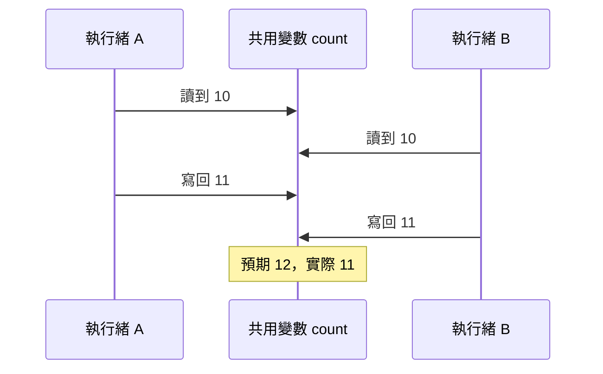

## 這是什麼

伺服器會同時處理很多請求，每個請求可能在不同的執行緒上。當兩個執行緒同時讀寫同一個共用的值，例如 Singleton 服務裡的計數器或快取，結果就可能出錯。這叫**競爭條件**（race condition）。

**執行緒安全**指的是：不管有幾個執行緒同時使用，結果都正確。C# 提供幾種工具達成這件事，差別在於保護的範圍和成本。

## 運作原理

`count++` 看起來是一個動作，其實是三步：讀出目前的值、加一、寫回去。兩個執行緒同時做，就可能兩個都讀到 10，各自加一後都寫回 11，少算了一次。



解法是讓這三步變成「不可分割」：

- **Interlocked**：由 CPU 指令保證單一數值的操作不可分割，例如加一、交換、比較後交換。成本最低。
- **lock**：一次只讓一個執行緒進入一段程式碼（臨界區），適合要一起改好幾個欄位的情況。
- **SemaphoreSlim**：和 lock 類似，但可以用 `await WaitAsync()` 非同步地等待，所以臨界區裡可以 await。

## 常見錯誤與正確寫法

### 1. 共用計數器直接 ++

```csharp
public sealed class OrderStatistics
{
    private long _placedCount;

    // 對：Interlocked.Increment 是不可分割的加一
    public void RecordPlaced() => Interlocked.Increment(ref _placedCount);

    public long PlacedCount => Interlocked.Read(ref _placedCount);
}
```

如果只是要做監控指標，直接用 `System.Diagnostics.Metrics` 的 `Counter<T>`，它本身就是執行緒安全的。

### 2. 在鎖裡面做慢的 I/O

lock 裡面不能 await（編譯器會報錯），所以有人改用 `SemaphoreSlim`，然後把整段遠端呼叫都包進去。結果每個請求都要排隊等前一個呼叫結束，吞吐量掉到一次一個。

鎖只包住「讀寫共用狀態」那一小段，慢的 I/O 放在鎖外面：

```csharp
private readonly SemaphoreSlim _gate = new(1, 1);
private ExchangeRates? _rates;

public async Task<ExchangeRates> GetRatesAsync(CancellationToken ct)
{
    if (_rates is { IsExpired: false } cached) return cached;

    var fresh = await _ratesClient.FetchAsync(ct); // 慢的 I/O 不在鎖裡

    await _gate.WaitAsync(ct);
    try
    {
        _rates = fresh; // 只保護寫入共用欄位這一步
        return fresh;
    }
    finally
    {
        _gate.Release(); // 一定放在 finally，例外時也會釋放
    }
}
```

`Release()` 沒放在 `finally`，一旦中間丟出例外，鎖就永遠不會被釋放，之後所有請求都卡在 `WaitAsync`。

### 3. 鎖住公開的物件

`lock (this)`、`lock (typeof(X))` 或鎖一個字串，外部程式碼也可能鎖住同一個物件，造成意想不到的等待或死結。永遠鎖一個私有、唯讀、專用的物件。.NET 9 起可以用專門的 `Lock` 型別：

```csharp
private readonly Lock _sync = new(); // .NET 9 以上；更早的版本用 private readonly object

public void Apply(CartChange change)
{
    lock (_sync)
    {
        _items[change.ProductId] = change.Quantity;
        _updatedAt = DateTimeOffset.UtcNow;
    }
}
```

## 使用邊界

- **本機鎖只保護同一個程序。** API 部署成三個 Pod，就有三把各自的鎖。跨 Pod 的庫存扣減、重複下單，要靠資料庫的條件更新或唯一約束，見 [EF Core 樂觀並行](/data-access/concurrency/)；分散式鎖的限制見 [Redis 併發控制](/infrastructure/redis/concurrency/)。
- 能不共用就不共用。把狀態放在請求範圍內（Scoped 服務或區域變數），就不需要鎖。
- 生產者與消費者之間傳資料，用 [Channels](/languages/csharp/channels/) 比自己加鎖管理佇列更簡單。
- `ConcurrentDictionary` 這類執行緒安全集合，只保證單一操作安全；「先查再改」的組合操作仍可能有競爭，要用它提供的 `GetOrAdd`、`AddOrUpdate` 等方法。
