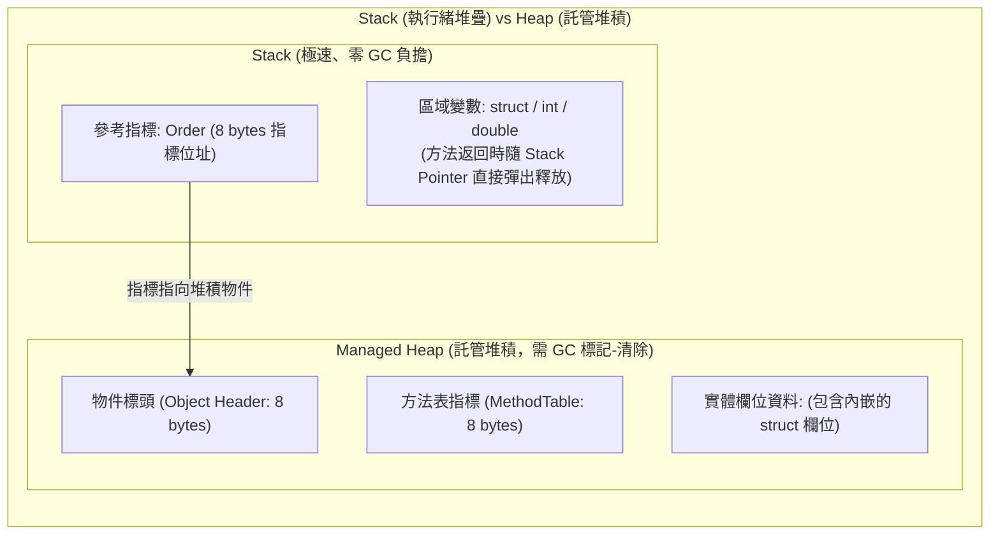

在 C# 與 .NET 的型別系統中，**值型別（Value Types，如 `struct`、數值純量）**與**參考型別（Reference Types，如 `class`、`record class`）**有著根本性的記憶體配置差異。許多工程師為了「消滅 GC 壓力」，將龐大的業務模型盲目改成 `struct`，卻反而引發更致命的 CPU 頻繁記憶體拷貝、隱形防禦性複製（Defensive Copying）與隱蔽裝箱（Boxing）。理解兩者在執行期的記憶體佈局與傳遞語義，是寫出生產級高性能 .NET 後端程式的基石。

## 案發現場

某電商平台的撮合與訂單定價核心引擎在進行效能調校時，遭遇了令人費解的效能倒退事故：

1. **改用 Struct 後 CPU 反而暴衝 200%**：架構師為了降低 GC 壓力，將包含 12 個屬性（包含金額、多個 ID、狀態旗標，總大小達 88 bytes）的 `OrderPricingContext` 由 `class` 改為 `struct`。結果在高頻呼叫鏈路中，由於每次方法傳參都是「按值複製（Pass-by-Value）」，CPU 不斷在 Stack 上進行 88 位元組的整塊記憶體拷貝，撮合引擎的 CPU 使用率直接打滿 100%，延遲反向激增 3 倍！
2. **字典查找慢了 100 倍（反射與裝箱災難）**：開發者自定義了一個 `struct ProductKey(int CategoryId, int SkuId)` 作為 `Dictionary<ProductKey, Price>` 的鍵值，但遺漏了實作 `IEquatable<ProductKey>`。在線上每秒數萬次快取查找時，.NET 預設回退至 `ValueType.Equals`，而該方法在底層採用了**反射（Reflection）掃描所有欄位**，並將兩者強制裝箱為 `object`，造成 GC Allocation 飆升至每秒數百 MB！
3. **防禦性複製悄悄吞噬效能**：為了避免拷貝，工程師宣告了 `readonly OrderPricingContext _ctx;` 欄位並傳入方法。由於該 struct 未宣告為 `readonly struct`，C# 編譯器為了保證該欄位不被方法內部修改，在**每一次存取其屬性或呼叫方法前，都自動在 Stack 上複製一份暫存副本**，引發了上億次隱形防禦性複製。



## 反模式與正確解法

### 反模式一：大型 Struct（> 16 bytes）盲目按值傳遞

C# 中的 `class` 在方法傳參時，僅僅複製一個 8 位元組（64-bit 系統）的記憶體指標，速度極快。而 `struct` 是按值傳遞，方法呼叫會完整複製其內部的所有欄位。若 struct 體積較大且呼叫鏈路層級深，拷貝開銷將遠遠超過 GC 配置物件的成本。

#### 正確解法：微型結構（<= 16 bytes）選 Struct；大型結構搭配 `in` 關鍵字

- 遵循微軟官方準則：只有在邏輯代表單一純量（如座標、時間區間、單純金額）、體積 $\le 16$ bytes 且生命週期短暫時，才優先考慮 `struct`。
- 若必須傳遞較大的 struct，**方法參數必須加上 `in` 關鍵字（唯讀參照傳遞）**：

```csharp
// 💣 Bad：每次傳遞都在 Stack 上拷貝 88 位元組
public void CalculateDiscountBad(OrderPricingContext ctx) { ... }
```

~~~csharp title="Program.cs"
// ✅ Good：宣告為 readonly struct 並透過 in 傳遞參照，零拷貝且執行期不可竄改
var point = new GeoPoint(10, 20);
ProcessLocation(in point);
Console.WriteLine($"座標計算: {point.X}, {point.Y}");
Console.WriteLine("防禦性複製已避免");

static void ProcessLocation(in GeoPoint location)
{
    // location 透過記憶體指標傳遞，不產生整筆 struct 的值拷貝
    _ = location.X + location.Y;
}

public readonly struct GeoPoint(double x, double y)
{
    public double X { get; } = x;
    public double Y { get; } = y;
}
~~~

預期輸出：
```text
座標計算: 10, 20
防禦性複製已避免
```

### 反模式二：未實作 `IEquatable<T>` 的 Struct 作為集合 Key

若自定義的 `struct` 未宣告實作 `IEquatable<T>` 並覆寫 `GetHashCode()`：

```csharp
// 💣 Bad：未實作 IEquatable<T>，查找時遭遇反射與裝箱雙重暴擊！
public struct CartItemKey
{
    public int ShopId { get; set; }
    public long ProductId { get; set; }
}

var dict = new Dictionary<CartItemKey, decimal>();
```

#### 崩潰機理：
`Dictionary` 在比對 Key 時，發現 `CartItemKey` 未實作 `IEquatable<CartItemKey>`，只能呼叫 `object.Equals(object)`。這會觸發：
1. **隱形裝箱（Boxing）**：在 Managed Heap 上配置一個包含該 struct 的暫存包裝物件；
2. **基底類別反射比對**：`System.ValueType.Equals` 會透過反射逐欄位比較記憶體內容。這會讓原本 $O(1)$ 的字典查找效能暴跌數百倍！

#### 正確解法：強制實作 `IEquatable<T>` 或直接使用 `readonly record struct`

```csharp
// ✅ Good 1：現代 C# 推薦：使用 readonly record struct（編譯器自動生成高效 IEquatable）
public readonly record struct CartItemKey(int ShopId, long ProductId);

// ✅ Good 2：傳統寫法手動實作 IEquatable<T>
public readonly struct CartItemKeyManual : IEquatable<CartItemKeyManual>
{
    public int ShopId { get; }
    public long ProductId { get; }

    public CartItemKeyManual(int shopId, long productId) => 
        (ShopId, ProductId) = (shopId, productId);

    public bool Equals(CartItemKeyManual other) =>
        ShopId == other.ShopId && ProductId == other.ProductId;

    public override bool Equals(object? obj) =>
        obj is CartItemKeyManual other && Equals(other);

    public override int GetHashCode() =>
        HashCode.Combine(ShopId, ProductId);
}
```

### 反模式三：未宣告 `readonly struct` 引發防禦性複製（Defensive Copying）

當你將一個可變的 `struct` 宣告為 `readonly` 欄位（例如 `private readonly MyStruct _data;`），或者透過 `in MyStruct param` 傳入方法時：
- C# 編譯器無法確認你呼叫的屬性或方法會不會在內部修改其欄位值（如 `_data.Calculate()`）。
- 為了保證 `readonly` 的承諾不被破壞，**編譯器在每一次呼叫前，都會在 Stack 上強制做一份該 struct 的臨時拷貝**，並在副本上執行呼叫！

#### 正確解法：所有 Struct 必須全面標註 `readonly struct`

只要將 struct 本身宣告為 `readonly struct`，編譯器便能從元資料中得知該型別絕對不可能修改自身狀態，從而徹底消除所有防禦性複製！

```csharp
// 💣 Bad：呼叫 _point.Distance() 時產生隱形防禦性複製
public struct Point { public double X, Y; public double Distance() => Math.Sqrt(X*X + Y*Y); }

// ✅ Good：宣告為 readonly struct，防禦性複製完全消除
public readonly struct SafePoint
{
    public double X { get; }
    public double Y { get; }
    public SafePoint(double x, double y) => (X, Y) = (x, y);
    public double Distance() => Math.Sqrt(X*X + Y*Y);
}
```

## 踩坑與避坑指南

### 1. Struct 存放在哪裡？「Struct 一定在 Stack 上」的常見迷思
- **真相**：`struct` 的存放位置取決於其**聲明上下文**，而非其型別本身！
  - 若 `struct` 是方法的區域變數，它確實在 **Stack** 上。
  - **若 `struct` 是某個 `class` 的欄位（Field），它會直接內嵌在該 class 內部，存放在 Managed Heap 上！**
  - 若 `struct` 被 Lambda 閉包捕獲，它會被編譯器提升至產生的閉包 class 中，同樣存放在 **Heap** 上！

### 2. `ref struct` 的絕對棧約束（如 `Span<T>`）
C# 7.2 引進了 `ref struct`。CLR 保證此類別型別**永遠不可能被配置到 Heap 上**。
- **限制條款**：不能被裝箱、不能賦值給 `object` 或介面、不能成為普通 class 的欄位、不能跨越 `async/await` 邊界。
- **適用場景**：超高效能熱路徑資料處理（例如 `Span<T>`、`ReadOnlySpan<T>`）。

### 3. 字串插值與泛型中的隱性裝箱
當你執行 `$"訂單編號: {orderId}"`，若 `orderId` 是自定義的 struct 且未覆寫 `ToString()`，或者呼叫了介面方法 `((IEntity)myStruct).GetId()`，都會引發隱形裝箱，產生託管堆積垃圾。
- **最佳實踐**：struct 一律覆寫 `public override string ToString()`。

## 線上排查指令

針對生產環境中因 Struct 拷貝、防禦性複製與裝箱引發的 GC 與 CPU 異常，使用下列指令排查：

```bash
# 1. 監控每秒記憶體配置速率（alloc-rate 異常高通常伴隨大量隱形裝箱）
dotnet-counters monitor --process-id <PID> \
    --counters System.Runtime[alloc-rate,gc-count,gc-pause-ratio]

# 2. 使用 dotnet-trace 採集記憶體配置分析日誌
dotnet-trace collect --process-id <PID> \
    --providers Microsoft-DotNETCore-SampleProfiler,Microsoft-Windows-DotNETRuntime:0x1:4 \
    --output /tmp/boxing_trace.nettrace

# 3. 使用 PerfView 或 dotnet-dump 排查堆積中是否有大量被裝箱的 ValueType 物件：
dotnet-dump collect --process-id <PID> --output /tmp/boxing.dump
dotnet-dump analyze /tmp/boxing.dump

# 在 dump 命令列中統計堆積中所有物件（尋找 ValueType 裝箱後殘留的實例）：
> dumpheap -stat
```
