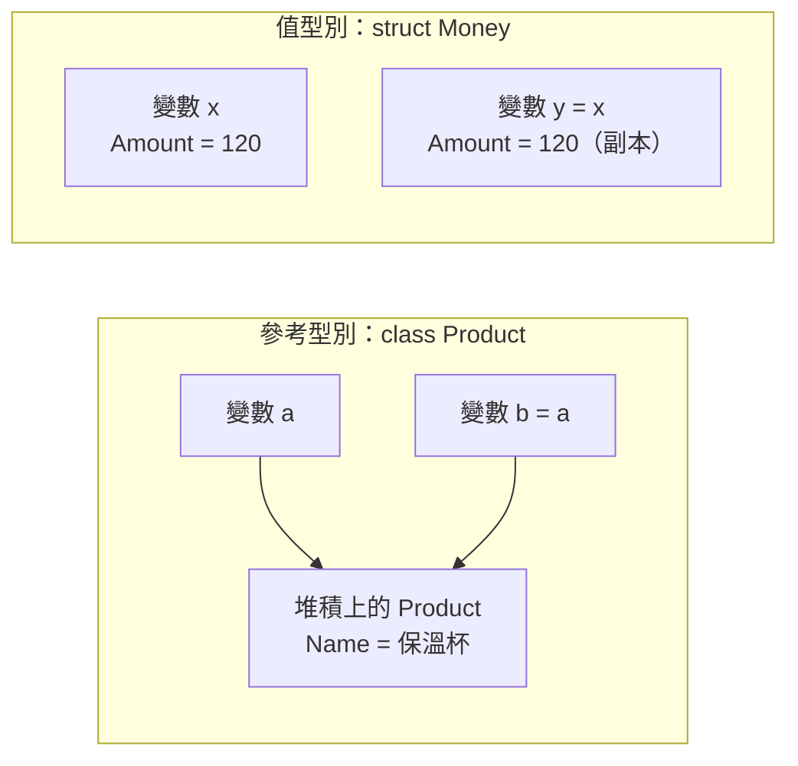

## 這是什麼

C# 的型別分兩種：

- **參考型別**（`class`、`record`、陣列、字串）：變數裡放的是「資料在哪裡」。把它指派給另一個變數，兩個變數指向同一份資料，改一邊，另一邊看得到。
- **值型別**（`struct`、`int`、`decimal`、`DateTime`、`enum`）：變數裡放的就是資料本身。指派或傳參數時會整份複製，改副本不影響原本的。

在電商後端，這個差異決定了兩件事：改資料時會不會不小心動到別人的資料，以及大量處理時會不會多出許多複製或記憶體配置。

## 運作原理



參考型別的物件放在「堆積」（heap），由 GC 負責回收；變數只是指向它。值型別的資料直接存在變數所在的位置：區域變數通常在堆疊上，但如果它是某個 class 的欄位，就跟著那個物件一起放在堆積上。所以「struct 一定在堆疊上」並不正確。

值型別被當成 `object` 或介面使用時，會被「裝箱」（boxing）：系統在堆積上建立一個物件，把值複製進去。這會產生額外的記憶體配置，大量發生時增加 GC 的負擔。

## 常見錯誤與正確寫法

### 1. 把大型資料做成 struct，到處複製

struct 每傳一次參數就複製一次。微軟的設計準則建議，struct 適合小於 16 位元組、不可變、生命週期短的資料。把十幾個欄位的訂單明細做成 struct，每次呼叫方法都複製整份，反而比 class 慢。

```csharp
// 小而不可變：適合 struct
public readonly record struct Money(decimal Amount, string Currency);

// 欄位多、會被到處傳遞：用 class 或 record
public sealed record OrderLine(Guid ProductId, string Name, Money UnitPrice, int Quantity, string? Note);
```

如果大型 struct 已經存在、又只需要讀取，可以用 `in` 傳參數，以唯讀參考的方式傳遞，避免複製：

```csharp
static decimal Subtotal(in OrderLineSnapshot line) => line.UnitPrice * line.Quantity;
```

### 2. struct 當字典鍵，卻沒實作 IEquatable<T>

沒有自己實作相等性的 struct，比較時會用 `ValueType.Equals` 的預設行為，可能需要反射逐一比對欄位，而且比較過程會裝箱。放進 `Dictionary` 當鍵，每次查詢都會多出這些成本。

`readonly record struct` 會自動產生 `IEquatable<T>`、`Equals` 和 `GetHashCode`，是最省事的寫法：

```csharp
// 編譯器產生強型別的 Equals 與 GetHashCode，查字典時不需要裝箱
public readonly record struct SkuKey(int ProductId, string Variant);

var stock = new Dictionary<SkuKey, int>();
stock[new SkuKey(1, "白色")] = 3;
```

### 3. 沒宣告 readonly，編譯器偷偷複製

當 struct 是 `readonly` 欄位或用 `in` 傳入時，編譯器必須確保它不被修改。如果 struct 本身沒宣告 `readonly`，編譯器不知道呼叫某個方法會不會改到欄位，只好先複製一份再呼叫，這叫「防禦性複製」。

```csharp
// 宣告為 readonly struct：所有欄位都不可變，編譯器不需要防禦性複製
public readonly struct Coordinate
{
    public Coordinate(double lat, double lng) => (Lat, Lng) = (lat, lng);
    public double Lat { get; }
    public double Lng { get; }
}
```

## 使用邊界

- 拿不準時用 class 或 record。struct 只在「小、不可變、大量建立」的情境有明顯好處，例如金額、座標、識別碼。
- 實體（Entity）要有身分、會隨時間改變，例如訂單、商品，一律用 class。
- `ref struct`（例如 `Span<T>`）只能存在堆疊上，不能放進 class 欄位、不能被 lambda 捕獲、也不能跨越 `await`，見 [集合與 LINQ](/languages/csharp/collections-linq/)。
- 記憶體配置和 GC 的關係見 [GC 與容器記憶體](/platforms/dotnet/gc-memory/)。
