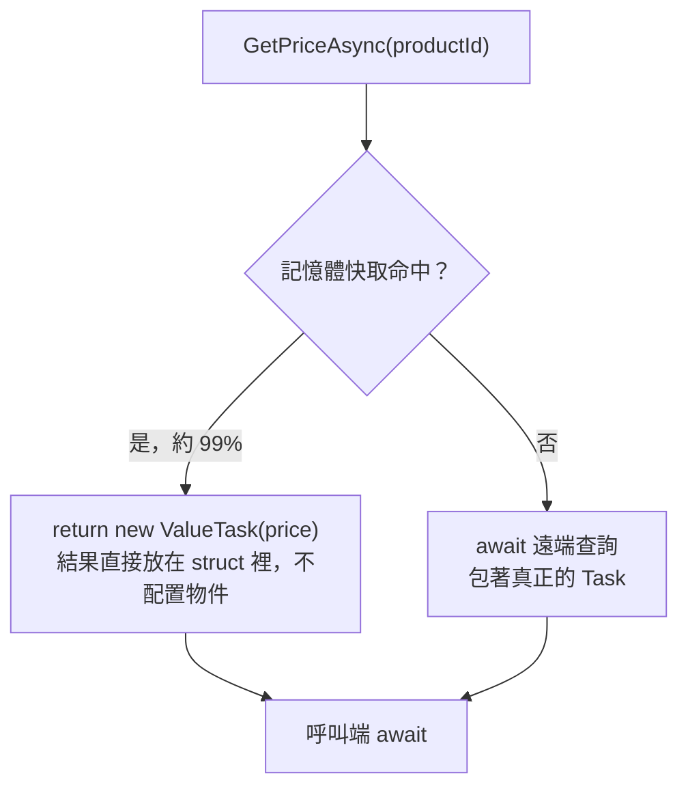

## 這是什麼

每個回傳 `Task<T>` 的非同步方法，結果都要放進一個 `Task` 物件，而物件需要在堆積上配置記憶體。大部分情況下這點成本可以忽略。

但想像商品價格查詢：99% 的請求直接從記憶體快取拿到答案，根本沒有 I/O，卻仍然每次都配置一個 `Task`。每秒上萬次時，這些短命物件會讓 GC 更忙。`ValueTask<T>` 讓「同步就有答案」的情況不必配置物件。

`TaskCompletionSource<T>`（TCS）則是另一個方向：你自己建立一個 Task，等某個外部事件發生時，再手動讓它完成。例如等待某個回呼、或把舊式事件包成可以 await 的 API。

## 運作原理

`ValueTask<T>` 是一個 struct，它可以直接裝著結果，也可以包著一個真正的 Task。



因為 `ValueTask` 背後的物件可能被重複利用，它有嚴格的使用規則：**只能 await 一次**、不能同時被多處 await、在完成前不能讀 `.Result`。

TCS 的關鍵在「完成之後，接著執行的程式碼在哪條執行緒上跑」。預設情況下，呼叫 `SetResult` 的那條執行緒會直接接著執行所有在等這個 Task 的程式碼。如果那條執行緒是 I/O 回呼或某把鎖裡面，就會被拖住，甚至造成死結。`RunContinuationsAsynchronously` 讓接續的程式碼排到執行緒池上執行，`SetResult` 立刻返回。

## 常見錯誤與正確寫法

### 1. 熱路徑回傳 Task<T>，每次都配置

```csharp
// 套件：Microsoft.Extensions.Caching.Memory
public ValueTask<decimal> GetPriceAsync(int productId, CancellationToken ct)
{
    if (_cache.TryGetValue(productId, out decimal price))
    {
        return new ValueTask<decimal>(price); // 命中：不配置物件
    }
    return new ValueTask<decimal>(LoadAndCacheAsync(productId, ct)); // 未命中：包著真正的 Task
}

private async Task<decimal> LoadAndCacheAsync(int productId, CancellationToken ct)
{
    var price = await _pricing.FetchAsync(productId, ct);
    _cache.Set(productId, price, TimeSpan.FromMinutes(1));
    return price;
}
```

### 2. 把 ValueTask 存起來 await 兩次

```csharp
// 錯：同一個 ValueTask 被 await 兩次，第二次的行為未定義
var pending = GetPriceAsync(1, ct);
var a = await pending;
var b = await pending;
```

需要多次使用、或要放進 `Task.WhenAll`，先轉成 Task：

```csharp
Task<decimal> first = GetPriceAsync(1, ct).AsTask();
Task<decimal> second = GetPriceAsync(2, ct).AsTask();
decimal[] prices = await Task.WhenAll(first, second);
```

### 3. TCS 沒加 RunContinuationsAsynchronously

```csharp
public sealed class PaymentCallbackWaiter
{
    // 一律加上這個選項：SetResult 不會在呼叫端的執行緒上執行等待者的程式碼
    private readonly TaskCompletionSource<PaymentResult> _tcs =
        new(TaskCreationOptions.RunContinuationsAsynchronously);

    public Task<PaymentResult> WaitAsync(CancellationToken ct) => _tcs.Task.WaitAsync(ct);

    // 付款閘道的回呼可能重送：用 TrySetResult，重複完成時回傳 false 而不是丟例外
    public bool Complete(PaymentResult result) => _tcs.TrySetResult(result);
}
```

`SetResult` 對已經完成的 TCS 會丟出 `InvalidOperationException`。外部回呼常常會重送，用 `TrySetResult`、`TrySetException`、`TrySetCanceled` 比較安全。

## 使用邊界

- **預設回傳 Task。** 只有在量測過、確定方法大多同步完成且在熱路徑上時，才改用 `ValueTask`。介面上的 `ValueTask` 會把使用限制傳給所有呼叫端。
- 每次都會真的等 I/O 的方法，用 `ValueTask` 沒有好處。
- 等待外部回呼的 TCS 要搭配逾時（`WaitAsync(timeout)` 或取消權杖），避免永遠等不到。
- 跨程序或跨 Pod 的「等某件事完成」，不能用記憶體裡的 TCS；要改用資料庫狀態或訊息佇列，見 [RabbitMQ 入門](/infrastructure/rabbitmq/getting-started/)。
