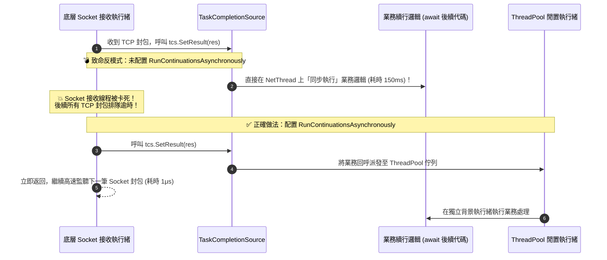

在追求極致吞吐量與低延遲的現代 C# 高效能架構中，非同步模型（`async/await`）雖然解決了 I/O 執行緒阻塞問題，但每一次非同步呼叫回傳的 `Task` 或 `Task<T>` 都是一個配置在託管堆積（Managed Heap）上的參考型別物件。在每秒數萬次請求的高頻路徑（例如熱點商品快取查詢）中，這些瞬間完成的 Task 物件會形成巨大的 GC 記憶體分配壓力。`ValueTask` 與 `TaskCompletionSource` 是 .NET 官方提供的高效協調解法，但若使用不慎，極易引發底層連線卡死與狀態機物件池污染。

## 案發現場

某電商核心商品目錄系統在秒殺促銷期間，遇到了兩起隱蔽且嚴重的系統異常：

1. **快取命中率高達 99%，但 GC 暫停頻繁引發 P99 毛刺**：商品詳情快取服務在記憶體中快取了百萬筆熱門商品，快取命中率超過 99%。然而，APM 監控顯示服務的 Gen 0 GC 每秒觸發上百次，記憶體配置速率（Allocation Rate）高達每秒 400 MB！記憶體傾印分析顯示，堆積中積壓了數百萬個生命週期僅數微秒、狀態早已是 `RanToCompletion` 的 `Task<ProductDto>` 實體。
2. **底層 Socket 網路接收執行緒被業務邏輯拖死**：架構團隊自研了一套非同步 RPC 客戶端，透過單一長連線多工發送請求，並在內部以 `TaskCompletionSource<Response>`（TCS）等待回應。當網路封包抵達時，底層 Socket 執行緒呼叫 `tcs.SetResult(response)`。然而，由於未設定非同步續行旗標，等待該結果的業務程式碼（包含複雜的 JSON 還原序列化與資料庫日誌記錄）直接在**底層 Socket 接收執行緒上同步執行**！該執行緒被卡住了整整 150ms，期間所有其他並行 RPC 請求的 TCP 封包完全無法被接收，引發大面積連線超時中斷。
3. **重複 await 引發隨機不可重現的崩潰**：工程師為了將商品資料傳遞給兩個獨立的非同步處理模組，將一個回傳 `ValueTask<Product>` 的結果存入區域變數，並在兩個地方先後執行了 `await valueTask`。線上環境偶發性拋出 `InvalidOperationException`，甚至取到了已被其他執行緒修改的髒資料！



## 反模式與正確解法

### 反模式一：在絕大多數同步完成的熱點方法中無腦回傳 `Task<T>`

在讀取快取（MemoryCache / Redis 本機分級快取）或同步校驗時，資料在 90% 以上的情況下已經存在於記憶體中，方法能立即同步返回。此時如果宣告回傳 `Task<T>`，C# 依然會在 Managed Heap 上配置一個 Task 物件。

#### 正確解法：採用 `ValueTask<T>` 消除快速路徑的記憶體配置

`ValueTask<T>` 是一個結構體（Struct）。當操作同步完成時，它直接將數值內嵌在結構體內部回傳，**完全不產生任何堆積物件配置（0 Allocation）**；只有在真正需要進行非同步遠端 I/O 時，才在內部包裹一個 Task：

~~~csharp title="Program.cs"
// ✅ Good：結合 ValueTask 零配置與安全 TaskCompletionSource
var service = new OrderStockService();

// 1. 快速路徑：快取命中，零 Heap 配置
int stock1 = await service.GetStockAsync("P01");
Console.WriteLine($"快取庫存: {stock1}");

// 2. 慢速路徑：透過安全的 TCS 非同步通知結果
var tcs = new TaskCompletionSource<int>(TaskCreationOptions.RunContinuationsAsynchronously);
_ = Task.Run(async () =>
{
    await Task.Delay(20);
    // 在獨立 ThreadPool 執行緒執行續行，不卡住目前排程
    tcs.TrySetResult(99);
});

int stock2 = await tcs.Task;
Console.WriteLine($"遠端回傳庫存: {stock2}");

public sealed class OrderStockService
{
    private readonly Dictionary<string, int> _cache = new() { ["P01"] = 50 };

    public ValueTask<int> GetStockAsync(string sku)
    {
        // 快速路徑：直接以 struct 包裝數值回傳，無 Heap 配置
        if (_cache.TryGetValue(sku, out int count))
        {
            return new ValueTask<int>(count);
        }

        // 慢速路徑：回退至非同步 Task
        return new ValueTask<int>(FetchRemoteAsync(sku));
    }

    private static async Task<int> FetchRemoteAsync(string sku)
    {
        await Task.Delay(10);
        return 10;
    }
}
~~~

預期輸出：
```text
快取庫存: 50
遠端回傳庫存: 99
```

### 反模式二：`TaskCompletionSource` 未加上 `RunContinuationsAsynchronously`

預設情況下建立 `new TaskCompletionSource<T>()` 時，其設定為同步續行（Synchronous Continuation）。當你在 Thread A 呼叫 `tcs.SetResult()` 時，所有 `await tcs.Task` 的後續程式碼將會在 Thread A 上**原地同步執行**！

#### 崩潰機理：
若呼叫 `SetResult` 的執行緒是高優先級的關鍵排程者（例如 Socket 封包接收執行緒、定時器執行緒、或持有鎖的執行緒），等待該 Task 的消費者可能撰寫了沉重的業務邏輯或阻塞呼叫，直接將關鍵執行緒拖垮或形成死鎖。

#### 正確解法：永遠強制宣告 `TaskCreationOptions.RunContinuationsAsynchronously`

```csharp
// 💣 Bad：預設行為會直接在 SetResult 呼叫線程上同步執行續行，極易拖垮核心線程
var badTcs = new TaskCompletionSource<RpcResponse>();

// ✅ Good：強制將續行排程至 ThreadPool，保護觸發線程立即釋放
var goodTcs = new TaskCompletionSource<RpcResponse>(
    TaskCreationOptions.RunContinuationsAsynchronously);

// .NET 5+ 現代簡寫：
// new TaskCompletionSource<RpcResponse>(TaskCreationOptions.RunContinuationsAsynchronously);
```

### 反模式三：對 `ValueTask` 重複 `await` 或進行並行等待

`Task` 支援被多個呼叫者多次 `await`，也支援傳入 `Task.WhenAll`。
**但 `ValueTask` 絕對不能重複 await！**

#### 崩潰機理：
為了極致效能，許多高效類別庫（如 Socket / Kestrel / Channels）回傳的 `ValueTask` 底層實作了 `IValueTaskSource` 物件池。當第一次 `await` 完成時，底層物件可能已經被歸還至物件池並指派給其他並行請求。若你第二次 `await`，會引發競爭、拋出 `InvalidOperationException`，甚至讀取到其他使用者的機密資料！

#### 正確解法：若需多次使用或傳入 WhenAll，必須先呼叫 `.AsTask()`

```csharp
ValueTask<OrderDto> vt = GetOrderAsync(orderId);

// 💣 Bad 1：重複 await 同一個 ValueTask 實體（未定義行為/可能拋錯）
var order1 = await vt;
var order2 = await vt; // 💥 致命錯誤！

// 💣 Bad 2：不可直接傳入 Task.WhenAll
// Task.WhenAll(vt1, vt2); // 編譯不通過！

// ✅ Good：若需重複讀取或平行組合，必須顯式轉換為標準 Task
Task<OrderDto> task = vt.AsTask();
await Task.WhenAll(task, OtherTask());
var result = await task; // Task 可以安全地被多次讀取
```

## 踩坑與避坑指南

### 1. 什麼時候千萬不要用 `ValueTask`？
- **純 I/O 且無快取的慢速方法**：如果一個方法 100% 一定要打資料庫或外部 HTTP API，使用 `ValueTask` 不僅省不下任何配置，反而因為 `ValueTask` 結構體比 `Task` 指標更大（記憶體傳值開銷較大），效能反而略微變差。
- **回傳值無結果的非同步方法**：對於不帶回傳值的 `Task`，.NET 內部已經預先快取了單例的 `Task.CompletedTask`。因此普通的非同步方法通常回傳 `Task` 即可，無需改用 `ValueTask`，除非在超高頻熱路徑且使用自訂 `IValueTaskSource`。

### 2. 避免在 `TaskCompletionSource` 上呼叫 `SetResult` 時發生重複呼叫崩潰
在處理逾時或多執行緒競態時，若有多個執行緒同時嘗試完成 TCS，呼叫 `SetResult` 會拋出 `InvalidOperationException: TaskT_TransitionToFinal_AlreadyCompleted`。
- **最佳實踐**：永遠使用 `tcs.TrySetResult(value)` 或 `tcs.TrySetException(ex)`，失敗時僅回傳 false，保證並發安全。

## 線上排查指令

針對生產環境中非同步續行阻塞與 TCS 物件堆積問題，使用下列指令排查：

```bash
# 1. 採集記憶體 Dump 快照
dotnet-dump collect --process-id <PID> --output /tmp/tcs_analysis.dump
dotnet-dump analyze /tmp/tcs_analysis.dump

# 2. 查詢堆積中未完成或滯留的 TaskCompletionSource 物件數量
> dumpheap -type System.Threading.Tasks.TaskCompletionSource -stat

# 3. 檢查是否有底層 I/O 執行緒被意外卡在業務邏輯上（排查續行同步執行問題）
> clrstack -all
# 尋找 Socket / 網路接收執行緒的呼叫堆疊頂部是否意外出現了業務 Controller 或 Service 代碼

# 4. 監控每秒物件配置率，驗證使用 ValueTask 後的 GC 降幅
dotnet-counters monitor --process-id <PID> --counters System.Runtime[alloc-rate,gen-0-gc-count]
```
