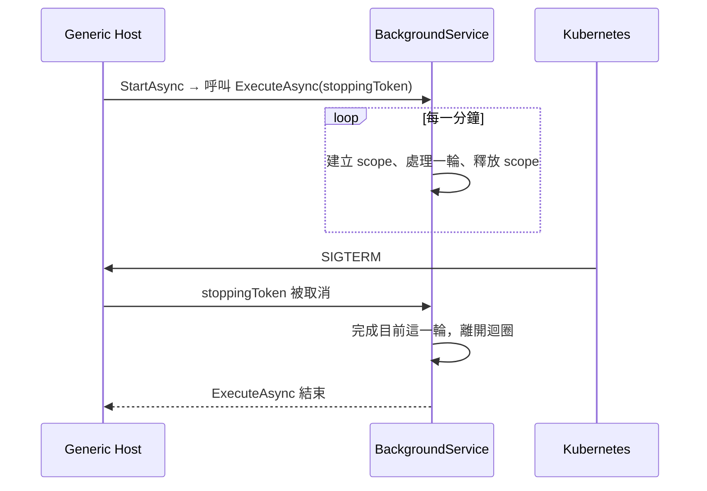

## 這是什麼

訂單 API 除了處理 HTTP 請求，還有一些要在背景持續進行的工作：每分鐘釋放過期的庫存保留、把 outbox 的事件發布到 RabbitMQ、消費通知訊息。**BackgroundService** 是 .NET 提供的基底類別：你實作一個 `ExecuteAsync` 方法，Host 啟動時開始執行它，停止時透過 `stoppingToken` 通知它結束。

它很容易寫，但有幾個預設行為會在正式環境造成意外：一個例外就能讓整個 API 停止、Singleton 生命週期不能直接使用 `DbContext`、多個 Pod 會各自執行同一份工作。

## 運作原理



**未處理的例外會停止主機。** 從 .NET 6 起，`ExecuteAsync` 丟出未處理的例外時，預設行為（`BackgroundServiceExceptionBehavior.StopHost`）是記錄錯誤並**停止整個主機**。如果這個背景服務和 API 在同一個程序，API 也會跟著停止。

**BackgroundService 是 Singleton。** 它在整個應用程式生命週期只有一個實例，不能直接注入 Scoped 服務（例如 `DbContext`），否則就是 Captive Dependency。

## 常見錯誤與正確寫法

### 1. 一次失敗就讓整個服務停止

```csharp
public sealed class ReservationExpiryWorker(
    IServiceScopeFactory scopes, ILogger<ReservationExpiryWorker> logger, TimeProvider time) : BackgroundService
{
    protected override async Task ExecuteAsync(CancellationToken stoppingToken)
    {
        using var timer = new PeriodicTimer(TimeSpan.FromMinutes(1));
        while (await timer.WaitForNextTickAsync(stoppingToken))
        {
            try
            {
                await using var scope = scopes.CreateAsyncScope();          // 每一輪一個新的 scope
                var db = scope.ServiceProvider.GetRequiredService<ShopDbContext>();
                var released = await db.Reservations
                    .Where(r => r.ExpiresAt < time.GetUtcNow())
                    .ExecuteDeleteAsync(stoppingToken);
                logger.LogInformation("釋放 {Count} 筆過期保留", released);
            }
            catch (OperationCanceledException) when (stoppingToken.IsCancellationRequested)
            {
                break;                                                     // 正在停止：正常離開
            }
            catch (Exception ex)
            {
                logger.LogError(ex, "釋放過期保留失敗，下一輪再試");          // 一輪失敗，不影響之後的輪次
            }
        }
    }
}
```

每一輪自己接住例外，記錄後繼續下一輪。`PeriodicTimer` 在 `stoppingToken` 被取消時會結束等待，迴圈自然離開。

### 2. 直接注入 DbContext

如上例，注入 `IServiceScopeFactory`，每一輪建立 scope 再取得 `DbContext`；或注入 `IDbContextFactory<T>`，見 [C# 連線設計](/data-access/csharp-connections/)。

### 3. 停止時直接中斷進行中的工作

收到停止訊號時，不要再領取新的工作，但讓正在處理的這一筆完成（或確保它可以安全地重做）。訊息消費者停止時不 Ack 未完成的訊息，讓它回到佇列，見 [.NET 整合 RabbitMQ](/infrastructure/rabbitmq/dotnet-integration/)。停止的總時間要在 Host 的 `ShutdownTimeout` 之內，見 [Generic Host](/platforms/dotnet/hosting/)。

### 4. 多個 Pod 重複執行同一份排程

API 擴到 5 個 Pod，每個 Pod 都有一個 `ReservationExpiryWorker`，同一份工作每分鐘被執行 5 次。上面的例子是冪等的（刪除已過期的資料，重複執行也無害），所以可以接受。不能重複的工作有幾種做法：

- 用 Kubernetes 的 **CronJob** 執行，排程由叢集負責，一次只跑一個。
- 把背景工作放在獨立的 Worker Deployment，固定 1 個副本（搭配 Single Active Consumer 等機制避免中斷時沒人執行）。
- 每一輪先以資料庫的鎖或條件更新「領取」工作，只有領到的 Pod 執行。

## 使用邊界

- 長時間的 CPU 密集工作不要放在和 API 同一個程序的背景服務，會搶走處理請求的資源；放到獨立的 Worker。
- 不要用 `Task.Run` 啟動一個永遠不結束的迴圈；它佔用執行緒池的執行緒，也沒有停止與例外處理的機制。用 BackgroundService。
- 程序內的工作佇列見 [Channels](/languages/csharp/channels/)；不能遺失的工作要持久化，見 [Outbox 與 Inbox](/architecture/outbox-inbox/)。

## 雲端排查

### 叢集層（GKE 與 EKS 相同）

```bash
# 背景服務的例外讓主機停止時，容器會結束並重啟
kubectl get pod -n shop -l app=order-api -o jsonpath='{range .items[*]}{.metadata.name}{"\t"}{.status.containerStatuses[0].restartCount}{"\n"}{end}'
kubectl logs <pod-name> -n shop --previous | grep -i -B2 -A10 "BackgroundService"

# 以 CronJob 執行的排程：最近幾次是否成功
kubectl get cronjob -n shop
kubectl get jobs -n shop --sort-by=.status.startTime | tail -5
```

### 託管服務層

#### GKE

Cloud Logging 中查詢背景服務的錯誤：

```bash
gcloud logging read 'resource.type="k8s_container" AND resource.labels.namespace_name="shop" AND severity>=ERROR AND textPayload:"BackgroundService"' \
  --freshness=6h --limit=20
```

#### EKS

CloudWatch Logs Insights（Container Insights 的應用程式日誌群組）：

```text
fields @timestamp, kubernetes.pod_name, log
| filter kubernetes.namespace_name = "shop" and log like /BackgroundService/ and log like /fail|error|Exception/
| sort @timestamp desc
| limit 20
```

### 應用程式層

為每一輪背景工作記錄開始時間、處理筆數與耗時，並建立「最後一次成功執行時間」的指標；它停止更新，就代表背景服務已經不在運作，即使 Pod 看起來一切正常。
