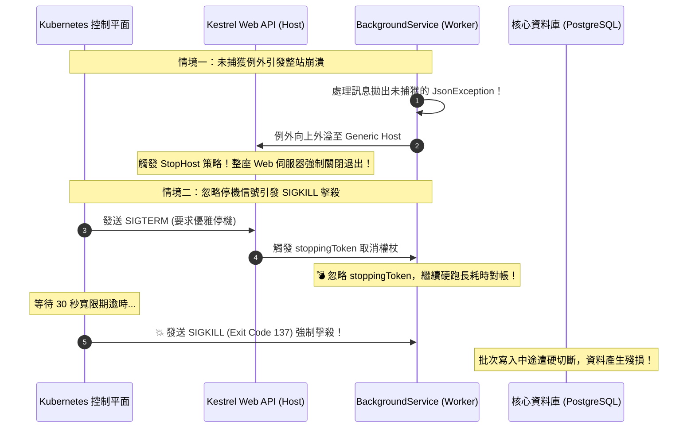

在 ASP.NET Core 與 .NET Generic Host 架構中，`BackgroundService` 是執行非同步常駐任務（如定時對帳排程、從 RabbitMQ/Kafka 拉取訊息消費、或將記憶體日誌批次刷盤）的標準基礎類別。然而，自 .NET 6 起，宿主執行環境引進了更嚴苛的容錯政策：**背景工作中的未處理例外預設會被視為致命錯誤，直接終止整座 Web 伺服器**！若未深刻理解其生命週期管理、DI 範圍約束與 Kubernetes 容器信號協同，看似無害的背景 Worker 很可能成為線上伺服器集體崩潰與資料損毀的定時炸彈。

## 案發現場

某電商核心交易微服務在一次黑色星期五促銷期間，遭遇了接二連三的離奇崩潰與停機災難：

1. **一筆格式錯誤的毒訊息直接搞垮整座 Web API**：為了非同步推送訂單通知，工程師在 Web API 內部註冊了一個 `BackgroundService` 來消費內部的非同步佇列。在促銷尖峰，一筆包含非法字元的 JSON 訊息進入佇列，還原序列化時拋出了 `JsonReaderException`。由於開發者未在 `ExecuteAsync` 內部捕捉該例外，自 .NET 6 起預設的 `BackgroundServiceExceptionBehavior.StopHost` 立即生效——整座承受著每秒數千請求的 ASP.NET Core Kestrel 伺服器進程**被直接無條件關閉（Process Shutdown）**，引發全站可用率崩盤！
2. **多執行緒併發崩潰（Captive Dependency）**：Worker 負責定時從資料庫撈取過期未付款訂單並自動取消。工程師在建構子中直接注入了 `OrderDbContext`。由於 `BackgroundService` 是單例（Singleton），而 `DbContext` 是範圍型別（Scoped），在並行執行時，底層拋出著名的 `InvalidOperationException: A second operation was started on this context instance before a previous operation completed`，導致資料庫連線損毀。
3. **K8s 滾動更新被 SIGKILL 暴力擊殺**：在微服務進行例行版本發布時，Kubernetes 向舊 Pod 發送了 `SIGTERM` 優雅停機信號。然而 Worker 的執行迴圈沒有檢查 `stoppingToken`，依然在進行一筆長達 45 秒的批次對帳任務。30 秒寬限期（`terminationGracePeriodSeconds`）過後，Kubernetes 判定容器未退出，直接發送 `SIGKILL` 撲殺，正在寫入一半的會計憑證資料庫發生狀態撕裂，留下數千筆未對齊帳目的殘損資料。



## 反模式與正確解法

### 反模式一：未隔離例外，任由非同步任務例外外溢至 Host

在 `ExecuteAsync` 內部直接裸跑迴圈，一旦依賴的遠端服務（如 Redis 或資料庫）發生短暫網路中斷或還原序列化失敗，拋出的例外會直接逃逸出 `ExecuteAsync`。

#### 正確解法：在迴圈內部嚴格隔離例外，並區分取消信號

Worker 必須在處理每一筆工作項目時建立嚴格的 `try-catch` 隔離防線。業務例外應記錄警報並重試或跳過，**唯獨 `OperationCanceledException` 在 `stoppingToken` 被觸發時，才應允許退出迴圈**：

```csharp
// 💣 Bad：一旦任何一個例外拋出，整座 API 伺服器陪葬退出
protected override async Task ExecuteAsync(CancellationToken stoppingToken)
{
    while (!stoppingToken.IsCancellationRequested)
    {
        await ProcessNextOrderAsync(); // 拋出例外即 Crash 整個 Host
    }
}

// ✅ Good：例外自我防禦、安全隔離與優雅停機
public sealed class OrderProcessingWorker : BackgroundService
{
    private readonly ILogger<OrderProcessingWorker> _logger;
    private readonly IServiceScopeFactory _scopeFactory;

    public OrderProcessingWorker(
        ILogger<OrderProcessingWorker> logger,
        IServiceScopeFactory scopeFactory)
    {
        _logger = logger;
        _scopeFactory = scopeFactory;
    }

    protected override async Task ExecuteAsync(CancellationToken stoppingToken)
    {
        _logger.LogInformation("訂單處理背景服務啟動");

        // 使用 .NET 6+ 原生的 PeriodicTimer 代替手動 Task.Delay
        using var timer = new PeriodicTimer(TimeSpan.FromSeconds(5));

        while (!stoppingToken.IsCancellationRequested)
        {
            try
            {
                // 等待定時器或取消信號
                if (!await timer.WaitForNextTickAsync(stoppingToken))
                    break;

                await ProcessBatchSafelyAsync(stoppingToken);
            }
            catch (OperationCanceledException) when (stoppingToken.IsCancellationRequested)
            {
                // 收到優雅停機信號，正常退出迴圈
                _logger.LogInformation("收到主機停機信號，正在退出背景工作迴圈");
                break;
            }
            catch (Exception ex)
            {
                // 核心關鍵：捕捉並記錄所有未預期的業務或網路例外，絕對不讓例外擊垮主機！
                _logger.LogError(ex, "背景處理單批訂單時遭遇異常，將於下一輪重試");
            }
        }

        _logger.LogInformation("訂單處理背景服務已安全停機");
    }

    private async Task ProcessBatchSafelyAsync(CancellationToken ct)
    {
        // 解決捕捉性依賴：手動建立獨立的生命週期範圍
        using var scope = _scopeFactory.CreateScope();
        var dbContext = scope.ServiceProvider.GetRequiredService<OrderDbContext>();

        var expiredOrders = await dbContext.Orders
            .Where(o => o.Status == OrderStatus.Pending && o.CreatedAt < DateTime.UtcNow.AddMinutes(-30))
            .Take(50)
            .ToListAsync(ct);

        foreach (var order in expiredOrders)
        {
            order.Cancel("逾時未付款系統自動取消");
        }

        await dbContext.SaveChangesAsync(ct);
    }
}
```

### 反模式二：在 Singleton Worker 中直接注入 Scoped 服務（Captive Dependency）

`BackgroundService` 在 DI 容器中是作為 `Singleton`（單例）註冊的。若在建構子中直接注入 `OrderDbContext` 或任何 Scoped 服務，該 DbContext 將被迫變成單例，整個進程共享同一實體，不僅永遠無法釋放記憶體，而且在多執行緒併發時必然引發資料競爭崩潰。

#### 正確解法：注入 `IServiceScopeFactory` 並在每次迭代建立 Scope

如上方良好範例所示，注入 `IServiceScopeFactory`，並在每次迴圈或每批訊息處理時呼叫 `using var scope = _scopeFactory.CreateScope();`，使用完畢後立即隨 `using` 釋放 DbContext 連線，確保連線池正常歸還。

### 反模式三：忽略 `stoppingToken`，長耗時作業無法優雅停機

在微服務更新部署時，Kubernetes 會發送 `SIGTERM`，.NET Host 會觸發 `stoppingToken.Cancel()` 並等待 `HostOptions.ShutdownTimeout`（預設 30 秒）。若 Worker 內部執行的非同步 I/O 未傳入 `stoppingToken`，Worker 就無法及時中止，最終在超時後被 `SIGKILL` 暴力中斷。

#### 正確解法：所有內部非同步 I/O 一律傳入 `stoppingToken`，並配合 HostOptions

在 `Program.cs` 中，若預期背景作業需要充足的時間收尾（例如清空佇列緩衝），可調大關機寬限期，並確保與 Kubernetes `terminationGracePeriodSeconds` 對齊：

```csharp
builder.Services.Configure<HostOptions>(options =>
{
    // 提供足夠的優雅停機時間讓背景任務排空
    options.ShutdownTimeout = TimeSpan.FromSeconds(45);
    
    // 若特定次要背景服務確實允許崩潰而不影響 Web API，可調為 Ignore（預設為 StopHost）
    // options.BackgroundServiceExceptionBehavior = BackgroundServiceExceptionBehavior.Ignore;
});
```

## 踩坑與避坑指南

### 1. `ExecuteAsync` 提前返回的假成功陷阱
如果 `ExecuteAsync` 內部啟動了一個未被 `await` 的 `Task.Run`，該方法會立即執行完畢並返回。
- **後果**：.NET Generic Host 會認為該 BackgroundService 已經成功完成並退出！若內部 Task 隨後拋出例外，將無人監管，甚至造成背景執行緒成為孤兒程序。
- **最佳實踐**：`ExecuteAsync` 本身必須保持非同步執行，直到整個服務生命週期結束才退出。

### 2. 多 Pod 水平擴展環境下的排程重複執行
`BackgroundService` 是進程內部的常駐 Worker。當你的 API 透過 HPA 水平擴展為 5 個 Pod 時，**5 個 Pod 內部各自都會執行一份該 BackgroundService**！
- **避坑建議**：若任務是「定時取消訂單」或「定時發送對帳報表」，多個 Pod 同時跑會造成嚴重重複執行與死鎖。應升級為：
  1. 使用 Kubernetes `CronJob` 執行一次性容器任務；
  2. 使用分散式排程架構（如 Quartz.NET 叢集模式或搭配 Redis 分散式鎖 / DB 悲觀鎖排他執行）。

### 3. DI 容器驗證範圍設置
為了在開發階段就杜絕 Captive Dependency 注入錯誤，必須在 `Program.cs` 啟用嚴格的 DI 範圍驗證：

```csharp
builder.Host.UseDefaultServiceProvider(options =>
{
    options.ValidateScopes = true;     // 禁止在 Singleton 中解析 Scoped 服務
    options.ValidateOnBuild = true;    // 啟動建置時即檢查依賴樹
});
```

## 線上排查指令

針對生產環境中背景 Worker 崩潰、例外排查與 Kubernetes 停機逾時問題，使用下列指令排查：

```bash
# 1. 檢視 Pod 上一次崩潰退出的日誌（排查是否因 BackgroundService 未處理例外引發 StopHost）
kubectl logs <pod-name> -n ecommerce-prod --previous --tail=100

# 2. 檢視 Pod 終止事件（確認是否為 Exit Code 137 SIGKILL 超時強制殺死）
kubectl describe pod <pod-name> -n ecommerce-prod | grep -A 10 "Last State:"

# 3. 監控運行中背景服務的執行緒狀態與活躍計時器數量
dotnet-counters monitor --process-id <PID> \
    --counters System.Runtime[active-timer-count,threadpool-thread-count,exception-count]

# 4. 抓取記憶體 Dump 並檢查 Worker 執行緒是否卡在死循環或死鎖
dotnet-dump collect --process-id <PID> --output /tmp/worker_hang.dump
dotnet-dump analyze /tmp/worker_hang.dump
> clrstack -all
```
