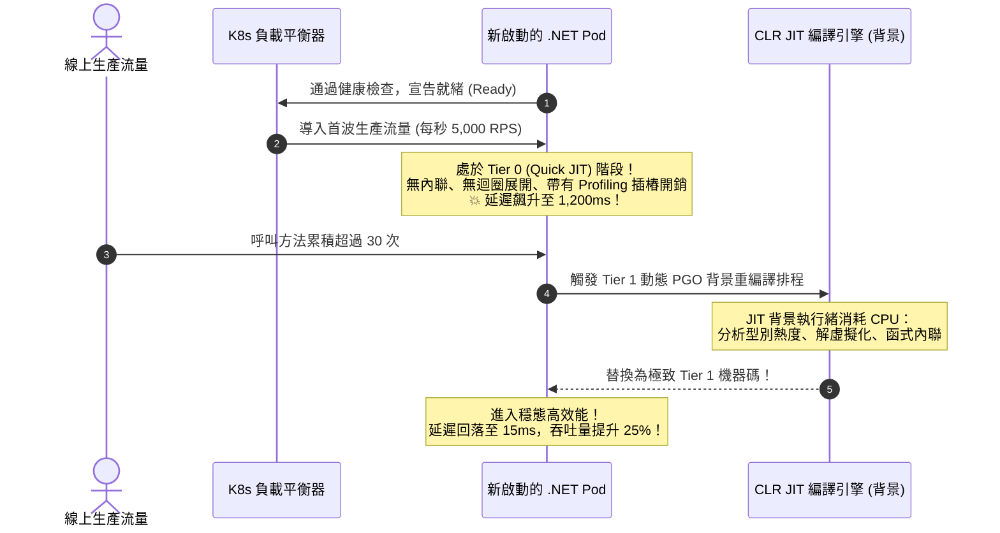

在雲端原生微服務與容器化架構中，.NET 應用程式的效能由兩個看似矛盾的目標所驅動：**極速的容器冷啟動（Cold Start）**以因應 Kubernetes HPA 彈性擴縮，以及**極致的穩態吞吐量（Steady-State Throughput）**以承受電商尖峰流量。為了解決這一經典矛盾，現代 .NET（.NET 8 / .NET 10）引進了高度精密的 **分層編譯（Tiered Compilation）** 與 **動態設定檔引導最佳化（Dynamic PGO, Profile-Guided Optimization）** 機制。然而，若未掌握其執行期時序特性，新 Pod 上線時往往會遭遇嚴重的「首波延遲毛刺（Warmup Latency Spikes）」。

## 案發現場

某電商核心商品目錄微服務在年中慶促銷期間，每當遭遇流量高峰觸發 Kubernetes HPA 自動擴容或進行滾動更新發布時，監控圖表便會出現極其劇烈的震盪：

1. **新 Pod 剛上線前 30 秒 P99 延遲暴增 50 倍**：當 HPA 偵測到負載擴充了 5 個新 Pod，新 Pod 剛通過預設的 HTTP 就緒探針（Readiness Probe）並切入流量時，前 30 秒至 1 分鐘內的 API P99 延遲由正常的 20ms 瘋狂飆升至 1,200ms 以上，前端買家頻繁回報商品頁面卡頓，部分外部請求甚至因逾時而收到 HTTP 504 錯誤。
2. **三分鐘後性能奇蹟般飆升**：令人費解的是，伺服器完全沒有重啟，在持續承接流量 2~3 分鐘後，這些新 Pod 的延遲突然自動滑落至 15ms，整體的每秒處理能力（RPS）甚至比舊版 Pod 還高出近 25%！
3. **盲目關閉分層編譯引發冷啟動逾時崩潰**：維運團隊為了消除上線初期的延遲毛刺，嘗試在組態中粗暴地設定 `DOTNET_TieredCompilation=0`（關閉分層編譯）。結果新 Pod 啟動時間由原本的 2.5 秒直接暴增至 35 秒，導致容器多次因超過 Kubernetes `initialDelaySeconds` 與探針超時而陷入 `CrashLoopBackOff`，促銷擴容徹底失敗！



## 反模式與正確解法

### 反模式一：冷 Pod 剛通過基本健康檢查即直面全量生產流量

許多微服務的就緒探針（Readiness Probe）僅回傳一個靜態的 `200 OK`，完全沒有觸發任何業務核心路徑。當容器宣告就緒時，內部數百個核心業務方法甚至**尚未被 JIT 編譯過**，或僅處於未經最佳化的 **Tier 0（Quick JIT）** 階段。

#### 崩潰機理：分層編譯的生命週期演進
1. **Tier 0（Quick JIT）**：當方法第一次被呼叫時，JIT 為了極速啟動，完全放棄耗時的內聯（Inlining）與迴圈展開，以極粗略的代碼迅速生成機器碼；更重要的是，現代 .NET 會在代碼中注入「效能分析計數器（Tier 0 Instrumentation）」，收集執行期型別分佈與分支機率。
2. **Tier 1（Optimized JIT + Dynamic PGO）**：當該方法在 Tier 0 下被呼叫累積達 **30 次**（且經過一段冷卻平穩期）後，CLR 會將該方法排入背景 JIT 工作佇列。JIT 引擎讀取收集到的實際執行期特徵，進行深度的介面解虛擬化（Guarded Devirtualization）、大膽的熱路徑內聯與暫存器配置，編譯出終極機器碼並原子替換舊指標。
若在 Tier 0 階段就硬接大促尖峰流量，插樁代碼的開銷加上背景 JIT 搶奪 CPU，必然引發嚴重的延遲毛刺！

#### 正確解法：在就緒探針（Readiness Probe）之前實施受控預熱（Warmup Loop）

在 ASP.NET Core 的啟動流程中（例如自定義的 `IHostedService` 或就緒健康檢查中），主動對最關鍵的熱路徑（如折扣計算、訂單序列化、快取反序列化）發起內部暖身迴圈（通常虛擬執行 35~50 次），促使 CLR 在流量導入前就將關鍵熱方法升級至 Tier 1：

```csharp
public sealed class JitWarmupHostedService : IHostedService
{
    private readonly ILogger<JitWarmupHostedService> _logger;

    public JitWarmupHostedService(ILogger<JitWarmupHostedService> logger)
    {
        _logger = logger;
    }

    public Task StartAsync(CancellationToken cancellationToken)
    {
        _logger.LogInformation("開始執行 JIT 動態 PGO 核心路徑預熱...");

        var dummyOrder = new OrderCalculationContext
        {
            Quantity = 2,
            UnitPrice = 100m,
            CouponCode = "WARMUP"
        };

        // 循環呼叫超過 30 次，滿足 JIT Tier 1 升級門檻 (Tiering threshold)
        for (int i = 0; i < 35; i++)
        {
            OrderPricingEngine.CalculateFinalPrice(dummyOrder);
        }

        _logger.LogInformation("JIT 核心路徑預熱完成，準備開放接收線上流量");
        return Task.CompletedTask;
    }

    public Task StopAsync(CancellationToken cancellationToken) => Task.CompletedTask;
}
```

### 反模式二：為了消除預熱期，盲目關閉分層編譯（TieredCompilation = false）

部分工程師為了追求「開機即最高效能」，在組態中設定了 `DOTNET_TieredCompilation=0`。這會強制 JIT 在應用程式啟動時，對呼叫到的每一個方法直接進行完整的 Tier 1 複雜優化編譯。

#### 嚴重代價：
1. **冷啟動時間暴增 10 倍以上**：原本 2 秒啟動的 Web API，啟動時間延長至數十秒，喪失了容器秒級水平擴縮容（Autoscaling）的能力；
2. **喪失 Dynamic PGO 效益**：沒有了 Tier 0 的執行期插樁取樣，JIT 無法得知真實流量下哪些介面實作佔了 99%，也就無法實施精確的介面解虛擬化（Interface Devirtualization），其最終穩態效能反而不如開啟分層編譯！

#### 正確解法：保持預設的分層編譯與 Dynamic PGO 開啟

確保專案設定檔中開啟現代最佳化標準（.NET 8+ 預設已啟用）：

```xml
<PropertyGroup>
  <!-- 保持啟用分層編譯與動態 PGO（預設即為 true） -->
  <TieredCompilation>true</TieredCompilation>
  <TieredPGO>true</TieredPGO>
</PropertyGroup>
```

### 反模式三：對極端超低延遲方法未進行強制預編譯

在部分對延遲極度敏感的交易環節（例如每小時僅觸發一次、但一旦觸發必須在 100 微秒內完成的高頻撤單防線），由於該方法呼叫頻率過低，可能永遠無法達到 30 次呼叫門檻，每次執行都會撞上冷啟動。

#### 正確解法：使用 `RuntimeHelpers.PrepareMethod` 強制預編譯

```csharp
// 對於極少呼叫但要求首擊超低延遲的極端方法，手動強制 JIT 編譯至最高階
RuntimeHelpers.PrepareMethod(
    typeof(RiskEngine).GetMethod(nameof(RiskEngine.EmergencyCancel))!.MethodHandle);
```

## 踩坑與避坑指南

### 1. Dynamic PGO 的核心威力：介面解虛擬化（Guarded Devirtualization）
在傳統物件導向中，呼叫介面方法（如 `IOrderCalculator.Calculate()`）需要查詢虛擬方法表（vtable），編譯器無法對其進行內聯（Inlining）。
- **Dynamic PGO 的突破**：在 Tier 0 階段，CLR 觀察到線上 99.8% 的呼叫傳入的都是 `StandardOrderCalculator`。升級至 Tier 1 時，JIT 會生成保護性跳轉：
  `if (calculator is StandardOrderCalculator fast) { /* 直接內聯代碼，零虛擬呼叫開銷！ */ } else { /* 回退 vtable 查詢 */ }`

### 2. ReadyToRun（R2R）與 JIT 的折衷
ReadyToRun（AOT 預編譯為本機指令）能顯著縮短容器冷啟動時間，因為大部分代碼在打包 Docker 映像時已經編譯好。
- **避坑細節**：即便使用了 ReadyToRun，.NET 依然會在背景利用 Dynamic PGO 重新編譯熱方法，以達到超越靜態編譯的峰值效能。若追求極速冷啟動，建議在 Docker 映像構建時開啟 `<PublishReadyToRun>true</PublishReadyToRun>`。

### 3. Native AOT vs. JIT + Dynamic PGO 的吞吐量迷思
許多人認為 Native AOT 一定比 JIT 快。
- **真相**：Native AOT 擁有最極致的**冷啟動（毫秒級）與超低記憶體佔用**；但在**長效高吞吐量（穩態性能）**方面，具備 Dynamic PGO 的 JIT 引擎因為能根據真實生產流量做動態內聯與分支預測，其吞吐極限往往能超越或持平靜態編譯！

## 線上排查指令

針對生產環境中 JIT 編譯時間、方法編譯計數與延遲毛刺問題，使用下列指令排查：

```bash
# 1. 監控 JIT 編譯速率與在 JIT 中消耗的 CPU 時間比例
dotnet-counters monitor --process-id <PID> \
    --counters System.Runtime[jit-compilation-rate,methods-jitted-count,time-in-jit]

# 2. 檢視分層編譯與動態 PGO 的執行期狀態（在除錯環境觀察）
export DOTNET_TieredPGO=1
export DOTNET_JITMinOpts=0

# 3. 輸出特定熱路徑方法的底層反組譯彙編代碼（驗證是否已成功內聯與解虛擬化）
export DOTNET_JitDisasm="*OrderPricingEngine*CalculateFinalPrice*"
dotnet run --project src/OrderApi/

# 4. 使用 dotnet-trace 採集啟動階段的 CPU Profile，排查 JIT 編譯是否佔用過多啟動時間
dotnet-trace collect --process-id <PID> --profile cpu-sampling --output /tmp/jit_startup.nettrace
```
