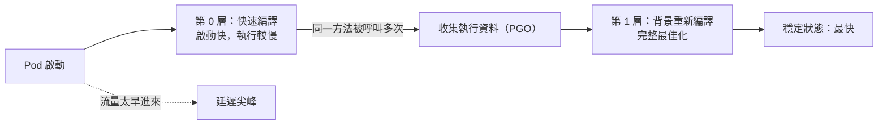

## 這是什麼

C# 編譯後產生的是 IL（中間語言），不是 CPU 能直接執行的機器碼。程式執行時，**JIT 編譯器**在第一次呼叫某個方法時才把它編譯成機器碼。

為了讓程式快速啟動，.NET 使用**分層編譯**：一開始用「快速但不太最佳化」的方式編譯（第 0 層），等某個方法被呼叫很多次、確定是熱門路徑後，再在背景用「完整最佳化」的方式重新編譯（第 1 層）。.NET 8 起還預設開啟**動態 PGO**：在第 0 層執行時收集實際的執行資料（例如某個介面最常見的實作類別），讓第 1 層的最佳化更精準。

結果是：程式越跑越快。反過來說，剛啟動的程序比較慢。

## 運作原理



新 Pod 通過 readiness 後立刻接到正常流量，這時大部分程式碼還在第 0 層，再加上第一次呼叫時要即時編譯、連線池還沒建立、快取是空的，前幾百個請求的延遲會明顯偏高。HPA 在尖峰時擴容，新 Pod 正好在最忙的時候加入，這個暖機延遲就特別明顯。

## 常見錯誤與正確寫法

### 1. 新 Pod 一啟動就接全部流量

在 readiness 通過之前，先讓熱門路徑實際跑過一輪：建立資料庫與 Redis 的連線、呼叫幾次主要的查詢。

```csharp
public sealed class Warmup(IServiceScopeFactory scopes, ReadinessState readiness, ILogger<Warmup> logger) : IHostedService
{
    public async Task StartAsync(CancellationToken ct)
    {
        try
        {
            await using var scope = scopes.CreateAsyncScope();
            var catalog = scope.ServiceProvider.GetRequiredService<ProductReader>();
            for (var i = 0; i < 50; i++)
            {
                await catalog.GetAsync(productId: 1, ct); // 觸發 JIT、建立連線、填入快取
            }
        }
        catch (Exception ex)
        {
            logger.LogWarning(ex, "暖機未完成，仍然開始接受流量");
        }
        finally
        {
            readiness.MarkReady(); // /health/ready 依此回應
        }
    }
    public Task StopAsync(CancellationToken ct) => Task.CompletedTask;
}
```

暖機只能加速前段，第 1 層的重新編譯仍需要實際流量累積，所以暖機後的延遲仍會在前幾分鐘逐步下降。

### 2. 為了避免暖機而關閉分層編譯

關閉分層編譯（`TieredCompilation=false`），所有方法一開始就做完整最佳化編譯：啟動時間大幅增加，而且失去動態 PGO 的效果，穩定狀態反而可能更慢。保留預設值，用暖機與 ReadyToRun 處理啟動問題。

### 3. 啟動很慢就直接改用 Native AOT

**ReadyToRun** 在發布時先把程式預先編譯成機器碼，啟動時不需要 JIT，之後仍可以由分層編譯換成更好的版本；它只是讓檔案變大一些，相容性幾乎沒有限制：

```xml
<PropertyGroup>
  <PublishReadyToRun>true</PublishReadyToRun>
</PropertyGroup>
```

**Native AOT** 啟動最快、記憶體最小，但不能使用依賴執行期反射的功能，也沒有動態 PGO，長時間執行的吞吐量不一定比較好，見 [API 風格與 Native AOT](/frameworks/aspnet-core/api-styles-aot/)。

## 使用邊界

- 可預期的尖峰（例如大促開始時間）提前擴容，讓新 Pod 有時間暖機，比在尖峰時才自動擴容更穩定，見 [自動擴縮](/platforms/kubernetes/autoscaling/)。
- 暖機要有時間上限，失敗也不能讓 Pod 永遠不就緒；配合 startupProbe 的上限設定。
- 量測效能時，排除前幾分鐘的資料，否則會把暖機的成本誤認為穩定狀態的表現。

## 雲端排查

### 叢集層（GKE 與 EKS 相同）

```bash
# 新 Pod 的啟動時間：建立到 Ready 花了多久
kubectl get pods -n shop -l app=order-api \
  -o custom-columns=NAME:.metadata.name,CREATED:.metadata.creationTimestamp,READY:'.status.conditions[?(@.type=="Ready")].lastTransitionTime'
```

### 託管服務層

#### GKE

在 Cloud Monitoring 把 `loadbalancing.googleapis.com/https/backend_latencies` 依後端分組，對照擴容與部署的時間：每次有新 Pod 加入就出現延遲尖峰，代表暖機不足。

#### EKS

CloudWatch `AWS/ApplicationELB` 的 `TargetResponseTime`（可看 p99）在部署或擴容時出現尖峰；搭配 ALB 目標群組的「慢啟動」設定，可以讓新目標在一段時間內逐步增加流量。

### 應用程式層

```bash
dotnet-counters monitor --process-id 1 --counters System.Runtime
```

`dotnet.jit.compiled_methods` 在啟動後快速增加，然後趨於平緩；它還在快速增加時，程式仍在大量 JIT 編譯，延遲偏高是預期的。
