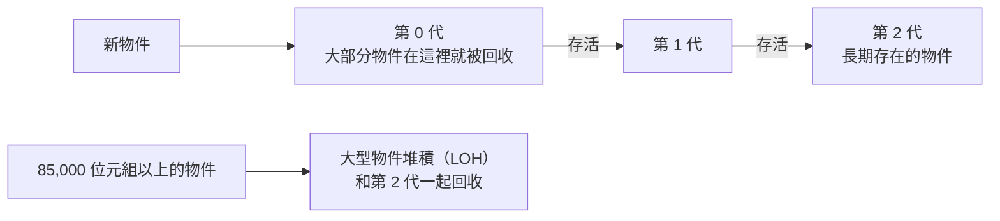

## 這是什麼

.NET 的**記憶體回收器**（Garbage Collector，GC）自動找出不再使用的物件並回收它們的記憶體，你不需要手動釋放。但「自動」不代表「免費」：GC 執行時會花 CPU，有時還會短暫暫停程式；在容器裡，記憶體用量超過上限，Pod 就會被系統直接終止（OOMKilled）。

這篇說明 GC 怎麼運作、它在容器中如何決定可以用多少記憶體，以及最常見的兩個問題：大型暫存陣列與記憶體上限設定。

## 運作原理



**世代**：大部分物件很短命（一個請求結束就不用了），GC 把新物件放在第 0 代，頻繁而快速地回收；存活下來的才升級到第 1、2 代，回收頻率較低、成本較高。

**大型物件堆積（LOH）**：85,000 位元組以上的物件直接放在 LOH，只在回收第 2 代時才一起處理。頻繁配置大型暫存陣列（例如讀取上傳檔案的緩衝區），會讓昂貴的第 2 代回收變多，LOH 也容易產生碎片。

**容器中的上限**：Pod 設定了記憶體 limits 時，.NET 會讀取容器的上限，預設把 GC 堆積的上限設為容器上限的 75%。剩下的 25% 要容納 GC 堆積以外的記憶體：執行緒堆疊、JIT 編譯的程式碼、原生函式庫（例如資料庫 driver 的原生部分、TLS）。

**Server GC 與 DATAS**：ASP.NET Core 預設使用 Server GC，吞吐量較高但傾向使用較多記憶體。.NET 9 起，Server GC 預設啟用 DATAS（動態調整應用程式大小），會依實際負載調整堆積，在容器中更節省記憶體。

## 常見錯誤與正確寫法

### 1. 每個請求都配置一個大陣列

```csharp
// 錯：每次都配置 1 MB 的陣列，直接進 LOH，增加第 2 代回收
var buffer = new byte[1024 * 1024];
var read = await stream.ReadAsync(buffer, ct);
```

用 `ArrayPool` 借用再歸還：

```csharp
var buffer = ArrayPool<byte>.Shared.Rent(1024 * 1024); // 可能拿到比要求更大的陣列
try
{
    var read = await stream.ReadAsync(buffer.AsMemory(0, 1024 * 1024), ct);
    // 只使用前 read 個位元組
}
finally
{
    ArrayPool<byte>.Shared.Return(buffer); // 一定要歸還；歸還後不能再使用這個陣列
}
```

`Rent` 回傳的陣列可能比要求的大，而且內容可能是上一個使用者留下的資料；處理時以實際讀取的長度為準。含有敏感資料的緩衝區，歸還時用 `Return(buffer, clearArray: true)` 清除。

### 2. 記憶體上限依感覺設定

上限 512 Mi，GC 堆積只能用約 384 Mi；尖峰時堆積加上原生記憶體超過 512 Mi，Pod 就被終止。先在接近正式環境的負載下觀察 working set 的高峰，再設定上限並留餘裕。需要調整堆積佔上限的比例時，使用 `GCHeapHardLimitPercent`（在 `runtimeconfig.json` 中以十進位設定；以環境變數 `DOTNET_GCHeapHardLimitPercent` 設定時，數值以十六進位解讀，例如 `0x46` 代表 70%）。

### 3. OOMKilled 就以為是記憶體洩漏

先分清楚是哪一種記憶體：GC 堆積持續增長且回收後不下降，可能是物件被不該有的參考留住（例如靜態快取無上限）；GC 堆積穩定但 working set 一直增加，問題在原生記憶體。兩者的分析工具不同，見 [.NET 效能診斷](/platforms/dotnet/profiling/)。

## 使用邊界

- 一般的業務程式不需要手動呼叫 `GC.Collect()`，那通常只會讓效能變差。
- `ArrayPool` 用在頻繁、大型、短期的暫存陣列；小陣列或只用一次的情況，直接配置反而簡單。
- `Span<T>` 與 `stackalloc` 可以避免小型暫存資料的配置，見 [集合與 LINQ](/languages/csharp/collections-linq/)。
- Pod 的記憶體設定與探針見 [探針與安全停止](/platforms/kubernetes/probes-resources/)。

## 雲端排查

### 叢集層（GKE 與 EKS 相同）

```bash
# 是否被 OOMKilled，以及目前的用量
kubectl get pod <pod-name> -n shop -o jsonpath='{.status.containerStatuses[0].lastState.terminated.reason}{"\n"}'
kubectl top pod <pod-name> -n shop

# 容器的記憶體上限
kubectl get pod <pod-name> -n shop -o jsonpath='{.spec.containers[0].resources.limits.memory}{"\n"}'
```

### 託管服務層

#### GKE

Cloud Monitoring 的 `kubernetes.io/container/memory/used_bytes`（依記憶體類型區分）與 `kubernetes.io/container/memory/limit_utilization`。用量呈鋸齒狀（上升後隨回收下降）是正常的；只升不降、最後觸頂被終止，才需要分析。

#### EKS

Container Insights 的 `pod_memory_working_set`、`pod_memory_utilization_over_pod_limit` 與 `pod_number_of_container_restarts`。

### 應用程式層

```bash
dotnet-counters monitor --process-id 1 --counters System.Runtime
```

觀察 `dotnet.gc.last_collection.heap.size`（回收後的堆積大小）、`dotnet.gc.collections`（各世代的回收次數）與 `dotnet.process.memory.working_set`。第 2 代回收次數快速增加、同時有大量配置，常是 LOH 上的大型陣列；working set 遠大於堆積，往原生記憶體的方向找。
