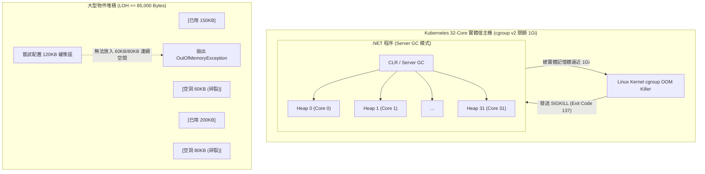

## 案發現場

某跨境電商平台在促銷檔期期間，將核心結帳與訂單匯入服務部署於 Kubernetes 叢集。Pod 的規格配置為 Requests: 500m CPU / 512Mi Memory，Limits: 2 CPU / 1Gi Memory。然而在流量湧入短短 15 分鐘內，多個 Pod 突然相繼無預警終止並重啟，Kubernetes Pod 狀態直接標記為 `OOMKilled`，終端退出碼為 `Exit Code 137`。令開發團隊困惑的是：應用程式日誌中未捕捉到任何未處理例外（Unhandled Exception），APM 監控上的「.NET 託管記憶體（Managed Heap）」甚至只顯示使用了約 380MB，遠低於 1Gi 的上限！

同一時期，另一個批次報表匯出服務發生了相反的怪象：服務運行數十小時後，記憶體用量持續爬升到 800MB，接著系統拋出 `System.OutOfMemoryException` 崩潰。排查人員調取記憶體快照（Memory Dump）後赫然發現：剩餘可用虛擬記憶體空間仍十分充裕，但服務在嘗試配置一個僅 120KB 的位元組陣列時直接宣告失敗。

經過 SRE 與核心開發小組的深入排查，確認了兩起重大架構事故的根本原因：
1. **容器環境下 Server GC 與 cgroup 認知脫節**：微服務執行在 32-core 的宿主機節點上，預設啟用的 Server GC 自動為每個 CPU 核心切割獨立的 Heap。在記憶體剛增長到容器 Limit 邊緣時，CLR 尚未觸發跨堆積的 Full GC，而 Linux 核心的 cgroup v2 監控程序便已判定該容器超出 1Gi 配額，以 SIGKILL（Kill -9）冷血抹殺了程序。
2. **大型物件堆積（LOH）虛擬位址碎裂（Fragmentation）**：報表匯出邏輯反覆配置 100KB~2MB 的臨時 `byte[]` 緩衝區。所有大於等於 85,000 位元組的物件直接繞過世代回收進入 LOH，而 LOH 預設為了效能不做壓縮搬移（Compaction）。長時間運作後，LOH 堆積內部充斥著碎形空隙，再也無法找到一塊連續的 120KB 實體位址，直接引發 OOM。



---

## 致命反模式 vs. 正確解法

### 反模式一：在高併發情境頻繁以 `new byte[]` 配置大型暫存緩衝區

在處理檔案上傳串流、Excel 產生或巨量 JSON 序列化時，開發者常習慣撰寫 `byte[] buffer = new byte[128 * 1024];`。任何大小大於等於 85,000 位元組的物件會直接分配至 LOH（大型物件堆積）。LOH 物件只會在 Gen 2（完整記憶體回收）期間被回收，頻繁產生大型短期物件會導致：
- 提早觸發代價昂貴的 Gen 2 Full GC，引發顯著的 Stop-The-World（STW）全局停頓。
- 由於 LOH 預設不做記憶體壓縮重組，陣列釋放後遺留的空隙若無法精確匹配下次配置的大小，將造成嚴重的記憶體膨脹與碎裂。

### 反模式二：未設定容器記憶體硬上限（GCHeapHardLimit），仰賴 CLR 自適應

在容器化部署時，若未針對 .NET 執行環境提供明確的記憶體約束變數，.NET 執行環境可能誤判可用記憶體（特別是在舊版 cgroup v1 或核心限制傳遞延遲的環境中），導致 Server GC 在高核心數節點上為多個堆積同時預留記憶體區段（Segments），當整體 Resident Set Size（RSS）觸及容器 Limits 時，作業系統直接發起 OOMKilled，毫無緩衝機會。

### 正確解法：引入 `ArrayPool<T>` 複用大型緩衝區，並精確配置 cgroup 硬上限

以下範例展示了如何透過 `System.Buffers.ArrayPool<T>` 消除 LOH 分配，並展示如何在類別中落實標準的 `IDisposable` 記憶體歸還機制，防止緩衝區洩漏。

```csharp
using System;
using System.Buffers;
using System.IO;

namespace DotNetPerformance.MemoryOptimization;

/// <summary>
/// 安全租借與歸還的大型緩衝處理器
/// </summary>
public sealed class HighPerformancePayloadProcessor : IDisposable
{
    private readonly ArrayPool<byte> _pool;
    private byte[]? _rentedBuffer;
    private bool _disposed;

    public HighPerformancePayloadProcessor(ArrayPool<byte>? pool = null)
    {
        // 預設採用 CLR 共享陣列集區
        _pool = pool ?? ArrayPool<byte>.Shared;
    }

    /// <summary>
    /// 處理大型二進位有效負載（零 LOH 配置）
    /// </summary>
    /// <param name="requiredSize">所需位元組長度（例如 128KB）</param>
    /// <returns>實際處理之位元組總數</returns>
    public int ProcessPayload(int requiredSize)
    {
        ObjectDisposedException.ThrowIf(_disposed, this);

        if (requiredSize <= 0)
        {
            throw new ArgumentOutOfRangeException(nameof(requiredSize), "大小必須大於 0");
        }

        // 從集區租借陣列。注意：租借出的陣列長度必定大於或等於 requiredSize
        _rentedBuffer = _pool.Rent(requiredSize);

        try
        {
            // 透過 AsSpan 裁切出業務邏輯真正需要的有效視窗，杜絕溢位讀寫
            Span<byte> activeSpan = _rentedBuffer.AsSpan(0, requiredSize);

            // 模擬高效能資料填充與處理
            activeSpan.Fill(0x5A);

            long checksum = 0;
            for (int i = 0; i < activeSpan.Length; i++)
            {
                checksum += activeSpan[i];
            }

            Console.WriteLine($"[ProcessPayload] 成功處理 {activeSpan.Length:N0} 位元組，校驗碼: {checksum}");
            return activeSpan.Length;
        }
        finally
        {
            // 在處理完畢後立即歸還集區
            ReturnBufferToPool();
        }
    }

    private void ReturnBufferToPool()
    {
        if (_rentedBuffer is not null)
        {
            byte[] bufferToReturn = _rentedBuffer;
            _rentedBuffer = null;

            // clearArray: false 可提升效能；若處理機密資訊（如密碼或私鑰），必須設為 true 清空內容
            _pool.Return(bufferToReturn, clearArray: false);
        }
    }

    public void Dispose()
    {
        if (!_disposed)
        {
            ReturnBufferToPool();
            _disposed = true;
            GC.SuppressFinalize(this);
        }
    }
}

public static class Program
{
    public static void Main()
    {
        Console.WriteLine("=== .NET GC 大型緩衝區 ArrayPool 效能驗證 ===");

        using var processor = new HighPerformancePayloadProcessor();

        // 模擬兩次超過 85KB 的大型資料流處理
        int processed1 = processor.ProcessPayload(120 * 1024); // 120 KB (進 LOH 的臨界大小)
        int processed2 = processor.ProcessPayload(256 * 1024); // 256 KB

        Console.WriteLine($"處理作業全部完成，累計處理: {processed1 + processed2:N0} 位元組。");
    }
}
```

預期控制台輸出：

```text
=== .NET GC 大型緩衝區 ArrayPool 效能驗證 ===
[ProcessPayload] 成功處理 122,880 位元組，校驗碼: 11059200
[ProcessPayload] 成功處理 262,144 位元組，校驗碼: 23592960
處理作業全部完成，累計處理: 385,024 位元組。
```

---

## 踩坑與避坑指南

### 1. 深入理解堆積世代與物件生命週期假設

.NET GC 建立在強大的**世代假設（Generational Hypothesis）**之上：
- **第 0 代（Gen 0）**：最新配置的短期物件（例如區域變數、臨時字串）。回收頻率最高，耗時通常小於 1 毫秒。
- **第 1 代（Gen 1）**：作為 Gen 0 與 Gen 2 之間的緩衝區。在 Gen 0 回收中存活下來的物件會晉升（Promotion）至 Gen 1。
- **第 2 代（Gen 2）**：長期存活物件（如靜態快取、Singleton 實例）以及大型物件堆積（LOH）。Gen 2 回收又稱 Full GC，會掃描所有世代，停頓時間最長。
- **固定物件堆積（POH, Pinned Object Heap, .NET 5+）**：專門存放被固定（Pinned）的陣列（例如 Interop/Socket 緩衝區），防止固定物件打散普通世代造成空洞。

> [!WARNING]
> **嚴禁在商務邏輯中主動呼叫 `GC.Collect()`**：
> 呼叫 `GC.Collect()` 會強行引發 Full GC，將剛誕生在 Gen 0 的暫存短命物件強制提升為 Gen 1 甚至是 Gen 2，造成「過早晉升（Premature Promotion）」。這不僅嚴重浪費 CPU，還會讓短期物件佔據長期堆積，徹底摧毀 CLR 的自我微調演算法。

### 2. Kubernetes 容器環境防禦 OOMKilled 的三大核心配置

在 Linux 容器（Docker / K8s）環境中，若容器設定了 `resources.limits.memory`，必須在應用程式層配合以下環境變數，讓 CLR 的記憶體收縮速度跑在 Linux OOM Killer 之前：

| 環境變數 | 建議值 | 作用與設計理念 |
| :--- | :--- | :--- |
| `DOTNET_GCHeapHardLimitPercent` | `75` | 將 GC 堆積硬上限限制在容器記憶體限制的 75%。預留 25% 空間給 JIT 編譯器、Thread Stack、Socket Native 緩衝區等非託管（Native）開銷，防止 Pod 遭 SIGKILL。 |
| `DOTNET_gcServer` | `1`（多核心高吞吐服務）或 `0`（微型服務） | 1 為 Server GC（預設），每個核心獨立 Heap；若容器配置記憶體極小（如小於 512Mi）但宿主機 CPU 核心極多，建議設為 `0`（Workstation GC）或限制堆積數。 |
| `DOTNET_GCHeapCount` | 例如 `2` 或 `4` | 當宿主機為 64 核心但容器 CPU Limit 僅配給 2 核心時，強制限制 Server GC 堆積數量，避免 64 個 Heap 瓜分僅有的記憶體額度導致迅速 OOM。 |

### 3. ArrayPool 租借與歸還的四大常見陷阱

1. **未歸還（Buffer Leak）**：忘記將租借的陣列歸還至 `ArrayPool<T>.Shared`，雖然不會引發即時崩潰，但物件池失去作用，內部反覆重新配置新陣列，喪失集區效益。務必使用 `try...finally` 區塊保證歸還。
2. **重複歸還（Double Return）**：同一份陣列參照被歸還了兩次。在後續多執行緒租借時，會造成兩個不同的請求共享同一個陣列，引發極其難以捉摸的記憶體資料覆蓋損毀事故。
3. **歸還後繼續使用（Use-After-Return）**：歸還後應立刻將本機變數設為 `null`，嚴禁在歸還後再次讀取或寫入該緩衝區。
4. **資訊洩漏（Security Hazard）**：租借取得的陣列內部可能包含上一個請求遺留的髒資料。在處理敏感憑據、密碼或跨租戶資料時，呼叫 `Return(buffer, clearArray: true)` 確保資料清除，或在讀取前主動清零。

---

## 線上排查指令

當線上容器出現記憶體用量居高不下、Pod 瀕臨 OOMKilled 或懷疑記憶體碎裂時，請依照下列生產診斷 SOP 進行定位：

### 1. 監控容器底層 cgroup 記憶體用量與核心限額

進入容器內確認 .NET 是否正確讀取到 cgroup v2 資源邊界：

```bash
# 檢查 cgroup v2 當前程序記憶體消耗與絕對上限（單位：Bytes）
cat /sys/fs/cgroup/memory.current
cat /sys/fs/cgroup/memory.max

# 若為 cgroup v1 舊版架構
cat /sys/fs/cgroup/memory/memory.usage_in_bytes
cat /sys/fs/cgroup/memory/memory.limit_in_bytes
```

### 2. 即時監看 CLR GC 與記憶體配置計數器

利用 `dotnet-counters` 觀察 GC 停頓比率與各世代配置速率：

```bash
# 即時監控 GC 堆積大小、配置速率、LOH 尺寸與 GC 停頓時間比
dotnet-counters monitor System.Runtime \
  --counters alloc-rate,gc-heap-size,gen-0-gc-count,gen-1-gc-count,gen-2-gc-count,time-in-gc,loh-size,poh-size \
  --process-id $(pgrep -n -f "dotnet.*YourService")
```

指標判讀準則：
- 若 `time-in-gc`（GC 所花時間百分比）持續大於 `10%`，代表系統深陷嚴重的記憶體配置壓力與頻繁 GC 停頓。
- 若 `loh-size` 隨流量急速階梯式上升，代表存在未集區化（Non-pooled）的大型物件配置反模式。

### 3. 採集記憶體轉儲並分析 LOH 碎裂與根引用路徑

當記憶體膨脹時，截取 Core Dump 並透過 `dotnet-dump` 深入分析：

```bash
# 1. 抓取完整程序 Dump
dotnet-dump collect --type Full -p $(pgrep -n -f "dotnet.*YourService") -o /tmp/app_memory.dmp

# 2. 啟動互動式分析命令列
dotnet-dump analyze /tmp/app_memory.dmp
```

在 `dotnet-dump` 互動式視窗內執行下列 SOS 診斷命令：

```text
# 檢視託管堆積整體狀態（包括各世代大小與記憶體碎裂度）
> eeheap -gc

# 統計記憶體中大於等於 85,000 位元組（LOH）的物件分佈
> dumpheap -stat -min 85000

# 針對特定類型（如 byte[]）列出所有大於 85KB 的實體記憶體位址
> dumpheap -type System.Byte[] -min 85000

# 追蹤某個大物件為何無法被 GC 回收（分析根節點 GC Root 引用鏈條）
> gcroot <物件實體十六進位位址>
```
