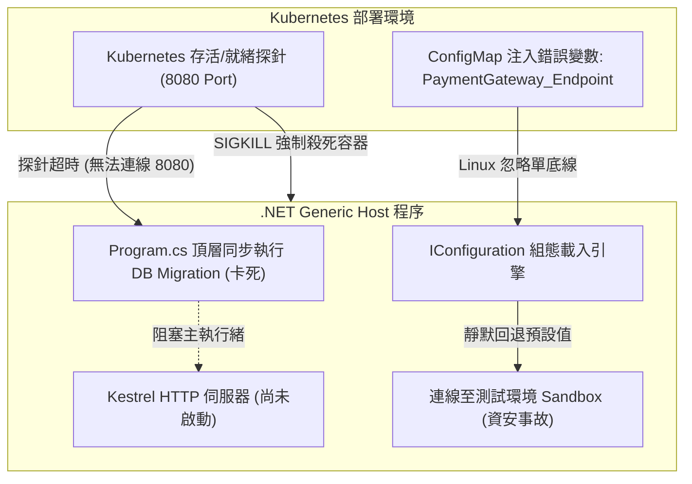

## 案發現場

某金融科技公司的支付核心微服務在週五夜間進行重大改版上線。發布完成後僅十分鐘，維運團隊與稽核系統同時拉響高危險警報：生產環境的交易日誌顯示，所有對外扣款請求全部打向了測試環境的第三方 Sandbox 金流閘道，造成數萬筆真實訂單無法扣款！

經過緊急搶修排查，發現問題出在 Kubernetes ConfigMap 注入的環境變數。在內部 `appsettings.json` 中，金流金鑰的 JSON 結構為：
```json
{
  "PaymentGateway": {
    "Endpoint": "https://sandbox.api.com",
    "ApiKey": "sandbox-secret-key"
  }
}
```
維運人員在 K8s Deployment YAML 檔中透過環境變數試圖覆蓋此設定，寫成了 `PaymentGateway_Endpoint: "https://prod.api.com"`。然而在 Linux 容器環境中，.NET 的組態提供者（Configuration Provider）僅認可「雙底線 `__`」代表層級分隔，單底線被直接當作獨立無效鍵值忽略。因此，程式在毫無報錯的情況下，靜默退回預設的 Sandbox 端點。

雪上加霜的是，在該團隊嘗試緊急推送修復版本時，服務更新後的 Pod 全數陷入 `CrashLoopBackOff` 死迴圈。原因是一名工程師在 `Program.cs` 最頂層呼叫了 `await dbContext.Database.MigrateAsync()`，且未配置連線超時防護。恰巧當時資料庫連線集區瞬時飽和，程式在 `app.Run()` 前同步卡死數十秒。Kubernetes 的 Startup Probe 與 Liveness Probe 在未收到 HTTP 200 回應的情況下判定容器不健康，直接向容器發送 SIGKILL，引發全站雪崩。



---

## 致命反模式 vs. 正確解法

### 反模式一：Linux 環境變數誤用單底線或未實施 Fail-Fast 啟動驗證

在 Windows 系統或本機除錯時，開發者習慣使用冒號 `:`（例如 `PaymentGateway:ApiKey`）來存取巢狀配置。但在 Linux shell 及 Kubernetes 環境中，冒號是無效的環境變數名稱字元。若誤用單底線（`_`），.NET 無法將其映射為巢狀結構。

此外，若未在啟動階段針對必要設定宣告 `ValidateDataAnnotations()` 與 `ValidateOnStart()`，系統會延遲到使用者實際點擊扣款時才擲出 `ArgumentNullException` 或採用預設空字串，將潛在錯誤延後至生產運行期。

### 反模式二：在 Host 建置期間同步執行長耗時網路 I/O

在 `builder.Build()` 或 `app.Run()` 之前執行耗時操作（如遠端資料庫結構遷移、Redis 預載入、大型字典下載），會導致應用程式無法監聽 HTTP 埠號。Kubernetes 容器探針在寬限期過後將判定容器死結並直接終止程序。

### 正確解法：規範雙底線映射、配置 Options 早期驗證與非同步生命週期鉤子

以下完整程式碼展示了如何安全地載入組態、利用 `AddOptionsWithValidateOnStart` 進行啟動驗證，並藉由 `IHostApplicationLifetime` 註冊應用程式啟動與優雅停機流程。

```csharp
using System;
using System.Collections.Generic;
using System.ComponentModel.DataAnnotations;
using Microsoft.Extensions.Configuration;
using Microsoft.Extensions.DependencyInjection;
using Microsoft.Extensions.Hosting;
using Microsoft.Extensions.Options;

namespace DotNetPerformance.HostingLifecycle;

/// <summary>
/// 金流閘道強型別設定類別
/// </summary>
public sealed class PaymentGatewayOptions
{
    public const string SectionName = "PaymentGateway";

    [Required(ErrorMessage = "金流端點必須提供")]
    [Url(ErrorMessage = "金流端點必須為合法 URL 格式")]
    public string Endpoint { get; set; } = string.Empty;

    [Required(ErrorMessage = "金流金鑰不得為空")]
    [MinLength(16, ErrorMessage = "金鑰長度不得少於 16 碼")]
    public string ApiKey { get; set; } = string.Empty;

    [Range(1, 60, ErrorMessage = "逾時時間必須介於 1 到 60 秒之間")]
    public int TimeoutSeconds { get; set; } = 30;
}

/// <summary>
/// 應用程式生命週期協調服務
/// </summary>
public sealed class LifecycleHostedService : IHostedService
{
    private readonly IHostApplicationLifetime _lifetime;
    private readonly PaymentGatewayOptions _options;

    public LifecycleHostedService(
        IHostApplicationLifetime lifetime,
        IOptions<PaymentGatewayOptions> options)
    {
        _lifetime = lifetime;
        _options = options.Value;
    }

    public Task StartAsync(CancellationToken cancellationToken)
    {
        // 註冊啟動完成鉤子
        _lifetime.ApplicationStarted.Register(OnStarted);
        // 註冊正在停機鉤子
        _lifetime.ApplicationStopping.Register(OnStopping);
        // 註冊完全終止鉤子
        _lifetime.ApplicationStopped.Register(OnStopped);

        Console.WriteLine($"[StartAsync] 服務初始化中... 生效端點: {_options.Endpoint}");
        return Task.CompletedTask;
    }

    public Task StopAsync(CancellationToken cancellationToken)
    {
        Console.WriteLine("[StopAsync] 收到 Host 停機請求，等待非同步工作清理完畢...");
        return Task.CompletedTask;
    }

    private void OnStarted()
    {
        Console.WriteLine("[Lifecycle] ApplicationStarted: 伺服器已就緒，K8s 探針可開始接收流量。");
    }

    private void OnStopping()
    {
        Console.WriteLine("[Lifecycle] ApplicationStopping: 收到 SIGTERM 信號，拒絕新流量並倒數優雅清空排隊佇列。");
    }

    private void OnStopped()
    {
        Console.WriteLine("[Lifecycle] ApplicationStopped: 應用程式已安全關閉。");
    }
}

public static class Program
{
    public static void Main()
    {
        Console.WriteLine("=== .NET Generic Host 生命週期與組態驗證驗證 ===");

        // 模擬基礎 appsettings.json 與 Linux 環境變數雙底線覆寫
        var inMemoryConfig = new Dictionary<string, string?>
        {
            // 基礎設定（預設為測試站台）
            ["PaymentGateway:Endpoint"] = "https://sandbox.api.com",
            ["PaymentGateway:ApiKey"] = "sandbox-default-secret-key-12345",
            ["PaymentGateway:TimeoutSeconds"] = "15",

            // 模擬 Linux / Kubernetes 注入環境變數（使用雙底線 __ 代表階層冒號）
            ["PaymentGateway__Endpoint"] = "https://prod-secure.payment.com/v1",
            ["PaymentGateway__ApiKey"] = "prod-production-verified-secret-key-99999"
        };

        IHost host = Host.CreateDefaultBuilder()
            .ConfigureAppConfiguration((context, configBuilder) =>
            {
                // 注入自定義組態來源以模擬生產覆蓋
                configBuilder.AddInMemoryCollection(inMemoryConfig);
            })
            .ConfigureServices((context, services) =>
            {
                // 註冊 Options 並啟用啟動期即時驗證（Fail-Fast）
                services.AddOptions<PaymentGatewayOptions>()
                    .Bind(context.Configuration.GetSection(PaymentGatewayOptions.SectionName))
                    .ValidateDataAnnotations()
                    .ValidateOnStart();

                // 註冊生命週期協調服務
                services.AddHostedService<LifecycleHostedService>();
            })
            .Build();

        // 啟動主機
        host.Start();

        // 模擬服務短暫運行後收到終止信號
        var lifetime = host.Services.GetRequiredService<IHostApplicationLifetime>();
        lifetime.StopApplication();

        // 等待完全停止
        host.WaitForShutdown();
    }
}
```

預期控制台輸出：

```text
=== .NET Generic Host 生命週期與組態驗證驗證 ===
[StartAsync] 服務初始化中... 生效端點: https://prod-secure.payment.com/v1
[Lifecycle] ApplicationStarted: 伺服器已就緒，K8s 探針可開始接收流量。
[StopAsync] 收到 Host 停機請求，等待非同步工作清理完畢...
[Lifecycle] ApplicationStopping: 收到 SIGTERM 信號，拒絕新流量並倒數優雅清空排隊佇列。
[Lifecycle] ApplicationStopped: 應用程式已安全關閉。
```

---

## 踩坑與避坑指南

### 1. 深入理解 .NET 組態載入順序與階層覆寫鏈

.NET 泛型主機預設依照嚴格的順序載入組態提供者（Configuration Providers），**後註冊者具有最高覆蓋優先級**：

```text
1. appsettings.json
      ▼ (覆蓋)
2. appsettings.{Environment}.json (例如 appsettings.Production.json)
      ▼ (覆蓋)
3. User Secrets (僅當 Environment 為 Development 時載入)
      ▼ (覆蓋)
4. 環境變數 (Environment Variables，支援 Linux 雙底線 __ 語法)
      ▼ (覆蓋)
5. 命令列引數 (Command-line arguments，例如 --PaymentGateway:TimeoutSeconds=30)
```

在設定陣列（Arrays）時，環境變數需以索引數字標示層級，例如：
`AllowedHosts__0=api.internal`、`AllowedHosts__1=api.public`。

### 2. Options 模式三大介面的選型矩陣

| 介面 | 生命週期 | 支援動態熱重載 (Hot Reload) | 適用場景與潛在陷阱 |
| :--- | :--- | :--- | :--- |
| `IOptions<T>` | Singleton | 否（啟動時讀取一次後固定） | 效能開銷最低，適用於整個生命週期不變的基礎設定（如連線字串）。 |
| `IOptionsSnapshot<T>` | Scoped | 是（每次 HTTP 請求重新讀取） | 適用於 Controller / Minimal API 等請求管線。**嚴禁注入 Singleton 服務**，否則拋出 Captive Dependency 例外。 |
| `IOptionsMonitor<T>` | Singleton | 是（支援 `OnChange` 監聽器與即時 `CurrentValue`） | 適用於 Singleton 服務（如 BackgroundService 或快取管理器），動態響應 Consul / ConfigMap 的熱更新。 |

### 3. K8s 優雅停機（Graceful Shutdown）的時間差陷阱

在 Kubernetes 終止 Pod 時，程序會收到 `SIGTERM` 信號，觸發 Generic Host 的停機流程：
- `HostOptions.ShutdownTimeout`：.NET 預設給予託管服務清空連線的寬限期為 **30 秒**。
- Kubernetes `terminationGracePeriodSeconds`：Pod 預設的等待上限通常也是 **30 秒**。

若微服務內部有耗時較長的資料批次落盤作業，一旦兩者時間相等，Kubernetes 往往在 .NET 剛好執行到 29 秒時便不等回應直接發出 `SIGKILL`。
**避坑黃金準則**：將 Pod 的 `terminationGracePeriodSeconds` 設為大於 `ShutdownTimeout`（例如 K8s 設為 45s，.NET 設為 30s），預留 15 秒給作業系統核心清空網路緩衝區與容器排空（Drain）。

---

## 線上排查指令

### 1. 印出完整組態視圖（Configuration Debug View）

當線上懷疑組態被錯誤覆寫或環境變數未生效時，可於診斷端點或啟動記錄中印出包含來源說明的除錯視圖：

```csharp
// 在排查端點或本機除錯時調用
var root = (IConfigurationRoot)host.Services.GetRequiredService<IConfiguration>();
string debugView = root.GetDebugView();
Console.WriteLine(debugView);
```

輸出範例會清晰標記每一個值的最終來源：
```text
PaymentGateway:
  Endpoint=https://prod-secure.payment.com/v1 (EnvironmentVariablesConfigurationProvider)
  ApiKey=prod-production-verified-secret-key-99999 (EnvironmentVariablesConfigurationProvider)
  TimeoutSeconds=15 (MemoryConfigurationProvider)
```

### 2. 檢查 Linux Pod 內部實際注入之環境變數

進入 Kubernetes 容器確認注入的環境變數鍵名是否正確採用雙底線：

```bash
# 1. 檢查特定前綴的環境變數名稱與值
kubectl exec -it <pod-name> -c <container-name> -- env | grep -E "PaymentGateway__|ConnectionStrings__"

# 2. 確認 Kubernetes Secret 或 ConfigMap 的掛載內容
kubectl describe pod <pod-name> | grep -A 10 "Environment:"
```

### 3. 查看容器被終止的真實原因（SIGTERM vs SIGKILL）

當 Pod 頻繁重啟時，檢視前一個實例的退出狀態碼：

```bash
# 檢視上一個容器的退出碼
kubectl get pod <pod-name> -o jsonpath='{.status.containerStatuses[0].lastState.terminated.exitCode}'

# 退出碼判讀：
# 0   : 正常結束 (Clean exit)
# 143 : 收到 SIGTERM 後在限期內優雅退出 (128 + 15)
# 137 : 遭到 SIGKILL 強制終止 (128 + 9)，通常為 OOMKilled 或停機寬限期逾時
```
