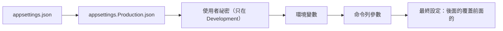

## 這是什麼

每個 ASP.NET Core 應用程式或背景 Worker，都跑在一個 **Host**（主機）裡。`WebApplication.CreateBuilder(args)` 或 `Host.CreateApplicationBuilder(args)` 建立的就是它。Host 負責：

- **設定**：從 `appsettings.json`、環境變數、命令列參數等來源組合出最終的設定。
- **相依注入**：建立 DI 容器。
- **生命週期**：啟動所有背景服務、在收到停止訊號時依序停止。

在 Kubernetes 上，這三件事分別對應到：設定從 ConfigMap 與 Secret 注入、Pod 何時可以接流量、Pod 被刪除時能不能好好收尾。

## 運作原理



**設定的覆蓋順序**：後面載入的來源，同一個鍵的值會覆蓋前面的。所以在 Kubernetes 上，用環境變數就能覆蓋映像裡 `appsettings.json` 的值，不需要重建映像。

**環境變數的階層**：設定鍵 `Payment:TimeoutSeconds` 的冒號在環境變數中寫成**雙底線**：`Payment__TimeoutSeconds`。Linux 的環境變數名稱不能有冒號。

**停止流程**：Kubernetes 送出 SIGTERM，Host 觸發 `ApplicationStopping`，依序停止所有 `IHostedService`，最多等待 `HostOptions.ShutdownTimeout`（預設 30 秒），然後結束程序。Kubernetes 那邊的寬限期（`terminationGracePeriodSeconds`，預設 30 秒）到了還沒結束，就會強制終止。

## 常見錯誤與正確寫法

### 1. 環境變數寫成單底線或冒號

```yaml
env:
  - name: Payment_TimeoutSeconds    # 錯：單底線，對應不到 Payment:TimeoutSeconds
    value: "5"
  - name: Payment__TimeoutSeconds   # 對：雙底線
    value: "5"
```

寫錯不會有任何錯誤，只是設定沒有生效，程式默默用了預設值。搭配 Options 的 `ValidateOnStart` 檢查必要設定，見 [Options](/frameworks/aspnet-core/options/)。

### 2. 啟動時同步做長時間的工作

```csharp
// 錯：在建立 Host 之前同步呼叫遠端服務，啟動被卡住；探針逾時，Pod 被重啟
var rates = httpClient.GetFromJsonAsync<Rates>("https://rates.example.com").Result;
builder.Services.AddSingleton(rates!);
```

需要在啟動時預先載入的資料，放在 `IHostedService.StartAsync` 中非同步執行，並用 readiness 探針表示「預熱完成前不要送流量」：

```csharp
public sealed class RatesWarmup(RatesCache cache, ReadinessState readiness) : IHostedService
{
    public async Task StartAsync(CancellationToken ct)
    {
        await cache.LoadAsync(ct);
        readiness.MarkReady();      // /health/ready 檢查這個狀態
    }
    public Task StopAsync(CancellationToken ct) => Task.CompletedTask;
}
```

### 3. 停止的等待時間比 Kubernetes 寬限期長

.NET 等 30 秒、Kubernetes 也只給 30 秒，再加上 `preStop` 的等待，程序還在收尾就被強制終止。時間要由內而外遞增：

```text
preStop 等待（10 秒）+ HostOptions.ShutdownTimeout（25 秒）< terminationGracePeriodSeconds（45 秒）
```

```csharp
builder.Services.Configure<HostOptions>(o => o.ShutdownTimeout = TimeSpan.FromSeconds(25));
```

## 使用邊界

- `IOptionsMonitor` 可以讀到設定檔的變更，但環境變數在 Pod 啟動後不會改變；要改設定就重新部署，見 [Options](/frameworks/aspnet-core/options/)。
- 背景服務的例外與停止行為，見 [BackgroundService](/platforms/dotnet/background-services/)。
- 機密不要放在 `appsettings.json` 或映像裡，見 [設定、Secret 與權限](/platforms/kubernetes/configuration-security/)。

## 雲端排查

### 叢集層（GKE 與 EKS 相同）

```bash
# Pod 實際拿到的環境變數（不要在共用畫面上執行，可能顯示機密）
kubectl exec <pod-name> -n shop -- printenv | grep -E "^(ASPNETCORE|DOTNET|Payment)__?"

# 上一次結束的原因與結束碼：137 代表被強制終止（沒在寬限期內結束）
kubectl get pod <pod-name> -n shop -o jsonpath='{.status.containerStatuses[0].lastState.terminated}'

# 寬限期設定
kubectl get deployment order-api -n shop -o jsonpath='{.spec.template.spec.terminationGracePeriodSeconds}'
```

### 託管服務層

#### GKE

Cloud Logging 可以查詢某個 Pod 收到停止訊號到結束之間的日誌：

```bash
gcloud logging read 'resource.type="k8s_container" AND resource.labels.container_name="order-api" AND textPayload:"Application is shutting down"' \
  --freshness=1h --limit=10
```

#### EKS

啟用 Container Insights 的日誌收集後，在 CloudWatch Logs Insights 查詢：

```text
fields @timestamp, kubernetes.pod_name, log
| filter kubernetes.container_name = "order-api" and log like /Application is shutting down/
| sort @timestamp desc
| limit 20
```

### 應用程式層

ASP.NET Core 在啟動與停止時會寫出 `Application started`、`Application is shutting down` 等日誌。比較「收到停止」與程序最後一筆日誌的時間差，就知道收尾實際花了多久，是否接近寬限期。
