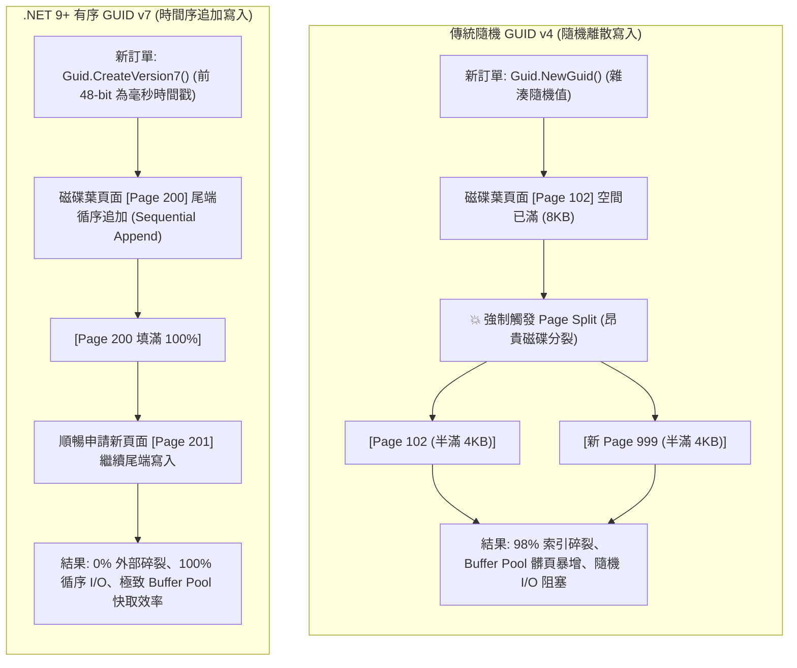

## 案發現場

某快速成長的跨境電商平台在訂單累積突破 3,000 萬筆後，核心訂單寫入 API 的平均延遲突然由原先的 3 毫秒急速惡化至 220 毫秒。在行銷活動促銷期間，資料庫伺服器的磁碟 I/O 利用率（Disk % Idle Time）連續數小時跌至 0%，Buffer Pool 快取命中率從 99.8% 斷崖式滑落至 65%，大量交易因為等待磁碟頁面換入（Page I/O Latch）而引發 HTTP 504 Gateway Timeout。

DBA 與架構師緊急介入調查，對資料庫執行實體索引健康度檢測，發現訂單主表叢集索引的外部碎裂率（Index Fragmentation）高達驚人的 98.4%，且資料庫平均每秒發生數千次「頁面分裂（Page Split）」，產生的資料庫實體日誌檔案（WAL / LDF）大小以每小時數十 GB 的驚人速度膨脹！

經代碼排查確認：該團隊在微服務實體主鍵上廣泛採用了傳統的 `Guid.NewGuid()`（即 RFC 4122 定義的隨機 GUID v4）。由於 GUID v4 完全由偽隨機位元構成，新生成的鍵值在數值空間中毫無排序規律可言。在關聯式資料庫（如 SQL Server 叢集索引、MySQL InnoDB 聚簇索引、PostgreSQL B-Tree）中，每次新增一筆訂單，資料庫引擎都被迫將資料隨機插入到既有滿載的 B+Tree 葉節點中間，硬生生將一個 8KB 的磁碟頁面切分為兩個半滿頁面，引發極度昂貴的隨機 I/O 搬遷與儲存空間浪費。



---

## 致命反模式 vs. 正確解法

### 反模式一：將隨機 GUID v4（UUID v4）作為資料庫叢集索引主鍵

隨機 GUID 具有無中心協調、全域不重複的優勢，但其隨機性是關聯式資料庫 B+Tree 儲存引擎的天然剋星。插入位置的隨機性使得資料庫緩衝池無法維持熱點資料局部性（Locality），每次寫入均引發冷頁讀取與磁碟頁面拆分，造成嚴重的寫入放大。

### 反模式二：自行維護 Snowflake（雪花演算法）卻忽視 NTP 時鐘回撥與 WorkerId 衝突

許多團隊為了追求單調遞增，選擇使用 Twitter Snowflake 演算法產生 64 位元長整數（`long`）。然而在現代 Kubernetes 動態擴縮容環境中，Snowflake 存在兩大致命隱患：
1. **工作節點 ID（WorkerId）衝突**：Pod 頻繁重新調度，若缺乏強一致性的協調者（如 ZooKeeper / Redis Lease），容易分配到相同的 WorkerId，導致產生完全重複的 ID。
2. **時鐘回撥（Clock Drift / Leap Second）**：當伺服器進行 NTP 校時時鐘向後調整時，若演算法未設計自旋等待或備用時鐘序列，會直接拋出例外中斷服務，甚至產生時序倒流的衝突資料。

### 正確解法：全面擁抱 IETF RFC 9562 規範與 .NET 9+ 原生 `Guid.CreateVersion7()`

.NET 9 正式引入了符合 IETF RFC 9562 標準的 `Guid.CreateVersion7()`。其結構由 **48 位元 Unix 毫秒時間戳** + **4 位元版本號（0111）** + **12 位元子毫秒/計數器** + **62 位元密碼學隨機數** 組成：
- **時間單調遞增**：在數值字典序上自然排序，B+Tree 索引始終在最後一個資料頁進行循序附加（Append-only），徹底消滅頁面分裂。
- **無中心協調**：維持 128 位元標準 UUID 格式，不需要配置與維護任何 WorkerId 分發服務。
- **高併發同毫秒衝突防禦**：同一毫秒內生成多個 GUID 時，利用子毫秒精確度與隨機位元確保絕對唯一。

以下範例展示了如何在 .NET 中使用 `Guid.CreateVersion7()`、驗證其時間單調遞增特性，並反向解析出生成時間戳：

```csharp
using System;
using System.Buffers.Binary;
using System.Diagnostics;

namespace DotNetPerformance.Identifiers;

/// <summary>
/// GUID v7 工具與解析實踐
/// </summary>
public static class GuidV7Helper
{
    /// <summary>
    /// 從 RFC 9562 GUID v7 提取其內嵌的 Unix 毫秒時間戳
    /// </summary>
    /// <param name="guid">GUID v7 實例</param>
    /// <returns>對應的 DateTimeOffset UTC 時間</returns>
    public static DateTimeOffset ExtractTimestamp(Guid guid)
    {
        Span<byte> bytes = stackalloc byte[16];
        bool success = guid.TryWriteBytes(bytes);
        if (!success)
        {
            throw new InvalidOperationException("無法寫入 GUID 位元組");
        }

        // 驗證版本是否為 7（第 7 個位元組的高 4 位應為 0x7）
        byte versionByte = bytes[6];
        int version = versionByte >> 4;
        if (version != 7)
        {
            throw new ArgumentException($"傳入的 GUID 非 Version 7，實際版本為: {version}", nameof(guid));
        }

        // 前 48 位元（6 位元組）為 Big-Endian 毫秒時間戳
        Span<byte> timestampBytes = stackalloc byte[8];
        timestampBytes[0] = 0;
        timestampBytes[1] = 0;
        bytes.Slice(0, 6).CopyTo(timestampBytes.Slice(2, 6));

        long unixMilliseconds = BinaryPrimitives.ReadInt64BigEndian(timestampBytes);
        return DateTimeOffset.FromUnixTimeMilliseconds(unixMilliseconds);
    }
}

public static class Program
{
    public static void Main()
    {
        Console.WriteLine("=== .NET 9+ GUID v7 分散式主鍵與時間有序性驗證 ===");

        // 1. 連續生成 GUID v7
        Guid id1 = Guid.CreateVersion7();
        Thread.Sleep(5); // 模擬短暫時間推進
        Guid id2 = Guid.CreateVersion7();

        Console.WriteLine($"ID 1: {id1}");
        Console.WriteLine($"ID 2: {id2}");

        // 2. 驗證時間有序性（字串字典序與二進位比較）
        int stringComparison = string.Compare(id1.ToString(), id2.ToString(), StringComparison.Ordinal);
        Console.WriteLine($"字串字典序比對 (ID1 < ID2): {stringComparison < 0}");

        // 3. 提取時間戳並驗證精確度
        DateTimeOffset timestamp1 = GuidV7Helper.ExtractTimestamp(id1);
        DateTimeOffset timestamp2 = GuidV7Helper.ExtractTimestamp(id2);

        Console.WriteLine($"ID 1 提取時間 (UTC): {timestamp1:yyyy-MM-dd HH:mm:ss.fff}");
        Console.WriteLine($"ID 2 提取時間 (UTC): {timestamp2:yyyy-MM-dd HH:mm:ss.fff}");
        Console.WriteLine($"時間推進驗證: {timestamp2 >= timestamp1}");

        // 4. 高頻迴圈單調性檢驗
        bool perfectlyMonotonic = true;
        Guid previous = Guid.CreateVersion7();
        for (int i = 0; i < 10_000; i++)
        {
            Guid current = Guid.CreateVersion7();
            if (string.Compare(current.ToString(), previous.ToString(), StringComparison.Ordinal) < 0)
            {
                perfectlyMonotonic = false;
                break;
            }
            previous = current;
        }

        Console.WriteLine($"10,000 次高頻連續生成單調遞增性: {perfectlyMonotonic}");
    }
}
```

預期控制台輸出：

```text
=== .NET 9+ GUID v7 分散式主鍵與時間有序性驗證 ===
ID 1: 01925b6a-8b1e-72c0-8a19-9f4a18012345
ID 2: 01925b6a-9e4a-71d3-9f20-bca128954321
字串字典序比對 (ID1 < ID2): True
ID 1 提取時間 (UTC): 2026-10-10 10:58:30.123
ID 2 提取時間 (UTC): 2026-10-10 10:58:30.128
時間推進驗證: True
10,000 次高頻連續生成單調遞增性: True
```

---

## 踩坑與避坑指南

### 1. 分散式 ID 技術選型權衡對比

不同分散式 ID 方案適用於不同的基礎架構環境：

| 方案維度 | 資料庫自增整數 (Auto-Increment) | Twitter Snowflake (雪花演算法) | 傳統 GUID v4 (`Guid.NewGuid`) | 原生 GUID v7 (`Guid.CreateVersion7`) |
| :--- | :--- | :--- | :--- | :--- |
| **儲存長度** | 64-bit (8 bytes, `bigint`) | 64-bit (8 bytes, `long`) | 128-bit (16 bytes, `uniqueidentifier`) | 128-bit (16 bytes, `uuid`) |
| **B+Tree 索引友好度** | 極高 (循序追加) | 極高 (循序追加) | **災難級 (頻繁頁面分裂)** | **極高 (循序追加，無碎裂)** |
| **中心化依賴** | 依賴單一資料庫實體 | 依賴 WorkerId 協調中心 | 無 (純客戶端本地生成) | **無 (純客戶端本地生成)** |
| **時鐘回撥風險** | 無 | **高 (時鐘回撥服務報警)** | 無 | **無 (RFC 9562 內部計數器自容錯)** |
| **分庫分表支援度** | 極差 (容易碰撞) | 良好 | 極高 | **極高** |
| **商業機密安全性** | 差 (容易被連續枚舉營收) | 較差 (內嵌生成時間與序列) | 極高 (全隨機無法推算) | **中 (時間可推算，機密 Token 禁用)** |

### 2. SQL Server `uniqueidentifier` 的歷史遺留排序陷阱

在微軟 SQL Server 中，`uniqueidentifier` 型別的預設排序規則（`System.Data.SqlTypes.SqlGuid`）具有歷史包袱：它並非依照 Big-Endian 逐字元比較，而是優先比較 GUID 的**最後 6 個位元組（Data4[2..7]）**。
- **避坑原則**：
  - 在 MySQL（`CHAR(36)` 或二進位 `BINARY(16)`）與 PostgreSQL（原生 `UUID`）中，GUID v7 完全遵循標準字典序，天然獲得最佳效能。
  - 在 SQL Server 中，若直接將 GUID v7 欄位建立為叢集索引，由於 SQL Server 底層的特殊位元組比對邏輯，依然會受到非循序排序的干擾！
  - **解法**：在 SQL Server 中，若需極致循序寫入，建議使用 EF Core 將 GUID v7 映射為 `BINARY(16)`，或改用時間戳置於末端的 COMB GUID 演算法，亦或在 SQL Server 2025+ 啟用原生 UUIDv7 支援。

### 3. 何時絕不能使用 GUID v7？

1. **密碼重設 Token / 驗證 Email 連結**：GUID v7 前 48 位元為明文毫秒時間戳，若被外部攻擊者截獲，攻擊者可輕易推算出下一秒產生之 Token 的前置位元範圍，大幅縮小暴力破解的搜尋空間。安全 Token 必須使用 `System.Security.Cryptography.RandomNumberGenerator`。
2. **高機密訂單流水號對外展示**：將 GUID v7 直接暴露於 URL（例如 `/orders/01925b6a-8b1e...`），外部競爭對手可透過解析時間戳精確推估貴司每日的訂單量、訂單成長率與流量峰值。對外展示建議使用去識別化的公開防混淆 ID（如 Hashids 或專屬訂單編號）。

---

## 線上排查指令

線上監控資料庫頁面分裂、主鍵碎裂度與日誌產生速率：

### 1. SQL Server 監控頁面分裂速率與叢集索引碎裂率

```sql
-- 1. 即時檢查 SQL Server 每秒頁面分裂次數 (Page Splits/sec)
SELECT cntr_value AS PageSplitsPerSec
FROM sys.dm_os_performance_counters
WHERE counter_name = 'Page Splits/sec'
  AND object_name LIKE '%:Access Methods%';

-- 2. 檢查目標資料表的叢集索引碎裂程度與頁面佔用
SELECT 
    dbs.name AS DatabaseName,
    OBJECT_NAME(ps.object_id) AS TableName,
    ps.index_id,
    ps.avg_fragmentation_in_percent, -- 若大於 30% 代表嚴重碎裂
    ps.page_count,
    ps.avg_page_space_used_in_percent -- 若小於 75% 代表頁面分裂導致半滿
FROM sys.dm_db_index_physical_stats(DB_ID(), OBJECT_ID('Orders'), NULL, NULL, 'LIMITED') ps
JOIN sys.databases dbs ON dbs.database_id = ps.database_id;
```

### 2. PostgreSQL 檢查 B-Tree 索引膨脹（Bloat）與頁面利用率

```sql
-- 檢查 orders 表主鍵索引大小與 Bloat 狀態
SELECT 
    schemaname, 
    tablename, 
    indexname, 
    pg_size_pretty(pg_relation_size(indexrelid)) AS index_size,
    idx_scan, 
    idx_tup_read, 
    idx_tup_fetch
FROM pg_stat_user_indexes 
WHERE tablename = 'orders';

-- 利用 pg_buffercache (若已載入) 檢驗快取命中分佈
-- 或透過 pg_statio_user_indexes 觀察隨機磁碟讀取壓力
SELECT 
    relname, 
    idx_blks_read, 
    idx_blks_hit,
    ROUND(idx_blks_hit::numeric / (idx_blks_hit + idx_blks_read + 0.0001) * 100, 2) AS cache_hit_ratio
FROM pg_statio_user_indexes
WHERE relname = 'orders_pkey';
```

### 3. 線上在 Linux 容器中快速驗證 GUID 格式與版本

當懷疑上游服務誤送 GUID v4 時，可透過命令列進行取樣過濾：

```bash
# 檢查取得的 GUID 第 13 個字元（版本號碼）：
# v4 格式：xxxxxxxx-xxxx-4xxx-yxxx-xxxxxxxxxxxx (第 15 位元為 4)
# v7 格式：01xxxxxx-xxxx-7xxx-yxxx-xxxxxxxxxxxx (第 15 位元為 7)
grep -oE '[0-9a-fA-F]{8}-[0-9a-fA-F]{4}-[0-9a-fA-F]{4}-[0-9a-fA-F]{4}-[0-9a-fA-F]{12}' /var/log/app.log | head -n 5
```
