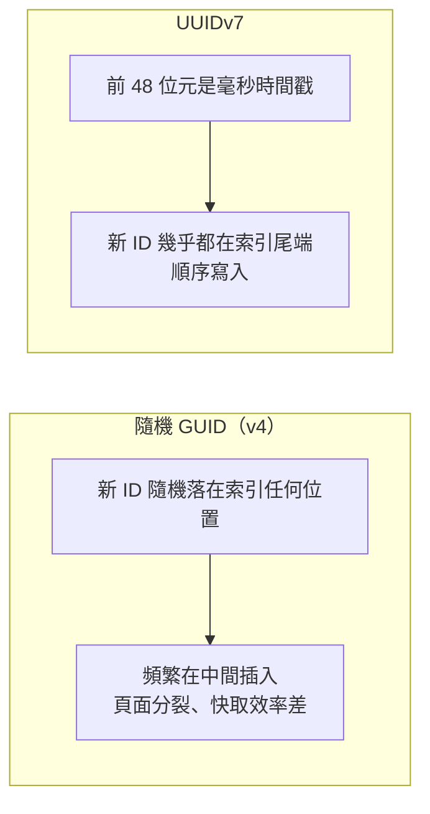

## 這是什麼

訂單需要一個唯一的 ID。最常見的兩種做法：

- **資料庫自動遞增**：插入時由資料庫產生 1、2、3……。簡單，但 ID 要等寫入後才知道，而且多個資料庫（分片）之間會重複。
- **應用程式產生**：在寫入前就由程式產生一個全域唯一的值，例如 GUID。好處是可以先產生 ID、作為冪等鍵、放進事件，再一起寫入。

應用程式產生 ID 時，ID 的「排序特性」會大幅影響資料庫的寫入效能。

## 運作原理



資料庫的主鍵通常是 B-tree 索引，資料依 ID 排序存放在一頁頁的磁碟頁中。新的 ID 如果是**隨機**的，每次插入都可能落在任何一頁的中間：那一頁滿了就要分裂成兩頁，而且需要的頁面散布在整個索引，記憶體快取的效率很差。資料量一大，寫入明顯變慢、索引也變得更大。

**UUIDv7**（RFC 9562）的前段是毫秒精度的時間戳，後段是隨機值。新產生的 ID 幾乎總是比舊的大，插入都落在索引的尾端，就像自動遞增一樣是順序寫入，同時仍保有全域唯一、不需要協調的特性。.NET 9 起提供 `Guid.CreateVersion7()`。

## 常見錯誤與正確寫法

### 1. 用 Guid.NewGuid() 當主鍵

```csharp
// 錯：v4 完全隨機，大量寫入時索引頻繁分裂
var order = new Order { Id = Guid.NewGuid(), ... };

// 對：依時間排序的 v7
var order = new Order { Id = Guid.CreateVersion7(), ... };
```

如果需要讓 ID 的時間和業務時間一致（例如使用 `TimeProvider`），可以傳入時間：`Guid.CreateVersion7(time.GetUtcNow())`。

PostgreSQL 的 `uuid` 型別以 16 位元組儲存，並依位元組順序比較，v7 的排序特性可以直接發揮。

### 2. 在 MySQL 中用錯誤的位元組順序存放

MySQL 沒有原生的 UUID 型別，常見做法是 `BINARY(16)`。但 .NET 的 `Guid.ToByteArray()` 預設使用混合位元組順序（前幾段是小端序），存進去後排序就不再依時間，v7 的優點消失。

使用 MySqlConnector 時，以連線選項 `GuidFormat` 指定存放格式，讓 `BINARY(16)` 依 RFC 的順序（大端序）存放；自己轉換時用 `guid.ToByteArray(bigEndian: true)`。不確定時，`CHAR(36)` 雖然佔空間較多，但排序一定正確。

### 3. 自己實作雪花演算法

雪花演算法（Snowflake）用「時間戳 + 機器編號 + 序號」組成 64 位元整數，很緊湊。但自己實作要處理兩個難題：每個 Pod 的機器編號不能重複（Pod 會擴縮、替換），以及伺服器時鐘被 NTP 往回調整時可能產生重複的 ID。除非真的需要 64 位元的整數 ID，否則 UUIDv7 不需要任何協調，更簡單。

## 使用邊界

- **UUIDv7 會透露建立時間。** 任何人拿到 ID 都能解出它大約何時產生。對外公開、不希望洩漏建立時間或數量的情境（例如分享連結），另外產生一個隨機的公開代碼。
- UUIDv7 是 16 位元組，比 8 位元組的整數大；索引與外鍵都會跟著變大。資料量極大的表可以權衡使用整數。
- 在同一毫秒內大量產生的 v7 之間，順序取決於隨機部分，不保證嚴格遞增；不要用 ID 的大小判斷事件的先後順序。
- 大表的索引與分頁見 [上億筆資料的查詢](/data-access/large-table-queries/)。
