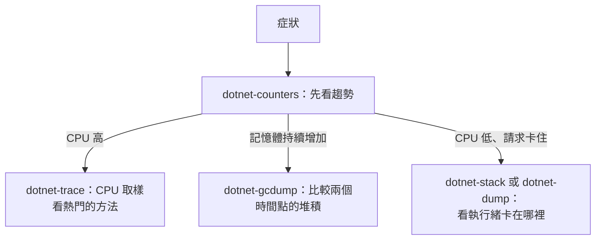

## 這是什麼

正式環境出現效能問題時，你需要知道「程式此刻在做什麼」。.NET 提供一組命令列診斷工具，透過 runtime 內建的診斷通道連到執行中的程序，不需要重新部署或修改程式：

| 工具 | 回答的問題 | 成本 |
| --- | --- | --- |
| `dotnet-counters` | 整體趨勢：CPU、GC、執行緒池、請求數 | 很低，可以持續觀察 |
| `dotnet-trace` | CPU 時間花在哪些方法 | 中等，取樣一段時間 |
| `dotnet-gcdump` | 堆積裡有哪些物件、各佔多少 | 收集時會觸發一次完整 GC，短暫暫停 |
| `dotnet-dump` | 所有執行緒在做什麼、完整記憶體內容 | 高：檔案和程序記憶體一樣大，收集時暫停程序 |

## 運作原理



這些工具透過 runtime 的**診斷通道**（在 Linux 上是 `/tmp` 下的一個 socket）和程序溝通，所以工具必須能看到目標程序與它的 `/tmp`。在 Kubernetes 上，正式的映像通常沒有診斷工具，chiseled 映像甚至沒有 shell，因此要用 `kubectl debug` 掛上一個帶有工具的**臨時容器**，與應用程式容器共用程序命名空間。

## 常見錯誤與正確寫法

### 1. 一出問題就收集完整的 dump

完整的 dump 和程序的記憶體一樣大（幾 GB），收集時程序會暫停，還可能包含敏感資料（連線字串、使用者資料）。記憶體問題先用 `dotnet-gcdump`：它只記錄堆積中物件的型別與數量，檔案小得多。只有在需要看執行緒的完整狀態（例如死結）或原生記憶體時，才收集完整 dump。

### 2. 在 Pod 裡找不到工具或連不到程序

以臨時容器的方式掛上診斷工具，`--target` 指定要共用程序命名空間的容器：

```bash
# 掛上一個帶有 .NET SDK 的臨時容器
kubectl debug -it <pod-name> -n shop --image=mcr.microsoft.com/dotnet/sdk:10.0 --target=order-api -- bash

# 在臨時容器中安裝工具並列出可診斷的程序
dotnet tool install -g dotnet-counters && export PATH="$PATH:/root/.dotnet/tools"
dotnet-counters ps
```

診斷通道的 socket 位於目標容器的 `/tmp`，臨時容器需要能存取它；依官方「在容器中使用診斷工具」文件的建議設定（例如共用 `/tmp` 的 volume，或以目標程序的根目錄路徑存取），並確認兩個容器以相同的使用者身分執行。

### 3. 只看平均，沒有比較

記憶體洩漏要比較兩個時間點：先收集一次 gcdump，等一段時間（例如處理了一萬個請求後）再收集一次，比較哪些型別的物件數量持續增加。

```bash
dotnet-gcdump collect --process-id 1 --output /tmp/before.gcdump
# ……等待一段時間
dotnet-gcdump collect --process-id 1 --output /tmp/after.gcdump
```

CPU 問題收集 30 秒左右的取樣，輸出成可以用 Speedscope 或 PerfView 開啟的格式：

```bash
dotnet-trace collect --process-id 1 --duration 00:00:30 --format Speedscope --output /tmp/cpu
```

## 使用邊界

- 診斷工具對正式環境仍有影響：gcdump 與 dump 會暫停程序，先把那個 Pod 從流量中移除（例如暫時讓 readiness 失敗或調整 label），再收集。
- dump 可能包含個資與機密，收集、傳輸與保存都要依資料保護規範處理，用完刪除。
- 持續性的監控交給指標與追蹤，診斷工具是出事時的放大鏡，見 [指標與追蹤](/engineering/metrics-tracing/)。

## 雲端排查

### 叢集層（GKE 與 EKS 相同）

```bash
# 選一個有問題的 Pod，記下它所在的節點與容器名稱
kubectl get pods -n shop -l app=order-api -o wide
kubectl get pod <pod-name> -n shop -o jsonpath='{.spec.containers[*].name}'
```

chiseled 映像沒有 `tar`，`kubectl cp` 無法從應用程式容器複製檔案；把診斷檔案寫在臨時容器能存取的位置，再從臨時容器上傳到物件儲存。

### 託管服務層

#### GKE

在臨時容器中（或使用帶有 gcloud 的映像）把檔案上傳到 Cloud Storage，再下載到自己的電腦分析。臨時容器以 Pod 的工作負載身分存取，需要對該 bucket 有寫入權限：

```bash
gcloud storage cp /tmp/after.gcdump gs://shop-diagnostics/order-api/$(date +%Y%m%d-%H%M)/
```

#### EKS

上傳到 S3，Pod 的 Pod Identity 角色需要該 bucket 的 `s3:PutObject` 權限：

```bash
aws s3 cp /tmp/after.gcdump s3://shop-diagnostics/order-api/$(date +%Y%m%d-%H%M)/
```

存放診斷檔案的 bucket 設定較短的生命週期規則，自動刪除舊檔。

### 應用程式層

```bash
# 在臨時容器中即時觀察：GC、執行緒池、例外與 ASP.NET Core 請求
dotnet-counters monitor --process-id 1 --counters System.Runtime,Microsoft.AspNetCore.Hosting
```

`dotnet.exceptions` 突然暴增，常常是某段重試或錯誤處理在大量丟出例外，這本身就會消耗大量 CPU；搭配 dotnet-trace 找出是哪裡在丟。
