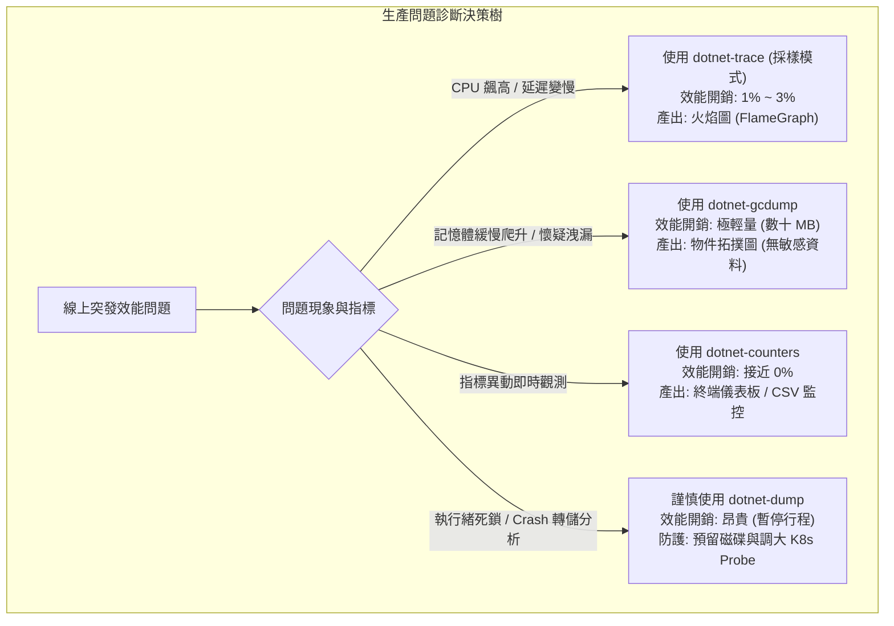

## 案發現場

某金融支付微服務在促銷晚間突發 CPU 100% 滿載，對外 API 延遲由正常的 15ms 飆升至 8,000ms 以上，大批前端交易逾時。由於生產環境受嚴格金融資安規範管控，容器內部未安裝開發環境工具、禁止掛載 Visual Studio 遠端偵錯埠，且宿主機只開放唯讀與有限的 Bastion SSH 存取。

值班工程師在緊張混亂中登入 Kubernetes 叢集節點，使用急救指令對佔用了 14GB 記憶體的服務容器執行了 `dotnet-dump collect --type Full`。然而，抓取 14GB 記憶體轉儲的過程耗時近 2 分鐘，磁碟 I/O 瞬間被寫入操作打滿，整個 .NET 程序在寫入期間處於凍結狀態（Freeze）。這段期間內，Kubernetes 的 Liveness Probe 探針因連續 3 次健康檢查未回應（HTTP 504 / Connection Refused），判定容器死鎖失效，毫不留情地發送 SIGKILL 強制殺死並重啟了該 Pod！

最終結果：不僅問題沒有排查出來，寶貴的第一案發現場記憶體狀態完全蒸發，還引發了大規模的服務震盪中斷。

事後復盤證實，該次事故是團隊對 .NET 官方**跨平台 CLI 診斷工具鏈**的工作原理與負載代價缺乏系統性理解所致。面對生產環境故障，必須根據問題特徵（CPU 暴增、記憶體洩漏、緒池飢餓、執行緒死鎖）精準挑選工具，而非盲目採取代價最昂貴的全量傾印。



---

## 致命反模式 vs. 正確解法

### 反模式一：記憶體排查盲目採集完整 Full Core Dump

在生產容器記憶體高達數 GB 至十幾 GB 時，執行全量 Dump 會將所有虛擬記憶體頁面寫入容器內部或暫存磁區。這會帶來三大致命威脅：
1. **磁碟溢滿崩潰**：多數容器的根檔案系統（Root OverlayFS）或臨時空間限制在幾 GB，寫入 Dump 會直接導致 `No space left on device`。
2. **行程長時間凍結**：CLR 必須凍結所有執行緒以維護記憶體一致性，極易觸發容器平台（K8s / ECS）的 Liveness 探針超時而遭殺死。
3. **敏感資訊外洩**：Full Dump 包含記憶體內所有使用者密碼、API 金鑰與明文字串，違反 PCI-DSS 與 GDPR 資安規範。

### 反模式二：排查 CPU 瓶頸使用全量事件追蹤（Allocation Profiler）

在 CPU 滿載時若使用追蹤工具捕捉「每一個記憶體配置事件」，會向 ETW / EventPipe 塞入每秒數百萬筆事件，進一步加劇 CPU 耗損達 30% 以上，直接引發服務雪崩。

### 正確解法：建立分級診斷矩陣，並在應用程式暴露標準 Metrics 指標

排查 CPU 應採用「取樣分析器（Sample Profiler）」，排查記憶體洩漏優先採用僅記錄型別與物件關聯的 `dotnet-gcdump`。同時，程式庫應使用 `System.Diagnostics.Metrics` 暴露自訂指標，無縫對接 CLI 工具。

```csharp
using System;
using System.Collections.Generic;
using System.Diagnostics.Metrics;
using System.Threading;

namespace DotNetPerformance.Diagnostics;

/// <summary>
/// 應用程式核心效能指標暴露器
/// </summary>
public sealed class PaymentMetricsPublisher : IDisposable
{
    private readonly Meter _meter;
    private readonly Counter<long> _transactionCounter;
    private readonly Histogram<double> _latencyHistogram;
    private readonly ObservableGauge<int> _activeWorkerGauge;
    private int _currentActiveWorkers;
    private bool _disposed;

    public PaymentMetricsPublisher()
    {
        // 建立微服務指標量測器（可透過 dotnet-counters 即時採集）
        _meter = new Meter("DotNetPerformance.PaymentCore", "1.0.0");

        // 累計交易計數器
        _transactionCounter = _meter.CreateCounter<long>(
            name: "payment_transactions_total",
            unit: "{transactions}",
            description: "累計處理交易筆數");

        // 處理延遲直方圖
        _latencyHistogram = _meter.CreateHistogram<double>(
            name: "payment_latency_ms",
            unit: "ms",
            description: "交易處理時間分佈");

        // 當前工作執行緒觀測計
        _activeWorkerGauge = _meter.CreateObservableGauge(
            name: "payment_active_workers",
            observeValue: () => _currentActiveWorkers,
            unit: "{workers}",
            description: "當前正在處理中之背景工作執行緒數");
    }

    public void RecordTransaction(double elapsedMilliseconds, bool isSuccess)
    {
        ObjectDisposedException.ThrowIf(_disposed, this);

        var statusTag = new KeyValuePair<string, object?>("status", isSuccess ? "success" : "failed");
        _transactionCounter.Add(1, statusTag);
        _latencyHistogram.Record(elapsedMilliseconds, statusTag);
    }

    public void SetActiveWorkers(int count)
    {
        Interlocked.Exchange(ref _currentActiveWorkers, count);
    }

    public void Dispose()
    {
        if (!_disposed)
        {
            _meter.Dispose();
            _disposed = true;
        }
    }
}

public static class Program
{
    public static void Main()
    {
        Console.WriteLine("=== .NET CLI 診斷整合與標準指標暴露實測 ===");

        using var publisher = new PaymentMetricsPublisher();
        publisher.SetActiveWorkers(5);

        // 模擬交易處理與指標記錄
        publisher.RecordTransaction(12.5, isSuccess: true);
        publisher.RecordTransaction(45.2, isSuccess: true);
        publisher.RecordTransaction(180.0, isSuccess: false);

        Console.WriteLine($"指標服務已成功就緒，進程 PID: {Environment.ProcessId}");
        Console.WriteLine("請在外部終端執行以下指令即可無侵入式觀察即時數據：");
        Console.WriteLine($"  dotnet-counters monitor DotNetPerformance.PaymentCore -p {Environment.ProcessId}");
    }
}
```

預期控制台輸出：

```text
=== .NET CLI 診斷整合與標準指標暴露實測 ===
指標服務已成功就緒，進程 PID: 12345
請在外部終端執行以下指令即可無侵入式觀察即時數據：
  dotnet-counters monitor DotNetPerformance.PaymentCore -p 12345
```

---

## 踩坑與避坑指南

### 1. 深入理解 CLR 診斷架構底層：Diagnostics IPC 運作機制

.NET Core 3.0 開始，CLR 在啟動時會自動在作業系統層級建立 Diagnostics IPC 管道：
- **Linux 系統**：在 `/tmp` 目錄下建立 Unix Domain Socket，格式為 `/tmp/dotnet-diagnostic-{PID}-{epoch}-socket`。
- **Windows 系統**：建立具名管道（Named Pipe），格式為 `\\.\pipe\dotnet-diagnostic-{PID}`。

#### 容器內診斷的兩大權限天坑：
1. **Linux 使用者 UID/GID 不匹配**：
   如果您的 .NET 應用程式在容器中以非 root 帳號（例如 UID `1000` / `appuser`）運行，而您透過 `kubectl exec` 以 `root` 帳號進入容器執行診斷工具，診斷工具將**無法掛載 Socket**。診斷工具必須以與 .NET 行程完全相同的 UID 運行（`su appuser` 或在指令中指定 `--user 1000`）。
2. **缺少的 Linux Capability（`SYS_PTRACE`）**：
   診斷工具若要附加（Attach）到不同 PID 的程序，Linux 容器必須具備 `CAP_SYS_PTRACE` 權限。若在精簡的生產環境中執行，需透過 Kubernetes Pod 設定檔宣告：
   ```yaml
   securityContext:
     capabilities:
       add: ["SYS_PTRACE"]
   ```

### 2. 四大診斷工具分工矩陣與取捨權衡

| 診斷工具 | 主要適用場景 | 對線上行程的效能損耗 | 產出檔案大小 | 是否包含記憶體明文 |
| :--- | :--- | :--- | :--- | :--- |
| **dotnet-counters** | 即時儀表板監控、GC 停頓比率、執行緒池排隊觀察 | 趨近於 0% | 無產出（或輕量 CSV/JSON） | 否 |
| **dotnet-trace** | CPU 100% 暴增、方法執行延遲熱點、I/O 阻塞定位 | 1% ~ 3%（取樣模式） | 數十 MB 至數百 MB | 否（僅方法簽名與呼叫棧） |
| **dotnet-gcdump** | 記憶體持續增長、LOH 碎裂、記憶體洩漏初篩 | 極低（短暫暫停標記堆積） | 5MB ~ 100MB（僅記錄型別與引用） | **否（絕無使用者明文）** |
| **dotnet-dump** | 程式死鎖（Deadlock）、Crash 崩潰前夕、原生記憶體洩漏 | **極高（凍結行程寫入磁碟）** | 等同於進程記憶體（數 GB 至十幾 GB） | **是（包含所有敏感資料）** |

---

## 線上排查指令

針對四大典型生產事故場景的標準排查 SOP：

### 場景一：CPU 飆高 100% ── 採集 CPU 取樣並產出 Speedscope 火焰圖

在不中斷業務的情況下，抓取 30 秒的 CPU 呼叫棧取樣：

```bash
# 1. 採集 30 秒 CPU 取樣數據 (使用輕量 Sample Profiler)
dotnet-trace collect \
  --process-id $(pgrep -n -f "dotnet.*YourApp") \
  --duration 00:00:30 \
  --providers Microsoft-DotNETCore-SampleProfiler \
  --output /tmp/cpu_profile.nettrace

# 2. 將 nettrace 格式轉換為開源火焰圖工具可讀取的 Speedscope 格式
dotnet-trace convert /tmp/cpu_profile.nettrace --format Speedscope

# 3. 將 cpu_profile.speedscope.json 下載至本機，打開 https://www.speedscope.app 即刻視覺化分析熱點方法
```

### 場景二：記憶體洩漏 ── 採集輕量 GCDump 比對物件增長

避免 OOMKilled 的輕量記憶體分析：

```bash
# 1. 於第 0 分鐘採集第一份快照
dotnet-gcdump collect -p $(pgrep -n -f "dotnet.*YourApp") -o /tmp/heap_baseline.gcdump

# 2. 等待 10 分鐘記憶體爬升後，採集第二份快照
dotnet-gcdump collect -p $(pgrep -n -f "dotnet.*YourApp") -o /tmp/heap_growth.gcdump

# 3. 使用 Visual Studio 或 dotnet-gcdump report 比對兩者之間數量淨增加最多的型別
dotnet-gcdump report /tmp/heap_growth.gcdump
```

### 場景三：執行緒池排隊與 GC 停頓即時觀測

快速辨識系統是否深陷 ThreadPool 飢餓或頻繁 Full GC：

```bash
# 監控 System.Runtime 核心計數器，每 1 秒更新一次
dotnet-counters monitor System.Runtime \
  --counters alloc-rate,cpu-usage,gc-heap-size,time-in-gc,threadpool-thread-count,threadpool-queue-length \
  --process-id $(pgrep -n -f "dotnet.*YourApp")
```

重點指標判定：
- `threadpool-queue-length > 50` 且持續上升：典型的 Sync-over-Async 或長工作阻塞執行緒池。
- `time-in-gc > 15%`：嚴重記憶體分配壓力，GC 正在吞噬系統吞吐量。

### 場景四：服務死鎖（Deadlock）排查 ── dotnet-dump SOS 深度除錯

當行程毫無 CPU 消耗但所有請求全部卡死，確認發生死鎖時：

```bash
# 1. 採集 Mini/Full 傾印
dotnet-dump collect -p $(pgrep -n -f "dotnet.*YourApp") -o /tmp/deadlock.dmp

# 2. 啟動互動式分析命令列
dotnet-dump analyze /tmp/deadlock.dmp
```

在互動式視窗內執行 SOS 診斷命令：

```text
# 自動偵測 CLR Monitor 鎖死狀態
> deadlocks

# 列出所有執行緒的託管呼叫堆疊
> clrstack -all

# 檢視目前所有執行緒的狀態與鎖等待情況
> threads

# 檢視未完成的非同步工作狀態機（Async State Machines）
> dumpasync
```
