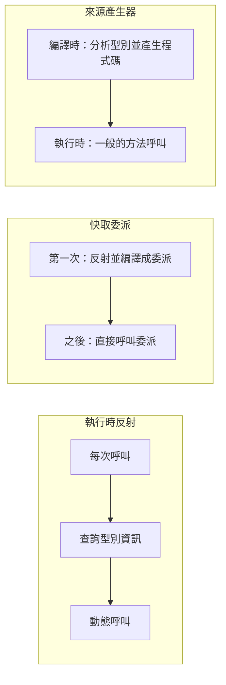

## 這是什麼

**反射**讓程式在執行時檢查型別：有哪些屬性、方法，並且動態地讀寫它們。很多框架都靠它：JSON 序列化要知道物件有哪些屬性、DI 容器要知道建構子需要哪些參數、ORM 要知道實體對應哪些欄位。

反射很方便，但每次查詢型別資訊、動態呼叫都比直接呼叫慢得多，也會產生額外的記憶體配置。啟動時做一次沒關係；在每秒上千次的請求路徑上反覆做，就會成為明顯的 CPU 成本。

**來源產生器**（Source Generator）提供另一條路：在**編譯時**就分析程式碼，產生原本要靠反射才能做的程式碼。執行時直接呼叫產生好的程式碼，沒有反射的成本，也能和 Native AOT 相容。

## 運作原理



Native AOT 與程式碼修剪（trimming）需要在發布時就知道哪些程式碼會被用到。依字串名稱動態查找的反射，編譯器無法分析，可能被修剪掉或無法支援，所以會產生修剪警告。

## 常見錯誤與正確寫法

### 1. 每個請求都用反射讀取屬性

```csharp
// 錯：每次都查詢 PropertyInfo 並動態讀取
foreach (var item in items)
{
    var value = item.GetType().GetProperty(fieldName)!.GetValue(item);
    // ...
}
```

如果真的需要動態存取，至少把查詢結果快取起來，最好編譯成強型別的委派：

```csharp
private static readonly ConcurrentDictionary<(Type, string), Func<object, object?>> Getters = new();

static Func<object, object?> GetGetter(Type type, string name) =>
    Getters.GetOrAdd((type, name), key =>
    {
        var target = Expression.Parameter(typeof(object));
        var body = Expression.Convert(
            Expression.Property(Expression.Convert(target, key.Item1), key.Item2), typeof(object));
        return Expression.Lambda<Func<object, object?>>(body, target).Compile(); // 只編譯一次
    });
```

快取的鍵數量要有上限；如果 `fieldName` 來自使用者輸入，先用允許清單驗證，避免快取無限增長。

### 2. 能用來源產生器卻還在用反射

.NET 內建好幾個來源產生器，直接換用就能消除反射：

```csharp
// JSON：編譯時產生序列化程式碼
[JsonSerializable(typeof(OrderDto))]
internal partial class ShopJsonContext : JsonSerializerContext;

// Regex：編譯時產生比對程式碼
[GeneratedRegex(@"^\d{4}-[A-Z]+-[SML]$")]
private static partial Regex SkuPattern();

// 日誌：編譯時產生不需要裝箱與解析格式字串的方法
[LoggerMessage(Level = LogLevel.Information, Message = "訂單 {OrderId} 已建立，金額 {Amount}")]
static partial void OrderPlaced(ILogger logger, Guid orderId, decimal amount);
```

Options 驗證也有對應的來源產生器（`[OptionsValidator]`），見 [Options](/frameworks/aspnet-core/options/)。

### 3. 為了讀取私有欄位而用反射

測試或特殊整合需要存取私有成員時，.NET 8 起可以用 `UnsafeAccessor`，由編譯器直接產生存取程式碼，不需要反射：

```csharp
[UnsafeAccessor(UnsafeAccessorKind.Field, Name = "_lines")]
static extern ref List<OrderLine> LinesField(Order order);
```

它繞過了封裝，只適合測試或框架層的特殊需求，不應出現在一般的業務程式碼中。

## 使用邊界

- 啟動時執行一次的反射（例如掃描組件註冊服務）通常不需要最佳化，先量測再決定。
- 要支援 Native AOT 或修剪的程式碼，必須處理所有修剪警告；需要反射的地方用 `[DynamicallyAccessedMembers]` 等屬性告訴編譯器要保留哪些成員。
- 判斷反射是否真的是瓶頸，用 CPU 取樣看它在呼叫堆疊中的比例，見 [.NET 效能診斷](/platforms/dotnet/profiling/)。
