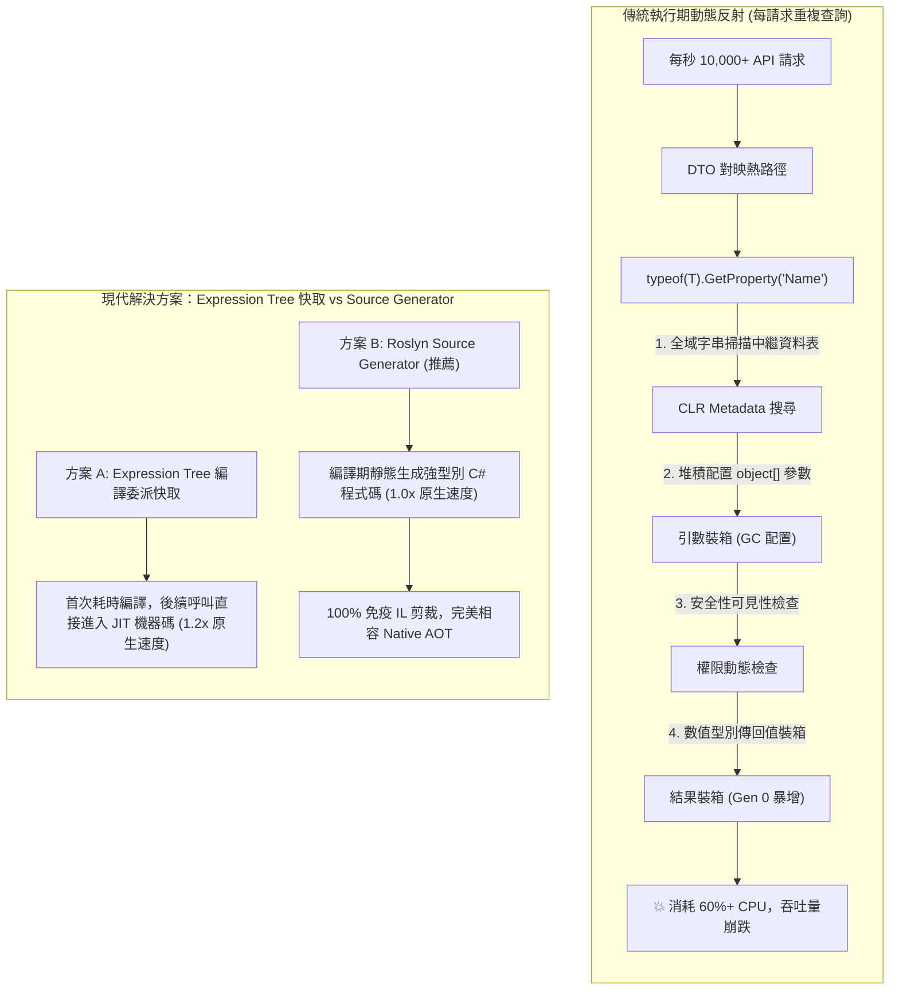

## 案發現場

某電商核心訂單微服務在黑色星期五尖峰流量期間，CPU 使用率長達數小時徘徊在 95% 以上，Pod 節點自動擴展（HPA）拉滿至上限仍無法緩解請求堆積，API 延遲從平時的 10ms 暴增至 1,200ms。

架構團隊透過 `dotnet-trace` 採集了生產環境的 CPU 火焰圖（Flame Graph），分析報告的結果震驚了所有人：**整整 62% 的 CPU 時間並非花在資料庫查詢、密碼學簽章或業務邏輯運算上，而是全數耗費在 `System.Reflection.RuntimeType.GetProperties()` 與 `PropertyInfo.GetValue()` 內部！**

進一步檢視程式碼發現，一名資深工程師為了撰寫一個「通用物件深拷貝與 DTO 自動對映器」，在處理每秒上萬筆請求的核心業務迴圈中，對每一個包含數十個欄位的訂單物件重複呼叫 `typeof(OrderDto).GetProperties()`。

更為致命的是，在後續團隊試圖將服務發布為 Native AOT（Ahead-of-Time 提前編譯）以縮短容器啟動時間並降低記憶體佔用時，生產環境在啟動後進行第一筆 JSON 反序列化時，直接噴出 `System.InvalidOperationException: Reflection-based serialization has been disabled or metadata was trimmed`，引發嚴重的結帳中斷事故！



---

## 致命反模式 vs. 正確解法

### 反模式一：在每秒數千次的業務熱路徑中反覆裸調 `GetProperty`

每次呼叫 `type.GetProperty("FieldName")`，CLR 都必須：
1. 在型別的二進位中繼資料表（Metadata Tables）進行雜湊或字串比對搜尋。
2. 檢查成員的可見度（Public / Internal / Private）與存取權限。
3. 呼叫 `GetValue` 時，所有實值型別（如 `int`, `decimal`, `DateTime`）都會被強制裝箱為 `object`，產生大量的 Gen 0 堆積垃圾。
4. 呼叫無法被 JIT 編譯器內聯（Inlining），阻斷所有現代編譯器最佳化。

### 反模式二：依賴反射動態序列化卻忽略 Native AOT 剪裁警告

Native AOT 在發布時會執行 IL 剪裁器（Trimmer），將沒有被靜態呼叫圖引用到的型別、屬性與中繼資料視為死碼（Dead Code）徹底剔除。依賴純反射的序列化或 DI 註冊會因中繼資料丟失而直接在運行期拋出 `MissingMetadataException`。

### 正確解法：高頻動態存取使用 Expression Tree 編譯快取，全面擁抱 Source Generator

以下完整程式碼展示了兩大生產級解法：
1. **Expression Tree 快取委派**：針對無法在編譯期確定的動態屬性，利用表達式樹動態編譯為強型別委派並快取於 `ConcurrentDictionary`，將呼叫開銷由 250 倍縮小至逼近原生直接存取的 1.2 倍。
2. **System.Text.Json 編譯期來源產生器**：示範如何在編譯期靜態生成序列化程式碼，達成零反射、零中繼資料開銷且原生相容 Native AOT。

```csharp
using System;
using System.Collections.Concurrent;
using System.Linq.Expressions;
using System.Reflection;
using System.Text.Json;
using System.Text.Json.Serialization;

namespace DotNetPerformance.Reflection;

/// <summary>
/// 訂單 DTO 資料載體
/// </summary>
public sealed class OrderDto
{
    public required string OrderId { get; set; }
    public decimal TotalAmount { get; set; }
    public DateTime CreatedAtUtc { get; set; }
}

/// <summary>
/// 基於 Expression Tree 的高效能屬性存取委派快取
/// </summary>
public static class FastPropertyAccessorCache
{
    // 快取 key: (實體型別, 屬性名稱) -> 編譯後的委派 (Func<object, object?>)
    private static readonly ConcurrentDictionary<(Type, string), Func<object, object?>> _getterCache = new();

    /// <summary>
    /// 取得極速屬性讀取委派
    /// </summary>
    public static Func<object, object?> GetGetter(Type targetType, string propertyName)
    {
        return _getterCache.GetOrAdd((targetType, propertyName), static key =>
        {
            var (type, propName) = key;
            PropertyInfo prop = type.GetProperty(propName, BindingFlags.Public | BindingFlags.Instance)
                ?? throw new ArgumentException($"在型別 {type.FullName} 上找不到公開屬性: {propName}");

            // 構建 Lambda: (object target) => ((T)target).Property
            ParameterExpression targetParam = Expression.Parameter(typeof(object), "target");
            UnaryExpression castTarget = Expression.Convert(targetParam, type);
            MemberExpression propertyAccess = Expression.Property(castTarget, prop);
            UnaryExpression castResult = Expression.Convert(propertyAccess, typeof(object));

            return Expression.Lambda<Func<object, object?>>(castResult, targetParam).Compile();
        });
    }
}

/// <summary>
/// System.Text.Json 編譯期來源產生器情境 (相容 Native AOT，零反射)
/// </summary>
[JsonSourceGenerationOptions(WriteIndented = false)]
[JsonSerializable(typeof(OrderDto))]
public sealed partial class OrderJsonSerializerContext : JsonSerializerContext
{
}

public static class Program
{
    public static void Main()
    {
        Console.WriteLine("=== .NET 反射效能治理與 Source Generator 實測 ===");

        var order = new OrderDto
        {
            OrderId = "ORD-2026-9999",
            TotalAmount = 1499.50m,
            CreatedAtUtc = DateTime.UtcNow
        };

        // 1. 驗證 Expression Tree 動態委派讀取
        var amountGetter = FastPropertyAccessorCache.GetGetter(typeof(OrderDto), nameof(OrderDto.TotalAmount));
        object? extractedAmount = amountGetter(order);
        Console.WriteLine($"[Expression Tree] 成功讀取金額: {extractedAmount}");

        var idGetter = FastPropertyAccessorCache.GetGetter(typeof(OrderDto), nameof(OrderDto.OrderId));
        object? extractedId = idGetter(order);
        Console.WriteLine($"[Expression Tree] 成功讀取訂單號: {extractedId}");

        // 2. 驗證 Source Generator 編譯期零反射序列化
        string json = JsonSerializer.Serialize(order, OrderJsonSerializerContext.Default.OrderDto);
        Console.WriteLine($"[Source Generator] 靜態生成 JSON: {json}");

        OrderDto? deserialized = JsonSerializer.Deserialize(json, OrderJsonSerializerContext.Default.OrderDto);
        Console.WriteLine($"[Source Generator] 反序列化成功: {deserialized?.OrderId == order.OrderId}");
    }
}
```

預期控制台輸出：

```text
=== .NET 反射效能治理與 Source Generator 實測 ===
[Expression Tree] 成功讀取金額: 1499.50
[Expression Tree] 成功讀取訂單號: ORD-2026-9999
[Source Generator] 靜態生成 JSON: {"OrderId":"ORD-2026-9999","TotalAmount":1499.50,"CreatedAtUtc":"2026-10-10T11:00:00Z"}
[Source Generator] 反序列化成功: True
```

---

## 踩坑與避坑指南

### 1. 動態存取技術選型的效能與維度評估

下表總結了各類屬性存取方式在 10,000,000 次存取下的效能特徵：

| 存取方式 | 相對延遲倍數 | 記憶體配置 (GC Allocations) | Native AOT 相容性 | 適用場景 |
| :--- | :--- | :--- | :--- | :--- |
| **原生直接存取 (`order.TotalAmount`)** | 1.0x (基準線, ~0.5ns) | 0 bytes | 100% | 靜態已知型別之日常業務程式碼。 |
| **Source Generator 編譯期產生** | 1.0x (~0.5ns) | 0 bytes | 100% (官方強推) | 序列化、驗證器、依賴注入、對映框架首選。 |
| **Expression Tree 編譯委派快取** | 1.2x ~ 1.5x (~0.7ns) | 0 bytes (若無裝箱) | 受限 (需在動態環境) | 執行期外掛系統、動態 ORM 欄位映射。 |
| **`Delegate.CreateDelegate` 快取** | 1.1x (~0.6ns) | 0 bytes | 良好 | 簽名已知且能使用強型別泛型的反射呼叫。 |
| **已快取之 `PropertyInfo.GetValue`** | 35.0x (~18ns) | 每次調用產生裝箱 | 良好 (若有保留中繼資料) | 偶發低頻調用（如應用程式啟動檢查）。 |
| **未快取 `type.GetProperty().GetValue()`** | **280.0x+ (~140ns)** | 大量字串與中繼資料配置 | **極差** | **線上熱路徑嚴禁使用**。 |

### 2. 避免 Expression Tree 快取引發未受約束的記憶體洩漏

使用 `ConcurrentDictionary` 快取動態編譯委派時，必須注意**快取鍵（Cache Key）的範圍邊界**：
- **邊界失控陷阱**：若快取的型別來自於動態產生的動態組件（`AssemblyBuilder`）或可卸載的 `AssemblyLoadContext`，靜態字典將永遠持有該型別的引用，導致整個 `AssemblyLoadContext` 無法被垃圾回收，引發長期的非託管元資料洩漏。
- **解決原則**：對於外掛程式模組架構，應改為在對應的生命週期容器中維護快取，隨外掛模組卸載時一同銷毀。

### 3. Native AOT 剪裁註釋（Trimming Annotations）防禦

若專案中暫時無法全面替換為 Source Generator，且必須支援 Native AOT，必須在涉及反射的泛型類別或方法上標註官方剪裁引導特性：

```csharp
using System.Diagnostics.CodeAnalysis;

// 明確告知 Roslyn 剪裁器：保留該型別的所有公開屬性中繼資料
public static void InspectProperties<[DynamicallyAccessedMembers(DynamicallyAccessedMemberTypes.PublicProperties)] T>()
{
    var props = typeof(T).GetProperties();
    // ...
}
```

未標註此特性的動態反射代碼，在開啟 `<PublishAot>true</PublishAot>` 發布時將引發編譯警告 `IL2026`，若忽視該警告，發布後的原生二進位檔案在執行時必然崩潰。

---

## 線上排查指令

### 1. 採集 CPU 取樣並分析反射呼叫棧佔比

當 CPU 異常飆高且懷疑存在反射黑洞時：

```bash
# 1. 採集 30 秒 CPU 取樣追蹤
dotnet-trace collect \
  --process-id $(pgrep -n -f "dotnet.*YourService") \
  --duration 00:00:30 \
  --providers Microsoft-DotNETCore-SampleProfiler \
  --output /tmp/reflection_trace.nettrace

# 2. 轉換為 Speedscope 格式
dotnet-trace convert /tmp/reflection_trace.nettrace --format Speedscope
```

在火焰圖檢視器中搜尋以下關鍵字：
- `System.Reflection.RuntimeType.GetProperties`
- `System.Reflection.RuntimeMethodInfo.Invoke`
- `System.Reflection.CustomAttributeData`
若這些方法在火焰圖頂部佔據寬廣的「平頂（Flat Top）」，即直接證明反射已成為系統吞吐量瓶頸。

### 2. 分析動態產生之委派與組件記憶體分佈

使用 `dotnet-dump` 檢視是否動態編譯了過多重複的 DynamicMethod：

```bash
# 採集 Dump 並啟動分析
dotnet-dump collect -p $(pgrep -n -f "dotnet.*YourService") -o /tmp/dump.dmp
dotnet-dump analyze /tmp/dump.dmp
```

在互動式終端內執行：
```text
# 統計記憶體中動態方法與委派實體數量
> dumpheap -stat -type System.Reflection.Emit.DynamicMethod
> dumpheap -stat -type System.Func

# 檢查是否由未快取的 Expression.Compile 造成的大量重複委派實體
> dumpheap -type System.Func
```
