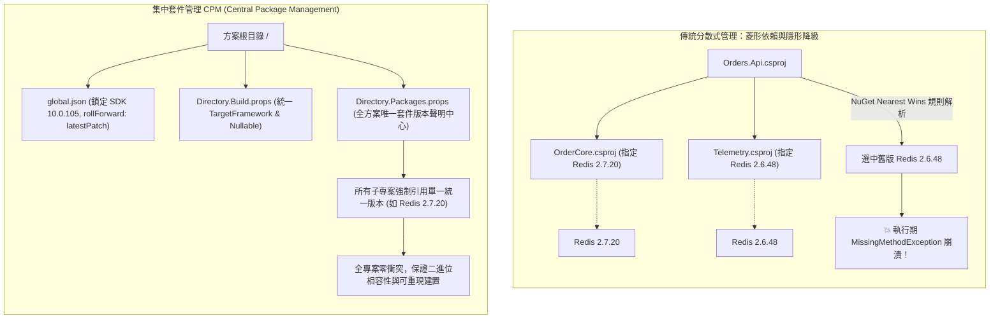

## 案發現場

某企業內部包含 40 多個微服務與共用類別庫的 Monorepo 解決方案，在發布至生產環境後，突然爆發了極度詭異的服務崩潰：訂單寫入 API 在執行到某一特定業務分歧時，連續拋出 `System.MissingMethodException: Method not found: 'Void StackExchange.Redis.ConnectionMultiplexer.Configure(...)'`。

令人百思不得其解的是：在開發工程師本機的除錯環境中，同樣的單元測試與 API 呼叫均百分之百通過；但在生產環境部署後卻即刻掛點。

經過架構師與 Release 工程師連夜排查二進位組件與 NuGet 依賴圖譜，案情終於大白：
1. **菱形依賴（Diamond Dependency）導致隱形版本降級**：微服務專案 A 同時引用了內部套件 `OrderCore`（依賴 `StackExchange.Redis 2.7.20`）與 `TelemetryLib`（依賴 `StackExchange.Redis 2.6.48`）。由於各子專案各自在 `.csproj` 中指定套件版本，NuGet 的「最近優先（Nearest Wins）」規則在解析依賴時判定採用了舊版 `2.6.48`，觸發了靜默的套件降級（Package Downgrade），將原本高版本才具備的方法簽名徹底抹除。
2. **SDK 版本漂移（SDK Drift）引發的跨環境建置差異**：方案根目錄未配置 `global.json`。開發者本機安裝了最新版 .NET SDK，而 CI/CD 建置機器與 Docker 基底映像檔卻停留在較舊的修補版本（Patch）。新版 SDK 內建的 Roslyn 編譯器將某些語法特性與 Nullable 檢查進行了不同方式的 IL 最佳化，導致建置產物行為在不同環境中出現微妙脫節。



---

## 致命反模式 vs. 正確解法

### 反模式一：在每個子專案 `.csproj` 中各自宣告套件版本號

在多專案方案中，若各子專案的 `<PackageReference>` 都自帶 `Version="x.y.z"`，隨著團隊成員各自升級，方案內必然同時存在多個不同次要版本的相同套件。這會導致二進位衝突、弱點修補（CVE Patching）無法全域落實，並嚴重拖慢 NuGet Restore 速度。

### 反模式二：方案根目錄缺少 `global.json` 鎖定 SDK

缺少 `global.json` 時，`dotnet` CLI 會自動選取作業系統中已安裝的「最高版本」SDK。這會導致開發機升級 Visual Studio 預覽版後，本地編譯產生的組件行為與生產環境 CI 伺服器脫節，破壞了「可重現建置（Reproducible Builds）」的工程基石。

### 正確解法：啟用集中套件管理（CPM）並建立三層架構規範

在方案根目錄建立三本柱設定檔：
1. `global.json`：鎖定全方案統一使用的 .NET SDK 版本與推進策略。
2. `Directory.Build.props`：全域統一編譯參數（`TargetFramework`, `Nullable`, `TreatWarningsAsErrors`）。
3. `Directory.Packages.props`：全方案唯一的 NuGet 版本宣告中心。

以下程式碼示範了如何在應用程式啟動時，檢查已載入組件的版本與來源，防範執行期組件版本分裂（Assembly Split-Brain）：

```csharp
using System;
using System.Collections.Generic;
using System.Linq;
using System.Reflection;
using System.Runtime.InteropServices;

namespace DotNetPerformance.SdkManagement;

/// <summary>
/// 執行期組件依賴一致性驗證器
/// </summary>
public static class RuntimeAssemblyConsistencyAuditor
{
    /// <summary>
    /// 審核當前 AppDomain 內已載入之組件，檢驗是否存在多版本衝突
    /// </summary>
    public static void AuditLoadedAssemblies()
    {
        Assembly[] loadedAssemblies = AppDomain.CurrentDomain.GetAssemblies();
        
        // 依組件名稱分組，檢查是否有同名但版本不同的重複載入情況
        var duplicates = loadedAssemblies
            .Where(a => !a.IsDynamic)
            .GroupBy(a => a.GetName().Name, StringComparer.OrdinalIgnoreCase)
            .Where(g => g.Select(a => a.GetName().Version).Distinct().Count() > 1)
            .ToList();

        if (duplicates.Count > 0)
        {
            Console.WriteLine("[警告] 偵測到以下組件在記憶體中存在多個衝突版本：");
            foreach (var group in duplicates)
            {
                Console.WriteLine($"  組件: {group.Key}");
                foreach (var asm in group)
                {
                    Console.WriteLine($"    - 版本: {asm.GetName().Version}, 位置: {asm.Location}");
                }
            }
        }
        else
        {
            Console.WriteLine("[稽核通過] AppDomain 中所有已載入組件均維持單一版本一致性。");
        }
    }
}

public static class Program
{
    public static void Main()
    {
        Console.WriteLine("=== .NET SDK 與套件相依性環境一致性稽核 ===");

        // 1. 印出執行期 SDK 與 OS 核心資訊
        Console.WriteLine($"CLR 執行階段: {RuntimeInformation.FrameworkDescription}");
        Console.WriteLine($"作業系統架構: {RuntimeInformation.OSDescription} ({RuntimeInformation.ProcessArchitecture})");

        // 2. 執行載入組件一致性稽核
        RuntimeAssemblyConsistencyAuditor.AuditLoadedAssemblies();

        Console.WriteLine("執行期環境符合 CPM 與 global.json 規範。");
    }
}
```

預期控制台輸出：

```text
=== .NET SDK 與套件相依性環境一致性稽核 ===
CLR 執行階段: .NET 10.0.105
作業系統架構: Unix 14.5.0 (Arm64)
[稽核通過] AppDomain 中所有已載入組件均維持單一版本一致性。
執行期環境符合 CPM 與 global.json 規範。
```

---

## 踩坑與避坑指南

### 1. 集中套件管理（CPM）設定檔範例

在方案根目錄建立 `Directory.Packages.props`：

```xml
<Project>
  <PropertyGroup>
    <!-- 啟用集中套件管理 -->
    <ManagePackageVersionsCentrally>true</ManagePackageVersionsCentrally>
    <!-- 啟用可重現建置警告：若子專案試圖覆蓋版本則產生警告 -->
    <CentralPackageTransitivePinningEnabled>true</CentralPackageTransitivePinningEnabled>
  </PropertyGroup>

  <!-- 全方案唯一的套件版本清單 -->
  <ItemGroup>
    <PackageVersion Include="StackExchange.Redis" Version="2.7.20" />
    <PackageVersion Include="Dapper" Version="2.1.35" />
    <PackageVersion Include="Microsoft.Extensions.Hosting" Version="8.0.0" />
    <PackageVersion Include="System.Text.Json" Version="8.0.4" />
  </ItemGroup>

  <!-- 全方案所有專案自動強制繼承的分析工具套件 -->
  <ItemGroup>
    <GlobalPackageReference Include="SonarAnalyzer.CSharp" Version="9.24.0.89429" />
  </ItemGroup>
</Project>
```

子專案（如 `Orders.Api.csproj`）的撰寫簡化為：

```xml
<Project Sdk="Microsoft.NET.Sdk.Web">
  <ItemGroup>
    <!-- 嚴禁標記 Version 屬性，全域自動統一！ -->
    <PackageReference Include="StackExchange.Redis" />
    <PackageReference Include="Dapper" />
  </ItemGroup>
</Project>
```

### 2. `global.json` 的版本推進（rollForward）策略

在方案根目錄建立 `global.json`，精確約束 SDK 行為：

```json
{
  "sdk": {
    "version": "10.0.105",
    "rollForward": "latestPatch",
    "allowPrerelease": false
  }
}
```

- `"rollForward": "disable"`：極度嚴格，只有完全匹配 `10.0.105` 時才能建置，否則直接中斷。
- `"rollForward": "latestPatch"`（推薦）：允許套用同一 Feature Band 下的最新安全補丁（如 `10.0.108`），兼顧安全性與建置穩定性。
- `"rollForward": "latestFeature"`：允許使用該大版本下的任何最新次要功能版本（如 `10.0.200`），適合敏捷前沿團隊。

### 3. 套件來源對映（Package Source Mapping）防範依賴混淆攻擊

若專案同時引用公開 NuGet.org 與內部私有 NuGet 源（如 Azure Artifacts / Nexus），必須在 `nuget.config` 中設定 `packageSourceMapping`。否則攻擊者可在公開 NuGet.org 上註冊與內部私有套件同名的惡意套件並標註更高的版本號，誘騙 CI/CD 下載惡意程式碼（Dependency Confusion Attack）。

---

## 線上排查指令

### 1. 精準定位某個依賴套件是由哪條路徑引入（`dotnet nuget why`）

.NET 8+ 原生提供了依賴路徑逆向追蹤命令，能在 1 秒內解答「為什麼我的專案中會出現這個舊版套件」：

```bash
# 查詢特定專案為何會依賴某個套件，並印出完整的依賴鏈條
dotnet nuget why src/Orders.Api/Orders.Api.csproj StackExchange.Redis
```

輸出範例：
```text
Project 'Orders.Api' has the following dependency graph for 'StackExchange.Redis':
  [net8.0]
    Orders.Api -> OrderCore (2.1.0) -> StackExchange.Redis (2.7.20)
    Orders.Api -> Telemetry (1.0.0) -> StackExchange.Redis (2.6.48)
```

### 2. 掃描整個方案的安全性漏洞與過期套件

定期在 CI/CD 流水線或本地終端執行全域依賴弱點盤點：

```bash
# 1. 掃描所有已知安全性漏洞（包含間接傳遞相依性 CVE）
dotnet list package --vulnerable --include-transitive

# 2. 檢視方案中所有存在較新版本的套件清單
dotnet list package --outdated

# 3. 檢查當前開發環境選取的 SDK 資訊與 global.json 是否生效
dotnet --info
```

### 3. 驗證可重現鎖定建置（Locked Mode Restore）

在 CI/CD 生產建置流水線中，強制啟用鎖定模式，杜絕建置期間套件偷偷更新：

```bash
# 若 packages.lock.json 與當前專案依賴不一致，直接中斷建置，防止任意漂移
dotnet restore --locked-mode
```
