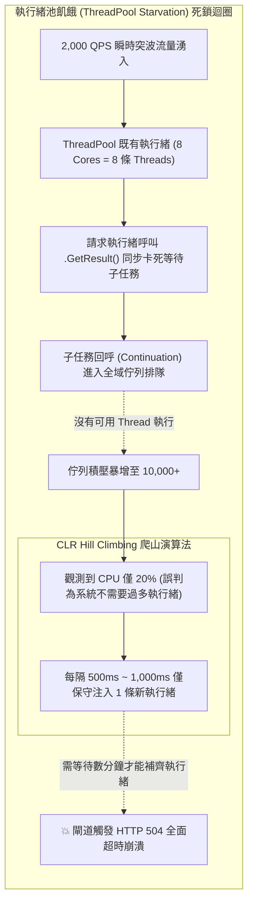

## 案發現場

某知名電商平台的限時搶購秒殺活動於晚間 20:00 準時引爆，瞬時流量由常態的 300 QPS 垂直躍升至 2,500 QPS。出乎架構團隊預料的是：Kubernetes 監控儀表板上的 Pod CPU 使用率非但沒有打滿，反而異常「閒置」在 15%~22% 之間；然而所有對外 API 延遲卻呈指數級惡化，從正常的 12ms 飆升至 10,000ms 以上，前端閘道（API Gateway）被大批 `HTTP 504 Gateway Timeout` 與連線重設錯誤淹沒。

維運工程師第一時間嘗試手動水平擴展 Pod 數量，但新啟動的 Pod 在接入流量後僅 10 秒便步入後塵——CPU 毫無負載，請求排隊數破萬，整座微服務叢集呈現「看似完全閒置卻徹底卡死」的詭異假死狀態。

排查小組利用 `dotnet-dump` 抓取行程轉儲並調閱 SOS 呼叫堆疊，發現了致命的骨牌連鎖效應：
1. **Sync-over-Async 同步阻塞執行緒**：在某一被高頻引用的權限驗證 Filter 中，工程師呼叫非同步權限檢查方法時使用了 `.GetAwaiter().GetResult()`。
2. **CLR 爬山演算法（Hill Climbing）的冷注入瓶頸**：突發湧入的 2,000 個並行請求瞬間將 ThreadPool 的初始工作執行緒佔滿。所有執行緒都在等待非同步子任務完成，而子任務排在佇列中等待可用執行緒執行。CLR 內建的爬山演算法為了防止過多的執行緒引發劇烈的 CPU 核心上下文切換（Context Switching），設計為每秒僅保守注入 1~2 條新執行緒。在等待演算法擴充出足夠執行緒的數十秒間，上游客戶端與閘道早已判定超時斷線，引發全面雪崩。



---

## 致命反模式 vs. 正確解法

### 反模式一：Sync-over-Async（在非同步 Task 上同步阻塞）

任何形式的 `.Result`、`.GetAwaiter().GetResult()` 或 `task.Wait()` 都會直接將當前託管執行緒死死釘在作業系統的等待事件上，使其無法回歸執行緒池處理佇列中的其他任務。當請求並行度大於當前執行緒池大小時，必然觸發執行緒池飢餓。

### 反模式二：將長生命週期的背景迴圈直接丟進 `Task.Run`

在微服務中啟動無限迴圈的輪詢（例如 RabbitMQ / Kafka 訊息持續拉取）若使用 `Task.Run(async () => while(true) { ... })`，會永久佔據一條原本專門用於短生命週期請求的 ThreadPool Worker 執行緒。

### 正確解法：落實非同步貫穿、調優突波 MinThreads 並隔離長任務

1. **貫穿式 async/await**：全鏈路消除同步阻塞，使執行緒在等待 I/O 時能立即釋放回執行緒池。
2. **合理預調 `SetMinThreads`**：針對可預測的秒殺或促銷活動，在服務啟動時將最小工作執行緒數提升至預期並行基準線，繞過爬山演算法每秒僅能增加 1 條執行緒的冷啟動限制。
3. **長生命週期任務指定 `LongRunning`**：通知執行緒池為該任務建立專屬的作業系統獨立執行緒，不污染共用集區。

```csharp
using System;
using System.Diagnostics;
using System.Threading;
using System.Threading.Tasks;

namespace DotNetPerformance.Threading;

/// <summary>
/// 執行緒池安全調度與預熱管理器
/// </summary>
public static class ThreadPoolTuningManager
{
    /// <summary>
    /// 為高併發秒殺場景安全預熱 ThreadPool
    /// </summary>
    /// <param name="targetMinWorkers">目標最小工作執行緒數</param>
    public static void WarmupThreadPool(int targetMinWorkers)
    {
        ThreadPool.GetMinThreads(out int defaultMinWorker, out int defaultMinIocp);
        ThreadPool.GetMaxThreads(out int maxWorker, out int maxIocp);

        Console.WriteLine($"[預設配置] MinWorker: {defaultMinWorker}, MinIOCP: {defaultMinIocp}, MaxWorker: {maxWorker}");

        // 確保調整後的數值在合法範圍內
        int safeMinWorker = Math.Clamp(targetMinWorkers, defaultMinWorker, maxWorker);

        // 設定最小執行緒數（避免秒殺瞬間觸發爬山演算法緩慢注入）
        bool success = ThreadPool.SetMinThreads(safeMinWorker, defaultMinIocp);
        if (success)
        {
            ThreadPool.GetMinThreads(out int currentWorker, out _);
            Console.WriteLine($"[調優生效] MinWorker 已成功提升至: {currentWorker}");
        }
        else
        {
            Console.WriteLine("[調優失敗] 無法更新 ThreadPool 最小執行緒數");
        }
    }

    /// <summary>
    /// 啟動長生命週期監聽任務（安全隔離於 ThreadPool 之外）
    /// </summary>
    public static Task StartDedicatedBackgroundWorker(CancellationToken cancellationToken)
    {
        // 使用 TaskCreationOptions.LongRunning 保證分配專屬 Dedicated Thread
        return Task.Factory.StartNew(() =>
        {
            Console.WriteLine($"[Dedicated Worker] 專屬背景工作啟動，Thread ID: {Environment.CurrentManagedThreadId}, 是否為集區執行緒: {Thread.CurrentThread.IsThreadPoolThread}");

            while (!cancellationToken.IsCancellationRequested)
            {
                // 模擬背景監聽佇列
                Thread.Sleep(50);
                break; // 測試示範僅執行一次後結束
            }

            Console.WriteLine("[Dedicated Worker] 背景監聽工作安全結束");
        }, cancellationToken, TaskCreationOptions.LongRunning, TaskScheduler.Default);
    }
}

public static class Program
{
    public static async Task Main()
    {
        Console.WriteLine("=== .NET ThreadPool 飢餓防範與預熱機制實測 ===");

        // 1. 執行秒殺前夕的執行緒池預熱
        ThreadPoolTuningManager.WarmupThreadPool(targetMinWorkers: 128);

        // 2. 啟動隔離的長任務
        using var cts = new CancellationTokenSource();
        Task workerTask = ThreadPoolTuningManager.StartDedicatedBackgroundWorker(cts.Token);

        // 3. 模擬高併發貫穿式非同步請求
        const int concurrentRequests = 10;
        var tasks = new Task[concurrentRequests];

        var sw = Stopwatch.StartNew();
        for (int i = 0; i < concurrentRequests; i++)
        {
            int requestId = i;
            tasks[i] = Task.Run(async () =>
            {
                // 正確做法：採用 await Task.Delay 釋放執行緒，絕不使用 Thread.Sleep
                await Task.Delay(20);
                return requestId;
            });
        }

        await Task.WhenAll(tasks);
        sw.Stop();

        await workerTask;

        Console.WriteLine($"[高併發非同步] {concurrentRequests} 筆並行請求在 {sw.ElapsedMilliseconds} ms 內順暢處理完畢。");
    }
}
```

預期控制台輸出：

```text
=== .NET ThreadPool 飢餓防範與預熱機制實測 ===
[預設配置] MinWorker: 8, MinIOCP: 8, MaxWorker: 32767
[調優生效] MinWorker 已成功提升至: 128
[Dedicated Worker] 專屬背景工作啟動，Thread ID: 15, 是否為集區執行緒: False
[Dedicated Worker] 背景監聽工作安全結束
[高併發非同步] 10 筆並行請求在 25 ms 內順暢處理完畢。
```

---

## 踩坑與避坑指南

### 1. 深入剖析 ThreadPool 內部結構與工作竊取機制

.NET ThreadPool 的架構高度針對多核心 CPU 進行了優化：
- **全域佇列（Global Queue）**：透過 `ThreadPool.QueueUserWorkItem` 或非工作執行緒派發的工作優先進入全域佇列。所有 Worker 執行緒以鎖機制競爭從中提取任務（FIFO）。
- **本機佇列（Local Work-Stealing Queue）**：當某個已在 ThreadPool 執行的任務產生子任務時（例如 `Task.Run`），子任務會被推入當前執行緒專屬的本機佇列。該執行緒以 **LIFO（後進先出）** 順序處理自己的任務，這能最大化保留 CPU L1/L2 快取資料局部性。
- **工作竊取（Work-Stealing）**：當某一執行緒的本機佇列清空且全域佇列無工作時，它會隨機從其他忙碌執行緒的本機佇列**尾端以 FIFO 方式竊取任務**，平衡全系統負載。

### 2. 爬山演算法（Hill-Climbing）的行為局限與盲點

爬山演算法的核心哲學是**透過測量系統吞吐量與 CPU 使用率，動態決定最佳執行緒數量**：
- 如果增加執行緒能提升整體吞吐量，演算法會繼續建立執行緒。
- 如果增加執行緒導致 CPU Context Switching 劇烈增加反而降低吞吐量，演算法會收縮執行緒。
- **致命盲點**：當系統陷入 Sync-over-Async 時，執行緒都在等待鎖或 I/O，CPU 使用率呈現低迷。演算法完全無法辨識「執行緒被同步卡死」的狀態，誤以為負載極輕，因而維持每秒 1~2 條執行緒的極度保守增長速率。

### 3. `SetMinThreads` 調優的黃金準則與反噬代價

`ThreadPool.SetMinThreads` 是一把雙面刃：
- **正確時機**：微服務面臨週期性瞬時突波（例如整點秒殺、定時巨量訊息消費），將 `MinWorker` 設為預期同時間並行請求數（例如 `100` ~ `300`），能在流量抵達的毫秒級瞬間直接獲得現成執行緒，無需排隊。
- **過度調優的反噬（Over-tuning）**：
  - **記憶體膨脹**：在 Linux 上，每條 .NET 執行緒預設佔用 1MB 虛擬記憶體堆疊（Thread Stack）。若將 `MinThreads` 盲目設為 5,000，光是執行緒堆疊就將預留 5GB 虛擬位址。
  - **核心切換崩潰（Context Switch Thrashing）**：當大量執行緒爭搶有限的 CPU 核心時，CPU 時間將全數浪費在核心排程與快取失效上，導致整體吞吐量斷崖式下跌。

---

## 線上排查指令

### 1. 即時監控執行緒池佇列與執行緒增長速率

使用 `dotnet-counters` 捕捉執行緒池飢餓的第一案發現場：

```bash
# 監控執行緒池總執行緒數、排隊佇列長度與已完成工作項速率
dotnet-counters monitor System.Runtime \
  --counters threadpool-thread-count,threadpool-queue-length,threadpool-completed-items-count,cpu-usage \
  --process-id $(pgrep -n -f "dotnet.*YourService")
```

指標判斷法則：
- `cpu-usage` 低（例如 < 30%），但 `threadpool-queue-length` 持續上升且高於 100：**100% 發生 ThreadPool 飢餓！**
- `threadpool-thread-count` 以每秒 1~2 的速率緩慢爬升：**證明系統正處於爬山演算法注入延遲陷阱中！**

### 2. 採集記憶體轉儲並透過 SOS 分析卡死的執行緒池

當服務無回應時，截取 Dump 並透過 `dotnet-dump` 定位阻塞根源：

```bash
# 1. 抓取 CoreDump
dotnet-dump collect -p $(pgrep -n -f "dotnet.*YourService") -o /tmp/threadpool_hang.dmp

# 2. 啟動 SOS 分析器
dotnet-dump analyze /tmp/threadpool_hang.dmp
```

在互動式視窗內執行 SOS 指令：

```text
# 檢視目前 ThreadPool 的詳細配置與佇列狀態
> threadpool

# 輸出所有執行緒的託管呼叫堆疊
> clrstack -all

# 搜尋堆疊中是否充斥著以下阻塞標誌：
# - System.Threading.Tasks.Task.GetResultCore
# - System.Threading.Monitor.Wait
# - System.Threading.ManualResetEventSlim.Wait
```
