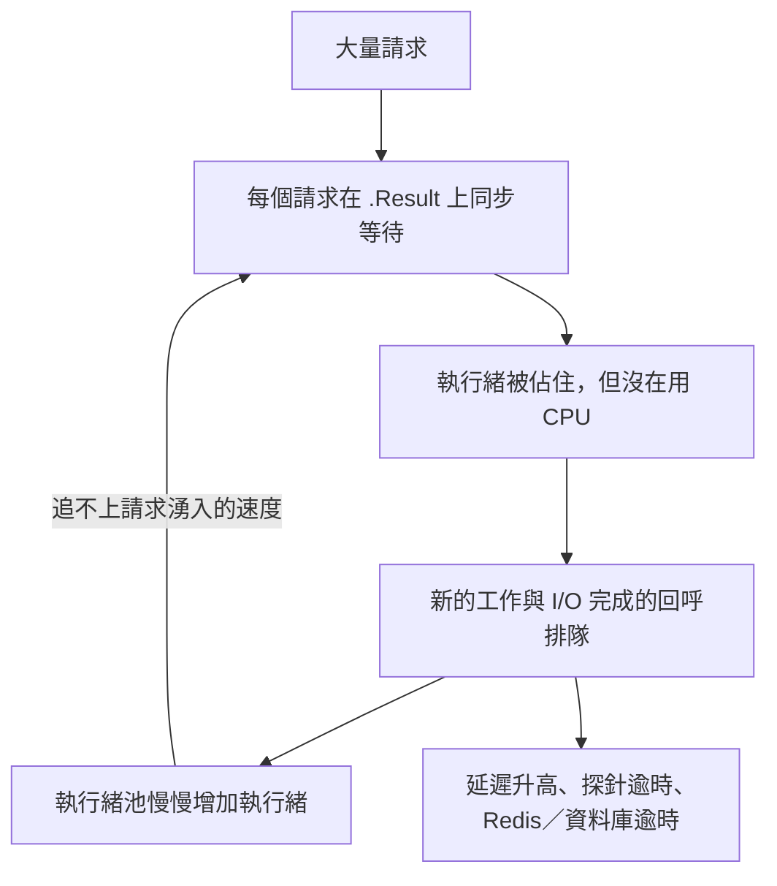

## 這是什麼

ASP.NET Core 用**執行緒池**裡的執行緒處理請求、執行 `await` 之後的程式碼、處理計時器與 I/O 完成的回呼。執行緒池會依負載自動增減執行緒數量。

**執行緒池耗盡**（starvation）指的是：執行緒池裡的執行緒都被佔住了，新的工作只能排隊等待。症狀很有特色：CPU 使用率不高，但請求延遲越來越長、探針逾時、Redis 或資料庫出現莫名的逾時錯誤。

## 運作原理



執行緒池有一個**最小執行緒數**（預設等於 CPU 核心數）。在這個數量以內，有工作就立刻建立執行緒；超過之後，執行緒池會以有節制的速度增加執行緒，避免執行緒太多造成大量的切換成本。

正常的非同步程式碼不需要很多執行緒，因為等待 I/O 時執行緒會被釋放。但如果程式碼**同步等待**非同步的結果（`.Result`、`.Wait()`、`GetAwaiter().GetResult()`），每個請求都會佔住一條執行緒什麼也不做，而它等待的那個 I/O 完成後，又需要另一條執行緒來執行後續程式碼。執行緒需求遠超過供應，工作就開始排隊。

.NET 6 起，執行緒池在偵測到這類阻塞時會更積極地增加執行緒，可以緩解，但無法消除問題。

## 常見錯誤與正確寫法

### 1. 同步等待非同步作業

這是執行緒池耗盡最主要的原因。修正方式是讓整條呼叫鏈都使用 `await`，見 [async/await](/languages/csharp/async-await/)。常見藏身處：

- 建構子或屬性 getter 裡的 `.Result`。
- 第三方函式庫只提供同步 API，內部卻在等待網路。
- `lock` 區塊裡呼叫同步版的 I/O 方法。

### 2. 用 Task.Run 執行永遠不結束的迴圈

```csharp
// 錯：這個迴圈永久佔住一條執行緒池的執行緒
_ = Task.Run(() => { while (true) { PollQueue(); Thread.Sleep(1000); } });
```

長期執行的背景工作用 `BackgroundService` 並以 `await` 等待，見 [BackgroundService](/platforms/dotnet/background-services/)。真的需要一條專屬的同步執行緒時，用 `TaskCreationOptions.LongRunning`，它會建立獨立的執行緒，不佔用執行緒池。

### 3. 把 SetMinThreads 當作解法

提高最小執行緒數，執行緒池在突發流量時能立刻提供更多執行緒，不必慢慢增加：

```csharp
// 只用於可預期的突發（例如大促開始的瞬間），而且要量測後決定數值
ThreadPool.GetMinThreads(out var worker, out var io);
ThreadPool.SetMinThreads(Math.Max(worker, 64), io);
```

它能減緩症狀，但如果根本原因是同步阻塞，執行緒越多只是讓更多執行緒一起等待，記憶體與切換成本也跟著上升。先修正阻塞，再考慮調整。

## 使用邊界

- 純 CPU 密集的工作佔滿執行緒是正常的（CPU 也會很高），解法是平行化或擴容，不是調整執行緒池。
- Redis 的 `RedisTimeoutException` 訊息中會帶出執行緒池的忙碌數與最小值，常常是執行緒池耗盡的第一個線索，見 [.NET 整合 Redis](/infrastructure/redis/dotnet-integration/)。
- 探針逾時導致 Pod 被重啟，會讓情況更糟（剩下的 Pod 負擔更多），見 [探針與安全停止](/platforms/kubernetes/probes-resources/)。

## 雲端排查

### 叢集層（GKE 與 EKS 相同）

```bash
# 探針逾時與重啟：執行緒池耗盡常見的連帶症狀
kubectl get events -n shop --field-selector reason=Unhealthy --sort-by=.lastTimestamp | tail
kubectl top pod -n shop -l app=order-api       # CPU 不高但延遲很高，是典型樣子
```

### 託管服務層

#### GKE

Cloud Monitoring 中，`kubernetes.io/container/cpu/core_usage_time` 不高，而負載平衡器的 `loadbalancing.googleapis.com/https/backend_latencies` 同時大幅上升，就符合執行緒池耗盡的特徵。

#### EKS

CloudWatch `AWS/ApplicationELB` 的 `TargetResponseTime` 上升，而 Container Insights 的 `pod_cpu_utilization` 偏低，是相同的特徵。

### 應用程式層

```bash
# 執行緒池的佇列長度與執行緒數
dotnet-counters monitor --process-id 1 --counters System.Runtime
```

`dotnet.thread_pool.queue.length` 持續大於 0、`dotnet.thread_pool.thread.count` 持續增加，就是執行緒池耗盡。接著找出執行緒卡在哪裡：

```bash
# 列出所有受控執行緒目前的呼叫堆疊
dotnet-stack report --process-id 1 > stacks.txt
```

大量執行緒的堆疊停在 `Task.Wait`、`TaskAwaiter.GetResult` 或 `Monitor.Enter`，往上幾層就是需要改成非同步的程式碼。在容器中執行這些工具的方式見 [.NET 效能診斷](/platforms/dotnet/profiling/)。
