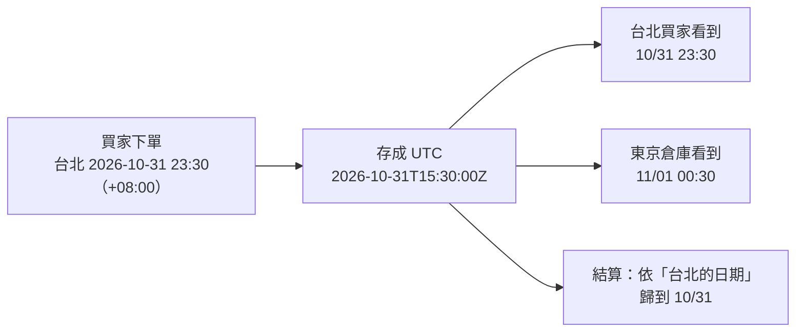

## 這是什麼

電商系統到處都是時間：訂單成立時間、優惠券到期時間、每日結算。看起來簡單，但伺服器在 UTC、買家在台北、倉庫在東京，同一個「晚上 11 點」在不同地方是不同的時間點。

.NET 有幾種時間型別，用途不同：

| 型別 | 是什麼 | 適合 |
| --- | --- | --- |
| `DateTimeOffset` | 一個時間點，帶著和 UTC 的時差 | 訂單時間、付款時間等所有「發生在某一刻」的事 |
| `DateTime` | 日期時間，時區資訊只有 `Kind`（Utc、Local、Unspecified） | 舊程式或已確定是 UTC 的值 |
| `DateOnly` | 只有日期 | 生日、結算日、促銷日期 |
| `TimeOnly` | 只有時間 | 每天的營業時間 |

## 運作原理



**時間點**（某件事發生的那一刻）在世界上只有一個，用 UTC 存放就不會有歧義。**顯示**與**依當地日期歸類**（例如每日營收算哪一天）才需要時區，而且要用明確的時區（`Asia/Taipei`），不是伺服器的時區。

時區不是固定的時差：有些地區有日光節約時間，一年中某一天只有 23 或 25 小時。所以「明天的同一時間」不一定是「加 24 小時」。

## 常見錯誤與正確寫法

### 1. 用 DateTime.Now 存資料或傳給其他系統

`DateTime.Now` 是伺服器的本地時間，而且沒有時區資訊。容器通常是 UTC，開發機可能是台北，同一份程式在不同地方存出不同的值。程式中取得目前時間一律透過 `TimeProvider`：

```csharp
public sealed class PlaceOrderHandler(TimeProvider time)
{
    public Order Handle(PlaceOrder cmd) =>
        Order.Place(cmd.BuyerId, cmd.Items, time.GetUtcNow()); // DateTimeOffset，UTC
}

builder.Services.AddSingleton(TimeProvider.System);
```

測試時改用 `FakeTimeProvider` 控制時間，見 [商業行為測試](/engineering/business-tests/)。

### 2. 依伺服器時區判斷「今天」

每日營收報表要算「台北時間 10 月 31 日」的訂單，用明確的時區把日期換成 UTC 的範圍：

```csharp
var taipei = TimeZoneInfo.FindSystemTimeZoneById("Asia/Taipei");
var day = new DateOnly(2026, 10, 31);

// 當地日期的開始與結束，轉成 UTC 時間點
var startLocal = day.ToDateTime(TimeOnly.MinValue);
var start = new DateTimeOffset(startLocal, taipei.GetUtcOffset(startLocal));
var end = start.AddDays(1);

var revenue = await db.Orders
    .Where(o => o.PlacedAt >= start && o.PlacedAt < end)
    .SumAsync(o => o.TotalAmount, ct);
```

`Asia/Taipei` 這種 IANA 時區名稱在 Linux、macOS、Windows 上都能使用（.NET 6 起支援跨平台轉換）。

### 3. 用 AddHours(24) 計算「明天同一時間」

在有日光節約時間的地區，加 24 小時可能變成隔天的 23 點或 1 點。依當地的日曆計算：先轉成當地時間、加一天、再轉回時間點。

## 使用邊界

- **精簡的容器映像可能沒有時區資料。** .NET 的 chiseled 映像不包含 tzdata，`FindSystemTimeZoneById("Asia/Taipei")` 會找不到時區；需要時區轉換的服務，改用包含時區資料與 ICU 的 `-extra` 變體映像，或在映像中加入 tzdata。
- 資料庫欄位的對應：PostgreSQL 用 `timestamptz` 存時間點，用 `date` 存 `DateOnly`；Npgsql 寫入 `timestamptz` 時要求 UTC，見 [EF Core 型別對應](/data-access/type-mapping/)。
- API 的時間格式用 ISO 8601 並帶時差（例如 `2026-10-31T15:30:00Z`），不要傳沒有時區的字串。
- 以時間排序的 ID 見 [分散式識別碼](/platforms/dotnet/identifiers/)。
