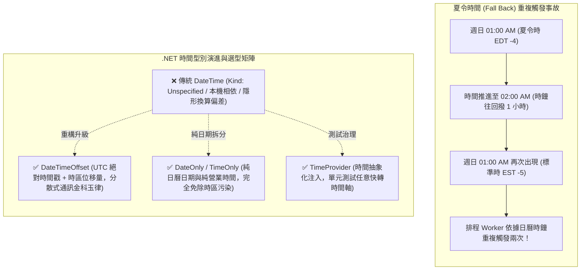

## 案發現場

某跨境跨國電商平台在月初執行全球營收結算時，財務對帳系統赫然出現高達新台幣 320 萬元的跨日帳目偏差。多個不同地區的門市報表顯示：大量在當地時間 10 月 1 日晚間發生的營業額，竟然被算入了 9 月 30 日的舊月份帳冊，導致稅務報表申報嚴重失真。

與此同時，該平台位於歐美市場的顧客滿意度也全面雪崩：在 11 月的第一個週日——即歐美切換夏令時間（Daylight Saving Time, DST）當天，負責在每日清晨 08:00 定時發放全館高額折扣券的背景排程工作，在短短 2 小時內被重複觸發了兩次，造成數萬名會員領取了雙倍折扣券，造成上百萬元的額外行銷虧損。

SRE 與核心架構團隊調取生產程式碼與資料庫紀錄進行聯合會診，揪出了兩大致命禍根：
1. **`DateTimeKind.Unspecified` 導致時區資訊靜默蒸發**：系統廣泛使用 `DateTime.Now` 記錄訂單建立時間。當資料存入關聯式資料庫（如 SQL Server `datetime2` 或 PostgreSQL `timestamp without time zone`）時，資料庫並不儲存時區位移量；微服務在查詢取出該欄位時，CLR 自動將 `Kind` 標記為 `Unspecified`。隨後在 API 序列化成 JSON 時，字串變成了不含時區的 `2026-10-01T20:00:00`，由不同國家的微服務解析時，各節點各自依照自身容器的本機時區進行解釋，產生了整整 8 小時的計算時間差！
2. **以硬編碼 24 小時（`TimeSpan.FromHours(24)`）推算跨日排程**：在夏令時間「秋季回撥（Fall Back）」當天，當地的凌晨 01:00 至 02:00 在時間軸上出現了整整兩次，當天實質上有 25 個小時！以固定的 24 小時累加時間戳，導致排程在同一個日曆天內被觸發了兩次。



---

## 致命反模式 vs. 正確解法

### 反模式一：使用 `DateTime.Now` 存入資料庫或進行跨系統通訊

`DateTime.Now` 嚴重依賴主機實體作業系統的本地時區設定。一旦微服務被打包成 Linux 容器部署於 Kubernetes（預設為 UTC 0 時區），原本預期的本地時間會莫名產生偏差。更糟的是，若未注意 `DateTimeKind`，在進行不同時區的比較或資料庫讀寫時，系統會假定兩者為同一個時區，造成跨日錯誤。

### 反模式二：使用 `TimeSpan.FromDays(1)` 或 `AddHours(24)` 計算行事曆跨日

在有夏令時間調整的地區（如北美、歐洲、澳洲），日曆天在夏令時間開始當天只有 23 小時（Spring Forward），結束當天則有 25 小時（Fall Back）。直接以固定秒數或小時累加，會導致日曆時間逐漸漂移或在切換當日重複執行。

### 正確解法：全面擁抱 `DateTimeOffset`、`DateOnly` 與 `TimeProvider`

1. **絕對時間點**：對外傳輸與資料庫儲存一律使用 `DateTimeOffset`，並強制轉換為 UTC 零時區（`ToUniversalTime()`）。
2. **純日曆日期**：生日、帳務結算日、國定假日等純業務日期，使用 .NET 6+ 引進的 `DateOnly`，徹底杜絕時區帶來的跨日干擾。
3. **時間依賴抽象化**：利用 .NET 8+ 原生的 `System.TimeProvider` 取代靜態的 `DateTime.UtcNow`，使時間相關邏輯具備 100% 的可測試性。

```csharp
using System;
using System.Globalization;

namespace DotNetPerformance.TimeArchitecture;

/// <summary>
/// 跨境多時區帳務結算服務
/// </summary>
public sealed class CrossBorderSettlementService
{
    private readonly TimeProvider _timeProvider;

    public CrossBorderSettlementService(TimeProvider? timeProvider = null)
    {
        _timeProvider = timeProvider ?? TimeProvider.System;
    }

    /// <summary>
    /// 計算指定商戶時區當前的營業結算日與對應的 UTC 查詢區間
    /// </summary>
    /// <param name="timeZoneId">IANA 時區標識 (例如 Asia/Taipei 或 America/New_York)</param>
    /// <returns>業務結算日與精確的 UTC 查詢範圍</returns>
    public (DateOnly BusinessDate, DateTimeOffset StartUtc, DateTimeOffset EndUtc) GetSettlementWindow(string timeZoneId)
    {
        // 取得跨平台相容的時區實體 (支援 IANA 與 Windows ID)
        if (!TimeZoneInfo.TryFindSystemTimeZoneById(timeZoneId, out TimeZoneInfo? timeZone))
        {
            throw new TimeZoneNotFoundException($"找不到指定的時區標識: {timeZoneId}");
        }

        // 1. 取得當前全域絕對 UTC 時間
        DateTimeOffset currentUtc = _timeProvider.GetUtcNow();

        // 2. 精確轉譯至商戶當地時間
        DateTimeOffset localTime = TimeZoneInfo.ConvertTime(currentUtc, timeZone);

        // 3. 提取純日曆日期 (DateOnly)，徹底免除時間戳換算誤差
        DateOnly businessDate = DateOnly.FromDateTime(localTime.DateTime);

        // 4. 計算當地當天 00:00:00 至 23:59:59.999 對應的真實 UTC 區間 (能安全處理夏令 23/25 小時)
        DateTime localStartOfDay = businessDate.ToDateTime(TimeOnly.MinValue);
        DateTime localEndOfDay = businessDate.ToDateTime(TimeOnly.MaxValue);

        TimeSpan startOffset = timeZone.GetUtcOffset(localStartOfDay);
        TimeSpan endOffset = timeZone.GetUtcOffset(localEndOfDay);

        DateTimeOffset startUtc = new DateTimeOffset(localStartOfDay, startOffset).ToUniversalTime();
        DateTimeOffset endUtc = new DateTimeOffset(localEndOfDay, endOffset).ToUniversalTime();

        return (businessDate, startUtc, endUtc);
    }
}

public static class Program
{
    public static void Main()
    {
        Console.WriteLine("=== .NET 跨時區結算與 TimeProvider 實測 ===");

        var settlementService = new CrossBorderSettlementService(TimeProvider.System);

        // 測試一：台灣時區結算 (UTC+8，無夏令時間)
        string twZone = OperatingSystem.IsWindows() ? "Taipei Standard Time" : "Asia/Taipei";
        var twWindow = settlementService.GetSettlementWindow(twZone);
        Console.WriteLine($"[台灣門市] 結算日: {twWindow.BusinessDate:yyyy-MM-dd}");
        Console.WriteLine($"  UTC 查詢起點: {twWindow.StartUtc:yyyy-MM-dd HH:mm:ss 'UTC'}");
        Console.WriteLine($"  UTC 查詢迄點: {twWindow.EndUtc:yyyy-MM-dd HH:mm:ss 'UTC'}");

        // 測試二：紐約時區結算 (受夏令時間影響)
        string nyZone = OperatingSystem.IsWindows() ? "Eastern Standard Time" : "America/New_York";
        var nyWindow = settlementService.GetSettlementWindow(nyZone);
        Console.WriteLine($"[紐約門市] 結算日: {nyWindow.BusinessDate:yyyy-MM-dd}");
        Console.WriteLine($"  UTC 查詢起點: {nyWindow.StartUtc:yyyy-MM-dd HH:mm:ss 'UTC'}");
        Console.WriteLine($"  UTC 查詢迄點: {nyWindow.EndUtc:yyyy-MM-dd HH:mm:ss 'UTC'}");
    }
}
```

預期控制台輸出：

```text
=== .NET 跨時區結算與 TimeProvider 實測 ===
[台灣門市] 結算日: 2026-10-10
  UTC 查詢起點: 2026-10-09 16:00:00 UTC
  UTC 查詢迄點: 2026-10-10 15:59:59 UTC
[紐約門市] 結算日: 2026-10-10
  UTC 查詢起點: 2026-10-10 04:00:00 UTC
  UTC 查詢迄點: 2026-10-11 03:59:59 UTC
```

---

## 踩坑與避坑指南

### 1. 跨平台 IANA vs Windows 時區識別碼對應

在跨平台部署時（例如 Windows 開發機與 Linux 生產容器），時區 ID 存在標準分歧：
- **Windows 時區格式**：`Taipei Standard Time`、`Eastern Standard Time`、`W. Europe Standard Time`。
- **Linux / IANA 標準格式**：`Asia/Taipei`、`America/New_York`、`Europe/Berlin`。
- **避坑原則**：
  在 .NET 6+ 中，`TimeZoneInfo.FindSystemTimeZoneById` 與 `TimeZoneInfo.TryFindSystemTimeZoneById` 已原生支援自動跨平台映射！即使在 Linux 上傳入 Windows 時區 ID，或在 Windows 上傳入 IANA ID，CLR 都會嘗試透過 ICU 函式庫自動對齊。然而為了最佳效能與標準化，強烈建議在資料庫與組態中統一儲存 **IANA 標準時區標識**。

### 2. 資料庫欄位型別對映黃金矩陣

| 業務資料意圖 | C# 型別 | SQL Server 推薦型別 | PostgreSQL 推薦型別 | 避坑重點 |
| :--- | :--- | :--- | :--- | :--- |
| **全域事件時間戳**（如建立時間、付款時間） | `DateTimeOffset` | `datetimeoffset(7)` | `timestamptz` (timestamp with time zone) | 存入前一律呼叫 `.ToUniversalTime()` 確保儲存零時區，杜絕位移量歧異。 |
| **日曆日期**（如出生日期、帳單日） | `DateOnly` | `date` | `date` | 嚴禁使用帶時間的 DateTime，防止時區轉換導致跨日前移或後移一天。 |
| **營業時間點**（如營業開始 09:00） | `TimeOnly` | `time(7)` | `time` | 不含日期與時區，單純表示一日內的相對時間。 |
| **耗時長度**（如 API 執行時間） | `TimeSpan` | `time(7)` 或 `bigint` (毫秒/微秒) | `interval` 或 `bigint` | 高頻指標儲存優先選用整數毫秒。 |

### 3. 單元測試中的時間快轉：FakeTimeProvider 實戰

在沒有 `TimeProvider` 之前，測試「訂單逾時 30 分鐘自動取消」往往需要透過 `Thread.Sleep` 或複雜的 mock 物件。
透過官方 NuGet 套件 `Microsoft.Extensions.TimeProvider.Testing` 提供的 `FakeTimeProvider`，可以在單元測試中任意快轉時間：

```csharp
// 單元測試示範
var fakeTime = new FakeTimeProvider();
fakeTime.SetUtcNow(new DateTimeOffset(2026, 10, 10, 10, 0, 0, TimeSpan.Zero));

var service = new OrderTimeoutService(fakeTime);
service.CreateOrder("ORD-001");

// 瞬間快轉 31 分鐘，觸發內部 Timer，毫秒級完成測試且絕無 flaky test
fakeTime.Advance(TimeSpan.FromMinutes(31));
Assert.True(service.IsOrderExpired("ORD-001"));
```

---

## 線上排查指令

### 1. 檢查 Linux 容器主機時間、時區與 NTP 校時狀態

確認容器是否被正確設定時區與時鐘同步：

```bash
# 1. 檢視 Linux 容器的本機時區設定
cat /etc/timezone || ls -l /etc/localtime

# 2. 檢視詳細的系統時間、UTC 時間與時區偏離 (需容器具備 systemd/timedatectl)
timedatectl status

# 3. 在精簡 Alpine / Debian 容器中快速印出 UTC 與本地時間
date -u +"%Y-%m-%d %H:%M:%S UTC"
date +"%Y-%m-%d %H:%M:%S %Z"
```

### 2. 資料庫時間戳與時區偏差線上查詢

在 SQL 命令列中確認資料庫實例當前系統時間與時區位移：

```sql
-- SQL Server：同時檢視 UTC 時間、帶時區的本地時間與時區偏移
SELECT 
    SYSUTCDATETIME() AS UtcTime,
    SYSDATETIMEOFFSET() AS LocalDateTimeWithOffset;

-- PostgreSQL：檢視資料庫目前時區與帶時區的時間戳
SHOW timezone;
SELECT 
    CURRENT_TIMESTAMP AS CurrentWithZone,
    timezone('UTC', CURRENT_TIMESTAMP) AS UtcTime;
```

### 3. 線上排查 API 日誌中 DateTime 缺失時區格式

透過 grep 快速檢測生產日誌中是否存在丟失時區資訊的裸日期：

```bash
# 抓取缺少 'Z' 或 '+08:00' 時區後綴的危險 ISO 時間字串
grep -E '"createdAt":\s*"[0-9]{4}-[0-9]{2}-[0-9]{2}T[0-9]{2}:[0-9]{2}:[0-9]{2}"' /var/log/app.log | head -n 10
```
