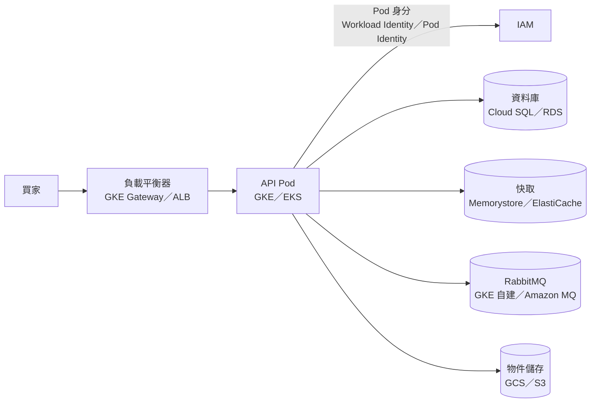

## 這是什麼

本站的電商後端可以部署在 Google Cloud 的 GKE，也可以部署在 AWS 的 EKS。兩朵雲提供的能力大致相同，但名字不一樣，有些名字很像的服務其實負責不同的事。

這篇是一張「翻譯表」：當你在 GKE 文章讀到 Cloud SQL、Memorystore 或 Workload Identity，可以在這裡查到 AWS 上對應的是什麼，再到 EKS 主題讀細節。反過來也一樣。

## 運作原理

不管在哪朵雲，買家的一筆請求都會經過同樣幾層：先進負載平衡器，再到 Kubernetes 裡的 API Pod，API 需要雲端權限時用 Pod 專屬的身分，最後連到託管的資料庫、快取和訊息佇列。差別只在每一層由哪個服務負責。

下表依「一筆請求會碰到的順序」排列：

| 用途 | GCP | AWS |
| --- | --- | --- |
| 帳務與資源的隔離單位 | Project | Account |
| 受管 Kubernetes | GKE | EKS |
| 不用自己管節點的模式 | GKE Autopilot | EKS Auto Mode |
| 自己選節點規格的模式 | GKE Standard（node pool） | EKS 受管節點群組（managed node group） |
| 容器映像倉庫 | Artifact Registry | ECR |
| 對外負載平衡 | Cloud Load Balancing，經 GKE Gateway 設定 | ALB／NLB，經 AWS Load Balancer Controller 設定 |
| TLS 憑證 | Certificate Manager／Google 代管憑證 | ACM |
| DNS | Cloud DNS | Route 53 |
| Pod 取得雲端權限 | Workload Identity Federation for GKE | EKS Pod Identity（較早的做法是 IRSA） |
| 機密管理 | Secret Manager | Secrets Manager |
| 關聯式資料庫 | Cloud SQL | RDS（或 Aurora） |
| 資料庫連線元件 | Cloud SQL Auth Proxy | RDS Proxy |
| Redis 相容快取 | Memorystore | ElastiCache |
| RabbitMQ | 沒有託管版，以 RabbitMQ Cluster Operator 自建在 GKE | Amazon MQ for RabbitMQ |
| 雲端原生訊息服務 | Pub/Sub | SNS／SQS |
| 物件儲存 | Cloud Storage（GCS） | S3 |
| 日誌 | Cloud Logging | CloudWatch Logs |
| 指標與告警 | Cloud Monitoring | CloudWatch Metrics／Alarms |
| 預算通知 | Cloud Billing budgets | AWS Budgets |

## 常見錯誤與正確寫法

**把 Cloud SQL Auth Proxy 當成 RDS Proxy。** 兩者名字都有 Proxy，但工作不同：

- Cloud SQL Auth Proxy 負責「安全地連上資料庫」：用 IAM 授權、加密連線。它不幫你共用連線，每個應用程式連線仍對應一條資料庫連線。
- RDS Proxy 是放在資料庫前面的「連線池」：很多應用程式連線可以共用較少的資料庫連線，並在容錯移轉時幫你接住連線。

所以在 GKE 上，連線池上限仍要在 .NET 的 driver 設定裡算清楚；在 AWS 上加了 RDS Proxy，也還要注意哪些操作會讓連線被「釘住」而無法共用。細節見 [GKE 資料服務](/platforms/gke/data-services/)與 [EKS 資料服務](/platforms/eks/data-services/)。

**以為 VPC 在兩邊是同一種東西。** GCP 的 VPC 是全球性的，子網屬於區域；AWS 的 VPC 屬於單一區域，子網屬於單一可用區。在 AWS 上規劃多可用區部署時，要為每個可用區準備子網；EKS 預設讓 Pod 直接使用 VPC 裡的 IP，子網太小會讓 Pod 拿不到 IP。

**以為兩邊的 RabbitMQ 一樣好維運。** AWS 有託管的 Amazon MQ，升級、備份與節點替換由 AWS 處理；GCP 沒有託管版，要用 Operator 自建在 GKE，磁碟、升級和叢集健康都由你負責。兩邊的排查方式也因此不同。

## 使用邊界

- 對照表適合「找到對應的服務」，不適合當成遷移計畫。實際遷移還要核對配額、價格、地區可用性與各服務的限制。
- 同一列的兩個服務只是「用途相同」，設定方式、預設值與故障行為可能不同。寫設定或排查時，以該雲端的官方文件為準。
- 本站的電商主線只走 GKE；EKS 主題補充 AWS 上不同的地方。
