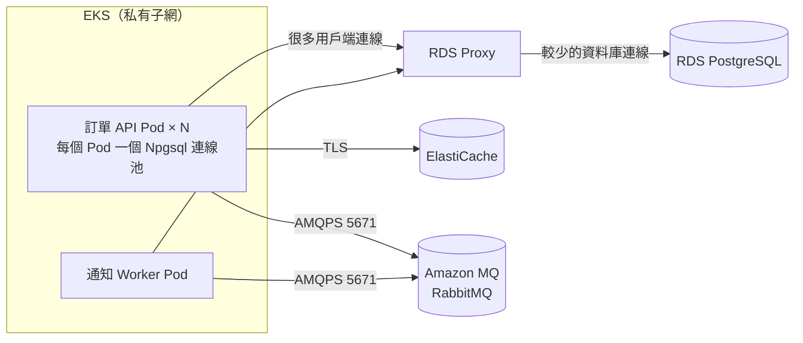

## 這是什麼

電商後端在本機時，PostgreSQL、Redis、RabbitMQ 都跑在自己電腦上。搬到 EKS 後，這三個服務改用 AWS 的託管版本：

- **PostgreSQL** → Amazon RDS，前面放 **RDS Proxy** 管理連線。
- **Redis** → **Amazon ElastiCache**（Redis／Valkey 相容）。
- **RabbitMQ** → **Amazon MQ for RabbitMQ**，由 AWS 管理 broker 節點。

這篇說明 Pod 怎麼安全地連上它們、連線數量怎麼算，以及出問題時看哪些指標。

## 運作原理

Pod 與這三個服務都在同一個 VPC 的私有子網，靠安全群組（security group）決定誰可以連誰。密碼放在 Secrets Manager，或直接改用 IAM 驗證；Pod 的 AWS 權限來自 [Pod Identity](/platforms/eks/pod-identity/)。



**RDS Proxy 怎麼省連線。** 每個 Pod 的 Npgsql 都有自己的連線池。沒有 Proxy 時，資料庫要同時容納「Pod 數 × 每個池的上限」條連線，擴容或 rolling update 時很容易超過。RDS Proxy 讓應用程式的連線在交易結束後把底層資料庫連線還回去，給別人用，所以資料庫端的連線數可以少很多。

**什麼是「釘住」（pinning）。** 如果某條連線做了會改變工作階段狀態的事，例如 `SET` 某個參數、建立暫存資料表，Proxy 就無法把這條底層連線給別人用，只能一直綁著這個用戶端，直到它斷線。被釘住的連線越多，Proxy 省下的連線就越少。

**Amazon MQ 只接受加密連線。** RabbitMQ 用戶端要用 AMQPS（port 5671）連線，不能用未加密的 5672。

## 常見錯誤與正確寫法

**以為有了 RDS Proxy 就不用算連線預算。** Proxy 自己也有上限（設定為資料庫最大連線數的百分比），而被釘住的連線不會被共用。仍要把「API Pod 數 × 池上限 + Worker Pod 數 × 池上限 + rolling update 多出的 Pod」算一次，並在 CloudWatch 看 `DatabaseConnectionsCurrentlySessionPinned` 有沒有持續偏高。計算方法見 [連線池預算](/data-access/pool-capacity/)。

**把資料庫密碼寫在 ConfigMap 或映像裡。** 改用 IAM 資料庫驗證：Pod 以自己的 IAM 角色產生一個約 15 分鐘有效的 token 當作密碼。Npgsql 的 `UsePeriodicPasswordProvider` 會定期重新產生 token，新的連線就用新 token：

```csharp
// 套件：Npgsql、AWSSDK.RDS
using Amazon.RDS.Util;
using Npgsql;

var dataSourceBuilder = new NpgsqlDataSourceBuilder(
    "Host=shop-proxy.proxy-abc.ap-northeast-1.rds.amazonaws.com;Port=5432;" +
    "Database=shop;Username=order_api;SSL Mode=VerifyFull;Maximum Pool Size=20");

// 每 10 分鐘換一次 token（token 本身約 15 分鐘到期）；失敗時 30 秒後重試
dataSourceBuilder.UsePeriodicPasswordProvider(
    (settings, _) => ValueTask.FromResult(
        RDSAuthTokenGenerator.GenerateAuthToken(settings.Host!, settings.Port, settings.Username!)),
    successRefreshInterval: TimeSpan.FromMinutes(10),
    failureRefreshInterval: TimeSpan.FromSeconds(30));

builder.Services.AddSingleton(dataSourceBuilder.Build());
```

`GenerateAuthToken` 使用預設憑證搜尋順序，也就是 Pod Identity 給的角色；角色要有對這個資料庫使用者的 `rds-db:connect` 權限。`SSL Mode=VerifyFull` 會驗證伺服器憑證，需要讓容器信任 RDS 的憑證機構。

**ElastiCache 開了傳輸加密，用戶端卻沒開 TLS。** 連線會直接失敗或卡住。StackExchange.Redis 的設定要加上 `ssl=true`，並使用 ElastiCache 給的主要端點或設定端點，不要寫死某一個節點的位址；容錯移轉後節點角色會改變，端點會自動指向新的主節點。

```csharp
// 套件：StackExchange.Redis
var redis = await ConnectionMultiplexer.ConnectAsync(
    "master.shop-cache.abc123.apne1.cache.amazonaws.com:6379,ssl=true,abortConnect=false");
```

**Amazon MQ 用單一執行個體跑正式環境。** 單一執行個體的 broker 在維護或故障時會整個停止。正式環境選叢集部署（cluster deployment），並使用 quorum queue 讓訊息在多個節點上都有副本。RabbitMQ.Client 的連線要設定 `Ssl.Enabled = true`、port 5671，並保留自動恢復，讓 broker 維護後能重新連上。

## 使用邊界

- **一定要 RDS Proxy 嗎？** Pod 數量少、連線預算很寬裕時可以不用。Pod 數量會隨流量大幅變動、或需要縮短容錯移轉時間時，Proxy 的價值才明顯。
- **會被釘住的寫法很多時，Proxy 效果有限。** 先檢查程式是否在連線上設定工作階段參數；必要的設定盡量放在資料庫或使用者層級。
- **ElastiCache 的資料不是權威來源。** 它是快取，失效時要能回到資料庫，見 [Redis 可靠性](/infrastructure/redis/reliability/)。
- **Amazon MQ 由 AWS 管理節點**，但佇列設計、Ack 時機與重試仍是應用程式的責任，見 [Ack 與 Publisher Confirm](/infrastructure/rabbitmq/acknowledgements/)。
- GKE 上的對應做法（Cloud SQL Auth Proxy、Memorystore、自建 RabbitMQ）見 [GKE 資料服務](/platforms/gke/data-services/)。

## 雲端排查

### 叢集層（GKE 與 EKS 相同）

```bash
# 從叢集內測試能否連到資料服務的 port（排除安全群組或 DNS 問題）
kubectl run netcheck -n shop --rm -it --image=busybox -- \
  nc -zv -w 3 shop-proxy.proxy-abc.ap-northeast-1.rds.amazonaws.com 5432
```

連不上時，先查安全群組是否允許 Pod 所在子網連到這個 port，再查 DNS 是否解析成私有 IP。

### 託管服務層

#### GKE

Cloud SQL、Memorystore 與自建 RabbitMQ 的排查，見 [GKE 資料服務](/platforms/gke/data-services/)。

#### EKS

```bash
# RDS Proxy 後面的資料庫目標是否可用
aws rds describe-db-proxy-targets --db-proxy-name shop-proxy \
  --query 'Targets[].{endpoint:Endpoint,state:TargetHealth.State,reason:TargetHealth.Reason}'

# ElastiCache 複寫群組的狀態與主節點
aws elasticache describe-replication-groups --replication-group-id shop-cache \
  --query 'ReplicationGroups[].{status:Status,nodes:NodeGroups[].PrimaryEndpoint.Address}'

# Amazon MQ broker 的狀態與部署模式
aws mq describe-broker --broker-id <broker-id> \
  --query '{state:BrokerState,mode:DeploymentMode,engine:EngineVersion}'
```

CloudWatch 指標：

| 服務 | 指標 | 看到什麼代表什麼 |
| --- | --- | --- |
| RDS Proxy | `ClientConnections` 與 `DatabaseConnections` | 前者遠大於後者是正常的，代表 Proxy 有在共用連線 |
| RDS Proxy | `DatabaseConnectionsCurrentlySessionPinned` | 持續偏高代表很多連線被釘住，Proxy 省不了連線 |
| RDS Proxy | `DatabaseConnectionsBorrowLatency` | Proxy 拿到底層連線要等多久；升高代表底層連線不夠 |
| RDS | `DatabaseConnections`、`CPUUtilization` | 資料庫端連線與負載；接近上限時先查連線預算 |
| ElastiCache | `EngineCPUUtilization` | Redis 主執行緒的 CPU；持續偏高代表命令太重或流量太大 |
| ElastiCache | `DatabaseMemoryUsagePercentage`、`Evictions` | 記憶體快滿、開始淘汰資料；命中率會跟著下降 |
| ElastiCache | `CurrConnections` | 連線數突然暴增，常是用戶端沒有重複使用連線 |
| Amazon MQ | `MessageReadyCount` | 等待被消費的訊息；持續增加代表 Worker 處理不及 |
| Amazon MQ | `MessageUnacknowledgedCount` | 已交付但還沒 Ack；偏高代表處理卡住或 prefetch 太大 |
| Amazon MQ | `RabbitMQMemUsed` 對比 `RabbitMQMemLimit` | 接近上限時 broker 會暫停發布者 |

### 應用程式層

應用程式日誌出現 `Npgsql` 的逾時，先分清楚是「借不到連線」（池滿了）還是「SQL 執行太久」，前者看池上限與 `DatabaseConnectionsBorrowLatency`，後者看資料庫的慢查詢。Redis 的 `RedisTimeoutException` 訊息裡會帶出佇列中的命令數與執行緒池狀態，可以判斷是網路、伺服器還是用戶端執行緒不足。
