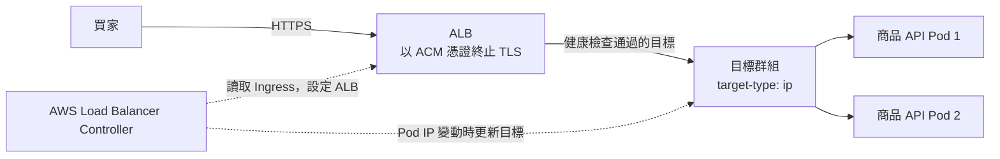

## 這是什麼

買家從瀏覽器打 `https://shop.example.com/products/1`，這個請求要先進 AWS 的負載平衡器，才會到 EKS 裡的商品 API。

在 EKS 上，你不用到 AWS 主控台手動建負載平衡器。你寫一份 Kubernetes 的 Ingress，**AWS Load Balancer Controller**（以下簡稱 controller）會讀到它，替你建立 Application Load Balancer（ALB）、掛上 TLS 憑證、設定轉送規則，之後 Ingress 改了，ALB 也跟著改。

## 運作原理

controller 是跑在叢集裡的程式。它持續監看 Ingress 與 Service，把它們「翻譯」成 ALB 的設定：監聽哪些 port、用哪張憑證、哪個路徑轉到哪個目標群組（target group）。



**target-type: ip** 讓 ALB 直接把流量送到 Pod 的 IP。EKS 的 Pod 使用 VPC 裡真的 IP，所以可以這樣做；流量不必先經過節點再轉一次。

**兩層健康檢查。** Pod 的 readiness probe 決定 Kubernetes 是否把流量交給它；ALB 另外有自己的健康檢查，決定是否把流量送進目標。兩者要指向同一個「準備好了」的端點，否則會出現 Kubernetes 覺得好了、ALB 覺得還沒好（或相反）的情況。

**停止時的時間差。** Pod 要被移除時，controller 會把它從目標群組移除，ALB 進入「解除註冊延遲」，等既有連線處理完。如果 Pod 比這段時間更早結束，ALB 還在送的請求就會變成 502。

如果叢集使用 EKS Auto Mode，負載平衡能力已經內建，不必另外安裝 controller；IngressClass 改指向 Auto Mode 提供的 controller（`eks.amazonaws.com/alb`），概念相同。

## 常見錯誤與正確寫法

**沒有設定 TLS 與 target-type，流量繞路又不加密。** 下面是商品 API 的 Ingress。每個註記後面都說明它的用途：

```yaml
apiVersion: networking.k8s.io/v1
kind: Ingress
metadata:
  name: product-api
  namespace: shop
  annotations:
    alb.ingress.kubernetes.io/scheme: internet-facing        # 對外的 ALB
    alb.ingress.kubernetes.io/target-type: ip                # 直接送到 Pod IP
    alb.ingress.kubernetes.io/listen-ports: '[{"HTTP":80},{"HTTPS":443}]'
    alb.ingress.kubernetes.io/ssl-redirect: "443"            # HTTP 一律轉 HTTPS
    alb.ingress.kubernetes.io/certificate-arn: arn:aws:acm:ap-northeast-1:111122223333:certificate/abcd-1234
    alb.ingress.kubernetes.io/healthcheck-path: /health/ready  # 與 readiness 用同一個端點
spec:
  ingressClassName: alb
  rules:
    - host: shop.example.com
      http:
        paths:
          - path: /products
            pathType: Prefix
            backend:
              service:
                name: product-api
                port:
                  number: 80
```

憑證來自 ACM，ALB 負責 TLS；ALB 到 Pod 這段走 VPC 內部網路。

**部署時出現 502。** 新 Pod 在 Kubernetes 看來已經 Ready，但 ALB 的健康檢查還沒通過，舊 Pod 就先被移除了。解法是開啟 **Pod readiness gate**：在命名空間加上標籤，controller 會讓 Pod 等到 ALB 確認健康後才算 Ready，rolling update 也就不會太早移除舊 Pod。

```bash
kubectl label namespace shop elbv2.k8s.aws/pod-readiness-gate-inject=enabled
```

標籤只影響之後建立的 Pod，加完要重新部署。

停止那一端，給 Pod 足夠時間：`preStop` 先等幾秒讓 ALB 停止送新請求，`terminationGracePeriodSeconds` 要大於這段等待加上應用程式收尾的時間。ASP.NET Core 收到 SIGTERM 後會停止接受新連線並等待進行中的請求完成。

**ASP.NET Core 以為請求是 HTTP。** TLS 在 ALB 結束，Pod 收到的是 HTTP，產生的重新導向網址或 Cookie 的 Secure 判斷就會錯。ALB 會帶上 `X-Forwarded-For` 與 `X-Forwarded-Proto` 標頭，應用程式要啟用 Forwarded Headers 才會採用：

```csharp
// 命名空間：Microsoft.AspNetCore.HttpOverrides
builder.Services.Configure<ForwardedHeadersOptions>(options =>
{
    options.ForwardedHeaders = ForwardedHeaders.XForwardedFor | ForwardedHeaders.XForwardedProto;
    // 只信任來自 ALB 所在子網的標頭，設定方式見參考來源中的 proxy 文件
});

var app = builder.Build();
app.UseForwardedHeaders(); // 放在其他會讀取 Scheme 或用戶端 IP 的 middleware 之前
```

## 使用邊界

- **ALB（Ingress）** 適合 HTTP／HTTPS：依路徑或主機分流、TLS、WAF。**NLB（Service type LoadBalancer）** 適合需要 TCP／UDP 或固定 IP 的服務。
- 每個 Ingress 預設會建立一個 ALB。多個服務要共用同一個 ALB，使用 controller 的 IngressGroup 功能，避免成本和憑證管理分散。
- controller 本身需要 IAM 權限來建立 ALB，請用 [Pod Identity](/platforms/eks/pod-identity/) 授予，不要放金鑰。
- GKE 上對應的是 GKE Gateway，見 [GKE Gateway 與 TLS](/platforms/gke/gateway-networking/)。

## 雲端排查

### 叢集層（GKE 與 EKS 相同）

```bash
# Ingress 有沒有拿到位址；Events 會顯示 controller 建立 ALB 時的錯誤
kubectl describe ingress product-api -n shop

# Service 背後有沒有 Ready 的 Pod
kubectl get endpointslices -n shop -l kubernetes.io/service-name=product-api
```

Ingress 的 ADDRESS 一直是空的，看 Events 裡的錯誤，常見是憑證 ARN 錯誤或 controller 權限不足。

### 託管服務層

#### GKE

負載平衡器後端健康與 NEG 的檢查，見 [GKE Gateway 與 TLS](/platforms/gke/gateway-networking/)的雲端排查。

#### EKS

```bash
# controller 自己的日誌：設定 ALB 失敗的原因會寫在這裡
kubectl logs -n kube-system deployment/aws-load-balancer-controller --tail=100

# 目標群組裡每個 Pod IP 的健康狀態與原因
aws elbv2 describe-target-health --target-group-arn <target-group-arn>
```

`describe-target-health` 的 `State` 為 `unhealthy` 時，`Reason` 會說明是逾時還是回應碼不符，對照 `healthcheck-path` 是否正確。

在 CloudWatch 的 `AWS/ApplicationELB` 命名空間看這幾個指標：

| 指標 | 看到什麼代表什麼 |
| --- | --- |
| `HTTPCode_ELB_5XX_Count` | ALB 自己回的 5xx。部署時跳升，多半是沒有健康目標（503）或 Pod 提早關閉（502） |
| `HTTPCode_Target_5XX_Count` | Pod 回的 5xx，問題在應用程式 |
| `TargetResponseTime` | 從 ALB 送出到 Pod 回應的時間；升高時再看應用程式層 |
| `UnHealthyHostCount` | 不健康的目標數；不為 0 時對照 `describe-target-health` |

### 應用程式層

```bash
# 在叢集內直接打 readiness 端點，排除 ALB 這一層
kubectl run curl -n shop --rm -it --image=curlimages/curl -- \
  curl -sS -o /dev/null -w '%{http_code}\n' http://product-api.shop.svc/health/ready
```

叢集內回 200、ALB 卻判定不健康，問題在 ALB 的健康檢查設定或安全群組；叢集內也失敗，問題在應用程式本身或它的相依服務。
