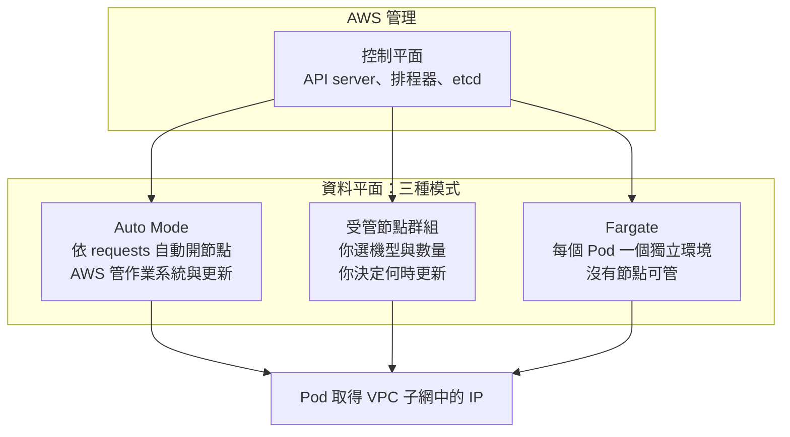

## 這是什麼

EKS 是 AWS 的受管 Kubernetes。AWS 一定會幫你管「控制平面」，也就是接收 `kubectl` 指令、記住叢集狀態、決定 Pod 要放哪裡的那一部分。

真正執行 Pod 的機器叫「節點」。節點由誰管，有三種選擇：

- **Auto Mode**：AWS 依 Pod 需求自動開關節點，也負責節點作業系統與更新。
- **受管節點群組（managed node group）**：你選機型和數量，AWS 幫你建立與替換 EC2 機器，但何時更新由你決定。
- **Fargate**：不看節點，每個 Pod 跑在 AWS 準備的獨立執行環境。

對電商團隊來說，這個選擇決定了你要花多少時間在「機器」上，而不是在商品與訂單上。

## 運作原理

控制平面跨多個可用區運作，由 AWS 維護。節點加入叢集後，kubelet 向控制平面回報；排程器依照 Pod 的 `resources.requests`（Pod 宣告需要多少 CPU 和記憶體）找出放得下的節點。



有兩件事三種模式都一樣：

**Pod 用的是 VPC 裡真的 IP。** EKS 預設使用 Amazon VPC CNI，每個 Pod 都從子網拿一個 IP。好處是負載平衡器可以直接把流量送到 Pod；代價是子網大小直接限制 Pod 數量。

**Kubernetes 版本要定期升級。** 每個版本有標準支援期，過期後進入延長支援，需要額外付費。升級時先升控制平面，再更新節點；Auto Mode 會在控制平面升級後替你更新節點。

Auto Mode 還有一個特性：節點有最長壽命，到期會被替換。這代表 Pod 隨時可能被搬走，應用程式必須能安全停止、重新啟動。

## 常見錯誤與正確寫法

**子網開太小，擴容時 Pod 拿不到 IP。** 大促時 HPA 把 API 從 4 個加到 40 個，新 Pod 卻一直停在 `ContainerCreating`，事件寫著無法分配 IP。原因是子網的可用 IP 用完了。

正確做法是建立叢集前就為每個可用區規劃足夠大的子網，並把節點、Pod 與擴容上限一起算進去。下面的指令可以查看每個子網還剩多少 IP：

```bash
aws ec2 describe-subnets \
  --subnet-ids subnet-0aaa subnet-0bbb subnet-0ccc \
  --query 'Subnets[].{id:SubnetId,az:AvailabilityZone,free:AvailableIpAddressCount}' \
  --output table
```

`free` 欄位接近 0 的子網，就是下一次擴容會卡住的地方。

**Pod 沒寫 requests，Auto Mode 開出太小的節點。** Auto Mode 依照 requests 決定要開多大的機器。沒寫 requests 的 Pod 看起來「不需要資源」，結果很多 Pod 擠在同一台小機器上，尖峰時互相搶 CPU。每個 Deployment 都要寫 requests：

```yaml
# 商品 API：requests 讓排程器與 Auto Mode 知道每個 Pod 需要多少資源
resources:
  requests:
    cpu: "500m"
    memory: "512Mi"
  limits:
    memory: "512Mi"
```

這裡只限制記憶體上限、不限制 CPU 上限，避免 CPU 被節流造成延遲；記憶體上限要和 .NET GC 的設定一起考慮，見 [GC 與容器記憶體](/platforms/dotnet/gc-memory/)。

**把版本升級拖到支援期結束。** 版本過了標準支援期，叢集會進入延長支援並多收費用，升級時也要一次跨好幾個版本的 API 變更。把升級排進每季的例行工作，先在測試叢集升級並跑一次部署。

## 使用邊界

- **沒有專職平台團隊**：選 Auto Mode。節點、作業系統更新與擴縮都交給 AWS，你專心在 Deployment 的 requests、探針和停止流程。
- **需要特定機型、GPU 或自訂節點設定**：選受管節點群組，代價是更新節點、規劃容量都要自己做。
- **Fargate**：適合少量、短時間的工作。它不支援 DaemonSet，依賴節點代理程式收集日誌或指標的做法要另外處理；每個 Pod 的資源規格也有固定的級距。
- GCP 上對應的選擇是 Autopilot 與 Standard，見 [GKE 平台模式](/platforms/gke/platform-modes/)。

## 雲端排查

### 叢集層（GKE 與 EKS 相同）

```bash
# 節點是否 Ready、是哪個版本
kubectl get nodes -o wide

# 依時間排序的事件：找 FailedScheduling、無法分配 IP 等訊息
kubectl get events -A --sort-by=.lastTimestamp | tail -30

# Pod 卡在 Pending 或 ContainerCreating 時，看最下方的 Events
kubectl describe pod <pod-name> -n shop
```

`FailedScheduling` 代表找不到放得下的節點，先看 requests 是否合理；事件提到 IP 分配失敗，就回去查子網剩餘 IP。

### 託管服務層

#### GKE

叢集版本、節點池與自動升級設定，見 [GKE 平台模式](/platforms/gke/platform-modes/)的雲端排查。

#### EKS

```bash
# 叢集版本與狀態
aws eks describe-cluster --name shop \
  --query 'cluster.{version:version,status:status,platform:platformVersion}'

# 受管節點群組的健康問題（例如子網 IP 不足、機型容量不足）
aws eks describe-nodegroup --cluster-name shop --nodegroup-name api \
  --query 'nodegroup.health.issues'

# Auto Mode：查看節點規格與 AWS 為了排程開出的節點
kubectl get nodepools
kubectl get nodeclaims
```

`health.issues` 不是空陣列時，訊息會直接說明原因，例如子網沒有可用 IP。Auto Mode 的 `nodeclaims` 一直沒有變成 Ready，通常是機型容量或子網問題。

### 應用程式層

```bash
# 實際用量和 requests 差多少
kubectl top pod -n shop
```

實際 CPU 長期遠低於 requests，代表 requests 設太高、浪費節點；長期貼近或超過，代表 requests 設太低，Pod 會被擠在一起。EKS 啟用 CloudWatch Container Insights 後，可以在 `ContainerInsights` 命名空間看 `pod_cpu_utilization`、`pod_memory_utilization` 與 `pod_number_of_container_restarts`，觀察長期趨勢。
