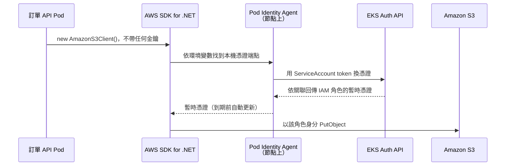

## 這是什麼

訂單 API 要把發票 PDF 寫進 S3、要從 Secrets Manager 讀資料庫密碼，都需要 AWS 權限。最直覺的做法是建立一組 Access Key 放進 Kubernetes Secret，但這組金鑰不會過期，一旦外洩，任何人都能拿來存取你的資源。

**EKS Pod Identity** 讓 Pod 直接扮演一個 IAM 角色。你在 EKS 設定「哪個命名空間的哪個 ServiceAccount 對應哪個 IAM 角色」，Pod 啟動後，AWS SDK 會自動拿到這個角色的暫時憑證，到期前自動更新。程式和設定裡都不需要放任何金鑰。

## 運作原理

整個流程有三個角色：

- **ServiceAccount**：Kubernetes 裡代表「這個工作負載是誰」的物件。
- **Pod Identity 關聯（association）**：記錄在 EKS 上，把「命名空間 + ServiceAccount」對應到一個 IAM 角色。
- **Pod Identity Agent**：每個節點上的代理程式，負責替 Pod 向 AWS 換取暫時憑證。



Pod 啟動時，EKS 會替使用了關聯 ServiceAccount 的 Pod 注入兩個環境變數：`AWS_CONTAINER_CREDENTIALS_FULL_URI`（向哪裡要憑證）與 `AWS_CONTAINER_AUTHORIZATION_TOKEN_FILE`（用來證明身分的 token 檔案）。支援 Pod Identity 的 AWS SDK 會依預設的憑證搜尋順序找到它們，所以程式不用改。

IAM 角色這邊，需要一份「信任政策」，允許 `pods.eks.amazonaws.com` 這個服務來扮演它：

```json
{
  "Version": "2012-10-17",
  "Statement": [
    {
      "Effect": "Allow",
      "Principal": { "Service": "pods.eks.amazonaws.com" },
      "Action": ["sts:AssumeRole", "sts:TagSession"]
    }
  ]
}
```

`sts:TagSession` 讓 EKS 在憑證上附加叢集名稱、命名空間、ServiceAccount 等標籤，之後可以用這些標籤寫更細的權限條件。

## 常見錯誤與正確寫法

**把 Access Key 放進 Secret。** 金鑰長期有效，而且任何能讀 Secret 的人都拿得到。改成建立 Pod Identity 關聯：

```bash
# 讓 shop 命名空間的 order-api ServiceAccount 使用 order-api 角色
aws eks create-pod-identity-association \
  --cluster-name shop \
  --namespace shop \
  --service-account order-api \
  --role-arn arn:aws:iam::111122223333:role/order-api
```

Deployment 只要指定 `serviceAccountName: order-api`。程式端用預設建構子建立用戶端即可：

```csharp
// 套件：AWSSDK.S3
using Amazon.S3;
using Amazon.S3.Model;

// 不傳任何金鑰：SDK 依預設順序找到 Pod Identity 提供的暫時憑證
builder.Services.AddSingleton<IAmazonS3>(_ => new AmazonS3Client());
```

用戶端註冊成 Singleton，重複使用同一個實例；憑證更新由 SDK 處理，不需要重建用戶端。

**所有服務共用節點的 IAM 角色。** 節點角色是給 kubelet 和節點元件用的。如果應用程式也靠它存取 S3，任何跑在該節點上的 Pod 都有同樣權限。每個工作負載應該有自己的 ServiceAccount 與角色，只給需要的動作，例如訂單 API 只能寫 `invoices/` 這個前綴。

**關聯建好了，Pod 卻還是拿不到權限。** 關聯只對「之後建立」的 Pod 生效，已經在跑的 Pod 不會被注入環境變數，要重新部署。另外，非 Auto Mode 的叢集要先安裝 `eks-pod-identity-agent` add-on，否則沒有代理程式替 Pod 換憑證。

## 使用邊界

- **IRSA（IAM Roles for Service Accounts）**是較早的做法，透過叢集的 OIDC 提供者建立信任，設定散落在 IAM 信任政策與 ServiceAccount 註記上。新叢集優先用 Pod Identity；舊叢集上的 IRSA 可以照常運作，再逐步遷移。
- Pod Identity 只解決「Pod 怎麼拿到 AWS 憑證」。角色能做什麼，仍要靠 IAM 政策限制到最小。
- 連資料庫的密碼放在 Secrets Manager，由 Pod 依角色權限讀取，見 [機密管理](/security/secrets-management/)；RDS 也可以改用 IAM 驗證，見 [EKS 資料服務](/platforms/eks/data-services/)。
- GCP 上對應的機制是 Workload Identity Federation for GKE，見 [GKE 工作負載身分](/platforms/gke/workload-identity/)。

## 雲端排查

### 叢集層（GKE 與 EKS 相同）

```bash
# Pod 用的是哪個 ServiceAccount
kubectl get pod <pod-name> -n shop -o jsonpath='{.spec.serviceAccountName}'
```

確認 Pod 使用的是你建立關聯的那個 ServiceAccount，而不是 `default`。

### 託管服務層

#### GKE

KSA 與 IAM 的綁定檢查，見 [GKE 工作負載身分](/platforms/gke/workload-identity/)的雲端排查。

#### EKS

```bash
# 這個命名空間有哪些關聯，對應哪個角色
aws eks list-pod-identity-associations --cluster-name shop --namespace shop

# 角色的信任政策是否允許 pods.eks.amazonaws.com
aws iam get-role --role-name order-api --query 'Role.AssumeRolePolicyDocument'

# 非 Auto Mode：代理程式是否在每個節點上執行
kubectl get daemonset eks-pod-identity-agent -n kube-system
```

清單裡沒有該 ServiceAccount，就是關聯沒建；信任政策沒有 `pods.eks.amazonaws.com`，換憑證時會被拒絕；DaemonSet 的 READY 數小於節點數，代表有節點上的 Pod 拿不到憑證。

### 應用程式層

```bash
# 環境變數有沒有被注入（沒有就代表 Pod 建立時關聯還不存在，需重新部署）
kubectl exec <pod-name> -n shop -- printenv AWS_CONTAINER_CREDENTIALS_FULL_URI

# 用同一個 ServiceAccount 起一個暫時 Pod，確認拿到的是哪個角色
kubectl run awscli -n shop --rm -it --image=amazon/aws-cli \
  --overrides='{"spec":{"serviceAccountName":"order-api"}}' -- sts get-caller-identity
```

`get-caller-identity` 回傳的 ARN 應包含 `assumed-role/order-api`。如果是節點角色，代表 Pod 沒有用到 Pod Identity；如果角色正確但應用程式日誌出現 `AccessDenied`，問題在 IAM 政策授權的動作或資源範圍。
