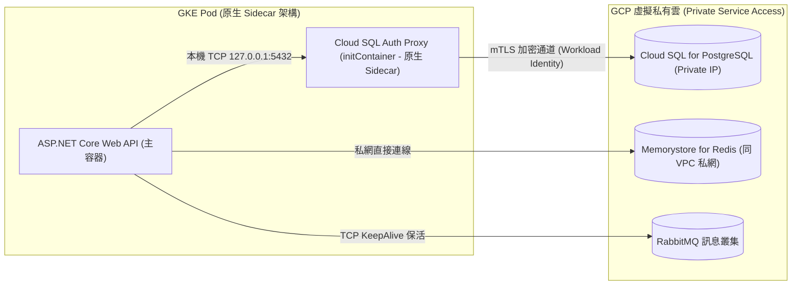

當電商 Web API 與事件 Worker 從本機 Docker 遷移到 GKE 時，過去依賴的 `localhost:5432` 或單機 Redis 端點便不復存在。在生產環境中，我們通常將資料庫委託給託管服務（如 Google Cloud SQL for PostgreSQL）、快取委託給 Memorystore for Redis、訊息佇列則連接獨立的 RabbitMQ 叢集。這項整合並非單純修改連線字串，更牽涉到私有網路路由、IAM 身分授權、連線池生命週期與容器啟動順序的深度協調。

## 案發現場

某電商技術團隊在完成 GKE 上線發布後的首週，線上服務接二連三爆發連線相關的重大事故：

1. **資料庫開啟公網暴露遭勒索掃描**：因為無法順利從 GKE 跨私網連線 Cloud SQL，維運工程師為了求快，直接在 Cloud SQL 上啟用了公開 IP 並配置 `0.0.0.0/0` 允許所有來源連線，數天後資料庫日誌顯示遭到數萬次自動化暴力破解攻擊。
2. **Sidecar 啟動順序競爭引發冷啟動連鎖失敗**：團隊採用 Cloud SQL Auth Proxy sidecar 為 ASP.NET Core Pod 提供本機連線通道。然而，在 Pod 啟動時，C# 應用程式容器（主程序）僅需 2 秒即完成初始化並嘗試開啟資料庫連線，此時旁邊的 Proxy 容器仍在進行 Google Cloud IAM 憑證交換。主程式瞬間收到 `NpgsqlException: Connection refused (127.0.0.1:5432)`，觸發啟動失敗崩潰重啟。
3. **Pod 終止時 Proxy 提早死亡造成交易中斷**：在滾動更新舊 Pod 縮容時，Kubernetes 同時向主容器與 Sidecar 發送 `SIGTERM`。Proxy 迅速關閉了本地監聽，而主容器中正在處理退款交易的非同步作業尚在進行，隨後的資料庫提交因通道中斷而拋出異常，導致交易懸掛。
4. **VPC NAT 閒置逾時致使 RabbitMQ 消費者靜默假死**：負責處理訂單成立事件的 Worker 在非尖峰時段運作數小時後，突然完全停止消費訊息。排查發現 Google Cloud VPC 預設對閒置 TCP 連線實施 20 分鐘逾時中斷；由於程式未開啟 TCP KeepAlive，底層 TCP 連線已被雲端防火牆靜默丟棄，但 C# 的 AMQP Client 仍誤以為連線正常，造成訊息嚴重積壓。



## 反模式與正確解法

### 反模式一：為雲端資料庫開啟公網 IP 與靜態高權限密碼

透過網際網路傳輸資料庫查詢不僅增加延遲與公網流量費用，而且一旦密碼外洩或被中間人竊聽，將面臨巨大的資料外洩風險。

#### 正確解法：啟用 Private IP 與 Cloud SQL Auth Proxy

1. **僅啟用 Private IP**：Cloud SQL 透過 Private Service Access（PSA）與 GKE 所在的 VPC 建立對等互連，完全不暴露公網 IP。
2. **透過 Workload Identity 驅動 Cloud SQL Auth Proxy**：利用 Proxy 自動處理憑證輪替與 mTLS 雙向加密通道，應用程式只需連線本地端點 `127.0.0.1:5432`：

```yaml
# 宣告 Cloud SQL Auth Proxy 容器
- name: cloud-sql-proxy
  image: gcr.io/cloud-sql-connectors/cloud-sql-proxy:2.11.0
  args:
    # 透過 Private IP 連線目標實例
    - "--private-ip"
    - "ecommerce-prod-project:asia-east1:order-pg-instance"
  securityContext:
    runAsNonRoot: true
  resources:
    requests:
      memory: "64Mi"
      cpu: "50m"
```

### 反模式二：傳統 Sidecar 容器生命週期失序

在舊版 Kubernetes 中，所有容器平行啟動與終止，主應用程式與 Proxy sidecar 之間經常發生啟動搶跑或關閉搶死的順序問題。

#### 正確解法：運用 Kubernetes 原生 Sidecar 容器特性

Kubernetes 1.28+ 推出了原生 Sidecar 支援（在 `initContainers` 中宣告 `restartPolicy: Always`）。原生 Sidecar 保證：
1. **啟動保障**：Sidecar 容器必須先完成啟動並通過健康檢查（Startup Probe 通過），主應用容器才會開始啟動。
2. **終止保障**：Pod 終止時，主應用程式先執行優雅停機；直到主應用程式完全結束退出後，Sidecar 容器才會收到終止訊號：

```yaml
spec:
  serviceAccountName: order-api-ksa
  initContainers:
  # 原生 Sidecar 容器：保證先於主應用啟動，晚於主應用結束
  - name: cloud-sql-proxy
    image: gcr.io/cloud-sql-connectors/cloud-sql-proxy:2.11.0
    restartPolicy: Always
    args:
      - "--private-ip"
      - "--port=5432"
      - "ecommerce-prod-project:asia-east1:order-pg-instance"
    startupProbe:
      tcpSocket:
        port: 5432
      failureThreshold: 20
      periodSeconds: 1
  containers:
  - name: api
    image: ecommerce-registry.internal/order-api:v2.1.0
    env:
    - name: ConnectionStrings__OrderDatabase
      value: "Host=127.0.0.1;Port=5432;Database=OrderDb;Username=order_app;Password=SuperSecretPass;Keepalive=30;"
```

### 反模式三：忽略雲端長連線中斷與未配置連線池 KeepAlive

雲端虛擬私有網路（VPC）對閒置連線具有狀態逾時限制。若 ASP.NET Core 的資料庫連線池、StackExchange.Redis 或 RabbitMQ 客戶端在閒置時未發送心跳保活封包，VPC 防火牆會靜默關閉狀態表記錄，後續查詢會因封包丟失而 hang 住數分鐘直至 TCP 逾時。

#### 正確解法：在所有連線驅動程式中顯式啟用 KeepAlive

- **PostgreSQL (Npgsql)**：在連線字串中加上 `Keepalive=30;`，每 30 秒自動發送 TCP KeepAlive 探測。
- **Redis (StackExchange.Redis)**：在 Options 中配置 `keepAlive = 30` 或 `syncTimeout = 5000`。
- **RabbitMQ (RabbitMQ.Client)**：在 ConnectionFactory 中設定 `RequestedHeartbeat = TimeSpan.FromSeconds(30)`。

## 踩坑與避坑指南

### 1. Memorystore for Redis 的私有存取邊界
Google Cloud Memorystore 僅支援純私網存取，**且完全不支援公網 IP**。
- **避坑建議**：建立 Memorystore 執行個體時，必須指定與 GKE 叢集完全相同的授權 VPC 網路。若 GKE 叢集在多專案 Shared VPC 架構中，需確認服務專案的連線許可權限。

### 2. Cloud SQL Auth Proxy 的連線數放大效應
Cloud SQL Auth Proxy 只是一個四層（L4）加密代理通道，**它本身不提供任何連線池復用（Connection Pooling）能力**。如果每個 Pod 的 Npgsql 連線池最大設為 100，當 HPA 將 Pod 擴充至 30 個副本時，依然會直接向 Cloud SQL 建立高達 3,000 個實體資料庫連線，迅速擠爆資料庫記憶體。
- **避坑建議**：高併發場景下，必須在 Cloud SQL 前置部署連線池中繼器（如 PgBouncer），或嚴格調降 Pod 的 `MaxPoolSize`。

### 3. Cloud SQL 高可用容錯移轉（Failover）瞬斷重試
Cloud SQL 高可用（HA）架構在主節點維護或故障時，會自動切換至備援實例。這個容錯移轉過程通常伴隨 **10 至 30 秒的短暫連線中斷**。
- **避坑建議**：EF Core 必須啟用自動重試機制：

```csharp
builder.Services.AddDbContext<OrderDbContext>(options =>
    options.UseNpgsql(connectionString, npgsqlOptions =>
    {
        npgsqlOptions.EnableRetryOnFailure(
            maxRetryCount: 5,
            maxRetryDelay: TimeSpan.FromSeconds(5),
            errorCodesToAdd: null);
    }));
```

## 線上排查指令

針對 GKE 與外部資料服務的連線中斷、Proxy 狀態異常與逾時問題，使用下列指令排查：

```bash
# 1. 查詢 Cloud SQL 實體狀態與 Private IP 位址
gcloud sql instances describe order-pg-instance --format="value(ipAddresses)"

# 2. 檢視 Memorystore for Redis 實體狀態與主機私網 IP
gcloud redis instances describe order-redis-cache --region=asia-east1

# 3. 查看 Pod 內部原生 Cloud SQL Proxy 容器日誌（確認通道建立與認證狀態）
kubectl logs deploy/order-api -c cloud-sql-proxy -n ecommerce-prod --tail=50

# 4. 進入應用容器測試本機 Proxy 監聽埠（5432）是否暢通
kubectl exec -it deploy/order-api -c api -n ecommerce-prod -- nc -zvw3 127.0.0.1 5432

# 5. 排查資料庫連線失敗與容器崩潰事件
kubectl get events -n ecommerce-prod --field-selector reason=CrashLoopBackOff --sort-by='.metadata.creationTimestamp'
```
