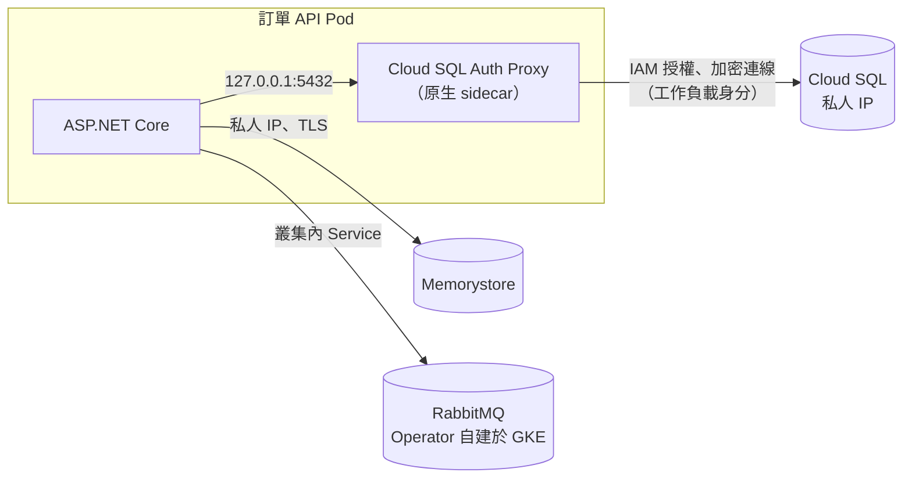

## 這是什麼

電商後端搬到 GKE 後，本機的 `localhost:5432` 不見了。本站的部署假設是：

- **PostgreSQL** → Cloud SQL，透過 **Cloud SQL Auth Proxy** 連線。
- **Redis** → Memorystore。
- **RabbitMQ** → GCP 沒有託管版，用 **RabbitMQ Cluster Operator** 自建在 GKE 上。

這篇說明 Pod 怎麼安全地連上它們，以及雲端環境特有的幾個問題：私有網路、啟動與停止順序、閒置連線被切斷。

## 運作原理



**Cloud SQL Auth Proxy** 在 Pod 裡和應用程式一起執行。應用程式連 `127.0.0.1:5432`，Proxy 以 Pod 的工作負載身分向 Cloud SQL 驗證，並建立加密連線。它解決的是「誰可以連、連線要加密」；它**不是連線池**，應用程式的每條連線都對應一條資料庫連線，見 [連線池預算](/data-access/pool-capacity/)。

**原生 sidecar**：Kubernetes 1.29 起，把 Proxy 放在 `initContainers` 並設定 `restartPolicy: Always`，它就成為原生 sidecar：會先於應用程式啟動並就緒、在應用程式結束之後才停止。這解決了以前「應用程式先啟動連不上」與「Proxy 先結束、最後的交易失敗」兩個問題。

**閒置連線**：TCP 連線長時間沒有資料，可能被中間的網路設備（例如 Cloud NAT、防火牆的連線追蹤）移除。用戶端以為連線還在，下一次使用時才發現失效，或像 RabbitMQ Consumer 一樣「看起來在線、其實收不到訊息」。

## 常見錯誤與正確寫法

### 1. 為了方便給資料庫開公開 IP

連不上私有 IP，就幫 Cloud SQL 開公開 IP 並允許所有來源，資料庫直接暴露在網際網路上。正確做法是讓 Cloud SQL 使用私人 IP（透過私人服務存取），GKE 叢集在同一個 VPC 或相連的網路中；Proxy 加上 `--private-ip` 走私有路徑。

### 2. Proxy 以一般容器執行，啟動與停止順序錯亂

```yaml
spec:
  serviceAccountName: order-api               # 工作負載身分：Proxy 以這個身分驗證
  initContainers:
    - name: cloud-sql-proxy
      image: gcr.io/cloud-sql-connectors/cloud-sql-proxy:2.14.1
      restartPolicy: Always                   # 原生 sidecar：先啟動、最後停止
      args:
        - "--private-ip"
        - "--auto-iam-authn"                  # 以 IAM 資料庫驗證，不需要密碼
        - "--structured-logs"
        - "--health-check"
        - "--http-address=0.0.0.0"
        - "shop-prod:asia-east1:shop-db"
      startupProbe:
        httpGet: { path: /startup, port: 9090 } # Proxy 就緒後才啟動應用程式容器
      resources:
        requests: { cpu: "100m", memory: "64Mi" }
  containers:
    - name: order-api
      image: asia-east1-docker.pkg.dev/shop-prod/apps/order-api@sha256:<digest>
      env:
        - name: ConnectionStrings__Shop
          value: "Host=127.0.0.1;Port=5432;Database=shop;Username=order-api@shop-prod.iam;Maximum Pool Size=20"
```

使用 IAM 資料庫驗證時，資料庫使用者對應到 IAM 身分，連線字串不需要密碼。Proxy 映像的版本以官方發布為準，部署時固定版本。

### 3. 長連線沒有保活，閒置後默默失效

- **Npgsql**：設定 `Keepalive`（秒）讓連線定期送出保活封包；連線池的 `Connection Idle Lifetime` 也會回收閒置太久的連線。
- **RabbitMQ.Client**：保留預設的心跳（`RequestedHeartbeat`），讓雙方定期確認連線仍然存活，斷線時觸發自動恢復。
- **StackExchange.Redis**：預設會定期送出保活命令（`KeepAlive`），不要把它關掉。

## 使用邊界

- **Memorystore 只能從授權的 VPC 存取**，沒有公開端點；GKE 叢集要在同一個 VPC（或已設定的連線方式）中。啟用 AUTH 與傳輸加密時，用戶端要帶上密碼與 CA 憑證。
- **自建的 RabbitMQ 由你負責**：節點數（建議 3 個）、持久化磁碟、升級、備份與監控都在你的責任範圍，見 [儲存與有狀態服務](/platforms/kubernetes/storage/)。
- Cloud SQL 的高可用容錯移轉期間連線會中斷，應用程式要能重試，見 [讀副本與災難復原](/data-access/replication-recovery/)。
- AWS 上對應的做法（RDS Proxy、ElastiCache、Amazon MQ）見 [EKS 資料服務](/platforms/eks/data-services/)。

## 雲端排查

### 叢集層（GKE 與 EKS 相同）

```bash
# 應用程式容器與 sidecar 的狀態
kubectl get pod <pod-name> -n shop -o jsonpath='{range .status.initContainerStatuses[*]}{.name}{"\t"}{.ready}{"\n"}{end}'

# Proxy 的日誌：IAM 授權失敗、找不到執行個體等錯誤
kubectl logs <pod-name> -n shop -c cloud-sql-proxy --tail=50
```

### 託管服務層

#### GKE

```bash
# Cloud SQL 的網路設定（是否有私人 IP、是否關閉公開 IP）
gcloud sql instances describe shop-db --format='value(ipAddresses,settings.ipConfiguration.ipv4Enabled)'

# Memorystore 的連線端點、傳輸加密與 AUTH 設定
gcloud redis instances describe shop-cache --region=asia-east1 \
  --format='value(host,port,transitEncryptionMode,authEnabled)'

# 自建 RabbitMQ 的叢集狀態
kubectl get rabbitmqclusters -n messaging
kubectl exec -n messaging shop-mq-server-0 -- rabbitmq-diagnostics cluster_status
```

連線數看 `cloudsql.googleapis.com/database/postgresql/num_backends`；Memorystore 的連線數看 `redis.googleapis.com/clients/connected`。

#### EKS

RDS Proxy、ElastiCache 與 Amazon MQ 的排查，見 [EKS 資料服務](/platforms/eks/data-services/)的雲端排查。

### 應用程式層

連線錯誤集中出現在「一段時間沒有流量之後」，通常是閒置連線被切斷；集中在 Pod 啟動或停止時，檢查 sidecar 的順序；持續出現 IAM 相關錯誤，檢查工作負載身分與 Cloud SQL 使用者的授權。
