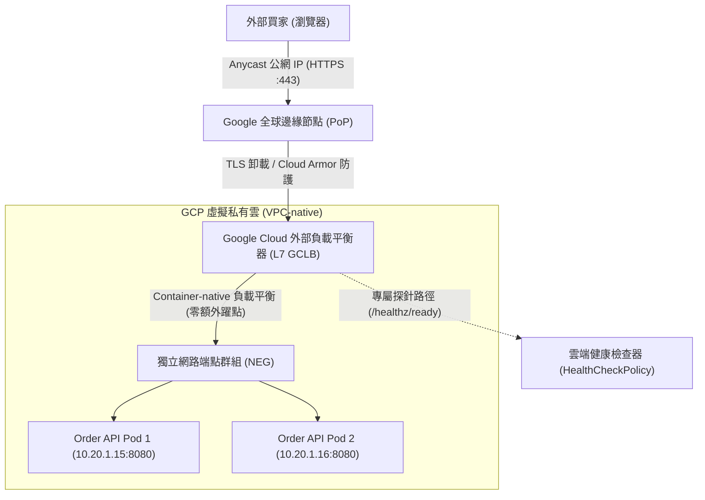

在本機開發環境中，工程師習慣透過 `kubectl port-forward` 測試 ASP.NET Core API，但在生產環境中，外部數十萬買家的 HTTPS 流量必須經過 Google 全球邊緣網路（Anycast IP）、Google Cloud 外部應用程式負載平衡器（External Application Load Balancer, GCLB）、TLS 憑證終止、Cloud Armor WAF 防護，最後精準派發至 GKE 叢集內部的容器。GKE Gateway API 是實現這一完整流量路徑的現代化標準。

## 案發現場

某電商平台的購物與結帳系統完成 GKE 部署並切換 DNS 後，線上監控警報狂響，大量顧客在結帳當下遭遇 HTTP 502 Bad Gateway 與瀏覽器「連線不安全」警告，導致當日促銷業績損失慘重：

1. **雲端健康檢查不匹配引發 502 雪崩**：團隊為商品 API 建立了 Gateway 與 HTTPRoute，Kubernetes 內部 Pod 的 Readiness Probe 顯示 100% 綠燈就緒。然而外部買家訪問時全面拋出 502。排查 Google Cloud 控制台發現，後端服務的健康檢查狀態為全體 `UNHEALTHY`。原因在於 GCLB 預設向根路徑 `GET /` 發起健康檢查探針，而 ASP.NET Core 應用程式並未註冊根路徑路由，直接回傳 HTTP 404，導致雲端負載平衡器認定所有後端已死亡並全面熔斷。
2. **TLS 憑證狀態卡死在 PROVISIONING**：工程師建立了 Google-managed SSL 憑證，但買家瀏覽器顯示憑證無效。排查發現公網網域的 DNS A 記錄尚未正確指向 Gateway 分配的 Anycast 靜態 IP，Google CA 驗證挑戰（Domain Verification Challenge）無法抵達，憑證簽發逾時失敗。
3. **缺少 Proxy-only Subnet 導致 Gateway 建立失敗**：團隊在 VPC 內部署區域型（Regional）外部負載平衡器時，未預先在該 Region 建立用途為 `REGIONAL_MANAGED_PROXY` 的專用代理子網路，導致 Gateway 資源的 Condition 始終卡在 `Programmed: False`，錯誤訊息晦澀難辨。
4. **反向代理標頭未信任導致 HTTPS 降級**：ASP.NET Core 程式在產生 OAuth2 重新導向或分頁連結時，產生的網址全變成 `http://` 而非 `https://`，引發瀏覽器 Mixed Content 阻擋。



## 反模式與正確解法

### 反模式一：混淆 Pod Readiness 與雲端負載平衡器健康檢查

許多工程師誤以為在 Pod Spec 中寫了 `readinessProbe`，Google Cloud 外部負載平衡器就會自動抓取該設定。實際上，**Kubernetes 控制平面的探針與 Google Cloud 基礎設施的健康檢查是兩套完全獨立的系統**。若未顯式宣告雲端健康檢查策略，GCLB 會使用預設值（例如向連接埠發送 `GET /`），一旦你的 API 根目錄未回應 200，即使 Pod 本身健康，GCLB 也會將所有 Pod 標記為不健康並回傳 502。

#### 正確解法：宣告 HealthCheckPolicy 精準對齊檢查路徑

透過 GKE 專屬的 `HealthCheckPolicy` 資源，明確將 Google Cloud 負載平衡器的健康檢查端點綁定至 Service：

```yaml
apiVersion: networking.gke.io/v1
kind: HealthCheckPolicy
metadata:
  name: order-healthcheck-policy
  namespace: ecommerce-prod
spec:
  default:
    config:
      type: HTTP
      httpHealthCheck:
        requestPath: /healthz/ready # 明確指定 ASP.NET Core 的就緒健康檢查路徑
        port: 8080
    checkIntervalSec: 5
    timeoutSec: 3
    healthyThreshold: 1
    unhealthyThreshold: 2
  targetRef:
    group: ""
    kind: Service
    name: order-service
```

### 反模式二：依賴傳統 NodePort 與 Ingress 造成不必要的二次轉發

舊式 Ingress 通常將流量導向 Node 節點的 NodePort，Node 節點上的 iptables / IPVS 再將封包 SNAT 後隨機轉發給另一台 Node 上的 Pod。這不僅增加了跨虛擬機器的網路延遲（Extra Network Hop），而且掩蓋了客戶端的真實來源 IP。

#### 正確解法：採用 GKE Gateway API 與獨立網路端點群組（NEG）

在 VPC-native 叢集架構下，GKE 支援容器原生（Container-native）負載平衡。Service 只要啟用 NEG，GCLB 就會直接將流量路由到目標 Pod 的次要 VPC IP，完全跳過 kube-proxy 與 NodePort：

```yaml
apiVersion: v1
kind: Service
metadata:
  name: order-service
  namespace: ecommerce-prod
  annotations:
    # 宣告啟用獨立網路端點群組 (NEG)
    cloud.google.com/neg: '{"ingress": true}'
spec:
  type: ClusterIP
  selector:
    app.kubernetes.io/name: order-api
  ports:
  - name: http
    port: 80
    targetPort: 8080
---
apiVersion: gateway.networking.k8s.io/v1
kind: Gateway
metadata:
  name: ecommerce-external-gateway
  namespace: ecommerce-prod
spec:
  gatewayClassName: gke-l7-global-external-managed # 全球外部應用程式負載平衡器
  listeners:
  - name: https
    protocol: HTTPS
    port: 443
    hostname: "api.eshop.example.com"
    tls:
      mode: Terminate
      certificateRefs:
      - name: eshop-managed-cert # 引用 Google-managed 憑證
```

### 反模式三：未處理反向代理標頭，導致 ASP.NET Core 協定降級

當外部 HTTPS 流量在 GCLB 完成 TLS 卸載後，GCLB 會以內部 HTTP 協定將請求轉發給容器中的 Kestrel。如果 ASP.NET Core 未正確信任反向代理標頭，程式碼中的 `Request.Scheme` 會變成 `http`，且 `Request.Host` 可能丟失原始客戶端網域名稱。

#### 正確解法：配置 ForwardedHeadersOptions 並信任代理

在 ASP.NET Core `Program.cs` 中正確掛載 ForwardedHeaders 中介軟體：

```csharp
builder.Services.Configure<ForwardedHeadersOptions>(options =>
{
    options.ForwardedHeaders = ForwardedHeaders.XForwardedFor | ForwardedHeaders.XForwardedProto;
    // 在雲端環境中清除已知網路限制，依賴 VPC 邊界防護
    options.KnownNetworks.Clear();
    options.KnownProxies.Clear();
});

var app = builder.Build();

app.UseForwardedHeaders(); // 務必置於所有路由與驗證中介軟體之前！
```

## 踩坑與避坑指南

### 1. Proxy-only Subnet（專用代理子網）要求
若選用區域型外部負載平衡器（`gke-l7-regional-external-managed`）或內部負載平衡器（`gke-l7-rilb`），Google Cloud 要求 VPC 的該區域必須存在一個用途標記為 `REGIONAL_MANAGED_PROXY` 的專用子網（建議容量 `/24` 或 `/26`）。如果遺漏此子網，GKE Gateway Controller 無法替負載平衡器指派 Envoy 代理 IP，Gateway 會永遠卡在同步失敗。

### 2. 宣告式資源到實體雲端負載平衡器的非同步延遲
在 Kubernetes 中執行 `kubectl apply` 建立 Gateway 或 HTTPRoute 後，底層 GKE 控制器需要呼叫 Google Cloud Compute API 來預約全域靜態 IP、建立 URL Map、設置 Backend Service 與 Target Proxy。這一過程通常需要 **3 至 8 分鐘**。
- **避坑建議**：請勿在 CI/CD 發布中假設 Gateway 立刻可用；必須透過腳本輪詢 `kubectl get gateway -o jsonpath='{.status.conditions[?(@.type=="Programmed")].status}'` 確認值為 `True`。

### 3. Google-managed SSL Certificate 簽發挑戰需依賴正確 DNS
Google-managed 憑證是透過公網驗證目標網域的 DNS A 記錄。若你建立了 Gateway 取得了靜態 IP，但在網域託管商（如 Cloudflare, Route53）處尚未將 `api.eshop.example.com` 的 A 記錄指向該 IP，憑證將處於 `PROVISIONING` 狀態，數小時後會判定失敗。
- **避坑建議**：先建立 Gateway 取得預約靜態 IP，完成 DNS A 記錄綁定後，再驗證憑證簽發狀態。

## 線上排查指令

針對 GKE Gateway 狀態異常、雲端健康檢查失敗與 NEG 端點問題，使用下列指令排查：

```bash
# 1. 檢視 Gateway 當前狀態與分配的外部 Anycast IP
kubectl get gateway -n ecommerce-prod -o wide

# 2. 深入排查 Gateway 控制器同步狀態與條件警告（確認 Programmed 狀態）
kubectl describe gateway ecommerce-external-gateway -n ecommerce-prod

# 3. 檢視 HTTPRoute 綁定條件與路由匹配規則
kubectl describe httproute order-route -n ecommerce-prod

# 4. 查詢後端 Service 對應的 NEG（獨立網路端點群組）實體狀態
gcloud compute network-endpoint-groups list --filter="zone:asia-east1"

# 5. 檢查 Google Cloud 後端服務的健康檢查實際判定狀態（定位 502 根因）
gcloud compute backend-services get-health <BACKEND_SERVICE_NAME> --global

# 6. 檢視自定義雲端健康檢查策略是否生效
kubectl get healthcheckpolicy -n ecommerce-prod
```
