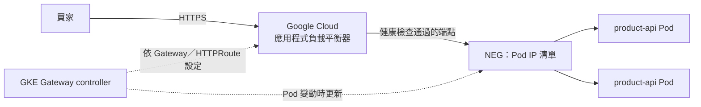

## 這是什麼

買家從網際網路連到 `shop.example.com`，請求要先進 Google Cloud 的負載平衡器，再到 GKE 裡的商品 API。在 GKE 上，你用 Kubernetes 的 **Gateway API** 宣告入口與路由，GKE 的 Gateway controller 會替你建立並設定負載平衡器。

- **Gateway**：宣告一個入口，選擇哪一種負載平衡器（由 GatewayClass 決定），以及使用哪張 TLS 憑證。
- **HTTPRoute**：宣告路由規則，例如 `/products` 送到 `product-api` Service。

## 運作原理



**NEG（網路端點群組）**：負載平衡器直接把 Pod 的 IP 當作後端，流量不必先經過節點再轉一次（容器原生負載平衡）。

**兩層健康檢查**：Kubernetes 用 readiness 決定 Pod 是否在 Service 的端點中；負載平衡器另外有自己的健康檢查，決定是否把流量送到這個 Pod。兩者要檢查同一件事，否則可能出現「Kubernetes 覺得好了，負載平衡器覺得沒好」而一直回 502。GKE 用 `HealthCheckPolicy` 設定負載平衡器的健康檢查。

**GatewayClass** 決定負載平衡器的類型，例如全域外部（`gke-l7-global-external-managed`）、區域外部（`gke-l7-regional-external-managed`）、內部（`gke-l7-rilb`）。區域型的負載平衡器需要在 VPC 中準備**代理專用子網**。

controller 建立負載平衡器需要幾分鐘；套用 Gateway 後，在 status 中看到位址並且條件為已就緒，才代表可以使用。

## 常見錯誤與正確寫法

### 1. 負載平衡器的健康檢查和 readiness 不一致

```yaml
apiVersion: networking.gke.io/v1
kind: HealthCheckPolicy
metadata:
  name: product-api
  namespace: shop
spec:
  default:
    config:
      type: HTTP
      httpHealthCheck:
        port: 8080
        requestPath: /health/ready   # 與 readinessProbe 使用同一個端點
  targetRef:
    group: ""
    kind: Service
    name: product-api
```

### 2. 沒有 TLS，或憑證手動管理

```yaml
apiVersion: gateway.networking.k8s.io/v1
kind: Gateway
metadata:
  name: shop-gateway
  namespace: gateway-infra
  annotations:
    networking.gke.io/certmap: shop-certmap   # 使用 Certificate Manager 的憑證對應
spec:
  gatewayClassName: gke-l7-global-external-managed
  listeners:
    - name: https
      protocol: HTTPS
      port: 443
      allowedRoutes:
        namespaces: { from: All }
```

Google 管理的憑證需要 DNS 正確指向負載平衡器（或使用 DNS 授權）才能簽發；簽發前 HTTPS 不會生效。

### 3. 應用程式以為請求是 HTTP，或 keep-alive 逾時太短

TLS 在負載平衡器結束，Pod 收到的是 HTTP。啟用 Forwarded Headers 讓 ASP.NET Core 採用 `X-Forwarded-Proto` 與 `X-Forwarded-For`；Google Cloud 負載平衡器到後端的 keepalive 逾時是 600 秒，Kestrel 的 `KeepAliveTimeout` 要設得更長，否則會出現間歇的 502，見 [一筆請求的網路路徑](/infrastructure/containers-networking/request-path/)。

## 使用邊界

- 外部服務對外開放時，考慮在負載平衡器上加上 Cloud Armor（WAF 與限流），擋掉明顯的惡意流量。
- 後端逾時、連線排空（connection draining）等設定用 `GCPBackendPolicy`；連線排空時間要和 Pod 的 `preStop` 等待配合。
- AWS 上對應的做法是 AWS Load Balancer Controller 與 ALB，見 [EKS 對外流量](/platforms/eks/load-balancing/)。

## 雲端排查

### 叢集層（GKE 與 EKS 相同）

```bash
# Gateway 是否取得位址、HTTPRoute 是否被接受（看 status 與 Events）
kubectl get gateway -n gateway-infra
kubectl describe gateway shop-gateway -n gateway-infra | tail -20
kubectl describe httproute product-api -n shop | tail -20
```

### 託管服務層

#### GKE

```bash
# 負載平衡器的後端服務與各端點的健康狀態
gcloud compute backend-services list --filter="name~shop"
gcloud compute backend-services get-health <backend-service-name> --global

# 502 的原因（statusDetails）
gcloud logging read 'resource.type="http_load_balancer" AND httpRequest.status>=500' \
  --freshness=1h --limit=20 --format='value(timestamp,httpRequest.status,jsonPayload.statusDetails)'
```

Cloud Monitoring 的 `loadbalancing.googleapis.com/https/request_count`（可依回應碼分組）與 `loadbalancing.googleapis.com/https/backend_latencies` 顯示錯誤量與後端延遲。

#### EKS

ALB 目標群組的健康檢查與指標，見 [EKS 對外流量](/platforms/eks/load-balancing/)的雲端排查。

### 應用程式層

從叢集內直接呼叫 `/health/ready`，確認應用程式本身回應正常；叢集內正常、負載平衡器卻判定不健康，問題在 HealthCheckPolicy 的路徑或 port，或防火牆沒有允許 Google 健康檢查的來源位址。
