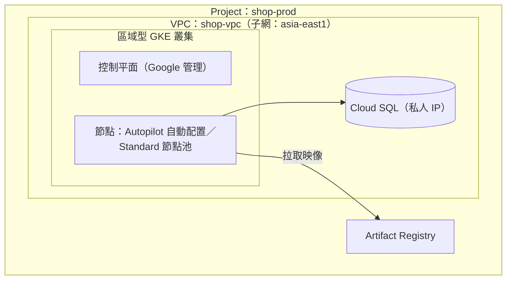

## 這是什麼

**GKE**（Google Kubernetes Engine）是 Google Cloud 的受管 Kubernetes。在使用它之前，先認識 GCP 的幾個基本單位：

- **Project**：資源、帳單與權限的隔離單位。正式環境與測試環境通常是不同的 Project。
- **IAM**：誰可以對哪些資源做什麼。
- **VPC**：私有網路。GCP 的 VPC 是全球性的，子網屬於某個區域。
- **Artifact Registry**：存放容器映像的倉庫。

GKE 有兩種運作模式：

- **Autopilot**：Google 管理節點，依 Pod 的 requests 配置運算資源，以 Pod 為單位計費。
- **Standard**：你建立並管理節點池（node pool），選擇機型、數量與更新時機，以節點計費。

## 運作原理



**VPC 原生叢集**：Pod 從子網的「次要 IP 範圍」取得 IP，可以直接和 VPC 中的其他資源（Cloud SQL、Memorystore）互通。Pod 與 Service 的 IP 範圍在建立叢集時決定，範圍太小會限制叢集能容納的 Pod 數量，事後很難擴大。

**區域型叢集**：控制平面與節點分散在區域內的多個可用區，單一可用區故障時叢集仍可運作。正式環境建議使用區域型叢集。

**發布頻道**：GKE 會自動升級叢集的 Kubernetes 版本。發布頻道（Rapid、Regular、Stable 等）決定升級的節奏；**維護時段**決定升級可以在什麼時間進行，**維護排除項目**可以在大促期間暫停升級。

## 常見錯誤與正確寫法

### 1. 沒有平台團隊卻選了 Standard

Standard 模式要自己決定節點機型、管理節點池的擴縮與升級、處理節點的安全設定。對以應用程式為主的團隊來說，這些工作很容易被忽略，直到某次升級或容量不足才發現。沒有特殊需求（GPU、特定機型、節點層級的自訂設定）時，選 Autopilot：

```bash
gcloud container clusters create-auto shop \
  --region=asia-east1 \
  --network=shop-vpc --subnetwork=shop-gke \
  --cluster-secondary-range-name=pods \
  --services-secondary-range-name=services \
  --release-channel=regular
```

### 2. 網段規劃太小

大促時 Pod 數暴增，新的 Pod 拿不到 IP。建立叢集前，依「節點數上限 × 每個節點的 Pod 數」規劃 Pod 的次要範圍，並預留成長空間；Service 的範圍也要足夠。

### 3. 沒設定維護時段，升級發生在尖峰

自動升級在營業時間進行，節點輪流被替換，Pod 被重新排程。設定維護時段在離峰，並在大促前加上維護排除項目：

```bash
gcloud container clusters update shop --region=asia-east1 \
  --maintenance-window-start=2026-01-01T18:00:00Z \
  --maintenance-window-end=2026-01-01T22:00:00Z \
  --maintenance-window-recurrence="FREQ=WEEKLY;BYDAY=TU,WE,TH"
```

配合 PodDisruptionBudget，升級時才不會一次移走所有副本，見 [探針與安全停止](/platforms/kubernetes/probes-resources/)。

## 使用邊界

- **Autopilot 依 Pod 的 requests 計費**，並會依規則調整 requests（例如最小值、CPU 與記憶體的比例）。requests 設太高就是多付錢，設太低則可能被節流，依實測調整。
- 節點拉取映像需要 Artifact Registry 的讀取權限；映像放在另一個 Project 時，要另外授權。
- AWS 上對應的選擇是 EKS Auto Mode 與受管節點群組，見 [EKS 平台模式](/platforms/eks/platform-modes/)。

## 雲端排查

### 叢集層（GKE 與 EKS 相同）

```bash
kubectl get nodes -o wide
kubectl get events -A --sort-by=.lastTimestamp | tail -20
```

### 託管服務層

#### GKE

```bash
# 叢集模式、版本、發布頻道與維護設定
gcloud container clusters describe shop --region=asia-east1 \
  --format='value(autopilot.enabled,currentMasterVersion,releaseChannel.channel,maintenancePolicy)'

# 最近的叢集操作（升級、修復）
gcloud container operations list --filter="targetLink~clusters/shop" --limit=10

# 叢集可用的 Pod IP 範圍
gcloud container clusters describe shop --region=asia-east1 \
  --format='value(ipAllocationPolicy.clusterIpv4CidrBlock,ipAllocationPolicy.servicesIpv4CidrBlock)'
```

`ImagePullBackOff` 且錯誤訊息提到權限，檢查節點使用的服務帳號是否有該 Artifact Registry 的 `roles/artifactregistry.reader`。

#### EKS

叢集版本、節點群組與子網 IP 的檢查，見 [EKS 平台模式](/platforms/eks/platform-modes/)的雲端排查。

### 應用程式層

升級期間 Pod 會被重新排程；應用程式日誌中「收到 SIGTERM」的時間與叢集操作的時間吻合，就能確認中斷來自維護，而不是程式本身的問題。
