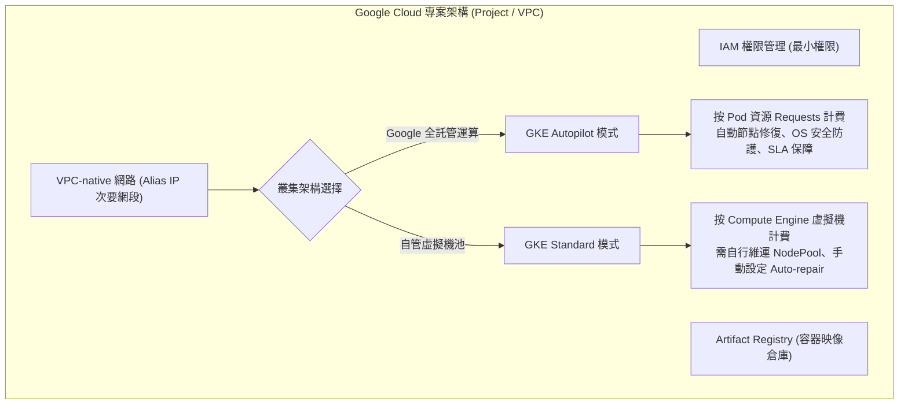

當電商後端應用程式從本機 Docker Compose 邁向 Google Cloud (GCP) 上線時，我們面臨的第一個核心架構抉擇就是：如何組織 Google Cloud 資源階級，以及應選擇 **GKE Autopilot** 還是 **GKE Standard** 叢集模式。這不僅僅是主機計費方式的差異，更直接決定了工程團隊在基礎設施、安全加固、節點維運與自動擴縮上的責任邊界（Shared Responsibility Model）。

## 案發現場

某電商技術團隊為了將核心交易系統遷移至 Google Kubernetes Engine (GKE)，架構師選擇了傳統的 GKE Standard 模式，並自行配置節點池（Node Pool）。上線營運三個月後，連續發生多次重大非預期事故：

1. **節點底層故障引發長時間掛死**：某個承載訂單 API 的實體節點發生底層硬體磁碟壞軌，由於團隊在建立 Standard 叢集時未開啟 `Node Auto-repair`（節點自動修復）與 `Node Auto-upgrade`，該節點陷入 `NotReady` 長達數小時，上面的 Pod 無法正常移轉，導致可用性嚴重受損。
2. **單可用區維護引發全站停擺**：為了節省節點池跨可用區（Cross-AZ）網路傳輸費用，團隊將 GKE Standard 節點池建立在單一可用區（`asia-east1-a`）。當 Google Cloud 針對該可用區進行機房底層維護時，整個叢集瞬間失去所有運算節點，造成全站停擺長達 40 分鐘。
3. **Route-based 舊式網路導致 IP 枯竭與轉發延遲**：建立叢集時使用了舊版的 Route-based 網路（而非 VPC-native），Pod IP 使用叢集內部私有覆蓋網路。隨著促銷活動副本擴展，Pod IP 迅速用盡；且外部負載平衡器無法直接定址 Pod，必須經由 NodePort 進行二次跳躍與 iptables SNAT，造成連線延遲顯著增加。
4. **促銷前夕遭遇控制平面強制升級**：叢集未配置發布頻道（Release Channel）與維護視窗（Maintenance Window）。在特賣活動開跑前 30 分鐘，GKE 控制平面觸發自動版本升級，API Server 短暫無法響應，導致 HPA 自動擴縮容指令全面失敗。



## 反模式與正確解法

### 反模式一：缺乏專職維運團隊卻盲目選用 GKE Standard 模式

許多中小型團隊認為 GKE Standard「比較有控制感」，可以自由登入節點除錯、調整 Linux Kernel 參數與安裝任意 DaemonSet。然而，這意味著團隊必須承擔節點 OS 安全更新、節點自動修復、節點擴展器（Cluster Autoscaler）容量規劃、OS CVE 補丁與 CIS 基準安全加固等龐大負載，常常因為維運失誤造成節點崩潰。

#### 正確解法：應用優先團隊全面採用 GKE Autopilot

在 GKE Autopilot 模式下，Google Cloud 全權負責節點基礎設施的管理、安全防護與自動修補：
1. **計費模型優化**：使用者僅針對 Pod 所宣告的 `requests`（CPU、記憶體、暫存儲存空間）付費，完全無需為未利用的節點閒置資源買單。
2. **預設安全加固**：Autopilot 強制實施 GKE 安全最佳實踐（預設封鎖特權容器、開啟 Workload Identity、內建 Linux Capabilities 限制與安全審計）。
3. **零維運節點池**：節點自動擴展、排程調度與自動修復全由平台演算法接手，無須手動配置 Node Pool。

只有在需要特殊 Linux 內核模組、客製 GPU 驅動，或必須運行特權 DaemonSet 的大型平臺團隊，才應選用 GKE Standard。

### 反模式二：使用 Route-based 網路建立叢集，忽視次要網段規劃

Route-based 叢集是舊世代的 Kubernetes 網路實作，依賴 VPC 路由表進行封包路由，限制了叢集節點上限（最多 250 個節點），且 Pod IP 無法被 Google Cloud 虛擬私有雲（VPC）其他原生服務（如 Cloud SQL、外部負載平衡器）直接定址。

#### 正確解法：強制使用 VPC-native（Alias IP）並合理規劃 Secondary CIDR

VPC-native 叢集利用 Google Cloud VPC Alias IP 機制，將 VPC 次要 IP 網段直接分配給 Pod：
1. **容器原生負載平衡**：外部負載平衡器可透過獨立網路端點群組（NEG）直接將封包送到 Pod IP，零額外轉發跳躍。
2. **次要網段空間規劃**：建立叢集前，必須在 VPC Subnet 內預先規劃足夠大的次要 IP 區段（例如 Pod 網段分配 `/18` 容納 16,384 個 IP，Service 網段分配 `/20` 容納 4,096 個 IP），避免日後業務擴張時 IP 枯竭：

```bash
# 建立包含充裕次要網段的 Subnet
gcloud compute networks subnets create gke-subnet-prod \
    --network=ecommerce-vpc \
    --region=asia-east1 \
    --range=10.10.0.0/20 \
    --secondary-range=gke-pods=10.20.0.0/16,gke-services=10.30.0.0/20
```

### 反模式三：未配置發布頻道與維護時段，導致非預期升級中斷

依賴 Static（靜態）版本且未宣告維護時段，會讓 GKE 在 Google 發布重大安全性補丁時，於非預期的任意時間（甚至在大促活動進行中）觸發強制更新，造成節點輪流重開機。

#### 正確解法：配置發布頻道（Release Channel）與維護排除視窗

- **Release Channel**：正式環境建議選用 `Regular`（平衡新功能與穩定性）或 `Stable`（經過廣泛驗證、變動頻率最低）。
- **維護時段（Maintenance Window）**：設定允許升級的時間區段（例如每週二凌晨 02:00 ~ 06:00）。
- **維護排除期（Maintenance Exclusion）**：在周年慶、雙十一等重大行銷活動期間，設定長達數週的全面禁止升級視窗：

```bash
# 為 GKE 叢集設定固定維護時段
gcloud container clusters update ecommerce-prod-cluster \
    --region=asia-east1 \
    --maintenance-window-start=2026-10-15T02:00:00Z \
    --maintenance-window-duration=4h \
    --maintenance-window-recurrence="FREQ=WEEKLY;BYDAY=TU"
```

## 踩坑與避坑指南

### 1. Autopilot 模式下的資源配額自動調升（Resource Rounding）
GKE Autopilot 為了確保節點排程穩定，對 Pod 的資源宣告設有強制規則：
- 最低 CPU request 為 250m（0.25 vCPU）。
- CPU 與 Memory 必須符合特定比率範圍（例如 1 vCPU 需搭配 1Gi 至 8Gi 記憶體）。
- **避坑建議**：若你在 Deployment 中宣告了 `cpu: 50m, memory: 128Mi`，Autopilot 在接收入口時會**自動將其向上調升**至 `250m / 512Mi` 並以此計費！設計 YAML 時務必對齊 Autopilot 基準規範，避免帳單溢出。

### 2. Artifact Registry 映像拉取的跨專案授權
當 GKE 叢集位於專案 `ecommerce-prod`，而共用映像倉庫 Artifact Registry 位於專案 `ecommerce-common` 時，GKE 節點的預設服務帳號在拉取映像時會遭到拒絕，出現 `ErrImagePull / ImagePullBackOff`。
- **避坑建議**：必須在 Artifact Registry 所在專案中，將 `roles/artifactregistry.reader` 角色授予 GKE 叢集服務帳號（或 Workload Identity 服務帳號）。

### 3. 多可用區（Multi-Zonal）與區域型（Regional）叢集差異
- **單一可用區叢集（Single-Zone）**：控制平面與節點都在同一個機房，若該可用區維護即全線中斷，僅適合開發測試。
- **區域型叢集（Regional）**：控制平面具備三份副本分散在三個可用區，節點池亦跨多可用區分佈。**所有生產環境必須強制採用 Regional 叢集**，確保單一機房斷電時服務不中斷。

## 線上排查指令

針對 GKE 叢集狀態、節點自動修復與雲端操作歷程，維運人員可使用下列指令排查：

```bash
# 1. 檢視目前專案下所有 GKE 叢集模式、版本與執行狀態
gcloud container clusters list

# 2. 深入查詢叢集詳細規格（包含 Release Channel、維護時段與次要網段）
gcloud container clusters describe ecommerce-prod-cluster --region=asia-east1

# 3. 檢視 VPC 子網路與次要 IP 區段（Secondary Ranges）剩餘容量
gcloud compute networks subnets describe gke-subnet-prod --region=asia-east1

# 4. 檢查 GKE 節點狀態與所屬節點池（Node Pool）標籤
kubectl get nodes -o wide -L cloud.google.com/gke-nodepool,topology.kubernetes.io/zone

# 5. 查看當前正在背景執行的 GKE 平台操作（排查控制平面升級或節點自動修復中）
gcloud container operations list --filter="STATUS=RUNNING" --sort-by='~startTime'
```
