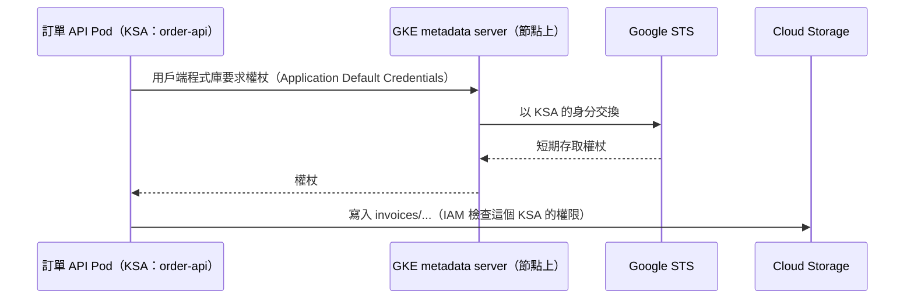

## 這是什麼

訂單 API 要把發票 PDF 寫進 Cloud Storage、從 Secret Manager 讀取機密、以 IAM 驗證連 Cloud SQL，都需要 GCP 的權限。最直覺的做法是下載一個服務帳號的 JSON 金鑰放進 Secret，但這把金鑰不會過期，外洩了誰都能拿來用。

**Workload Identity Federation for GKE** 讓 Pod 以自己的 Kubernetes ServiceAccount 身分，向 GCP 換取短期的存取權杖。你在 IAM 上直接授權給這個 ServiceAccount，程式裡不需要任何金鑰。

## 運作原理



Google Cloud 的用戶端程式庫會依 **Application Default Credentials** 的順序尋找憑證。在啟用了工作負載身分的 GKE 上，Pod 的請求會被導向節點上的 GKE metadata server，由它代表這個 Pod 的 Kubernetes ServiceAccount 取得權杖。

IAM 中可以直接以 principal 的形式授權給某個 Namespace 中的某個 ServiceAccount，例如：
`principal://iam.googleapis.com/projects/<專案編號>/locations/global/workloadIdentityPools/<專案 ID>.svc.id.goog/subject/ns/shop/sa/order-api`

Autopilot 叢集預設啟用工作負載身分；Standard 叢集要在叢集與節點池上啟用。

## 常見錯誤與正確寫法

### 1. 下載服務帳號金鑰放進 Secret

金鑰長期有效，任何能讀到 Secret 的人都能使用，輪替也很麻煩。改成直接授權給 Kubernetes ServiceAccount：

```bash
# 讓 shop 命名空間的 order-api ServiceAccount 可以寫入發票 bucket
gcloud storage buckets add-iam-policy-binding gs://shop-invoices \
  --role=roles/storage.objectCreator \
  --member="principal://iam.googleapis.com/projects/123456789012/locations/global/workloadIdentityPools/shop-prod.svc.id.goog/subject/ns/shop/sa/order-api"
```

Deployment 指定 `serviceAccountName: order-api`；程式使用預設的憑證即可：

```csharp
// 套件：Google.Cloud.Storage.V1
// 不傳任何憑證：用戶端程式庫依 Application Default Credentials 取得工作負載身分的權杖
builder.Services.AddSingleton(_ => StorageClient.Create());
```

### 2. 所有應用程式共用節點的服務帳號

應用程式靠節點的服務帳號存取 GCP，代表同一個節點上的所有 Pod 都有相同的權限。被入侵一個 Pod，就拿到了所有服務的權限。每個工作負載各自一個 Kubernetes ServiceAccount，只授權它需要的資源與動作。

### 3. 把不同的身分混為一談

| 身分 | 用途 | 管理位置 |
| --- | --- | --- |
| 買家／店家帳號 | 誰在使用 API | 身分服務、JWT，見 [驗證與授權](/security/authentication/) |
| Kubernetes RBAC | 誰能操作 Kubernetes API | Role、RoleBinding |
| 工作負載身分 | Pod 能存取哪些 GCP 資源 | IAM 授權給 Kubernetes ServiceAccount |
| CI 的身分 | 部署流程能推映像、改叢集 | Workload Identity Federation（GitHub OIDC），見 [CI/CD](/engineering/ci-cd/) |

「Pod 有 GCP 權限」不代表「Pod 能操作 Kubernetes」，反之亦然；每一種身分都要各自以最小權限設定。

## 使用邊界

- 部分 GCP 服務或舊版函式庫對直接授權給 Kubernetes ServiceAccount 的支援有限，這時可以改用「Kubernetes ServiceAccount 扮演 IAM 服務帳號」的做法（以 `iam.gke.io/gcp-service-account` 註記連結），細節見官方文件。
- 使用 NetworkPolicy 限制對外連線時，要允許 Pod 連到 metadata server，否則取不到權杖。
- AWS 上對應的機制是 EKS Pod Identity，見 [EKS Pod Identity](/platforms/eks/pod-identity/)。

## 雲端排查

### 叢集層（GKE 與 EKS 相同）

```bash
# Pod 使用的 ServiceAccount
kubectl get pod <pod-name> -n shop -o jsonpath='{.spec.serviceAccountName}'
```

### 託管服務層

#### GKE

```bash
# 叢集是否啟用工作負載身分（輸出應為 <專案 ID>.svc.id.goog）
gcloud container clusters describe shop --region=asia-east1 \
  --format='value(workloadIdentityConfig.workloadPool)'

# 用同一個 ServiceAccount 啟動臨時 Pod，確認拿到的身分與權限
kubectl run wi-test -n shop --rm -it --image=google/cloud-sdk:slim \
  --overrides='{"spec":{"serviceAccountName":"order-api"}}' -- \
  gcloud auth print-access-token --quiet > /dev/null && echo "取得權杖成功"

# 某個資源上有哪些授權
gcloud storage buckets get-iam-policy gs://shop-invoices
```

取得權杖成功但存取資源被拒（`403 PERMISSION_DENIED`），問題在 IAM 授權的 principal 字串或角色；連權杖都取不到，問題在叢集或節點池沒有啟用工作負載身分，或 NetworkPolicy 擋住了 metadata server。

#### EKS

Pod Identity 的關聯與信任政策檢查，見 [EKS Pod Identity](/platforms/eks/pod-identity/)的雲端排查。

### 應用程式層

應用程式日誌中的 `PermissionDenied` 例外通常會帶出被拒絕的資源與權限名稱；把它和 IAM 授權對照，就知道少了哪一個角色。
