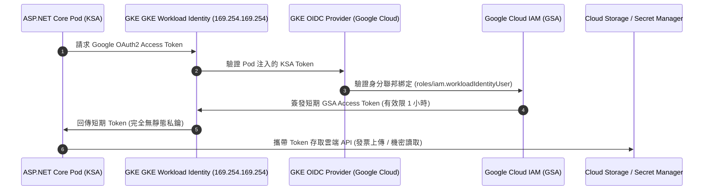

當 ASP.NET Core 微服務部署在 GKE 上時，應用程式經常需要與 Google Cloud 的原生代管服務互動（例如向 Secret Manager 讀取金流私鑰、將訂單發票 PDF 上傳至 Cloud Storage、或是透過 Pub/Sub 派發事件）。如何讓容器內的程式以安全、無密碼且最小權限的方式取得 Google Cloud IAM 授權，是雲端原生架構中至關重要的安全防線。

## 案發現場

某電商企業在一次第三方資安合規紅隊演練中，被揭露了災難性的權限控制漏洞：

1. **長期靜態 JSON 私鑰洩漏**：開發人員為了讓訂單 API 能上傳發票至 Cloud Storage，在 GCP 控制台下載了 Google 服務帳號（GSA）的長期私鑰檔案（`sa-key.json`），並將其轉為 Kubernetes Secret 掛載進容器。半年後，這把未設定過期機制的私鑰在兼職工程師的個人筆電備份中遭到外洩，攻擊者直接利用該金鑰讀取了包含數百萬筆顧客交易紀錄的儲存貯體（Bucket）。
2. **節點權限過大被 Pod 橫向竊取**：團隊在建立 GKE Standard 叢集時，未指定專用服務帳號，節點預設繼承了 Google Compute Engine 的預設服務帳號；而維運人員因圖省事，直接給該預設帳號授予了專案層級的 `Editor` 權限。某個存在套件漏洞的前台商品查詢 Pod 被植入 WebShell 後，攻擊者直接向節點本機 Link-local 位址 `http://169.254.169.254/computeMetadata/v1/` 發起查詢，成功取得了擁有全專案編輯權限的 Access Token！
3. **身分層級模糊與職責混亂**：技術團隊將四種截然不同的身分機制混為一談：將前台買家的 JWT 權限、Kubernetes RBAC 內部權限、Google Cloud IAM 雲端權限以及 CI/CD Pipeline 部署身分綁定在一起，導致單一身分異常時引發連鎖失控。



## 反模式與正確解法

### 反模式一：下載並掛載長期靜態服務帳號 JSON 私鑰

在容器中掛載 `sa-key.json` 具有極高的營運風險：私鑰不會自動過期、缺乏自動輪替機制、容易被打包進 Docker 映像檔或外洩至日誌與備份中。

#### 正確解法：全面啟用 Workload Identity Federation for GKE

徹底淘汰任何靜態私鑰，透過 GKE 原生身分聯邦，將 Kubernetes ServiceAccount（KSA）與 Google 服務帳號（GSA）雙向綁定：
1. **建立專屬 GSA 並授予最小雲端權限**：
```bash
# 建立專為訂單 API 設計的 Google 服務帳號
gcloud iam service-accounts create order-api-gsa \
    --project=ecommerce-prod-project

# 授予讀取指定 Secret 的權限（而非全專案 Secret Manager Admin）
gcloud secrets add-iam-policy-binding payment-gateway-secret \
    --member="serviceAccount:order-api-gsa@ecommerce-prod-project.iam.gserviceaccount.com" \
    --role="roles/secretmanager.secretAccessor"
```

2. **建立專屬 KSA 並建立雙向聯邦信任**：
```bash
# 允許 KSA 模擬該 GSA
gcloud iam service-accounts add-iam-policy-binding \
    order-api-gsa@ecommerce-prod-project.iam.gserviceaccount.com \
    --role="roles/iam.workloadIdentityUser" \
    --member="serviceAccount:ecommerce-prod-project.svc.id.goog[ecommerce-prod/order-api-ksa]"
```

3. **在 Kubernetes ServiceAccount 上加上 Annotation**：
```yaml
apiVersion: v1
kind: ServiceAccount
metadata:
  name: order-api-ksa
  namespace: ecommerce-prod
  annotations:
    iam.gke.io/gcp-service-account: order-api-gsa@ecommerce-prod-project.iam.gserviceaccount.com
```

4. **在 Deployment 中指定該 ServiceAccount**：
```yaml
spec:
  template:
    spec:
      serviceAccountName: order-api-ksa
      containers:
      - name: api
        image: ecommerce-registry.internal/order-api:v2.1.0
```

ASP.NET Core 應用程式在呼叫官方 Google Cloud SDK（例如 `SecretManagerServiceClient.Create()`）時，SDK 會全自動感知當前環境並向 GKE Metadata Server 請求短期 Token，程式碼中完全不需要任何金鑰路徑！

### 反模式二：依賴節點預設服務帳號，所有工作負載共用節點身分

未啟用 Workload Identity 時，Pod 發起的雲端請求會 fallback 至底層虛擬機節點的 Compute Engine 預設服務帳號。這會導致叢集內所有的 Pod（包括低安全等級的內部測試工具）都繼承了相同的節點身分，違背最小權限原則。

#### 正確解法：隔離節點身分與工作負載身分

- 叢集建立時強制啟用 Workload Identity（Autopilot 預設啟用）。
- 節點池本身的服務帳號僅配置節點基礎運作所需的最小角色（如 `roles/logging.logWriter`、`roles/monitoring.metricWriter`、`roles/artifactregistry.reader`）。
- 應用程式一律透過專屬 KSA 綁定 GSA，彼此權限嚴格隔離。

### 反模式三：混淆四大身分體系邊界

| 身分體系 | 驗證主體 | 授權邊界 | 電商實例 |
| :--- | :--- | :--- | :--- |
| **應用使用者身分** | 外部買家 / 顧客 | 業務 API 授權 (ASP.NET Core JWT / OAuth2) | 檢查買家是否有權查看 `/orders/12345` |
| **Kubernetes RBAC** | 內部 Pod / 維運人員 | Kubernetes API Server 資源 (Pods, ConfigMaps) | 控制器是否有權更新 Deployment 狀態 |
| **Google Cloud IAM** | 雲端資源工作負載 (GSA) | Google Cloud API (Cloud Storage, BigQuery) | 訂單 API 是否有權讀取 Secret Manager |
| **CI/CD Pipeline 聯邦** | GitHub Actions / GitLab | GCP 部署發布權限 (Workload Identity Federation) | CI Pipeline 是否有權推送映像並執行發布 |

四大身分各有明確職責，絕對不可互相借道混用。

## 踩坑與避坑指南

### 1. 雙向綁定設定的命名空間與名稱拼寫錯誤
Workload Identity 需要「GSA 的 IAM Policy 允許 KSA」以及「KSA 的 Annotation 指向 GSA」**兩端同時成立**。
- `serviceAccount:<PROJECT_ID>.svc.id.goog[<NAMESPACE>/<KSA_NAME>]` 格式中，若 Namespace 拼寫錯誤，或忘記加上 `.svc.id.goog`，Pod 呼叫雲端 API 時將收到 HTTP 403 `Caller does not have required permission`。

### 2. NetworkPolicy 誤擋 Link-local Metadata 位址（169.254.169.254）
若在 Namespace 中宣告了嚴格的 `NetworkPolicy` 限制 Egress 出站流量，而未白名單放行 GKE 節點本機 Metadata Server（`169.254.169.254:80`），Google Cloud C# SDK 將無法與身分代理通訊，導致請求在連線階段拋出 `HttpRequestException: Connection timed out`。
- **避坑建議**：限制出站時，必須在 Egress 規則中放行至 `169.254.169.254/32` 的 Port 80。

### 3. 本機偵錯與雲端部署的環境變數干擾
在本地開發時，工程師常透過環境變數 `GOOGLE_APPLICATION_CREDENTIALS` 指向本機的 JSON 憑證。當容器映像部署到 GKE 上時，若環境變數中依然殘留此路徑且檔案不存在，Google SDK 會直接拋出檔案找不到例外，而不會 fallback 到 Workload Identity。
- **避坑建議**：在正式環境部署 YAML 中，嚴格禁止宣告 `GOOGLE_APPLICATION_CREDENTIALS` 環境變數。

## 線上排查指令

針對 GKE 工作負載身分授權失敗與 Token 異常，使用下列指令排查：

```bash
# 1. 檢視 Kubernetes ServiceAccount 的 Annotation 是否精確指向目標 GSA
kubectl describe sa order-api-ksa -n ecommerce-prod

# 2. 檢視 Google Service Account 上的 IAM 信任政策（確認 WorkloadIdentityUser 綁定）
gcloud iam service-accounts get-iam-policy \
    order-api-gsa@ecommerce-prod-project.iam.gserviceaccount.com

# 3. 進入 Pod 內部排查能否正常取得 GSA 關聯身分（確認回傳非節點預設帳號）
kubectl exec -it deploy/order-api -n ecommerce-prod -- \
    curl -s -H "Metadata-Flavor: Google" \
    http://169.254.169.254/computeMetadata/v1/instance/service-accounts/default/email

# 4. 進入 Pod 內部排查短期 OAuth2 Access Token 簽發是否正常
kubectl exec -it deploy/order-api -n ecommerce-prod -- \
    curl -s -H "Metadata-Flavor: Google" \
    http://169.254.169.254/computeMetadata/v1/instance/service-accounts/default/token

# 5. 驗證 GSA 對目標雲端資源（如 Secret Manager）是否具備足夠 IAM 角色
gcloud secrets get-iam-policy payment-gateway-secret
```
