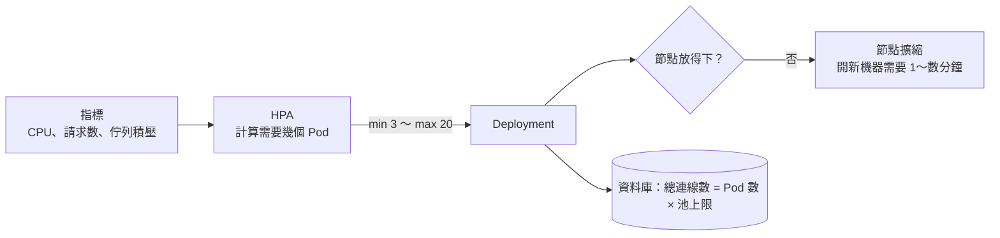

## 這是什麼

大促開始，流量在幾分鐘內變成平常的十倍。**HPA**（水平 Pod 自動擴縮器）會依指標自動增加 Pod 數；流量下降後再減少。節點不夠放新的 Pod 時，**節點擴縮**（GKE 的 Cluster Autoscaler 或 Autopilot、EKS 的 Karpenter 或 Auto Mode）再增加機器。

自動擴縮讓服務能撐住尖峰，但有一個常被忽略的問題：Pod 可以一直加，**下游不一定跟得上**。每個 Pod 都有自己的資料庫連線池，加到 50 個 Pod，資料庫的連線就可能超過上限。

## 運作原理



HPA 大約每 15 秒計算一次：「目前指標值 ÷ 目標值 × 目前 Pod 數」，得出需要的 Pod 數，並受最小與最大值限制。以 CPU 為指標時，使用率是相對於 **requests** 計算的，所以沒寫 requests 就無法依 CPU 擴縮。

不同的工作，適合不同的擴縮指標：

| 工作 | 適合的指標 | 原因 |
| --- | --- | --- |
| API | CPU 或每秒請求數 | 請求越多，CPU 越高 |
| 訊息 Worker | 佇列積壓或最老訊息的等待時間 | Worker 多半在等 I/O，CPU 不高但佇列可能塞爆 |

## 常見錯誤與正確寫法

### 1. 訊息 Worker 依 CPU 擴縮

通知 Worker 大部分時間在等寄信服務回應，CPU 很低。佇列積壓了上萬則訊息，HPA 卻認為不需要擴容。依佇列積壓擴縮，常用 **KEDA**：

```yaml
apiVersion: keda.sh/v1alpha1
kind: ScaledObject
metadata:
  name: notification-worker
  namespace: shop
spec:
  scaleTargetRef:
    name: notification-worker
  minReplicaCount: 1
  maxReplicaCount: 8               # 上限要配合資料庫連線預算與下游容量
  triggers:
    - type: rabbitmq
      metadata:
        queueName: notification
        mode: QueueLength
        value: "100"               # 每個 Worker 負責約 100 則積壓
      authenticationRef:
        name: rabbitmq-auth
```

依鍵分流以保持順序的設計下，Worker 數不能超過佇列數，見 [佇列類型與順序](/infrastructure/rabbitmq/queues-ordering/)。

### 2. 最大副本數沒有考慮下游

API 的 `maxReplicas` 設成 100，資料庫連線上限只有 500，每個 Pod 的池上限是 20。擴到 25 個以上時，新的 Pod 就開始拿不到連線。最大副本數要和資料庫的連線預算一起決定，見 [連線池預算](/data-access/pool-capacity/)；擴容到上限仍不夠時，該做的是在入口限流，而不是讓資料庫被壓垮。

### 3. 擴縮太敏感，Pod 數上下震盪

流量一波一波時，HPA 一下擴容、一下縮容，每次縮容都會中斷連線、清空程序內快取。設定縮容的穩定時間與速度：

```yaml
apiVersion: autoscaling/v2
kind: HorizontalPodAutoscaler
metadata:
  name: order-api
  namespace: shop
spec:
  scaleTargetRef: { apiVersion: apps/v1, kind: Deployment, name: order-api }
  minReplicas: 3
  maxReplicas: 20
  metrics:
    - type: Resource
      resource: { name: cpu, target: { type: Utilization, averageUtilization: 65 } }
  behavior:
    scaleUp:
      policies: [{ type: Percent, value: 100, periodSeconds: 60 }]  # 每分鐘最多加倍
    scaleDown:
      stabilizationWindowSeconds: 300                               # 指標下降後觀察 5 分鐘才縮容
      policies: [{ type: Pods, value: 2, periodSeconds: 60 }]       # 每分鐘最多減 2 個
```

## 使用邊界

- **節點擴容需要時間。** 從 HPA 決定擴容、開出新的節點、拉映像到 Pod 就緒，可能要數分鐘。可預期的尖峰（大促開始時間）提前手動調高最小副本數，比等自動擴縮可靠。
- 多個 Outbox 發布器同時執行需要工作領取機制，擴容前先確認程式支援多副本，見 [Outbox 與 Inbox](/architecture/outbox-inbox/)。
- 擴縮的設定要用壓測驗證，見 [容量驗證](/data-access/load-validation/)。

## 雲端排查

### 叢集層（GKE 與 EKS 相同）

```bash
# HPA 目前的指標、目標與副本數；-w 持續觀察
kubectl get hpa -n shop -w

# 為什麼沒有擴縮（例如抓不到指標）
kubectl describe hpa order-api -n shop | tail -20

# 因為節點不足而 Pending 的 Pod
kubectl get pods -n shop --field-selector=status.phase=Pending
```

`describe hpa` 的事件中出現 `FailedGetResourceMetric`，代表抓不到指標：通常是 Pod 沒有設定 requests，或指標服務有問題。

### 託管服務層

#### GKE

Autopilot 會自動配置節點；Standard 叢集的 Cluster Autoscaler 決策會寫進 Cloud Logging，可以查詢為什麼沒有擴容：

```bash
gcloud logging read 'resource.type="k8s_cluster" AND logName:"cluster-autoscaler-visibility"' \
  --freshness=1h --limit=10
```

#### EKS

Karpenter 或 Auto Mode 為 Pending 的 Pod 建立 NodeClaim：

```bash
kubectl get nodeclaims
kubectl describe nodeclaim <name> | tail -20   # 無法建立節點的原因（容量不足、子網 IP 不足等）
```

### 應用程式層

把 Pod 數、每秒請求數、P99 延遲與資料庫連線數放在同一張圖上。擴容後 P99 仍沒有下降、資料庫連線數卻一路上升，代表瓶頸在資料庫，繼續加 Pod 只會讓情況更糟。
