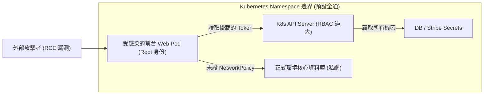

在將 ASP.NET Core 應用程式部署至多環境（開發、測試、生產）時，我們必須將「映像構建」與「執行期配置」嚴格解耦。然而，配置注入不僅僅是環境變數的傳遞，更牽涉到機密資料的生命週期保護、Kubernetes 內部 API 權限控制、主機安全上下文（SecurityContext）以及微服務間的網路隔離。

## 案發現場

某電商平台遭遇了一次內部資安滲透測試的嚴重警告：紅隊工程師利用促銷頁面一個舊版套件的遠端程式碼執行（RCE）漏洞攻陷了前台 Web 容器，並在短短 10 分鐘內橫向滲透取得正式環境資料庫的全量管理員密碼：

1. **Secret 誤作加密防線**：團隊將包含資料庫密碼與第三方支付私鑰的 Kubernetes Secret 直接提交至公開 Git 倉庫，認為 Base64 編碼即具備安全性；且 etcd 儲存未開啟靜態加密（Encryption at Rest）。
2. **預設權限過大被橫向利用**：該前台 Web Pod 掛載了預設的 `default` ServiceAccount，此帳號被維運人員因圖方便綁定了整個 Namespace 的管理員權限。攻擊者利用 Pod 內自動掛載的 Token（`/var/run/secrets/kubernetes.io/serviceaccount/token`）直接呼叫 Kubernetes API Server，下載了全命名空間的機密資料。
3. **特權容器逃逸風險**：容器映像使用 `root` 使用者啟動，且未限制 Linux Capabilities 與檔案系統寫入權限，攻擊者可在容器內任意安裝工具、竊聽節點流量。
4. **網路完全未隔離**：叢集內部未宣告任何 `NetworkPolicy`，預設為「全網互通（Flat Network）」。受損的前台 Pod 可以直接連通後端金流支付服務與內部 Redis 快取。



## 反模式與正確解法

### 反模式一：混淆 ConfigMap 與 Secret，或將 Base64 視為機密防線

ConfigMap 用於非敏感的業務參數（如快取過期時間、日誌等級、功能開關），其內容在叢集內為純文字保存。Secret 用於保存連線字串、憑證與金鑰，但原生 Kubernetes Secret 的 `data` 欄位僅為 Base64 編碼，任何人透過 `kubectl get secret -o yaml` 都能直接解碼還原。

#### 正確解法：職責切分、KMS 靜態加密與外部金鑰管理

1. **非敏感與機密嚴格拆分**：非敏感設定使用 ConfigMap，敏感資料使用 Secret。
2. **控制平面開啟 KMS 靜態加密**：由雲端提供商或 KMS（如 Google Cloud KMS、AWS KMS）對 etcd 中的 Secret 資料進行封套加密（Envelope Encryption）。
3. **整合外部金鑰管理中樞**：使用 External Secrets Operator 或 Secret Store CSI Driver，從雲端 Secret Manager 或 HashiCorp Vault 動態同步機密，杜絕將金鑰寫入 Git：

```yaml
apiVersion: v1
kind: ConfigMap
metadata:
  name: order-api-config
  namespace: ecommerce-prod
data:
  Logging__LogLevel__Default: "Information"
  Cache__ProductTtlSeconds: "300"
---
apiVersion: v1
kind: Secret
metadata:
  name: order-api-secrets
  namespace: ecommerce-prod
type: Opaque
stringData: # stringData 允許宣告純文字，由 K8s 自動轉為 Base64，但檔案禁止提交至 Git
  ConnectionStrings__OrderDatabase: "Server=db.internal;Database=OrderDb;User Id=order_app;Password=SuperSecurePassword123!;"
```

在 ASP.NET Core Deployment 中透過環境變數安全注入：

```yaml
spec:
  containers:
  - name: api
    image: ecommerce-registry.internal/order-api:v2.1.0
    envFrom:
    - configMapRef:
        name: order-api-config
    - secretRef:
        name: order-api-secrets
```

### 反模式二：所有 Pod 共用 default 帳號且自動掛載 API Token

Kubernetes 預設會為每個 Pod 掛載當前 Namespace 的 `default` ServiceAccount Token。絕大多數業務 Web API 根本不需要呼叫 Kubernetes API Server，自動掛載 Token 形同為主機攻擊者開了一扇任意嘗試 API 的後門。

#### 正確解法：關閉自動 Token 掛載與實施 RBAC 最小權限原則

若工作負載不需要存取 Kubernetes API，顯式關閉 Token 掛載：

```yaml
spec:
  automountServiceAccountToken: false
```

若應用程式（例如某些自研控制器或健康檢測代理）確實需要操作 API，必須建立專屬 ServiceAccount，並透過 `Role` 與 `RoleBinding` 嚴格限制資源類型與動詞（Verbs）：

```yaml
apiVersion: v1
kind: ServiceAccount
metadata:
  name: order-operator-sa
  namespace: ecommerce-prod
---
apiVersion: rbac.authorization.k8s.io/v1
kind: Role
metadata:
  name: pod-reader
  namespace: ecommerce-prod
rules:
- apiGroups: [""]
  resources: ["pods"]
  verbs: ["get", "list", "watch"] # 僅賦予讀取權限，嚴格禁止 write/update/delete
---
apiVersion: rbac.authorization.k8s.io/v1
kind: RoleBinding
metadata:
  name: read-pods-binding
  namespace: ecommerce-prod
subjects:
- kind: ServiceAccount
  name: order-operator-sa
  namespace: ecommerce-prod
roleRef:
  kind: Role
  name: pod-reader
  apiGroup: rbac.authorization.k8s.io
```

### 反模式三：以 Root 身分執行容器且開放主機提權

容器預設若以 UID 0（root）執行，且具備 `allowPrivilegeEscalation: true`，攻擊者一旦達成遠端代碼執行，便能透過 Linux Kernel 漏洞逃逸出容器邊界，進而控制底層 Host Node。

#### 正確解法：嚴格宣告工作負載安全上下文（SecurityContext）

在 Pod 與 Container 層級強制啟用非 Root 限制、移除所有 Linux Capabilities，並將根檔案系統設為唯讀：

```yaml
spec:
  securityContext:
    runAsNonRoot: true
    runAsUser: 10001
    runAsGroup: 10001
    fsGroup: 10001
    seccompProfile:
      type: RuntimeDefault
  containers:
  - name: api
    securityContext:
      allowPrivilegeEscalation: false
      readOnlyRootFilesystem: true # 唯讀檔案系統，防止被寫入惡意後門木馬
      capabilities:
        drop:
        - ALL                      # 移除所有 Linux 特權
    volumeMounts:
    - name: temp-storage
      mountPath: /tmp             # 若 ASP.NET Core 需要寫入暫存檔，掛載獨立 emptyDir
  volumes:
  - name: temp-storage
    emptyDir: {}
```

## 踩坑與避坑指南

### 1. ConfigMap / Secret 的熱更新（Hot Reload）陷阱
- **環境變數（env / envFrom）**：在容器啟動後即被固定注入 Linux 程序環境中。即使線上修改了 ConfigMap，正在執行的程序**絕對不會**自動更新，必須對 Deployment 執行 `rollout restart`。
- **Volume 掛載方式**：Kubernetes 會透過符號連結（symlink）定期同步檔案更新，但若在 VolumeMount 中使用了 `subPath`，則該檔案**永久不會**接收到後續的更新！
- **C# 應用程式監聽**：ASP.NET Core 中只有使用 `IOptionsMonitor<T>` 或 `IOptionsSnapshot<T>` 配合 `reloadOnChange: true` 的實體檔案，才能在 Volume 內容變更時即時感知；且快取連線池（如 `ConnectionMultiplexer`）通常需要自行撰寫重新連線邏輯，無法單靠 Options 框架自動重建連線。

### 2. NetworkPolicy 預設為全通，且套用後需顯式放行 DNS
Kubernetes 預設所有 Pod 之間全網互通。當你在 Namespace 中建立第一條 `NetworkPolicy` 限制 Ingress / Egress 時，未被明確白名單放行的流量將全面被阻擋。
- **避坑建議**：如果限制了 Pod 的 Egress 出站流量，**務必明確放行 kube-system 的 CoreDNS 連接埠**（UDP/TCP 53），否則 Pod 甚至無法解析資料庫或任何服務的網域名稱，引發全線超時：

```yaml
egress:
- to:
  - namespaceSelector:
      matchLabels:
        kubernetes.io/metadata.name: kube-system
    podSelector:
      matchLabels:
        k8s-app: kube-dns
  ports:
  - port: 53
    protocol: UDP
  - port: 53
    protocol: TCP
```

### 3. RBAC 權限僅支援加總（Additive Only）
Kubernetes RBAC 採用白名單模式，**沒有任何顯式的 Deny（拒絕）規則**。只要攻擊者取得的身分被任何一個 RoleBinding 或 ClusterRoleBinding 賦予了權限，該權限即生效。務必定期清查過時的 `ClusterRoleBinding`，切勿隨意綁定 `cluster-admin`。

## 線上排查指令

針對權限異常、機密排查與網路阻擋問題，可依下列指令排查：

```bash
# 1. 檢視 Namespace 下所有 ConfigMap 與 Secret（不顯示機密本體）
kubectl get cm,secret -n ecommerce-prod

# 2. 安全解碼 Secret 指定欄位內容（排查連線字串是否正確）
kubectl get secret order-api-secrets -n ecommerce-prod -o jsonpath="{.data['ConnectionStrings__OrderDatabase']}" | base64 -d

# 3. 模擬指定 ServiceAccount 驗證 RBAC 權限（測試最小權限原則）
kubectl auth can-i get pods --as=system:serviceaccount:ecommerce-prod:order-operator-sa -n ecommerce-prod
kubectl auth can-i delete secrets --as=system:serviceaccount:ecommerce-prod:order-operator-sa -n ecommerce-prod

# 4. 檢視 Pod 當前生效的 SecurityContext 與 UID 執行狀態
kubectl get pod <pod-name> -n ecommerce-prod -o jsonpath="{.spec.securityContext}"
kubectl get pod <pod-name> -n ecommerce-prod -o jsonpath="{.spec.containers[*].securityContext}"

# 5. 排查當前生效的 NetworkPolicy 隔離規則
kubectl get networkpolicy -n ecommerce-prod
kubectl describe networkpolicy isolate-order-db -n ecommerce-prod
```
