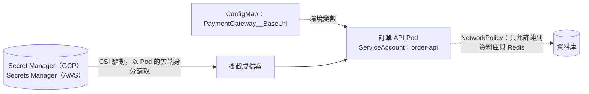

## 這是什麼

訂單 API 需要兩類設定：

- **一般設定**：付款閘道的網址、逾時秒數、功能開關。看到也沒關係。
- **機密**：資料庫密碼、付款閘道的 API 金鑰。外洩會造成損失。

Kubernetes 用 **ConfigMap** 放一般設定、**Secret** 放機密。但 Secret 預設只是把值做 Base64 編碼（任何人都能解開），並沒有加密；能讀取 Secret 的人就能看到密碼。所以機密的真正來源應該是雲端的機密管理服務，叢集只在需要時取用。

另外還有「誰能做什麼」的問題：Pod 能不能呼叫 Kubernetes API、能不能連到其他服務、容器能不能以 root 執行。

## 運作原理



**機密的來源**：GKE 與 EKS 都可以透過 Secrets Store CSI Driver，讓 Pod 以自己的雲端身分（Workload Identity／Pod Identity）讀取 Secret Manager 或 Secrets Manager 中的機密，掛載成檔案。機密的存取權限、輪替與稽核都在雲端服務上管理。

**ServiceAccount 與 RBAC**：每個 Pod 都以一個 ServiceAccount 執行。預設會使用該 Namespace 的 `default` 帳號，並把可以呼叫 Kubernetes API 的 token 掛進容器。一般的 API 服務不需要呼叫 Kubernetes API，應該關掉。

**NetworkPolicy**：預設所有 Pod 之間都可以互連。NetworkPolicy 可以限制「誰可以連到我」「我可以連到誰」；一旦對某個 Pod 套用了限制，沒有明確允許的流量就會被拒絕。

## 常見錯誤與正確寫法

### 1. 把密碼放進 ConfigMap 或版本控制

```yaml
# 錯：ConfigMap 是明文，而且這份 YAML 會被提交到版本控制
apiVersion: v1
kind: ConfigMap
data:
  ConnectionStrings__Shop: "Host=...;Password=SuperSecret123"
```

一般設定放 ConfigMap，密碼由 CSI 驅動從雲端機密服務掛載。應用程式讀取掛載的檔案作為設定來源（.NET 可以用 `AddKeyPerFile` 把一個目錄下的每個檔案當成一個設定鍵）：

```csharp
// 套件：Microsoft.Extensions.Configuration.KeyPerFile
builder.Configuration.AddKeyPerFile(directoryPath: "/mnt/secrets", optional: true, reloadOnChange: true);
```

### 2. 所有 Pod 使用 default 帳號並掛載 API token

```yaml
apiVersion: v1
kind: ServiceAccount
metadata:
  name: order-api
  namespace: shop
automountServiceAccountToken: false   # 不需要呼叫 Kubernetes API 就不要掛 token
```

每個服務一個 ServiceAccount，這同時是它取得雲端權限的身分，見 [GKE 工作負載身分](/platforms/gke/workload-identity/)與 [EKS Pod Identity](/platforms/eks/pod-identity/)。

### 3. 容器以 root 執行，檔案系統可寫

```yaml
securityContext:
  runAsNonRoot: true
  allowPrivilegeEscalation: false
  readOnlyRootFilesystem: true      # 需要暫存檔時，另外掛一個 emptyDir 到 /tmp
  capabilities:
    drop: ["ALL"]
```

.NET 官方映像預設以非 root 使用者執行，見 [容器映像](/infrastructure/containers-networking/image-runtime/)。

### 4. 套用 NetworkPolicy 後 DNS 失效

限制了 Pod 的對外連線，卻忘了允許 DNS（UDP／TCP 53），所有用名稱連線的呼叫都會失敗。對外的 NetworkPolicy 一定要明確允許到 kube-dns（或叢集 DNS）的流量。

## 使用邊界

- 機密的集中管理與輪替見 [機密管理](/security/secrets-management/)。
- 掛載的機密檔案在雲端輪替後會更新（依驅動的設定），但環境變數不會；用 `reloadOnChange` 讀檔案，或在輪替後重新部署。
- RBAC 只能「加上」權限，不能扣除。從最小權限開始，需要時再加。
- NetworkPolicy 需要叢集的網路外掛支援：GKE 的 Dataplane V2 內建支援；EKS 的 VPC CNI 需要開啟網路政策功能。

## 雲端排查

### 叢集層（GKE 與 EKS 相同）

```bash
# Pod 使用哪個 ServiceAccount、是否掛載了 API token
kubectl get pod <pod-name> -n shop -o jsonpath='{.spec.serviceAccountName}{"\t"}{.spec.automountServiceAccountToken}{"\n"}'

# 某個 ServiceAccount 能做哪些事
kubectl auth can-i --list --as=system:serviceaccount:shop:order-api -n shop

# 機密掛載失敗時，事件會說明是權限還是名稱錯誤
kubectl describe pod <pod-name> -n shop | grep -i -A3 "secret\|mount"
```

### 託管服務層

#### GKE

```bash
# Secret Manager 中的機密與版本
gcloud secrets versions list shop-db-password

# 誰可以讀這個機密（Pod 的身分應該在清單中）
gcloud secrets get-iam-policy shop-db-password
```

#### EKS

```bash
aws secretsmanager describe-secret --secret-id shop/db-password \
  --query '{rotation:RotationEnabled,lastRotated:LastRotatedDate}'
```

Pod 讀不到機密時，確認 Pod Identity 對應的 IAM 角色有該機密的 `secretsmanager:GetSecretValue` 權限。

### 應用程式層

應用程式啟動時用 `ValidateOnStart` 檢查必要設定是否存在，見 [Options](/frameworks/aspnet-core/options/)；機密讀不到時立即失敗，比上線後才發現更容易處理。日誌中永遠不要印出連線字串或密碼。
