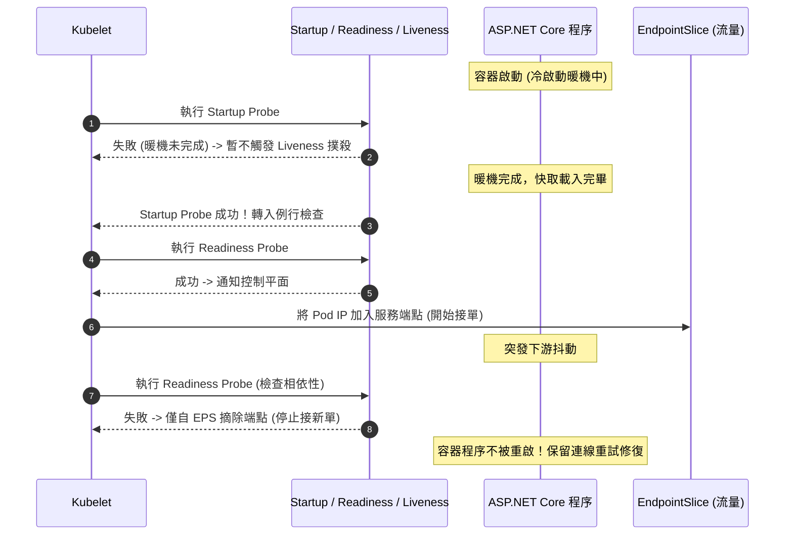

在 Kubernetes 叢集中運行 ASP.NET Core 微服務時，「容器程序已啟動（PID 存活）」並不等同於「應用程式已具備服務能力」。缺乏精確的健康探針（Probes）設計與資源配額（Requests/Limits），是導致微服務在面臨高負載尖峰時引發連鎖崩潰（Cascading Failure）的最常見根因。

## 案發現場

某電商核心訂單系統在年中慶特賣活動期間，進行了一次緊急熱修復發布。部署指令下達後，系統不但沒有平穩切換，反而引發全站級別的可用率雪崩：

1. **連鎖雪崩重啟（CrashLoopBackOff）**：新版訂單 API 在啟動時需預載千萬級商品目錄索引與暖機 EF Core 查詢模型，冷啟動需耗時 45 秒。然而部署清單配置了預設的 Liveness Probe（10 秒超時檢查一次），在程序尚未完成暖機前，Kubelet 即認定容器無回應並強制殺死重啟，所有 Pod 陷入無限循環的重啟死局。
2. **下游抖動引發全滅**：Liveness Probe 實作中包含了檢查下游 Redis 快取與資料庫連線的邏輯。當 Redis 發生 3 秒鐘的網路抖動時，全叢集 20 個訂單 API Pod 的存活檢查全數失敗，Kubelet 同步重啟所有 Pod，瞬間讓連線資料庫的連線池歸零，外部流量遭遇 100% 拒絕。
3. **無預警 OOMKilled（Exit Code 137）**：促銷開始後，大量查詢請求湧入商品 API，記憶體用量迅速攀升。因為未針對 .NET 垃圾回收機制配置合理的容器 cgroup 上限，Linux 核心 OOM Killer 直接介入，以無條件 `SIGKILL` 撲殺了數個核心 Pod。
4. **CPU 節流引發 P99 延遲暴增**：維運將 CPU Limit 設得極其嚴苛（0.5 Core），導致容器在高負載時觸發 Linux CFS Quota 節流（Throttling），原本 50ms 的 API 延遲飆升至 3,000ms 以上，前端逾時報錯。



## 反模式與正確解法

### 反模式一：單一 `/healthz` 端點包山包海，Liveness 檢查外部相依

許多團隊為了求快，只建立一個 `/healthz` 端點，並在其中查詢資料庫、Redis、訊息佇列乃至外部第三方 API，並將該端點同時綁定給 Liveness Probe 與 Readiness Probe。當外部相依短暫變慢或斷線時，Kubernetes 會直接殺死容器；而重啟根本無法修復外部資料庫故障，反而讓重啟後的數十個 Pod 同時發起連線重試，形成嚴重的重試風暴（Retry Storm）。

#### 正確解法：嚴格分離 Startup、Readiness 與 Liveness 三大探針職責

1. **Startup Probe（啟動探針）**：專門吸收慢速啟動（JIT 編譯、快取載入、連線池暖機）。在 Startup Probe 成功之前，Liveness 與 Readiness 探針處於凍結狀態，不會引發誤殺。
2. **Readiness Probe（就緒探針）**：回答「此 Pod 現在能否接單？」。若本機佇列滿載或核心相依異常，僅將 Pod 自 Service 的 EndpointSlice 摘除，流量不再進來，但**絕對不殺死程序**。
3. **Liveness Probe（存活探針）**：回答「此程序是否死鎖或死循環崩潰？」。**永遠只檢查本機行程內部狀態**（如 ping 本地記憶體標誌或死鎖檢測），嚴禁檢查任何網路外部相依！

```yaml
spec:
  containers:
  - name: api
    image: ecommerce-registry.internal/order-api:v2.1.0
    # 1. 啟動探針：最多允許 30 * 2s = 60 秒啟動期
    startupProbe:
      httpGet:
        path: /healthz/startup
        port: 8080
      failureThreshold: 30
      periodSeconds: 2
    # 2. 就緒探針：每 5 秒檢查一次本機承載能力
    readinessProbe:
      httpGet:
        path: /healthz/ready
        port: 8080
      periodSeconds: 5
      timeoutSeconds: 2
      failureThreshold: 2
    # 3. 存活探針：僅檢測本機死鎖
    livenessProbe:
      httpGet:
        path: /healthz/live
        port: 8080
      periodSeconds: 10
      timeoutSeconds: 2
      failureThreshold: 3
```

ASP.NET Core 中對應的健全檢查配置方式：

```csharp
// Program.cs 中的端點分離設定
builder.Services.AddHealthChecks()
    .AddCheck("self", () => HealthCheckResult.Healthy(), tags: new[] { "live" })
    .AddCheck("db_ready", () => CheckDatabaseReadiness(), tags: new[] { "ready" });

app.MapHealthChecks("/healthz/live", new HealthCheckOptions
{
    Predicate = check => check.Tags.Contains("live") // 僅檢查內部活性
});

app.MapHealthChecks("/healthz/ready", new HealthCheckOptions
{
    Predicate = check => check.Tags.Contains("ready") // 檢查能否承接流量
});
```

### 反模式二：未宣告 Requests/Limits 或過度壓榨 CPU Limit

未宣告 `requests` 會導致 Pod 成為 Best-Effort 等級，節點緊繃時優先遭到逐出（Evicted）。而過度壓低 `cpu.limits` 則會讓 Linux 核心 CFS（Completely Fair Scheduler）觸發配額限制（Quota Throttling），導致即便 Host 節點有充裕 CPU，Pod 依然被強制休眠，造成延遲劇烈飆高。

#### 正確解法：精確宣告 Requests 並依 Workload 特性配置 Limits

對於 .NET 高併發應用：
- **Memory Requests & Limits**：強烈建議將 Request 與 Limit 設為相同（或接近），確保 Pod 獲得 `Guaranteed` QoS 等級，降低被 OOM Killer 挑中為犧牲品的機率。
- **CPU Requests & Limits**：Request 必須滿足日常吞吐量基準（例如 500m），Limit 則建議設為 Request 的 2~4 倍，或在內部無惡意搶奪的情況下適度不設 CPU Limit（依賴節點排程與 HPA 擴縮），避免 CFS 節流損害 P99 延遲。

```yaml
resources:
  requests:
    cpu: "500m"
    memory: "1Gi"
  limits:
    cpu: "2000m"
    memory: "1Gi"
```

### 反模式三：忽略節點維護並未配置 PodDisruptionBudget（PDB）

雲端維運團隊對 Kubernetes Node 進行自動滾動升級（Node Drain）時，若未定義 PDB，控制平面可能一次性逐出所有 Pod 副本，造成線上服務瞬間完全中斷。

#### 正確解法：宣告 PodDisruptionBudget 守護高可用底線

```yaml
apiVersion: policy/v1
kind: PodDisruptionBudget
metadata:
  name: order-api-pdb
  namespace: ecommerce-prod
spec:
  minAvailable: 2 # 節點維護自願中斷期間，保證至少維持 2 個 Pod 處於就緒狀態
  selector:
    matchLabels:
      app.kubernetes.io/name: order-api
```

## 踩坑與避坑指南

### 1. .NET GC 堆與容器 cgroup v2 邊界限制
.NET 8+ 原生支援 cgroup v2 資源限制，但 Server GC 預設會根據可用核心數建立多個 GC 堆並預留記憶體。若容器的 Memory Limit 設定過小（例如低於 512Mi），且突發大量配置，GC 來不及在短時間內觸發 Full GC，Linux 核心即會以 Exit Code 137 撲殺容器。
- **避坑建議**：對於高併發 Web API，建議 Memory Limit 至少給予 1Gi 以上；若在資源受限環境（如 512Mi），可於 `.runtimeconfig.json` 或環境變數配置 `DOTNET_GCHeapHardLimitPercent=75`，強制 GC 在達到容器上限 75% 時即刻啟動回收。

### 2. 探針超時（timeoutSeconds）與 ThreadPool 飢餓
若健康檢查端點包含非同步 I/O 查詢或受到 ASP.NET Core ThreadPool 排程影響，而探針的 `timeoutSeconds` 僅設為 1 秒。在高負載造成 CPU 繁忙、執行緒池排隊時，健康檢查可能需要 1.1 秒才返回，觸發連續失敗而導致 Pod 被錯誤殺死。
- **避坑建議**：`timeoutSeconds` 應設為 2~3 秒，且健康檢查邏輯應極度輕量，不得在其中執行複雜的 LINQ 或大量物件配置。

### 3. preStop Hook 搭配優雅關機時限
Kubernetes 發送終止流程時，Kubelet 在容器停止前可觸發 `preStop` 命令。若未配置 `preStop: sleep 10`，在 Pod 剛收到 SIGTERM 的前幾百毫秒內，外部負載平衡器與 kube-proxy 可能尚未將其自端點完全摘除，導致殘存請求撞進已開始退出的程序。
- **避坑建議**：加入 `preStop` 延遲，並確保 Pod 的 `terminationGracePeriodSeconds`（例如 60 秒）大於 `preStop 時間 + ASP.NET Core HostOptions.ShutdownTimeout`。

## 線上排查指令

針對 Pod 重啟、探針失敗與 OOMKilled 問題，維運人員可使用下列指令精確定位原因：

```bash
# 1. 查看 Pod 終止詳細原因與退出代碼（排查 Exit Code 137 OOMKilled 或 143 SIGTERM）
kubectl describe pod <pod-name> -n ecommerce-prod | grep -A 10 "Last State:"

# 2. 檢視 Pod 上一次崩潰前輸出的容器日誌
kubectl logs <pod-name> -n ecommerce-prod --previous --tail=100

# 3. 即時監控 Pod 與容器層級的 CPU / 記憶體使用率
kubectl top pod -n ecommerce-prod --containers

# 4. 檢查當前生效的 PodDisruptionBudget 與中斷配額
kubectl get pdb -n ecommerce-prod

# 5. 過濾叢集中與探針失敗相關的最近事件
kubectl get events -n ecommerce-prod --field-selector reason=Unhealthy --sort-by='.metadata.creationTimestamp'
```
