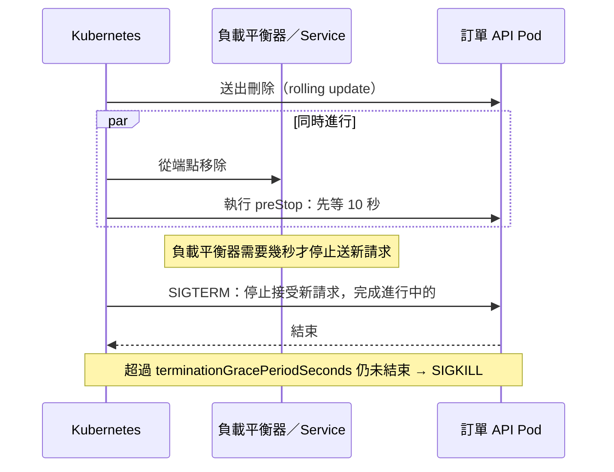

## 這是什麼

Kubernetes 需要知道每個 Pod 的狀況，才能做對決定：剛啟動的 Pod 何時可以開始接流量？卡住的 Pod 該不該重啟？節點維護時一次能移走幾個 Pod？

- **探針**（probe）讓 Kubernetes 定期詢問容器「你還好嗎」。
- **資源設定**（requests 與 limits）讓 Kubernetes 知道 Pod 需要多少 CPU 與記憶體，以及最多能用多少。
- **停止流程**決定 Pod 被移除時，進行中的請求能不能好好完成。

## 運作原理

三種探針回答不同的問題，失敗時的後果也不同：

| 探針 | 問的問題 | 失敗時 |
| --- | --- | --- |
| startup | 啟動完成了嗎？ | 繼續等；超過上限才重啟。完成前不執行另外兩種 |
| readiness | 現在可以接流量嗎？ | 從 Service 的端點移除，**不重啟** |
| liveness | 程序還活著嗎？ | **重啟容器** |



**requests** 是 Pod 宣告「我需要多少」，排程器依此找到放得下的節點，也是 HPA 計算 CPU 使用率的基準。**limits** 是上限：CPU 超過會被節流（變慢），記憶體超過會被終止（OOMKilled）。

## 常見錯誤與正確寫法

### 1. liveness 檢查資料庫

資料庫短暫中斷，所有 Pod 的 liveness 一起失敗，Kubernetes 把所有 Pod 都重啟。資料庫恢復後，大量 Pod 同時啟動、同時建立連線，反而讓資料庫更難恢復。

分成兩個端點：liveness 只回答「程序沒有卡死」，readiness 才檢查依賴：

```csharp
builder.Services.AddHealthChecks()
    .AddCheck("self", () => HealthCheckResult.Healthy(), tags: ["live"])
    .AddNpgSql(sp => sp.GetRequiredService<NpgsqlDataSource>(), tags: ["ready"]); // 套件：AspNetCore.HealthChecks.NpgSql

app.MapHealthChecks("/health/live", new HealthCheckOptions { Predicate = c => c.Tags.Contains("live") });
app.MapHealthChecks("/health/ready", new HealthCheckOptions { Predicate = c => c.Tags.Contains("ready") });
```

```yaml
startupProbe:
  httpGet: { path: /health/live, port: 8080 }
  failureThreshold: 30       # 最多等 30 × 2 = 60 秒完成啟動
  periodSeconds: 2
readinessProbe:
  httpGet: { path: /health/ready, port: 8080 }
  periodSeconds: 5
  timeoutSeconds: 2
livenessProbe:
  httpGet: { path: /health/live, port: 8080 }
  periodSeconds: 10
  timeoutSeconds: 2
  failureThreshold: 3
```

### 2. 沒寫 requests，或 CPU limit 設得太緊

沒寫 requests，排程器以為 Pod 不需要資源，把太多 Pod 塞在同一個節點。CPU limit 太緊，尖峰時程式被節流，延遲升高、探針逾時，Pod 被誤判為不健康。常見做法是：寫 CPU 與記憶體的 requests；記憶體的 limit 依實測設定；CPU 不設 limit 或設得寬鬆。

```yaml
resources:
  requests:
    cpu: "500m"
    memory: "512Mi"
  limits:
    memory: "768Mi"    # 依實測，並留給 .NET runtime 與原生記憶體的空間
```

.NET 會依容器的記憶體上限調整 GC，見 [GC 與容器記憶體](/platforms/dotnet/gc-memory/)。

### 3. 停止時立刻結束，最後幾個請求失敗

在容器上加 `preStop` 等待幾秒，讓負載平衡器先停止送新請求；寬限期要大於「等待時間 + 處理中請求完成的時間」：

```yaml
spec:
  terminationGracePeriodSeconds: 45
  containers:
    - name: order-api
      lifecycle:
        preStop:
          sleep:
            seconds: 10    # Kubernetes 1.30 起支援 sleep 動作；chiseled 映像沒有 sleep 指令可用
```

.NET 的 `HostOptions.ShutdownTimeout`（預設 30 秒）也要小於寬限期，見 [Generic Host](/platforms/dotnet/hosting/)。

### 4. 節點維護時所有副本一起被移走

設定 PodDisruptionBudget，限制自願中斷（節點升級、縮減）時至少保留多少可用的副本：

```yaml
apiVersion: policy/v1
kind: PodDisruptionBudget
metadata:
  name: order-api
  namespace: shop
spec:
  minAvailable: 2
  selector:
    matchLabels:
      app: order-api
```

## 使用邊界

- 探針端點要很快、不做昂貴的工作；探針逾時常常是執行緒池耗盡的症狀，見 [ThreadPool 耗盡](/platforms/dotnet/threadpool/)。
- GKE Autopilot 會依規則調整 Pod 的 requests（例如最小值與比例），實際配置以 Pod 的規格為準。
- 背景 Worker 的停止要額外處理：停止接收新工作，未完成的訊息不 Ack，見 [.NET 整合 RabbitMQ](/infrastructure/rabbitmq/dotnet-integration/)。

## 雲端排查

### 叢集層（GKE 與 EKS 相同）

```bash
# 探針失敗會出現在事件中（Unhealthy、Killing）
kubectl get events -n shop --field-selector involvedObject.name=<pod-name> --sort-by=.lastTimestamp

# 重啟次數與上次結束原因（OOMKilled、Error）
kubectl get pod <pod-name> -n shop -o jsonpath='{.status.containerStatuses[0].restartCount}{"\t"}{.status.containerStatuses[0].lastState.terminated.reason}{"\n"}'

# 實際用量和 requests 的差距
kubectl top pod -n shop -l app=order-api
```

### 託管服務層

#### GKE

負載平衡器有自己的健康檢查，和 readiness 是兩層，見 [GKE Gateway](/platforms/gke/gateway-networking/)。Cloud Monitoring 的 `kubernetes.io/container/cpu/limit_utilization` 接近 1 代表正在被節流；`kubernetes.io/container/memory/limit_utilization` 接近 1 代表快被 OOMKilled。

#### EKS

ALB 的健康檢查看 `describe-target-health`，見 [EKS 對外流量](/platforms/eks/load-balancing/)。Container Insights 的 `pod_cpu_utilization_over_pod_limit` 與 `pod_memory_utilization_over_pod_limit` 顯示用量相對於上限的比例。

### 應用程式層

記錄每次停止的時間軸：收到 SIGTERM、最後一個請求完成、程序結束。停止時間經常接近寬限期，代表有請求或背景工作沒有回應取消，要回頭檢查 `CancellationToken` 是否傳到底。
