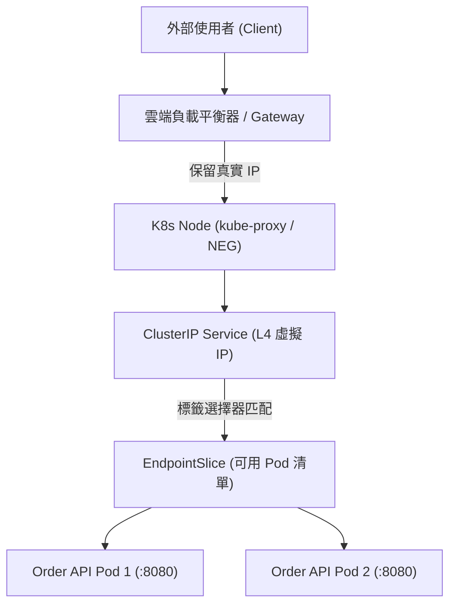

在 Kubernetes 動態排程環境中，Pod 隨時可能因為擴縮容、節點故障或版本部署而銷毀重建，其內部 IP 位址具備高度揮發性。為了解決後端微服務之間的連線定址，以及外部使用者造訪叢集內部應用的需求，Kubernetes 提供了四層（L4）的 Service 抽象與七層（L7）的 Gateway API 路由體系。

## 案發現場

某電商平台的購物車服務在呼叫商品目錄 API 時，尖峰期間頻繁拋出 `HttpRequestException: Connection refused` 與 HTTP 502 Bad Gateway 錯誤，同時安全風控團隊回報所有外部訂單請求的來源 IP 全數變成叢集 Node 節點的內部私有 IP，導致防刷單機制徹底失效：

1. **標籤選擇器拼寫錯誤**：發布新版商品 API 後，Service 的 `spec.selector` 遺漏了環境標籤，導致 Service 底下的 `EndpointSlice` 為空（0 endpoints），內部流量直接丟失。
2. **連接埠配置混淆**：將 Service 的 `port` 與容器監聽的 `targetPort` 搞混，呼叫端連線到 80 連接埠，但封包轉發至尚未監聽該埠的 Pod，引發連線被拒。
3. **客戶端真實 IP 遺失**：對外暴露的 Service 採用預設的 `externalTrafficPolicy: Cluster`，外部封包經過節點 SNAT（來源網路位址轉換），致使 ASP.NET Core 取得的 `HttpContext.Connection.RemoteIpAddress` 全為節點內網 IP。
4. **Ingress 單體規則失控**：所有微服務共用單一 Ingress 巨大設定檔，業務團隊為了調整金絲雀分流權重，意外改壞了全站 TLS 憑證路徑，導致購物車與付款入口全面癱瘓。



## 反模式與正確解法

### 反模式一：直連 Pod IP 或混淆 Service Port 與 TargetPort

開發者在微服務連線字串中寫死 Pod IP，或誤以為 Service 是一個實體代理程序，任意配置 port。當 Pod 重啟換 IP 時服務斷線；或將 Service 的 `port: 80` 轉向錯誤的容器連接埠，導致封包撞牆。

#### 正確解法：明確定義 ClusterIP 與正確映射埠號

Service 在 Kubernetes 內部本質上是一組虛擬 IP（VIP）與 iptables / IPVS 轉發規則。叢集內部呼叫一律使用穩定 DNS 名稱，並明確區分 Service Port（呼叫端所見）與 Container targetPort（Kestrel 監聽埠）：

```yaml
apiVersion: v1
kind: Service
metadata:
  name: catalog-service
  namespace: ecommerce-prod
  labels:
    app.kubernetes.io/name: catalog-service
spec:
  type: ClusterIP
  selector:
    app.kubernetes.io/name: catalog-api # 必須與 Pod template labels 精確匹配
  ports:
  - name: http
    port: 80             # 內部微服務呼叫端存取的連接埠
    targetPort: 8080     # ASP.NET Core 容器內部 Kestrel 監聽的連接埠
    protocol: TCP
```

內部微服務呼叫端（如購物車服務）只需使用標準的 CoreDNS 名稱：
`http://catalog-service.ecommerce-prod.svc.cluster.local/api/products`

### 反模式二：使用巨大的單體 Ingress 管理全站七層路由

舊式 Ingress API 將主機名稱、TLS 憑證、基礎設施負載平衡器型態、路徑轉發規則與外掛註解（Annotations）全部塞在單一資源中。在跨團隊協作時，平台團隊與業務團隊職責邊界模糊，極易因單一欄位誤動引發全站雪崩，且缺乏原生的百分比金絲雀權重支援。

#### 正確解法：採用 Gateway API 實踐角色解耦與精準分流

Gateway API（已晉升為正式標準）將入口架構拆解為三個核心角色：
1. **GatewayClass**：基礎設施提供者（如 GKE, Envoy, Cilium）定義控制器實作。
2. **Gateway**：平台維運團隊負責管理入口監聽埠（Port 80/443）、TLS 憑證與網域名稱綁定。
3. **HTTPRoute**：各業務微服務團隊自主維護路徑匹配、標頭改寫與金絲雀流量切換。

```yaml
# 1. 平台團隊維護的入口 Gateway
apiVersion: gateway.networking.k8s.io/v1
kind: Gateway
metadata:
  name: ecommerce-gateway
  namespace: ecommerce-infra
spec:
  gatewayClassName: gke-l7-global-external-managed
  listeners:
  - name: https
    protocol: HTTPS
    port: 443
    hostname: "api.eshop.example.com"
    tls:
      mode: Terminate
      certificateRefs:
      - name: eshop-tls-cert
    allowedRoutes:
      namespaces:
        from: All
---
# 2. 訂單團隊自主維護的 HTTPRoute（支援金絲雀 90:10 流量切分）
apiVersion: gateway.networking.k8s.io/v1
kind: HTTPRoute
metadata:
  name: order-route
  namespace: ecommerce-prod
spec:
  parentRefs:
  - name: ecommerce-gateway
    namespace: ecommerce-infra
  hostnames:
  - "api.eshop.example.com"
  rules:
  - matches:
    - path:
        type: PathPrefix
        value: /api/orders
    backendRefs:
    - name: order-service-v1
      port: 80
      weight: 90
    - name: order-service-v2
      port: 80
      weight: 10
```

### 反模式三：忽略 gRPC 與 HTTP/2 在 L4 Service 下的長連線負載不均

Service 預設的 ClusterIP 是基於 L4（TCP 層級）的 iptables/IPVS 連線分派。當微服務之間改用 gRPC（基於 HTTP/2 多工長連線）進行高頻通訊時，客戶端只會建立一次 TCP 連線，後續數萬個 RPC 請求全部灌入同一台 Pod，導致單一 Pod CPU 100% 爆滿，而其餘 Pod 閒置。

#### 正確解法：引入 Headless Service 或 L7 Service Mesh 負載平衡

若使用 gRPC，可透過 `clusterIP: None` 定義 Headless Service，使 CoreDNS 直接回傳所有可用 Pod 的 IP 清單，配合 gRPC 客戶端的 Client-side Load Balancing（Round Robin）；或透過 Envoy / Linkerd 等 L7 代理在請求層級進行逐呼叫負載平衡。

## 踩坑與避坑指南

### 1. CoreDNS ndots:5 解析放大問題
Linux 容器預設 `/etc/resolv.conf` 中帶有 `options ndots:5`。當 C# 應用發送外部 HTTP 請求（例如呼叫 Stripe 支付 API `api.stripe.com`）時，由於點的數量少於 5 個，系統會優先向 CoreDNS 查詢：
1. `api.stripe.com.ecommerce-prod.svc.cluster.local` (NXDOMAIN)
2. `api.stripe.com.svc.cluster.local` (NXDOMAIN)
3. `api.stripe.com.cluster.local` (NXDOMAIN)
4. 最後才查詢公網 DNS。
這會導致外部 API 呼叫延遲大幅增加，並對 CoreDNS 造成數倍的查詢風暴。
- **避坑建議**：對外呼叫使用完整網域名稱（FQDN，結尾補點 `api.stripe.com.`），或在 Pod Spec 的 `dnsConfig` 中將 `ndots` 調降為 2。

### 2. Pod 下線時的 EndpointSlice 移除競態（Race Condition）
當 Pod 準備下線時，Kubernetes 控制平面從 API Server 標記終止、更新 EndpointSlice，到各 Node 節點的 kube-proxy 刷新 iptables 規則，需要數百毫秒至 2 秒的非同步延遲。如果 ASP.NET Core 容器一收到 `SIGTERM` 就立即拒絕連線，此時尚未更新規則的負載平衡器仍可能把新請求派發過來，產生 502/504 錯誤。
- **避坑建議**：在 Pod 的 `container` 中配置 `lifecycle.preStop` 執行 `sleep 10`，先讓 EndpointSlice 順利移除並停止接收新流量，再讓應用程式優雅停機。

### 3. externalTrafficPolicy: Local vs Cluster 的取捨
- `Cluster`（預設）：流量可跨節點轉發，負載均衡良好，但經過 SNAT 會丟失客戶端原始 IP。
- `Local`：強制只轉發給接收節點上的在地 Pod，完整保留客戶端真實 IP 且無額外網路躍點（Hop），但若某些節點上沒有該 Pod 副本，外部負載平衡器必須具備節點健康檢查能力以避免黑洞。

## 線上排查指令

針對服務定址失敗、流量分發不均與 Gateway 路由異常，使用下列指令排查：

```bash
# 1. 檢查 Service 與 EndpointSlice 是否成功關聯 Pod
kubectl get svc,endpointslices -n ecommerce-prod -l app.kubernetes.io/name=catalog-service

# 2. 深入檢視 EndpointSlice 細部端點清單（確認 Ready 與 Serving 狀態）
kubectl describe endpointslices -n ecommerce-prod -l kubernetes.io/service-name=catalog-service

# 3. 進入 Pod 內部排查 CoreDNS 服務解析與連線
kubectl exec -it deploy/order-api -n ecommerce-prod -- nslookup catalog-service.ecommerce-prod.svc.cluster.local
kubectl exec -it deploy/order-api -n ecommerce-prod -- curl -v http://catalog-service.ecommerce-prod:80/healthz

# 4. 本機直接轉發 Service 流量進行快速驗證
kubectl port-forward svc/catalog-service 8080:80 -n ecommerce-prod

# 5. 檢視 Gateway API 資源狀態與條件（Conditions: Programmed, Accepted）
kubectl get gateway,httproute -n ecommerce-prod -o wide
kubectl describe httproute order-route -n ecommerce-prod

# 6. 監控 CoreDNS 日誌以排查 DNS 解析風暴與異常
kubectl logs -n kube-system -l k8s-app=kube-dns --tail=100 -f
```
