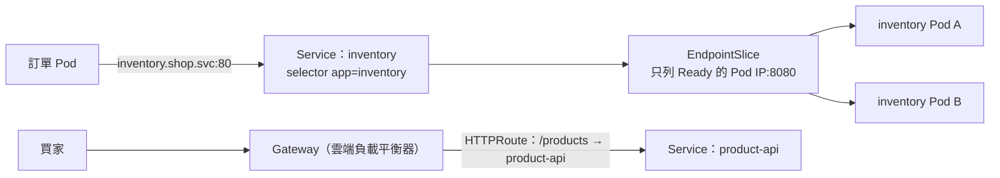

## 這是什麼

Pod 會被替換，每次替換 IP 都會變。如果訂單服務寫死庫存服務某個 Pod 的 IP，那個 Pod 一重建，呼叫就失敗了。

**Service** 為一組 Pod 提供一個不變的名稱與虛擬 IP。訂單服務只要呼叫 `http://inventory.shop.svc`，Kubernetes 就會把請求送到目前可用的某個庫存 Pod。

對外的 HTTP 流量（買家從網際網路進來）還需要依網址路徑、主機名稱分流到不同服務，並處理 TLS。這由 **Gateway API**（或較早的 Ingress）負責。

## 運作原理



**selector 與 EndpointSlice**：Service 用 label 選擇 Pod（例如 `app: inventory`），Kubernetes 把符合條件、而且 readiness 通過的 Pod IP 記在 EndpointSlice 裡。Pod 還沒準備好、或正在停止，就會從清單中移除。

**port 與 targetPort**：`port` 是 Service 對外的 port（例如 80），`targetPort` 是 Pod 裡容器實際監聽的 port（.NET 官方映像預設 8080）。

**Service 的負載平衡在連線層**：新連線建立時選一個 Pod。HTTP/1.1 用戶端通常會開多條連線，流量自然分散；gRPC 只開一條長連線，所有請求都會集中到那一個 Pod，見 [gRPC](/frameworks/aspnet-core/grpc/)。

**Gateway API** 把責任分開：平台團隊管理 `Gateway`（入口、TLS、負載平衡器），各服務團隊用 `HTTPRoute` 宣告自己的路由規則，不用大家共同編輯同一份巨大的 Ingress。

## 常見錯誤與正確寫法

### 1. port 與 targetPort 對不上

```yaml
apiVersion: v1
kind: Service
metadata:
  name: product-api
  namespace: shop
spec:
  selector:
    app: product-api      # 必須和 Pod 的 label 完全一致
  ports:
    - name: http
      port: 80            # 其他服務呼叫 http://product-api.shop.svc（預設 80）
      targetPort: 8080    # 容器實際監聽的 port
```

selector 打錯或 targetPort 錯誤時，Service 存在但 EndpointSlice 是空的，呼叫會連線失敗。

### 2. 所有對外路由擠在一份 Ingress

改用 Gateway API，每個服務管理自己的 HTTPRoute：

```yaml
apiVersion: gateway.networking.k8s.io/v1
kind: HTTPRoute
metadata:
  name: product-api
  namespace: shop
spec:
  parentRefs:
    - name: shop-gateway        # 平台團隊建立的 Gateway
      namespace: gateway-infra
  hostnames: ["shop.example.com"]
  rules:
    - matches:
        - path: { type: PathPrefix, value: /products }
      backendRefs:
        - name: product-api
          port: 80
```

GKE 原生支援 Gateway API；EKS 上常用 AWS Load Balancer Controller 以 Ingress 建立 ALB，細節見 [GKE Gateway](/platforms/gke/gateway-networking/)與 [EKS 對外流量](/platforms/eks/load-balancing/)。

### 3. Pod 停止時，請求還被送過去

Pod 被刪除時，「從 EndpointSlice 移除」和「送 SIGTERM 給容器」是同時開始的；負載平衡器與其他節點要一點時間才會停止送流量。程式立刻結束，最後幾個請求就會失敗。用 `preStop` 先等幾秒再開始停止，見 [探針與安全停止](/platforms/kubernetes/probes-resources/)。

## 使用邊界

- **叢集內的服務名稱用完整的名稱**，例如 `product-api.shop.svc.cluster.local.`（最後加點）或至少 `product-api.shop.svc`。Pod 的 DNS 設定 `ndots:5` 會讓短名稱先嘗試好幾個搜尋網域，外部網域（例如 `api.payment.com`）也會多查好幾次。
- `externalTrafficPolicy: Local` 可以保留用戶端的來源 IP，但流量只會送到有 Pod 的節點，可能不平均。
- Service 只處理叢集內的連線分配；跨服務的重試、逾時、斷路由應用程式或服務網格處理。

## 雲端排查

### 叢集層（GKE 與 EKS 相同）

```bash
# Service 背後有哪些 Pod（空的就是 selector 或 readiness 的問題）
kubectl get endpointslices -n shop -l kubernetes.io/service-name=product-api

# Pod 的 label 是否和 selector 一致
kubectl get pods -n shop --show-labels | grep product-api

# 從叢集內測試 DNS 與連線
kubectl run net -n shop --rm -it --image=busybox -- sh -c \
  'nslookup product-api.shop.svc.cluster.local && wget -qO- -T 3 http://product-api.shop.svc/health/ready'

# Gateway 與 HTTPRoute 是否被接受（看 status.conditions）
kubectl describe httproute product-api -n shop
```

### 託管服務層

#### GKE

GKE 的 Gateway 會建立 Google Cloud 負載平衡器，以 NEG（網路端點群組）直接把流量送到 Pod。後端是否健康：

```bash
gcloud compute backend-services list --filter="name~shop"
gcloud compute backend-services get-health <backend-service-name> --global
```

#### EKS

AWS Load Balancer Controller 以 target-type ip 把 Pod IP 註冊到 ALB 的目標群組：

```bash
aws elbv2 describe-target-health --target-group-arn <target-group-arn>
```

### 應用程式層

在呼叫端記錄目標服務的回應時間與錯誤；某個服務的錯誤只發生在部署期間，通常是 Pod 停止時的時間差；只發生在特定 Pod，則看那個 Pod 的資源與日誌。
