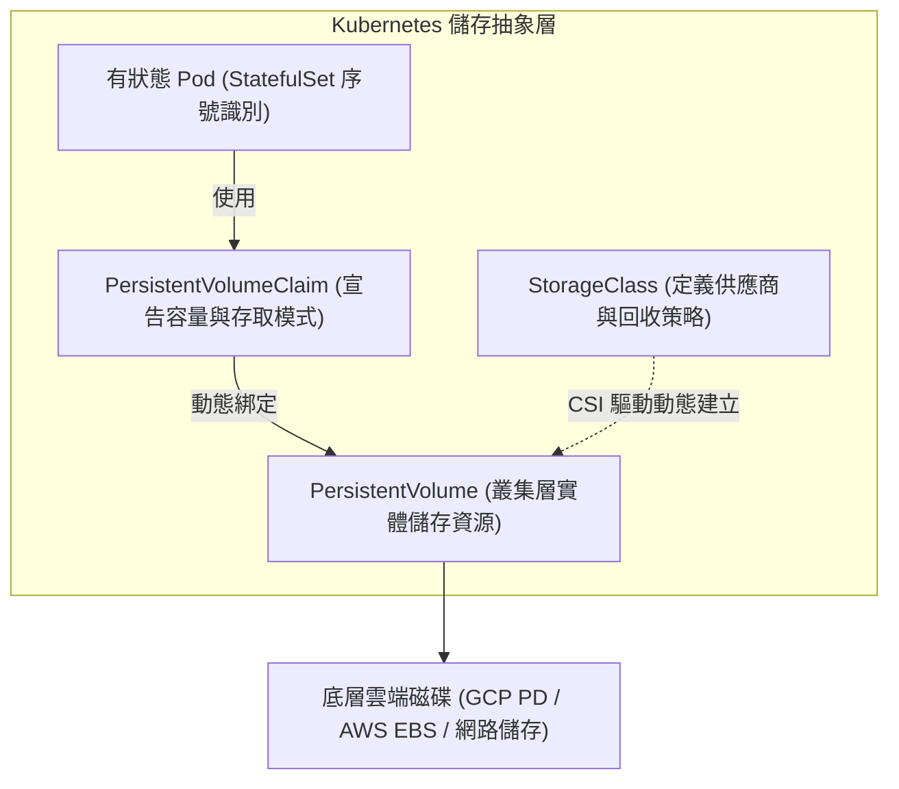

在 Kubernetes 架構中，運算資源（Pod）被設計為短暫且可隨時重建，然而電商核心的訂單資料庫、RabbitMQ 訊息佇列與 Redis 快取持久化檔案，卻必須在容器崩潰或節點故障後完好保留。將「儲存需求」與「底層儲存實作」解耦是 Kubernetes 儲存子系統的核心概念，但單純掛載持久化儲存，並不等於解決了分散式高可用與災難還原。

## 案發現場

某電商技術團隊為節省雲端託管資料庫成本，決定在內部 Kubernetes 叢集中以自建方式運行 RabbitMQ 與 PostgreSQL。在一次節點硬體故障觸發的自動遷移中，系統引發了災難性的停機：

1. **Volume 鎖死與 Multi-Attach 錯誤**：團隊使用無狀態的 `Deployment` 部署單節點 RabbitMQ，並手動掛載了一塊雲端區塊磁碟（PVC）。當該 Pod 所在的實體 Node 網路異常斷線時，Kubernetes 嘗試在另一台 Node 重建 Pod，但新 Pod 長達 20 分鐘卡在 `ContainerCreating`，事件顯示 `Multi-Attach error for volume: Volume is already used by pod`。原節點尚未完全釋放雲端磁碟掛載，導致新節點無法掛接。
2. **多副本跨節點寫入導致資料損毀**：工程師將 Deployment 副本數調整為 2，並宣告了 `ReadWriteOnce`（RWO）的雲端磁碟。當兩個 Pod 被排程在不同 Node 節點時，第二個 Pod 根本無法啟動；即使排程在同一節點，兩個程序同時向同一個資料目錄寫入 WAL 交易日誌，導致資料庫檔案結構徹底損毀。
3. **誤刪命名空間導致磁碟被雲端無情銷毀**：在執行例行環境清理時，維運人員刪除了一個測試 Namespace，由於底層預設 `StorageClass` 的回收策略為 `reclaimPolicy: Delete`，Kubernetes 在刪除 PVC 的同時，直接向雲端平台發送 API 將實體雲端磁碟連同所有備份數據一併格式化銷毀。



## 反模式與正確解法

### 反模式一：使用 Deployment 管理有狀態資料庫或訊息佇列

無狀態 Deployment 的 Pod 名稱是隨機雜湊字串（如 `rabbitmq-7b946f8-xk92m`），縮容或重啟時無法保證新舊 Pod 擁有相同的網路識別碼（Network Identity）與專屬磁碟對應關係。

#### 正確解法：採用 StatefulSet 與 volumeClaimTemplates

StatefulSet 為每個 Pod 提供從 0 開始的確定序號（`rabbitmq-0`, `rabbitmq-1`），並配合 Headless Service 提供穩定的內部 DNS 名稱（`rabbitmq-0.rabbitmq-headless.ecommerce-prod.svc.cluster.local`）。更重要的是，它透過 `volumeClaimTemplates` 為每個序號副本自動建立專屬的 PVC，確保重啟後精確掛載回原有的數據盤：

```yaml
apiVersion: v1
kind: Service
metadata:
  name: rabbitmq-headless
  namespace: ecommerce-prod
spec:
  clusterIP: None # Headless Service，直接解析個別 Pod IP
  selector:
    app.kubernetes.io/name: rabbitmq
  ports:
  - port: 5672
    name: amqp
---
apiVersion: apps/v1
kind: StatefulSet
metadata:
  name: rabbitmq
  namespace: ecommerce-prod
spec:
  serviceName: rabbitmq-headless
  replicas: 3
  selector:
    matchLabels:
      app.kubernetes.io/name: rabbitmq
  template:
    metadata:
      labels:
        app.kubernetes.io/name: rabbitmq
    spec:
      containers:
      - name: broker
        image: rabbitmq:3.13-management
        volumeMounts:
        - name: data
          mountPath: /var/lib/rabbitmq
  volumeClaimTemplates:
  - metadata:
      name: data
    spec:
      accessModes: [ "ReadWriteOnce" ]
      storageClassName: "standard-rwo-retain"
      resources:
        requests:
          storage: 50Gi
```

### 反模式二：混淆 AccessModes，對區塊儲存要求跨節點多寫

部分團隊將雲端區塊儲存（如 GCP Persistent Disk 或 AWS EBS）宣告為 `ReadWriteMany`（RWX），誤以為 Kubernetes 會自動在不同虛擬機之間同步區塊資料。

#### 正確解法：依據存取模式挑選相符的儲存架構

| 存取模式 | 意義 | 適用儲存類型 | 電商應用範例 |
| :--- | :--- | :--- | :--- |
| **ReadWriteOnce (RWO)** | 僅能由**單一 Node 節點**進行讀寫掛載 | 雲端區塊磁碟 (PD, EBS) | PostgreSQL, RabbitMQ, Redis 節點資料盤 |
| **ReadOnlyMany (ROX)** | 可由**多個 Node 節點**以唯讀方式同時掛載 | 唯讀區塊磁碟、靜態映像 | 機器學習離線模型檔、靜態資產快取 |
| **ReadWriteMany (RWX)** | 可由**多個 Node 節點**同時進行讀寫 | 網路檔案系統 (NFS, Filestore, EFS) | 使用者上傳商品圖片暫存目錄、跨副本共用檔案 |

如果業務需要多 Pod 同時讀寫檔案，必須使用託管網路檔案系統（RWX）或改以物件儲存（S3 / Google Cloud Storage API）存取，絕對不能強行在區塊儲存上宣告 RWX。

### 反模式三：生產環境採用預設的 reclaimPolicy: Delete

預設的 StorageClass 通常配置 `reclaimPolicy: Delete`。只要維運人員意外刪除 PVC 或整個 Namespace，底層對應的雲端磁碟會立刻被連帶銷毀，資料無法挽回。

#### 正確解法：建立自定義 StorageClass 並設定 Retain 與動態擴容

```yaml
apiVersion: storage.k8s.io/v1
kind: StorageClass
metadata:
  name: standard-rwo-retain
provisioner: pd.csi.storage.gke.io
volumeBindingMode: WaitForFirstConsumer # 延遲綁定：待 Pod 被調度到特定可用區後再建立磁碟
reclaimPolicy: Retain                   # PVC 刪除時保留實體 PV 與底層磁碟
allowVolumeExpansion: true              # 支援線上直接修改 PVC 擴增磁碟容量
parameters:
  type: pd-balanced
```

## 踩坑與避坑指南

### 1. 跨可用區（Cross-AZ）排程衝突與 WaitForFirstConsumer
雲端區塊儲存是綁定在特定的可用區（Zone / AZ，例如 `asia-east1-a`）。如果 StorageClass 配置為 `volumeBindingMode: Immediate`，磁碟會在 PVC 建立時立刻於隨機可用區建立。若 Pod 隨後被調度到 `asia-east1-b` 的 Node，將發生永遠無法掛接的排程死鎖。
- **避坑建議**：所有區塊儲存的 StorageClass 務必啟用 `volumeBindingMode: WaitForFirstConsumer`，確保 Kubernetes 先決定 Pod 位於哪個可用區的節點，才在該可用區動態建立雲端磁碟。

### 2. StatefulSet 縮容不等於刪除 PVC
當 StatefulSet 副本數由 3 縮容至 1 時，Kubernetes 為了保護資料資產，**絕對不會自動刪除** `data-rabbitmq-2` 與 `data-rabbitmq-1` 這兩個 PVC。若未來重新擴容，StatefulSet 會自動重新綁定舊有的 PVC。若確實需要清除，維運人員必須顯式且謹慎地手動刪除。

### 3. 持久化磁碟不等於高可用與災難還原
掛載了 PVC 只能保證在 Pod 崩潰重啟時資料依舊存在。但若底層實體磁碟發生硬體損壞、或者發生跨機房重大災難，PV 並無法替你完成多副本同步複製。
- **避坑建議**：生產環境的核心資料庫（如訂單庫），強烈建議優先選用雲端託管服務（如 Cloud SQL、Amazon RDS）；若在 K8s 自建，必須搭配具備 Raft/Quorum 仲裁機制的專用 Operator（如 CloudNativePG、RabbitMQ Cluster Operator），並在外部獨立配置定時 WAL 歸檔與冷備份。

## 線上排查指令

針對儲存掛載超時、PVC 狀態異常與磁碟鎖定問題，可使用下列指令精確定位：

```bash
# 1. 檢視 PVC 與 PV 綁定狀態（確認是否為 Bound）
kubectl get pvc,pv -n ecommerce-prod -o wide

# 2. 排查 PVC 處於 Pending 狀態的事件詳情
kubectl describe pvc <pvc-name> -n ecommerce-prod

# 3. 檢查 VolumeAttachment 物件（確認哪台 Node 鎖住了磁碟掛載）
kubectl get volumeattachments
kubectl describe volumeattachment <attachment-id>

# 4. 檢視 StorageClass 配置與擴容支援情況
kubectl get storageclass standard-rwo-retain -o yaml

# 5. 線上動態調整 PVC 容量大小（需 StorageClass 支援 allowVolumeExpansion）
kubectl patch pvc <pvc-name> -n ecommerce-prod -p '{"spec":{"resources":{"requests":{"storage":"100Gi"}}}}'
```
