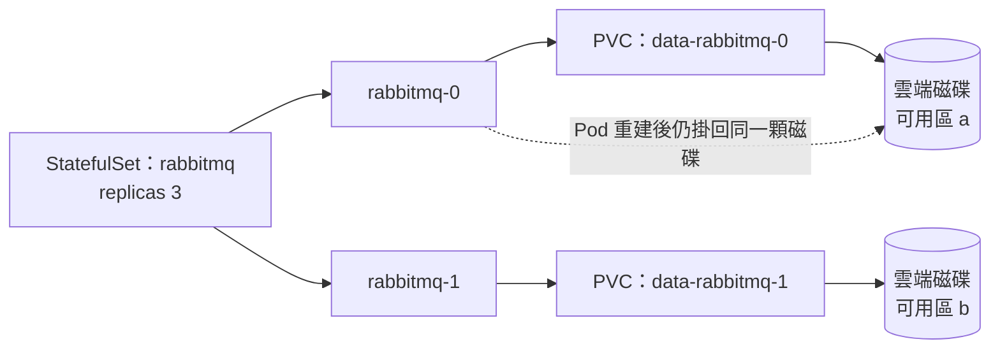

## 這是什麼

一般的 API Pod 沒有自己的資料，換掉也沒關係。但如果在 Kubernetes 上自己跑資料庫或 RabbitMQ（例如本站在 GKE 上以 Operator 自建 RabbitMQ），Pod 換掉時資料必須留下來。

Kubernetes 用三個物件管理持久化的儲存：

- **PersistentVolumeClaim（PVC）**：Pod 提出的需求，「我要一個 20 GB、可讀寫的磁碟」。
- **StorageClass**：定義「怎麼準備磁碟」，例如用哪種雲端磁碟、效能等級。
- **PersistentVolume（PV）**：實際的那顆磁碟，由 StorageClass 依 PVC 自動建立。

## 運作原理



**StatefulSet** 和 Deployment 不同：每個副本有固定的名稱（`rabbitmq-0`、`rabbitmq-1`）與自己的 PVC。Pod 重建後名稱不變，也會掛回同一顆磁碟。

**雲端區塊磁碟有位置限制。** GCP 的 Persistent Disk、AWS 的 EBS，都屬於某一個可用區，而且一般只能被一個節點以讀寫模式掛載（存取模式 `ReadWriteOnce`）。Pod 只能被排到和磁碟同一個可用區的節點上。

**回收政策**：PVC 被刪除時，背後的 PV 與雲端磁碟要怎麼處理。`Delete` 會連磁碟一起刪除，`Retain` 會保留磁碟，等人工處理。

## 常見錯誤與正確寫法

### 1. 用 Deployment 跑資料庫

Deployment 的副本沒有固定身分，多個副本會搶同一個 PVC，rolling update 時新舊 Pod 也可能同時嘗試掛載同一顆磁碟。有狀態服務用 StatefulSet，或直接用託管服務（Cloud SQL、RDS、Memorystore、ElastiCache、Amazon MQ），把節點、磁碟、複寫與備份的責任交給雲端。

### 2. 要求多個節點同時讀寫一顆區塊磁碟

把 PVC 設為 `ReadWriteMany`，希望多個 Pod 共用一個目錄放商品圖片。區塊磁碟不支援這種模式，PVC 會一直無法綁定。多個 Pod 共用的檔案放物件儲存（GCS、S3）；真的需要共用檔案系統時，使用 Filestore（GCP）或 EFS（AWS）這類網路檔案系統。

### 3. 重要資料使用預設的回收政策

許多預設的 StorageClass 回收政策是 `Delete`。有人誤刪了 PVC，或 Operator 在縮容時清理了 PVC，磁碟和資料就一起消失了。重要資料使用 `Retain`，並讓磁碟在 Pod 實際被排程時才在對應的可用區建立：

```yaml
apiVersion: storage.k8s.io/v1
kind: StorageClass
metadata:
  name: data-retain
provisioner: pd.csi.storage.gke.io      # EKS 改為 ebs.csi.aws.com
parameters:
  type: pd-balanced                      # EKS 改為 type: gp3
reclaimPolicy: Retain
volumeBindingMode: WaitForFirstConsumer  # 等 Pod 排程後，才在同一個可用區建立磁碟
allowVolumeExpansion: true
```

## 使用邊界

- **持久化不等於備份。** 磁碟損壞、誤刪資料、勒索軟體，都需要另外的備份或快照；高可用（多副本）也不能取代備份，見 [還原演練與成本](/engineering/recovery-cost/)。
- StatefulSet 縮容不會刪除 PVC，磁碟仍在計費；確認不需要後要手動清理。
- 能用託管服務就用託管服務。自建有狀態服務需要團隊具備升級、備份、容量與故障處理的能力。

## 雲端排查

### 叢集層（GKE 與 EKS 相同）

```bash
# PVC 是否綁定；Pending 代表還沒建立或無法綁定磁碟
kubectl get pvc -n messaging

# 綁定失敗或掛載失敗的原因
kubectl describe pvc data-rabbitmq-0 -n messaging | tail -10
kubectl describe pod rabbitmq-0 -n messaging | grep -A5 -i "volume\|attach"

# PV 的回收政策與狀態
kubectl get pv -o custom-columns=NAME:.metadata.name,CLAIM:.spec.claimRef.name,POLICY:.spec.persistentVolumeReclaimPolicy,STATUS:.status.phase
```

Pod 卡在 `Pending` 並出現「volume node affinity conflict」，代表磁碟所在的可用區沒有可用的節點。

### 託管服務層

#### GKE

```bash
# 叢集建立的磁碟，以及它們所在的可用區與是否被掛載
gcloud compute disks list --filter="name~pvc" --format="table(name,zone,sizeGb,users.basename())"
```

#### EKS

```bash
# EBS CSI 驅動是否安裝與健康
aws eks describe-addon --cluster-name shop --addon-name aws-ebs-csi-driver --query 'addon.status'

# PV 對應的 EBS 磁碟
aws ec2 describe-volumes --filters Name=tag:kubernetes.io/created-for/pvc/name,Values=data-rabbitmq-0
```

### 應用程式層

自建的 RabbitMQ 或資料庫在 Pod 重建後啟動很慢，常見原因是磁碟上的資料量大、需要重新載入或檢查；記錄啟動耗時，並把它計入 startupProbe 的上限與故障恢復時間。
