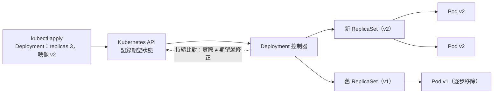

## 這是什麼

在一般的伺服器上，你會登入機器、啟動程式、程式當掉了再手動重啟。Kubernetes 的做法不同：你寫一份宣告，說「我要 3 個商品 API 的副本，用這個映像」，交給 Kubernetes。之後它會一直檢查實際狀態，少了就補、壞了就換，讓實際狀態維持和你宣告的一樣。這叫**期望狀態**（desired state）。

幾個基本的物件：

- **Pod**：Kubernetes 執行的最小單位，裡面是一或多個容器。
- **Deployment**：管理一組相同的 Pod，負責維持副本數與版本更新。適合 API 這類長期執行的服務。
- **Job**：執行一次、跑完就結束的工作，例如資料庫 migration。
- **Namespace**：把資源分組，例如 `shop`、`shop-staging`。

## 運作原理



**控制器**不斷執行一個迴圈：讀取期望狀態、觀察實際狀態、做出修正。節點故障讓 Pod 消失了，控制器發現副本數不足，就在其他節點建立新的 Pod。

**Pod 是可以被丟掉的。** Pod 會因為節點維護、擴縮、更新、資源不足等原因被刪除並在別處重建，而且新 Pod 有新的 IP、空的本機檔案系統。所以 Pod 裡不能保存「只存在這裡」的狀態。

**Rolling update**：更新映像時，Deployment 建立一個新的 ReplicaSet，逐步增加新版 Pod、減少舊版 Pod。這段期間新舊版本會同時處理請求、同時連到同一個資料庫。

## 常見錯誤與正確寫法

### 1. 把 Pod 當成一台長期存在的伺服器

把上傳的商品圖片存在 Pod 的本機目錄、把購物車放在 Pod 的記憶體裡。Pod 一重建，圖片消失；下一個請求被送到另一個 Pod，購物車是空的。

需要保存的東西放在 Pod 之外：資料放資料庫、檔案放物件儲存（GCS、S3）、共享的暫存狀態放 Redis。

### 2. API 啟動時執行 migration

每個 API Pod 啟動時都去執行資料庫 migration，副本一多就會同時執行、互相衝突。migration 用一個 Job 執行一次，成功後再更新 Deployment：

```yaml
apiVersion: batch/v1
kind: Job
metadata:
  name: db-migrate-20261021
  namespace: shop
spec:
  backoffLimit: 0                 # 失敗不要自動重試，由人確認原因
  template:
    spec:
      restartPolicy: Never
      containers:
        - name: migrate
          image: asia-east1-docker.pkg.dev/shop-prod/apps/order-api-migrations@sha256:<digest>
          args: ["--connection", "$(MIGRATION_CONNECTION_STRING)"]
          envFrom:
            - secretRef:
                name: migration-db
```

做法與 Expand／Contract 的原則見 [Migration](/data-access/migrations/)。

### 3. 直接建立 Pod 或手動修改 ReplicaSet

直接 `kubectl run` 建立的 Pod 沒有控制器管理，刪了就不會回來；手動修改 Deployment 底下的 ReplicaSet，會被控制器改回去。所有變更都透過 Deployment（或其他控制器）的宣告進行，並放在版本控制中。

## 使用邊界

- **Namespace 不是安全邊界。** 它是邏輯上的分組；不同團隊或環境要真正隔離，需要 RBAC、NetworkPolicy，甚至不同的叢集，見 [設定、Secret 與權限](/platforms/kubernetes/configuration-security/)。
- 有固定身分與專屬磁碟的服務（資料庫、自建的 RabbitMQ）使用 StatefulSet，見 [儲存與有狀態服務](/platforms/kubernetes/storage/)。
- 新舊版本同時運作，代表資料格式與 API 都要向下相容。
- Pod 如何判斷「準備好了」與如何安全停止，見 [探針與安全停止](/platforms/kubernetes/probes-resources/)。

## 雲端排查

### 叢集層（GKE 與 EKS 相同）

```bash
# 期望與實際的副本數
kubectl get deployment order-api -n shop

# 更新卡在哪裡：新舊 ReplicaSet 各有幾個 Pod
kubectl get replicaset -n shop -l app=order-api
kubectl rollout status deployment/order-api -n shop --timeout=30s

# Pod 狀態與最近的事件
kubectl get pods -n shop -l app=order-api -o wide
kubectl get events -n shop --sort-by=.lastTimestamp | tail -20
```

`Pending` 代表找不到可以放的節點（資源不足或條件不符）；`CrashLoopBackOff` 代表容器一直啟動失敗，用 `kubectl logs --previous` 看上一次的錯誤。

### 託管服務層

#### GKE

Autopilot 會依 Pod 的 requests 自動配置節點；Pod 長時間 `Pending` 時，事件會說明是否觸發了擴容。叢集層級的狀態與正在進行的操作：

```bash
gcloud container clusters describe shop --region=asia-east1 --format='value(status,currentMasterVersion)'
gcloud container operations list --filter="targetLink~shop" --limit=5
```

#### EKS

```bash
aws eks describe-cluster --name shop --query 'cluster.{status:status,version:version}'
# Auto Mode：為 Pending 的 Pod 開出的節點
kubectl get nodeclaims
```

### 應用程式層

在應用程式的啟動與停止日誌中記錄版本與 Pod 名稱。rolling update 期間如果錯誤只出現在新版 Pod（或只在舊版），就能快速判斷是新程式的問題，還是新舊版本相容性的問題。
