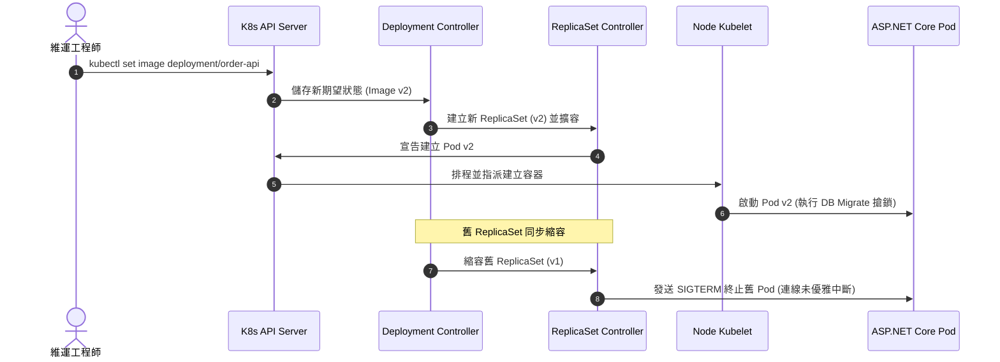

把電商商品與訂單 API 放上 Kubernetes，核心思維並非單純將 Docker 指令改寫為 YAML，而是從「指令式維運（Imperative）」轉移至「宣告式期望狀態（Declarative Desired State）」。開發者向 API Server 宣告系統應維持的最終狀態，控制平面（Control Plane）透過持續比對（Reconciliation Loop）驅動實際狀態向期望狀態收斂。

## 案發現場

某電商平台在晚間進行熱銷促銷版本更新時，維運團隊透過指令更新了 Deployment 映像標籤。隨後線上監控警報狂響，大量消費者在結帳當下收到 HTTP 500 與 502 錯誤，訂單資料庫更出現多筆重複扣款紀錄：

1. **連線強行中斷**：新舊版本交替期間，舊版 Pod 收到終止訊號後直接被強制銷毀，數十筆正在執行刷卡授權的 ASP.NET Core 請求被硬生生切斷，引發連線重置錯誤。
2. **單體記憶體狀態被跨副本割裂**：開發者在商品 API 內部使用了 C# 原生 `lock` 與 in-memory `ConcurrentDictionary` 來控制商品秒殺庫存。當 Deployment 將副本數由 1 擴展至 4 時，不同 Pod 各自維護獨立的計數器，導致庫存嚴重超賣。
3. **資料庫遷移競爭衝突**：應用程式將 Entity Framework Core 的 `context.Database.Migrate()` 寫在 ASP.NET Core 程式啟動流程（`Program.cs`）中。4 個新 Pod 同步啟動時同時執行 Migration 腳本，造成資料庫中繼資料鎖死（Schema Lock Timeout），全數 Pod 陷入啟動失敗崩潰。
4. **手動指令被控制器覆蓋**：值班人員情急之下以指令直接修改了 ReplicaSet 副本數，數分鐘後卻發現數量被自動調回，引發維運混亂。



## 反模式與正確解法

### 反模式一：將 Pod 視為持久化虛擬機器並依賴本機狀態

在傳統虛擬機器環境中，程式往往將暫存檔、本機記憶體鎖定視為永久可用資源。但在 Kubernetes 架構中，Pod 具備極強的短暫性（Ephemeral）。節點資源不足被逐出（Eviction）、叢集排程自動再平衡（Rebalancing）、或是例行性滾動升級，隨時都會讓 Pod 遭到銷毀並在另一台 Node 重建，且每次重建都會取得完全不同的內部 IP 位址。

#### 正確解法：無狀態設計與共享外部中樞

所有狀態（使用者 Session、購物車快取、秒殺分散式鎖）必須外移至 Redis 或關聯式資料庫。Pod 本身必須維持完全無狀態（Stateless），並由 Deployment 統一管理 ReplicaSet：

```yaml
apiVersion: apps/v1
kind: Deployment
metadata:
  name: order-api
  namespace: ecommerce-prod
  labels:
    app.kubernetes.io/name: order-api
    app.kubernetes.io/part-of: ecommerce
spec:
  replicas: 3
  revisionHistoryLimit: 5
  strategy:
    type: RollingUpdate
    rollingUpdate:
      maxSurge: 25%        # 滾動更新時最多允許額外建立 25% 副本
      maxUnavailable: 0     # 更新期間不允許任何舊副本提早不可用，確保容量充足
  selector:
    matchLabels:
      app.kubernetes.io/name: order-api
  template:
    metadata:
      labels:
        app.kubernetes.io/name: order-api
    spec:
      terminationGracePeriodSeconds: 60 # 提供充足時間完成優雅停機
      containers:
      - name: api
        image: ecommerce-registry.internal/order-api:v2.1.0
        ports:
        - containerPort: 8080
          name: http
```

### 反模式二：在 Web API 啟動階段並行執行資料庫 Schema Migration

在多副本架構下，若每個 Web 容器啟動時都自行呼叫 `context.Database.Migrate()`，會造成嚴重的並行競爭、鎖逾時或資料字典損毀。

#### 正確解法：運用 Kubernetes Job 實施一次性確定任務

將一次性遷移、批次補償作業從長駐的 Web 應用中抽離，改由 Kubernetes `Job` 執行，並搭配 CI/CD 發布流程（在更新 Deployment 之前先確保 Job 執行完畢）：

```yaml
apiVersion: batch/v1
kind: Job
metadata:
  name: order-db-migration-v2-1-0
  namespace: ecommerce-prod
spec:
  backoffLimit: 3           # 失敗重試次數上限
  activeDeadlineSeconds: 300 # 超過 5 分鐘強制標記逾時並停止
  template:
    spec:
      restartPolicy: OnFailure
      containers:
      - name: migrator
        image: ecommerce-registry.internal/order-migrator:v2.1.0
        env:
        - name: ConnectionStrings__OrderDatabase
          valueFrom:
            secretKeyRef:
              name: order-db-secret
              key: connection-string
```

### 反模式三：混淆控制器職責並直接操作低階物件

開發者直接手動修改 ReplicaSet 的副本數，或試圖直接編輯由 Job 管理的單一 Pod。當 Deployment 控制器的協調迴圈（Reconciliation Loop）觸發時，會以 Deployment 定義的 `replicas` 為準，直接將手動修改覆蓋並抹除。

#### 正確解法：始終透過高階資源宣告意圖

遵循 Kubernetes 資源分層階級：
1. **Deployment**：管理長駐且無狀態的 HTTP API 與事件 Worker。
2. **StatefulSet**：管理需要固定網路識別碼（如 `pod-0`, `pod-1`）與專屬磁碟的工作負載。
3. **Job / CronJob**：管理執行完成即結束的一批次或排程任務。
4. **DaemonSet**：確保叢集中每一台 Node 節點皆執行且僅執行一個副本（如日誌採集代理或節點監控）。

## 踩坑與避坑指南

### 1. 滾動更新期間的資料庫向下相容性（Expand / Contract）
在 `RollingUpdate` 過程中，新版 Pod（v2）與舊版 Pod（v1）會同時存活並接單長達數分鐘。如果 v2 移除了資料庫既有欄位或更改了型別，舊版 v1 的查詢將全面報錯拋出例外。
- **解法**：資料庫結構異動必須遵循兩階段發布（Expand and Contract）：
  - 階段一：新增欄位（允許 NULL 或有預設值），v1 與 v2 均能正常讀寫。
  - 階段二：全面替換為 v2 後，驗證無誤再於下一版本移除舊欄位。

### 2. 優雅停機（Graceful Shutdown）與緩衝時間配置
Linux 核心中容器程序接收終止訊號的流程如下：
- Kubelet 向 Pod 內容發送 `SIGTERM` 訊號。
- 等待 `terminationGracePeriodSeconds`（預設 30 秒）。
- 若程序尚未退出，直接發送無條件強制銷毀的 `SIGKILL`（Exit Code 137）。
- **避坑建議**：ASP.NET Core 應用程式內若有長耗時處理（例如從訊息佇列批次寫入訂單），務必向 `IHostApplicationLifetime.ApplicationStopping` 註冊取消旗標，並根據最大可能處理時長調整 `terminationGracePeriodSeconds: 60`。

### 3. Namespace 僅為邏輯邊界而非實體安全隔離
Kubernetes 的 Namespace 僅隔離物件名稱、ResourceQuota 與 RBAC 範圍，在預設情況下，跨 Namespace 的 Pod 彼此具備完整的網路路由能力，甚至能夠透過 `<service-name>.<namespace>.svc.cluster.local` 直接通訊。
- **避坑建議**：嚴禁將 Namespace 視同實體租戶隔離。在多租戶或高安全等級架構下，必須搭配 `NetworkPolicy` 限制跨 Namespace 流量存取。

## 線上排查指令

針對工作負載異常、滾動更新卡死與 Pod 排程失敗，維運與開發人員應依循下列指令排查：

```bash
# 1. 檢視工作負載清單與當前期望狀態收斂情形
kubectl get deployments,replicasets,jobs -n ecommerce-prod -o wide

# 2. 深入診斷 Deployment 滾動更新歷程與控制器事件
kubectl describe deployment order-api -n ecommerce-prod

# 3. 實時追蹤滾動發布狀態（常用於 CI/CD 流水線驗證）
kubectl rollout status deployment/order-api -n ecommerce-prod --timeout=120s

# 4. 檢視發布歷史版本並於事故時快速回滾
kubectl rollout history deployment/order-api -n ecommerce-prod
kubectl rollout undo deployment/order-api -n ecommerce-prod --to-revision=2

# 5. 排查 Pod 排程 Pending 或崩潰原因（依事件時間排序）
kubectl get events -n ecommerce-prod --sort-by='.metadata.creationTimestamp'

# 6. 一鍵過濾特定標籤工作負載的所有容器日誌
kubectl logs -l app.kubernetes.io/name=order-api -n ecommerce-prod --tail=100 -f
```
