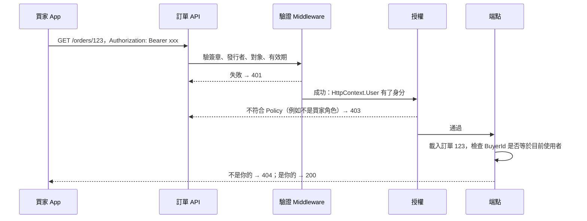

## 這是什麼

買家打開「我的訂單」頁面，API 要回答兩個問題：

- **驗證（Authentication）**：你是誰？通常從請求帶的 token 讀出使用者身分。
- **授權（Authorization）**：你能不能做這件事？例如只有店家能改價格、買家只能看自己的訂單。

驗證失敗回 **401**（沒有有效身分，請重新登入）；驗證成功但沒有權限回 **403**（知道你是誰，但不准）。

API 常用 **JWT**（JSON Web Token）當作 token：登入服務簽發一段帶有使用者資訊的字串，API 驗證簽章後就能信任裡面的內容，不需要每次去查登入服務。

## 運作原理



注意最後一步：`[Authorize]` 和 Policy 只能判斷「這個使用者能不能呼叫這種 API」，判斷不了「這一筆資料是不是他的」。資料擁有權要在載入資料之後檢查。漏掉這一步，買家把網址上的訂單編號改成別人的，就能看到別人的訂單。這是 OWASP API 安全風險排名第一的問題：**物件層級授權失效（BOLA）**。

## 常見錯誤與正確寫法

### 1. 只檢查「有登入」，沒檢查「是不是你的」

```csharp
// 錯：任何登入的買家，改 id 就能看到別人的訂單
app.MapGet("/orders/{id:guid}", async (Guid id, ShopDbContext db, CancellationToken ct) =>
    await db.Orders.FindAsync([id], ct)).RequireAuthorization();
```

把目前使用者的 ID 放進查詢條件，查不到就回 404：

```csharp
app.MapGet("/orders/{id:guid}", async Task<Results<Ok<OrderDto>, NotFound>> (
    Guid id, ClaimsPrincipal user, ShopDbContext db, CancellationToken ct) =>
{
    var buyerId = Guid.Parse(user.FindFirstValue(ClaimTypes.NameIdentifier)!);
    var order = await db.Orders.AsNoTracking()
        .Where(o => o.Id == id && o.BuyerId == buyerId) // 擁有權是查詢條件的一部分
        .Select(o => OrderDto.From(o))
        .SingleOrDefaultAsync(ct);
    return order is null ? TypedResults.NotFound() : TypedResults.Ok(order);
}).RequireAuthorization("Buyer");
```

回 404 而不是 403，避免讓對方知道這張訂單存在。規則較複雜時（例如客服可以看所有訂單），用 `IAuthorizationService.AuthorizeAsync(user, order, "CanViewOrder")` 搭配自訂的授權處理器，把規則集中在一處。

### 2. JWT 驗證項目不完整或時鐘誤差太寬

```csharp
builder.Services.AddAuthentication(JwtBearerDefaults.AuthenticationScheme)
    .AddJwtBearer(options =>
    {
        options.Authority = "https://login.example.com/"; // 從這裡取得簽章公鑰與發行者
        options.Audience = "shop-api";                     // 只接受發給這個 API 的 token
        options.TokenValidationParameters = new TokenValidationParameters
        {
            ValidateIssuer = true,
            ValidateAudience = true,
            ValidateLifetime = true,
            ClockSkew = TimeSpan.FromSeconds(30), // 預設 5 分鐘：過期後還能用 5 分鐘
        };
    });
```

`ClockSkew` 是容許伺服器之間時鐘不一致的誤差。預設 5 分鐘代表 token 過期後 5 分鐘內仍然有效；access token 只有 15 分鐘時，這個誤差就太大了。也不要設成 0，伺服器時間只要差一秒，剛簽發的 token 就可能被判定為「還沒生效」。

### 3. 角色判斷散落在各處

```csharp
// 定義一次，到處使用
builder.Services.AddAuthorizationBuilder()
    .AddPolicy("Buyer", p => p.RequireAuthenticatedUser().RequireClaim("role", "buyer"))
    .AddPolicy("Merchant", p => p.RequireAuthenticatedUser().RequireClaim("role", "merchant"));

app.MapPut("/products/{id:int}/price", UpdatePrice).RequireAuthorization("Merchant");
```

## 使用邊界

- **JWT 簽發後無法收回。** 在到期之前它都有效。所以 access token 有效期要短（例如 15 分鐘），搭配 refresh token 換新；需要立即停權的情況（例如帳號被盜），在高風險操作時額外查詢帳號狀態。
- 不要把敏感資料放進 JWT 的內容。JWT 只是簽章，沒有加密，任何人都能解碼看到內容。
- 登入、密碼、多因素驗證交給專門的身分服務（Identity Provider），不要自己實作。
- 服務對服務的身分（例如 Pod 存取雲端資源）是另一套機制，見 [GKE 工作負載身分](/platforms/gke/workload-identity/)與 [EKS Pod Identity](/platforms/eks/pod-identity/)。
